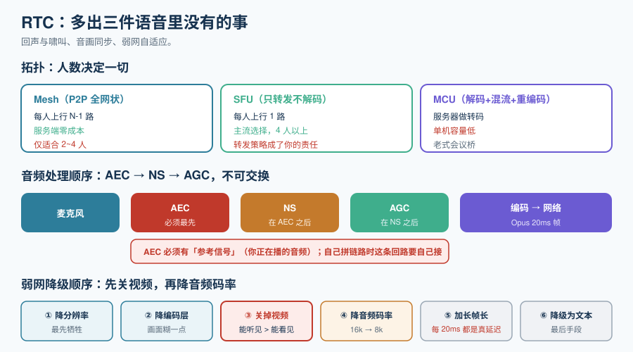

# 实时音视频（RTC）

如果只做语音通话，前面的传输页已经够用。但只要**画面也要实时流动**，就多出三件语音里没有的事：**回声与啸叫、音画同步、弱网自适应**。

这一页讲这三件事，以及一个绕不过去的架构决定：**点对点（P2P）还是 SFU**。



## 一、拓扑：P2P 只能撑到 4 个人

| 拓扑 | 模型 | 上行带宽（N 人） | 服务端成本 | 适用规模 |
| --- | --- | --- | --- | --- |
| **Mesh（P2P 全网状）** | 每人直连其他所有人 | N-1 路 | **零**（不转发） | **2~4 人** |
| **SFU（Selective Forwarding Unit）** | 每人上行 1 路到服务器，服务器按需转发 | **1 路** | 中（只转发不解码） | **4 人以上，主流选择** |
| **MCU（Multipoint Control Unit）** | 服务器解码、混流、再编码 | 1 路 | **高**（要解码+编码） | 老式会议桥、需要统一输出的场景 |

::: tip 为什么 SFU 是默认答案
SFU 的关键优势是**不做转码**：它只做「收一路、按需分发多路」，因此单机能承载的分辨率高得多。而 Mesh 的致命问题是**上行带宽随人数线性增长**——4 人时每人要传 3 路视频，手机上行直接爆。

**但 SFU 有一个容易被忽略的代价**：它把「转发策略」变成了你的责任——谁看谁的哪一路、什么时候降层、什么时候只发音频。**这些策略写错，比选错拓扑更常见。**
:::

::: info 与 AI 结合时的拓扑
如果通话的一方是 AI：**AI 参与者通常直接以「一个房间成员」的身份接入 SFU**，而不是点对点连到某个用户。这也是 **LiveKit Agents 的设计**——它让 agent 作为**普通参与者加入 LiveKit 房间**，从而把重连、打断、多方音频、SIP 电话能力都交给 WebRTC 层，而不是在应用层自己拼。Pipecat 则相反：它把传输当作**可替换的依赖**，因此可以跑在 LiveKit、Daily、电话桥或纯 WebSocket 上。
:::

## 二、音频处理链：AEC / NS / AGC 的顺序不能换

音频从麦克风到网络，中间必然经过这三道处理。**它们的顺序是有约束的。**

| 处理 | 全称 | 解决什么 | 放错顺序的后果 |
| --- | --- | --- | --- |
| **AEC** | Acoustic Echo Cancellation，回声消除 | 去掉扬声器播出的声音被麦克风收回去 | **必须最先**。放在 NS 之后会把噪声门限当成回声残差，越消越糊 |
| **NS** | Noise Suppression，噪声抑制 | 去掉稳态背景噪声（风扇、空调） | 放在 AEC 之前会**削掉回声的参考信号**，导致 AEC 失效 |
| **AGC** | Automatic Gain Control，自动增益 | 把音量拉到稳定区间 | 放在 AEC 之前会**放大回声**，让 AEC 更难做 |

```text
麦克风 ──▶ AEC ──▶ NS ──▶ AGC ──▶ 编码 ──▶ 网络
            ▲
      需要「参考信号」（也就是你正在播放的音频）
```

::: danger 关于 AEC 的三个事实
1. **AEC 必须有参考信号**。这是「你正在播什么」的回环——浏览器与 WebRTC 内建这条回路；**自己用 WebSocket 拼链路时，这条回路要你自己接**，接错了 AEC 就退化成一个没用的滤波器。
2. **AEC 不是万能的**。它主要消除**线性回声**；非线性失真（扬声器破音、音量过大）、强混响场景下会残留。所以**仍然需要一个「双讲检测」**：判断「现在是双方都在说」还是「只是我在播」。
3. **耳机是最有效的「AEC」**。如果用户戴耳机，回声路径根本不存在，问题消失。**产品上引导使用耳机，比做十轮 AEC 调优更有效。**
:::

## 三、音画同步：容差很小，但不必追求完美

人的视听容忍度**不对称**：音频领先画面可以宽容一些，画面领先音频则非常刺眼。

| 偏差 | 用户感受 |
| --- | --- |
| 音频领先 0~80ms | 基本无感 |
| 音频领先 80~125ms | 略微察觉 |
| **音频落后 > 45ms** | **明显察觉**（这是更严格的一侧） |
| 偏差 > 200ms | 「像配音没对上」，不可接受 |

::: tip 实现上的两条纪律
1. **以音频为时间基准**。音频是连续的、不能拉伸；视频可以丢帧。所以同步逻辑应当是**用视频去追音频**，而不是反过来。
2. **不要做「为了同步而缓冲视频」**。视频缓冲会让画面变卡；正确做法是**丢帧或降帧率**去追音频的时间轴。
:::

## 四、弱网自适应：先降什么

网络变差时，必须按优先级牺牲。这个优先级**不要临场决定**，要提前写死。

| 优先级 | 降什么 | 原因 |
| --- | --- | --- |
| 1（最先牺牲） | 视频分辨率 / 帧率 | 画面糊一点能接受 |
| 2 | 视频编码档位 / 层 | 同上 |
| 3 | **关闭视频，只保留音频** | 「能听见」远重要于「能看见」 |
| 4 | 音频编码码率（Opus 16kbps → 8kbps） | 语音仍可懂 |
| 5（最后牺牲） | 音频帧长（20ms → 40ms） | **每加 20ms 就是实打实的延迟** |
| 6 | 降级为文本 / 提示重连 | 最后手段 |

::: danger 最容易搞反的一条
**很多人先降音频码率。** 这是错的：视频的信息密度可以用分辨率换，而音频一旦降到 8kbps 以下就不可懂了。**要把「视频全关」这一步放在「音频降码率」之前**——大部分业务里，能听见比能看见重要得多。

另一条：**不要在网络抖动时加大缓冲来「稳住」，而不设衰减。** 见[实时传输协议](../StreamingProtocols/index.md)里关于抖动缓冲的三个坑。
:::

## 五、RTC 与 AI 服务对接的三个位置

| 位置 | 做法 | 优点 | 缺点 |
| --- | --- | --- | --- |
| **客户端直连** | 浏览器/App 直接连模型 API | 延迟最低 | **密钥暴露在客户端**；必须用短时凭证 |
| **服务端代理** | 客户端 → 你的服务 → 模型 | 密钥安全、可审计、可限流 | 多一跳（同机房内通常 < 10ms） |
| **SFU 内置** | 由 RTC 平台直接对接模型 | 运维省事 | 绑定平台 |

::: danger 客户端直连必须做到的一条
**绝不要把长期 API key 放进客户端。** 正确做法是服务端签发**短时凭证（ephemeral token）**：客户端拿它去连，过期即失效。微软的 Azure Realtime WebRTC 指南给出的正是这个模式（`client_secrets` 端点签发临时凭证），并且指出**更安全的做法是连 SDP 协商也由服务端代理**，让浏览器根本接触不到凭证。

**判据**：在浏览器 DevTools 里搜一遍你的 JS bundle，**搜不到 `sk-` 开头的串**，才算过关。
:::

## 六、常见坑速查

| 现象 | 原因 | 解法 |
| --- | --- | --- |
| 对方听到自己的回声 | AEC 未开或参考信号未接 | 接好参考信号；产品上引导用耳机 |
| 音量忽大忽小 | AGC 在双讲时误判 | 双讲检测；把 AGC 目标区间放宽 |
| 4 人以上通话就卡 | 用了 Mesh | 换 SFU |
| 画面比声音慢半拍 | 视频缓冲策略错误 | 以音频为基准，丢视频帧去追 |
| 弱网就整个断 | 没有分级降级 | 按优先级表实现，**先关视频再降音频码率** |
| 服务端 CPU 满 | 用了 MCU 或做了不必要的转码 | 换 SFU；检查是否在服务端解码 |
| 通话能建立但没声音 | ICE / TURN 未打通（对称 NAT） | 自建 TURN；不要只依赖 STUN |

## 七、可执行验证

```shell
# ① 静态：确认音频处理链路顺序（以 WebRTC 约束为例，检查你的采集配置）
#    预期：echoCancellation / noiseSuppression / autoGainControl 三项显式声明
#    浏览器侧可在控制台执行：
#      navigator.mediaDevices.getUserMedia({audio:{echoCancellation:true,
#        noiseSuppression:true,autoGainControl:true}}).then(s=>console.log(s.getAudioTracks()[0].getSettings()))

# ② 静态：确认客户端里没有长期密钥（搜索产物）
#    预期：无输出（无命中）
grep -rn "sk-" dist/ app/ --include='*.js' --include='*.ts' --include='*.html' || echo "clean"

# ③ 静态：TURN 可达性（对称 NAT 场景的关键依赖）
#    预期：能建立 UDP 连接；失败则说明 TURN 不可达，通话在部分网络下会失败
nc -zvu turn.example.com 3478 && echo "TURN/UDP OK" || echo "TURN/UDP 不可达"

# ④ 需要设备：音画同步与回声实测
#    做法：录屏后用编辑器逐帧比对「拍手画面」与「拍手声波形」的时间差
#    预期：本机无摄像头/麦克风时无法完成——按纪律标注为「未跑」
```

::: warning 关于浏览器侧的实测工具
Chrome 的 `chrome://webrtc-internals` 能直接看到 jitter、packet loss、`googEchoCancellation` 等内部状态，是排查 RTC 问题最直接的入口。**它给出的数据是实测值，可以直接抄进你的记录**；而本页表格里的容差数字是规范与经验值，用于判断「有没有超标」。
:::

## 与「音视频交付工程」的分工（第 203 天补充）

本页讲**实时**音视频（WebRTC、SFU、jitter buffer），缓冲模型是「越小越好」；[音视频交付工程](../../../Backend/MediaDelivery/index.md)讲**点播**，缓冲模型是「越大越稳」。两者的参数直觉正好相反，混用会得到完全错误的结论。

| 维度 | RTC（本页） | 点播交付 |
| --- | --- | --- |
| 缓冲目标 | 几十毫秒，宁可丢帧也不延迟 | 20~30 秒，宁可等也不卡 |
| 传输 | UDP + FEC/NACK，丢包重传代价高 | HTTP 分片 + CDN 缓存，丢包靠 TCP 重传 |
| 延迟预算 | < 400 ms | 2~5 s（起播） |

::: danger 把 jitter buffer 的思路搬到点播上
RTC 里「缓冲越小越好」是对的，因为要保实时；点播里把缓冲压到 1~2 秒，等于让每一次带宽抖动都直接变成卡顿。实测对比：4 s 分片、30 s 缓冲上限下，缓冲型 ABR 卡顿 **0.03%**，吞吐型 **0.36%**；缓冲一旦压到 5 s，两者都会显著恶化——**抗抖动能力就是缓冲本身**。
:::

## 参考资料

- WebRTC 规范（W3C）：https://www.w3.org/TR/webrtc/
- RTP（RFC 3550）/ SRTP（RFC 3711）/ Opus（RFC 6716）
- Azure OpenAI Realtime WebRTC 指南（临时凭证模式）：https://learn.microsoft.com/azure/ai-services/openai/how-to/realtime-audio-webrtc
- LiveKit Agents 文档（agent 作为房间参与者）：https://docs.livekit.io/agents/
- Pipecat 文档（传输无关的流水线）：https://docs.pipecat.ai/
- 相关专题：[实时传输协议](../StreamingProtocols/index.md)、[多模态应用 · 视频处理](../../Multimodal/VideoProcessing/index.md)
