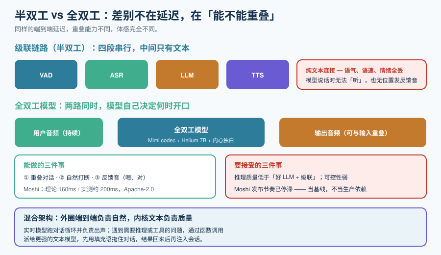

# 端到端语音到语音

到这一页，你已经有了流式识别和流式合成。把「VAD → ASR → LLM → TTS」串起来，就是一个能跑的语音助手了——**问题是，它是「回合制」的**：你说完，它才开口；它说话时，你插不进去。

真实对话不是这样的。这一页讲**双工（duplex）**、**打断（barge-in）**和**轮次（turn-taking）**，以及端到端模型和级联链路在这三件事上的根本差异。



## 一、半双工为什么不够

级联链路天生是半双工：ASR 的输出是文本，TTS 的输入是文本，**两段之间没有音频通道**。这带来三个无法通过「加调参」解决的问题：

| 问题 | 机制 | 用户感受 |
| --- | --- | --- |
| **听不到语气** | ASR 输出是纯文本，音高、语速、情绪全部丢失 | 系统无法判断「你是在确认还是在反问」 |
| **无法反馈** | 模型说话时，链路没有位置发出「嗯」「对」 | 用户以为系统没在听，开始重复 |
| **轮次是硬的** | 必须等端点判定 → ASR → LLM → TTS 全部完成一个来回 | 重叠对话直接崩 |

::: tip 但半双工也有它赢的地方
不要因为「双工更自然」就无脑选端到端。半双工的**可控性**在业务场景里经常更值钱：

- 能强制话术（合规场景必需）；
- 能加规则与兜底（「不管用户说什么，金额必须复述一遍」）；
- 能审计（每一次回答都有中间文本，可查、可评、可回归）；
- 能全本地（开源端到端全双工只有 Moshi 一条线，且发布节奏已停滞）。

**结论：先问业务是否需要「必须按话术说」，需要就留在级联。**
:::

## 二、全双工：模型级的同时说与听

全双工的机制是**输入与输出两路音频同时存在**，模型自己决定何时开口。

以 Kyutai Moshi（当前最成熟的开源全双工模型）为例，它的三个关键设计：

| 组件 | 规格 | 作用 |
| --- | --- | --- |
| **Mimi 神经音频编解码器** | 24 kHz 音频 → **12.5 Hz token**、1.1 kbps、约 80ms 延迟 | 把连续音频压成离散 token，让语言模型能处理 |
| **Helium 7B 语言模型骨干** | 7B 参数 | 文本 + 音频 token 联合建模 |
| **内心独白（Inner Monologue）** | 与音频 token **并行**生成的文本流 | 让模型「用文本思考、用语音说话」，把文本 LLM 的推理质量带进实时语音 |

它的实测表现：**理论延迟 160ms、实测约 200ms**，**用户与助手两路音频并行建模**，因此能处理重叠、打断与反馈信号。许可为 **Apache-2.0**。

::: danger 关于 Moshi 的三个事实性提醒（2026-10 口径）
1. **发布节奏已停滞**：PyPI 上的 `moshi` 停在 **0.2.13（2026-02-12）**，最新 tag 是 **v0.2.12（2026-01-08）**，主分支最新提交在 **2026-05-16**。仓库没归档，但也不是活跃项目。
2. **演示站换过地址**：老的 `moshi.chat` 已不再提供服务，现在用 **`moshi-chat.kyutai.org`**；而仓库 README 里仍有三处指向旧地址——**别拿 README 当可达性依据**。
3. **Kyutai 的重心已经移开**：实验室现在主推 **Unmute**（给任意文本 LLM 加语音，走流式 STT + TTS 的级联路线）、**Hibiki**（实时语音翻译）、**MoshiRAG**（全双工模型的异步检索）与 **Pocket TTS**。**Unmute 是同一作者给出的「级联式替代方案」，不是 Moshi 的后继**。

**实践建议：把 Moshi 当作「架构示范与研究基线」，不要把它当作生产依赖。**
:::

## 三、商业端的双工现状：快的半双工 vs 真全双工

这是选型时最容易对不上号的一点。

| 能力 | OpenAI Realtime API | Gemini Live API |
| --- | --- | --- |
| 模型形态 | 语音到语音，单模型完成听→想→说 | 原生音频，语音到语音 |
| 传输 | **WebRTC / WebSocket / SIP** 三种 | **有状态 WebSocket（WSS）** |
| 输入音频格式 | 由会话配置决定 | **16-bit PCM 16 kHz 小端** |
| 输出音频格式 | 由会话配置决定 | **16-bit PCM 24 kHz 小端** |
| 工具调用 | 支持函数调用 + **远程 MCP** | 支持工具调用，且支持**异步函数调用**（后台执行工具、同时继续流式回音频） |
| 打断 | 服务端 VAD + 打断响应，**打断恢复做得好** | 「更强的插话」：嘈杂环境下也能较自然地打断 |
| 重叠对话（真双工） | **当前不是真双工**：它是「**很快的半双工**」——模型不在说话的同时听，也不会在你说话时发反馈音 | 提供**主动音频**（模型自己决定何时开口）；但**是否构成完全重叠的双工，需要按业务实测确认** |
| 专属能力 | 连续翻译独立端点 `/v1/realtime/translations`（**不走 `response.create`**，没有助手轮次生命周期） | **共情对话**（Affective Dialog）、**实时虚拟化身**、多语言无缝切换 |

::: info 「很快的半双工」意味着什么
OpenAI 的 Realtime 模型在**打断恢复**上做得很好（你说一句它立刻停并重新接上），但它**不会在你说话时发出「嗯」**，也**不会在听的同时间组织语言**。这对绝大多数业务（客服、下单、问答）**完全够用**；对**陪伴、口语陪练、情感陪伴**这类场景，差别就明显了。

**结论：把「是否需要模型反馈音与真重叠」当成一个独立的产品问题先回答，再决定要不要为全双工付费。**
:::

## 四、轮次管理：一个不能省的状态机

无论级联还是端到端，你都需要一个**轮次状态机**。少了它，打断就会变成「对话错位」。

```text
状态：IDLE → LISTENING → THINKING → SPEAKING → (被打断) → LISTENING
```

| 状态 | 含义 | 谁可以把它推进到下一状态 |
| --- | --- | --- |
| `IDLE` | 会话已建立，无人说话 | 检测到用户人声 → `LISTENING` |
| `LISTENING` | 正在收用户语音 | 端点判定结束 → `THINKING` |
| `THINKING` | 正在生成（LLM 或端到端模型在算） | 收到首个输出音频 → `SPEAKING` |
| `SPEAKING` | 正在播放模型输出 | ① 输出结束 → `IDLE`；② 检测到用户人声 → **打断** → `LISTENING` |

::: danger 打断状态机最容易错的三处
1. **打断时把 `THINKING` 当成 `SPEAKING`**。用户在人声一出现就打断，此时模型可能还在生成、一个音都没播。**此时不需要「停止播放」，但必须取消生成**，否则生成的音频会在稍后突然开播——用户会以为系统在自言自语。
2. **打断后清空用户已说的内容**。用户打断往往是因为「你说错了，我要纠正」，而不是「我要换话题」。**打断时应保留当前轮的识别结果**，让模型能理解「他是在针对我刚才那句说的」。
3. **没有「回滚窗口」**。端点判早了之后，若在 200ms 内又检测到人声，应当**取消本次生成、回到 `LISTENING`**，而不是硬着头皮答完。这个窗口的实现成本极低，收益极高。
:::

### 反馈音（backchannel）：半双工链路的补偿手段

全双工模型自带反馈音，级联链路可以手工补一个**受限版本**：

| 做法 | 触发条件 | 风险 |
| --- | --- | --- |
| **固定填充语** | `THINKING` 状态超过 400ms | 用多了很机械；要准备 3~5 条轮换 |
| **工具调用期间播放** | 检测到函数调用开始 | **最实用**：用户会觉得「它在查」而不是「它卡了」 |
| **按语义插入** | 用部分结果判断用户说了长句 | 容易插错，最不推荐 |

::: tip 一条判据
**填充语必须「可被打断」。** 如果填充音播放期间用户插话而系统没有立刻停，用户会更烦躁——「我等了，你还在敷衍我」。所以填充音**要用最短的音频、最小的播放缓冲**，且不能被排队排在正式回答后面。
:::

## 五、混合架构：把两者拼起来

实践中常见的折中是**混合架构**：用端到端模型做「外圈」，用文本 LLM 做「内核」。

```text
用户音频 ──▶ 端到端实时模型（负责：听、打断、反馈、发声）
                    │
                    └── 遇到需要推理/工具的问题时 → 转交文本 LLM
                                  │
                    把结果注入回实时会话（模型用语音复述）
```

| 环节 | 用谁 | 原因 |
| --- | --- | --- |
| 听、打断、反馈、发声 | 端到端实时模型 | 延迟与自然度是它的强项 |
| 复杂推理、工具调用、检索 | 文本 LLM / Agent | 质量、可控性、可观测性更强 |

::: info 这个模式在 2026 年已被明确「产品化」
OpenAI 在 2026 年公布 GPT-Live 的架构时，明确描述了两条特征：**全双工对话**（模型每秒多次决定说/听/暂停/打断/调用工具）与**后台委派**（遇到需要搜索、推理或更强 agent 能力的问题时，把任务委派给另一个模型，再把答案编织回实时对话）。**截至 2026 年 10 月，GPT-Live 主要以 ChatGPT 功能形态发布，开发者 API 的开放节奏与端点形态需以官方公告为准**。

不过——**这个模式你现在就能自己拼出来**：用实时模型跑对话循环，把难问题通过函数调用派给更强的文本模型，模型先用填充语「拖住」对话，结果回来后再注入会话。这就是「后台委派」的工程实现。
:::

## 六、可执行验证

```shell
# ① 静态：验证你的状态机是「显式」的（而不是散落在回调里）
#    判据：状态转移可以被单测枚举；下面的极简实现可直接跑
python3 - <<'PY'
from enum import Enum, auto
class S(Enum): IDLE=auto(); LISTENING=auto(); THINKING=auto(); SPEAKING=auto()

TRANSITIONS = {
    (S.IDLE, "user_speech"):        S.LISTENING,
    (S.LISTENING, "endpoint"):      S.THINKING,
    (S.THINKING, "first_audio"):    S.SPEAKING,
    (S.THINKING, "user_speech"):    S.LISTENING,   # 打断：还没出声，只需取消生成
    (S.SPEAKING, "user_speech"):    S.LISTENING,   # 打断：还要清空播放队列
    (S.SPEAKING, "done"):           S.IDLE,
}
state = S.IDLE
for ev in ["user_speech", "endpoint", "first_audio", "user_speech", "endpoint", "first_audio", "done"]:
    state = TRANSITIONS[(state, ev)]
    print(state.name)
# 预期：IDLE/LISTENING/THINKING/SPEAKING/... 按序推进，且打断能正确回到 LISTENING
PY

# ② 静态：端到端模型端点的可达性（不消耗额度，只看握手是否成功）
#    预期：HTTP 101 或 4xx（取决于鉴权），不应是连接超时
curl -i -N --max-time 5 -H "Connection: Upgrade" -H "Upgrade: websocket" \
     -H "Sec-WebSocket-Key: dGhlIHNhbXBsZSBub25jZQ==" -H "Sec-WebSocket-Version: 13" \
     http://localhost:8080/v1/realtime | head -3

# ③ 需要设备：打断延迟实测
#    做法：屏幕录制，逐帧量「用户开口」到「播放停止」的帧差
#    预期：本机无音频设备时无法完成——按纪律标注为「未跑」，不要填期望值
```

## 参考资料

- Kyutai Moshi（仓库与论文）：https://github.com/kyutai-labs/moshi
- Kyutai Unmute（级联式替代方案）：https://github.com/kyutai-labs/unmute
- OpenAI Realtime API：https://platform.openai.com/docs/guides/realtime
- Gemini Live API（原生音频、主动音频、异步函数调用）：https://ai.google.dev/gemini-api/docs/live
- LiveKit Agents（轮次检测与打断）：https://docs.livekit.io/agents/
- 相关专题：[流式语音识别](../StreamingASR/index.md)、[流式语音合成](../StreamingTTS/index.md)、[语音智能体工程](../VoiceAgent/index.md)
