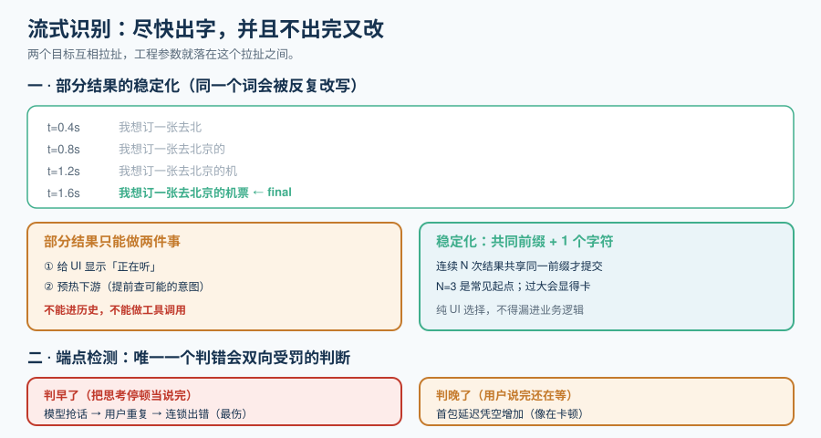

# 流式语音识别

离线转写的目标只有一个：**把字写对**。流式识别的目标有两个，而且互相拉扯：**尽快出字**，**并且不要出完又改**。

这一页讲清楚这个拉扯怎么落地成工程参数，以及一个更隐蔽的问题——**怎么知道用户说完了**。



## 一、流式到底流的是什么

识别引擎内部是一条「音频帧 → 声学编码 → 文本 token」的流水线。**「流式」指的是这条流水线可以被增量驱动**，而不是等整段音频凑齐再跑一遍。

| 模式 | 行为 | 单次延迟 | 适用 |
| --- | --- | --- | --- |
| **离线批处理** | 收完整段再识别 | 秒级 | 会议纪要、字幕文件、质检 |
| **分段流式（chunked）** | 每 N ms 送一块，块内做完整识别 | 与块长同量级 | 实时字幕、准实时 |
| **增量流式（true streaming）** | 状态在模型内延续，每帧都可出结果 | **最低** | 实时语音对话 |

::: info 「分段」不等于「流式」
把音频按 1 秒切块，每块单独调一次离线识别，看起来也能「边录边出字」——但**每一块的识别都丢失了上下文**，切在词中间时前后块都会错。这是最常见的伪流式实现。判据很简单：**看引擎 API 是否维护一个 session 对象**；要你每次传完整音频或每次都重新初始化的，都是分段而非流式。
:::

## 二、部分结果（partial）与稳定化

增量流式会持续产出**部分结果**：随着更多音频到来，同一个词的判定会变。

```text
t=0.4s  部分: 我想订一张去北
t=0.8s  部分: 我想订一张去北京的
t=1.2s  部分: 我想订一张去北京的机
t=1.6s  部分: 我想订一张去北京的机票        ← 稳定
```

| 结果类型 | 语义 | 用法 |
| --- | --- | --- |
| **部分结果（partial / interim）** | 会变，**不可作为最终依据** | 只用于 UI 显示「正在听」、或用于**提前启动下游**（见下节） |
| **最终结果（final）** | 该片段已定稿 | 写入对话历史、作为工具调用的输入 |
| **强制定稿（commit / finalize）** | 主动要求引擎把当前缓冲定稿 | 端点判定后立即调用，**不要等引擎自己的超时** |

::: danger 三个常见错误
1. **把部分结果写进对话历史**。用户会看到 AI 的回答基于一个后来被改写掉的句子。**历史只能写 final。**
2. **拿部分结果做工具调用**。部分结果是「去北京的机」，直接查航班会查错。正确做法是**用部分结果做「预热」**（提前把可能的意图送进缓存），**不用它做决策**。
3. **不做「稳定化」就直接展示**。原始部分结果会高频抖动（一个字来回改），体感比「慢一点但稳定」更糟。**稳定化**的标准做法是：只有当某个前缀在连续 N 次部分结果中保持一致时，才把它「提交」到 UI 的已定稿区。
:::

### 稳定化：一个可实现的判据

```python
# stabilize.py —— 部分结果稳定化（读者在自己工程里创建）
# 原则：只在「连续 N 次结果共享同一前缀」时，把该前缀提交给 UI
class Stabilizer:
    def __init__(self, stable_rounds: int = 3):
        self.n = stable_rounds
        self.committed = ""      # 已提交给 UI 的稳定前缀
        self.history: list[str] = []

    def feed(self, partial: str) -> tuple[str, str]:
        """返回 (已稳定前缀, 仍在变的尾巴)"""
        self.history.append(partial)
        self.history = self.history[-self.n:]

        if len(self.history) < self.n:
            return self.committed, partial

        # 取 N 条结果的共同前缀 + 下 1 个字符，作为「可以提交」的部分
        prefix = self.history[0]
        for h in self.history[1:]:
            i = 0
            while i < len(prefix) and i < len(h) and prefix[i] == h[i]:
                i += 1
            prefix = prefix[:i]

        if len(prefix) > len(self.committed):
            self.committed = prefix
        return self.committed, partial[len(self.committed):]
```

::: tip 为什么要「共同前缀 + 1 个字符」
只提交共同前缀会在长句里显得很卡（永远差一个字）；把最后一个字符也带上，观感上更接近「逐字浮现」。这是**纯 UI 选择**，不影响 final 结果的语义——**别让它漏进业务逻辑**。
:::

## 三、端点检测：最贵的判断

**端点检测（endpointing）**决定「用户说完了没有」。它是实时语音里**唯一一个错了会双向受罚**的判断：

| 判错方向 | 后果 | 用户感受 |
| --- | --- | --- |
| **判早了**（把思考停顿当说完） | 模型抢话，用户被迫重复 | **最伤**：像在被打断，且会连锁出错 |
| **判晚了**（用户说完了还在等） | 首包延迟凭空增加 | 像在卡顿 |

| 方案 | 机制 | 优点 | 缺点 |
| --- | --- | --- | --- |
| **纯静音时长** | 静音 > N ms 即判定结束 | 极简、零成本 | N 无法调对：短了会打断思考，长了会慢 |
| **VAD + 静音时长** | 先用人声检测确认真的静音 | 抗噪好 | 仍是固定阈值 |
| **模型化端点检测** | 用一个小模型判断「这句话是不是说完了」 | **能区分「思考停顿」与「句末」** | 需要额外模型与算力 |
| **语义端点** | 结合 ASR 的部分结果判断句子是否完整 | 准确率高 | 有识别错误就跟着错 |

::: danger 关于固定静音阈值
**不存在一个通用的静音阈值。** 实测里常见现象：同一批用户，说普通话的句末停顿中位数约 300ms，但在**报数字**（「138-0013-8000」）时中间停顿可达 600ms 以上。固定设 500ms 会让报数字场景反复被打断，设 1000ms 会让普通对话整体慢半拍。

**务实的默认**：**模型端点检测 + 一个较长的兜底静音阈值**（例如 800ms）。模型负责常规判断，兜底只在模型不确定时生效。**并且把这个「兜底被触发的比例」做成指标**——它一升高，说明模型端点在你的领域数据上退化了。
:::

### 抢话的兜底：让打断可恢复

即使端点判早了，也不该让整个对话崩掉：

- **留一个回滚窗口**：判定结束后、模型开始生成前，若 200ms 内又检测到人声，则取消本次生成（**成本几乎为零，收益很大**）。
- **不要清空已采集的音频**。判早了之后用户继续说的那一段，应当能拼回同一轮，而不是开启新一轮。
- **把抢话次数做成指标**。这是[四个实时指标](../VoiceAgent/index.md)里「端点误判率」的直接来源。

## 四、延迟与准确率的兑换表

流式识别的每一个「更快」的选项，都对应一个「更不准」：

| 手段 | 延迟收益 | 准确率代价 | 建议 |
| --- | --- | --- | --- |
| 用更小的模型 | 大 | 明显（尤其专有名词） | 用**自定义词表**补专有名词后再换小模型 |
| 缩短 chunk 大小 | 中 | 中（上下文变短） | 语音场景 160~320ms 是常见平衡点 |
| 关闭二级重打分 | 大 | 大 | **实时对话可以关**，离线链路不要关 |
| 降低采样率（16k → 8k） | 小 | 中 | 语音够用；但**不要低于 16k**，宽带语音对识别有帮助 |
| 贪心解码替代 beam search | 中 | 小~中 | 实时链路默认 |

::: info 一条来自 2026 年官方数据的锚
Google 在 2026 年公布的 Gemini 3.5 Transcribe 数据是**流式 WER 4.0% / 非流式 2.6%**，覆盖 85+ 语言。**流式比非流式高 1.4 个百分点是这个领域的常态**，不是你的配置有问题。选型时如果看到厂商只公布一个 WER 数字，**先问它是流式还是非流式**。
:::

## 五、专有名词：自定义词表与词汇偏置

实时场景里，识别错一个**专有名词**的代价远大于错一个常用词——它会让下游的工具调用直接查不到东西。

| 手段 | 机制 | 注意 |
| --- | --- | --- |
| **自定义词表 / 词汇偏置** | 给引擎一个词表，提升这些词的命中率 | Gemini 3.5 Transcribe 支持最多 **1000 个词**的自定义词表；OpenAI 侧也有 prompt 式的偏置 |
| **上下文提示（prompt / hotwords）** | 把当前会话的实体（用户名、订单号）作为提示 | **每轮动态更新**，而不是启动时一次性设置 |
| **后处理纠错** | 用规则或小模型修正 | 只对**已知的固定误识别**做，不要做成通用纠错（会引入新错） |

::: danger 词表不是越大越好
词表过大会稀释偏置效果，还会引入**假阳性**（把不相干的词听成你词表里的词）。经验做法：**按会话动态加载**——用户说「查我的订单」时，把该用户的订单号候选（通常 < 20 个）作为词表；而不是把全量商品名（几万条）塞进去。
:::

## 六、双工识别：一边输出一边收音

半双工链路里，模型说话时麦克风通常被静音（否则会录到自己）。这带来两个问题：

1. **用户没法在模型说话时插话**（除非另做打断）；
2. **模型听不到自己的输出**，因此无法对「用户是在回应我上一句吗」做出判断。

| 方案 | 做法 | 代价 |
| --- | --- | --- |
| 硬静音（最简单） | 播放时关闭采集 | 不能插话 |
| **回声消除（AEC）后持续收音** | 保留采集，用 AEC 去掉自己播出的声音 | 需要 AEC（见 [RTC 页](../RTC/index.md)）；AEC 失效时会自我对话 |
| 双工识别（模型原生） | 全双工模型两路同时 | 只有端到端模型支持，见[端到端语音到语音](../SpeechToSpeech/index.md) |

::: warning 「自我对话」是最吓人的故障
AEC 一旦失效（或客户端没做 AEC 而你又持续收音），模型会听到自己的输出、转写成文本、然后把它当成用户输入继续回答——表现为**模型自言自语、越说越多**。防线有三条：① 播放时抑制**你自己的 TTS 声纹**（用声源分离或简单的能量门控）；② 检测「转写文本与最近一次模型输出高度相似」时丢弃该轮；③ 设一个**连续自触发计数器**，超过阈值直接挂断并上报。
:::

## 七、可执行验证

```shell
# ① 静态：确认你的识别服务确实是「会话式」而非「每次新建」
#    判据：同一个 session 连续发送多块音频，能拿到递增的 partial 结果
python3 - <<'PY'
import json, base64, asyncio, websockets

async def main():
    async with websockets.connect("ws://localhost:8080/v1/asr") as ws:
        await ws.send(json.dumps({"type": "session.start", "language": "zh"}))
        seen = []
        for i in range(5):
            chunk = base64.b64encode(bytes(3200)).decode()   # 100ms @16k s16le
            await ws.send(json.dumps({"type": "audio.append", "audio": chunk}))
            ev = json.loads(await ws.recv())
            seen.append(ev.get("type"))
        print("事件序列:", seen)
        # 预期：出现多个 partial/is_final=false 的事件，而不是立刻给一个 final
asyncio.run(main())
PY

# ② 静态：计算 CER/WER（用你手工标注的一小段做基准）
#    预期：得到一个百分比；这就是你的基线，后续改动都要与它比较
python3 - <<'PY'
def cer(ref, hyp):
    # 编辑距离 / 参考长度；生产环境建议用 jiwer 或 Levenshtein 库
    import difflib
    sm = difflib.SequenceMatcher(a=list(ref), b=list(hyp))
    same = sum(b.size for b in sm.get_matching_blocks())
    return (len(ref) - same) / max(1, len(ref))
print("CER =", round(cer("我想订一张去北京的机票", "我想定一张去北京的机票"), 4))
PY

# ③ 需要设备：端点误判率人工抽样
#    做法：录 20 段真实对话，人工标注「应判说完的时刻」，
#          与系统判定时刻比较，统计判早/判晚的比例
#    预期：本机无音频设备时无法完成——按纪律标注为「未跑」而不是填期望值
```

## 参考资料

- OpenAI 实时转写与 Realtime 文档：https://platform.openai.com/docs/guides/realtime
- Gemini Live API（含音频格式与转写）：https://ai.google.dev/gemini-api/docs/live
- Silero VAD：https://github.com/snakers4/silero-vad
- 相关专题：[多模态应用 · 语音处理](../../Multimodal/SpeechProcessing/index.md)（离线转写与 CER/WER 基准）、[流式语音合成](../StreamingTTS/index.md)
