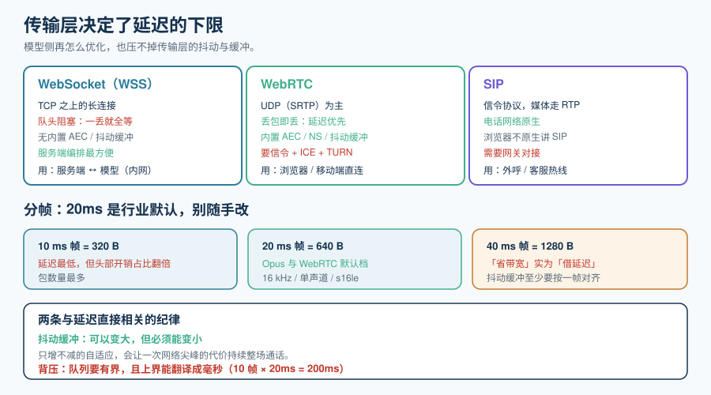

# 实时传输协议

实时语音的第一道工程题不是「用哪个模型」，而是「**音频怎么从麦克风走到模型、再走回来**」。这一层选错，后面所有延迟优化都是在错误的基数上做减法——因为**传输层的抖动和缓冲，是模型侧再怎么优化也压不下去的**。

这一页只讲三件事：**协议怎么选、音频怎么分帧、网络抖了怎么办**。



## 一、三条路：WebSocket / WebRTC / SIP

| 维度 | **WebSocket（WSS）** | **WebRTC** | **SIP** |
| --- | --- | --- | --- |
| 传输基础 | TCP 之上的长连接 | **UDP（SRTP）为主**，可回退 TCP | 信令协议，媒体通常交给 RTP |
| 丢包行为 | **队头阻塞**：前一个包丢了后面全等 | 丢包即丢，**延迟优先** | 取决于承载（RTP 一般延迟优先） |
| 内置音频处理 | 无——回声消除、抖动缓冲都要自己做 | **有**：AEC、NS、AGC、抖动缓冲、带宽自适应 | 通常由终端/网关提供 |
| 浏览器直连 | 需要服务端中转音频 | **原生支持**（`getUserMedia` + `RTCPeerConnection`） | 不支持（浏览器不原生讲 SIP） |
| 电话接入 | 需要自己做网关 | 需要 SIP ↔ WebRTC 网关 | **原生** |
| 服务端编排便利性 | **高**：一个端口、一个连接、易做鉴权与限流 | 低：要信令 + ICE + STUN/TURN | 中：需要 PBX / 运营商对接 |
| 典型用于 | 服务端到服务端、简单客户端、网络稳定场景 | 浏览器/移动端真人通话、多人场景 | 电话外呼、客服热线 |

::: tip 怎么选（一句话版）
- **浏览器/移动端直连用户 → WebRTC**。不要用 WebSocket 承载用户的麦克风数据：公网 TCP 的队头阻塞在高抖动时会直接把音频切碎，而 WebRTC 的 AEC 与抖动缓冲是你在 WebSocket 上要**自己重写一遍**的东西。
- **服务端 ↔ 模型（或服务端 ↔ 自建语音服务）→ WebSocket**。这一段在同一个机房/内网，抖动小，而 WebSocket 的「一条连接 + 有序事件流」让状态机好写得多。
- **要接电话 → SIP**。不要试图自己用 WebSocket 拼电话链路。
:::

::: info 官方的说法也印证这一点
Azure 的 GPT Realtime 文档对 WebRTC 与 WebSocket 的选择给出了明确口径：**「大多数情况下，实时音频流请用 WebRTC」**，原因是 WebRTC 延迟更低、**自带编解码与丢包/抖动处理**；而 WebSocket 更适合「服务端到客户端推流」与「服务端之间传数据」，并明确指出 **「WebSocket 不推荐用于实时音频流，因为延迟高于 WebRTC」**。
:::

### 一个常见误判：以为「都是长连接」就能共用一套代码

三个协议都是「长连接」，但**生命周期语义完全不同**：

| | 连接建立 | 会话生命周期 | 谁来收尾 |
| --- | --- | --- | --- |
| WebSocket | 一次 HTTP Upgrade | 一条连接 = 一个会话（多数实现） | 服务端或客户端主动关闭 |
| WebRTC | 信令 + ICE + DTLS 握手，**多步** | 一条 PeerConnection，可能承载多个媒体流 | 双方协商关闭 |
| SIP | INVITE / 200 OK / ACK 三步 | 一次 Dialog | BYE |

**推论**：不要按「连接」建模你的会话，要按**会话 ID**建模。连接可能断，会话应当能续——这一点在下一节会具体讲。

## 二、音频分帧：20ms 是怎么来的

音频是连续的模拟信号，传输必须切成离散的帧。**帧的大小决定了一切延迟的起点。**

| 帧长 | 每帧字节数（16 kHz / 16-bit / 单声道） | 特点 |
| --- | --- | --- |
| 10 ms | 320 B | 延迟最低，包数量最多，头部开销占比高 |
| **20 ms** | **640 B** | **行业事实标准**（Opus 默认、WebRTC 默认） |
| 40 ms | 1280 B | 包少，但**单次抖动带来的延迟更大** |
| 60 ms + | 1920 B + | 仅用于极端受限的链路 |

::: danger 为什么不要随手改帧长
1. **改大帧长看起来「省带宽」，实际是「借延迟」**。你把 20ms 改成 40ms，抖动缓冲至少要按最深的一帧对齐，端到端直接多出 20ms 的**固定**成本。
2. **改小帧长会放大头部开销**。RTP + UDP + IP 大约 40~60 字节头部；20ms 帧的载荷只有 640 字节，10ms 帧只有 320 字节——头部占比从约 8% 涨到约 15%。
3. **编码器有内部帧结构**。Opus 有 2.5/5/10/20/40/60 ms 这几档，**不要用「15ms」这种不在档位上的值**，编码器会自行补齐，实际延迟与你以为的不一致。
:::

### Opus：为什么它几乎总是答案

| 参数 | 建议 | 原因 |
| --- | --- | --- |
| 采样率 | **语音用 16 kHz 采集足够**；需要音乐/宽频再上 48 kHz | 16 kHz 覆盖人声主要频段（电话带宽 300~3400 Hz，宽带语音到 7 kHz） |
| 声道 | 语音 **单声道** | 立体声对语音没有信息增量，只翻倍带宽 |
| 比特率 | 语音 **16 ~ 32 kbps** | 再高收益极小；本专题的 ASR 输入多用 16 kHz PCM |
| 应用模式 | `voip`（或 `audio`） | `voip` 面向低延迟语音，`audio` 面向音乐质量 |
| 丢包隐藏 | **开启**（`useinbandfec`） | 有 FEC 时 20~30% 丢包仍可听懂 |
| 不连续传输 | **慎用**（DTX） | 静音时不发包能省带宽，但会让**端点判定**失去连续性信息 |

::: info 一次常见的「采样率三处不一致」
同一条链路里经常同时存在三个采样率：**采集端 48 kHz**（WebRTC 默认）、**模型侧 16 kHz**（ASR 与 Realtime API 输入）、**输出侧 24 kHz**（Gemini Live 输出、不少 TTS）。这三处不一致本身没问题，**但重采样必须发生在边界且只发生一次**——反复重采样会累积失真，而且每一处都会引入一点缓冲延迟。**在架构图上把「采样率在哪一变」标出来**，是这一页最实用的一条纪律。
:::

## 三、抖动缓冲：延迟与稳定的兑换点

网络不保证等间隔到达。**抖动缓冲（jitter buffer）**就是「多存几帧再播」，用延迟换稳定。

| 缓冲策略 | 深度 | 代价 | 适用 |
| --- | --- | --- | --- |
| 固定小缓冲 | 20 ~ 40 ms | 网络一抖就断续 | 内网、有线 |
| 固定保守缓冲 | 100 ~ 200 ms | 稳定但**固定**多出这么多延迟 | 简单实现、可接受 |
| **自适应** | 动态 20 ~ 200 ms | 实现复杂 | **生产默认** |

::: danger 缓冲的三个坑
1. **缓冲一旦变大就不会自己变小**。很多实现的「自适应」只增不减，一次网络抖动之后，这次通话的剩余时间都会带着那个大缓冲。**必须实现衰减**（例如静默期缓慢回收）。
2. **发送端缓冲比接收端缓冲更常见、更难发现**。你的采集回调如果按 20ms 触发但每次实际攒了 3 帧才发，等于天生加了 40ms。**在发送路径上打点，而不是只在接收路径上量。**
3. **把缓冲深度写死成常数**。移动网络和 Wi-Fi 的抖动分布完全不同，写死就必然在其中一种网络下过差或在另一种下浪费。
:::

## 四、背压：流式链路里最容易被忽略的一环

实时链路每一段都是生产者-消费者：采集 → 编码 → 网络 → 解码 → 模型 → 合成 → 播放。**只要有任何一段慢于上游，就必须有明确的背压策略**，否则会变成「延迟无声积累」。

| 处理策略 | 行为 | 什么时候用 |
| --- | --- | --- |
| **丢旧保新** | 队列满时丢弃最旧的数据 | **实时音频的唯一正确默认**：宁可丢一段，也不要让延迟持续增长 |
| 阻塞等待 | 队列满时生产者停 | 只有内网可靠链路可接受；公网会雪崩 |
| 无界队列 | 不丢，无限堆积 | **绝对不要**：延迟会单调增长到通话不可用 |

::: tip 一条判据
**如果对一个正在运行的通话，你无法回答「队列最深时有多少帧、超过多少帧会开始丢弃」，那么这个通话的延迟是不可控的。** 把队列深度作为一条指标暴露出来，比优化模型更能改善尾部延迟。
:::

## 五、三个协议下「会话续接」的写法差异

连接会断。断线之后能否续上，取决于你把状态放在哪。

| 场景 | WebSocket 做法 | WebRTC 做法 | SIP 做法 |
| --- | --- | --- | --- |
| 短暂断网 | 客户端重连 + 带 `session_id` 续接 | ICE 重启（ICE restart） | 一般直接重建 Dialog |
| 服务端滚动发布 | 服务端主动发「请重连」+ 新连接指向新实例 | 同左，配合 SFU 迁移 | 由 PBX 侧做呼叫转移 |
| 状态存放 | **外置**（Redis / 数据库），实例可随时替换 | 同左 | 状态天然分散在终端与网关 |

::: danger 不要用「连接」当会话标识
最常见的错误是「连接断了就结束会话」。用户在地铁里断了 3 秒、或者刚好赶上一次滚动发布，整段对话就被清空了——**这是最容易被投诉、也最容易在测试环境复现不出来的缺陷**。正确做法：**会话 ID 由业务生成并作为主键，连接只是它当前附着的一个通道。**
:::

## 六、常见坑速查

| 现象 | 原因 | 解法 |
| --- | --- | --- |
| 内网测试正常，公网一上就断续 | 用 WebSocket 承载公网音频，TCP 队头阻塞 | 用户侧改用 WebRTC；或自建带自适应缓冲的 UDP 通道 |
| 通话越久越延迟 | 某一段无界队列在积累 | 实现丢旧保新的背压，并把队列深度做成指标 |
| 首包突然变慢，之后再没恢复 | 抖动缓冲只增不减 | 给缓冲加衰减 |
| 语音识别偶尔「吃掉」开头半句 | 采集缓冲 + 编码延迟叠加 | 发送路径打点，把采集到首包的时间量出来 |
| 两个人同时说话后模型混乱 | 半双工链路没有处理重叠 | 加打断状态机（见[端到端语音到语音](../SpeechToSpeech/index.md)） |
| 声音发闷、有金属感 | 被重采样了两次以上 | 在架构图上固定每一处采样率转换的唯一位置 |
| 手机端耗电异常 | 采集帧长过小 + 无 DTX | 帧长回到 20ms，静音期用 DTX（但要确认不影响端点判定） |

## 七、可执行验证

以下验证分成**静态可查**（不需要音频设备）与**需要设备**两类，请分别对待。

```shell
# ① 静态：确认你的 WebSocket 端点确实是长连接且支持二进制/文本混合
#    预期：HTTP/1.1 101 Switching Protocols
curl -i -N -H "Connection: Upgrade" -H "Upgrade: websocket" \
     -H "Sec-WebSocket-Key: dGhlIHNhbXBsZSBub25jZQ==" -H "Sec-WebSocket-Version: 13" \
     http://localhost:8080/v1/realtime | head -5

# ② 静态：确认 Opus 参数（如果你用 ffmpeg 生成测试音频）
#    预期：输出中出现 sample_rate / channels / bit_rate 三项，且与你的约定一致
ffprobe -v error -show_streams -select_streams a:0 test.opus \
  | grep -E 'codec_name|sample_rate|channels|bit_rate'

# ③ 静态：确认包大小与帧长匹配（20ms @16k mono s16le = 640 B 载荷）
#    预期：每帧 640 字节（不含 RTP 头）
ls -l frames/ | head    # 如果你把帧落盘了

# ④ 需要设备：本机抖动与丢包观测（需一次真实通话）
#    预期：jitter 与 packet loss 两列稳定；出现尖峰时对照是否伴随卡顿
#    具体命令取决于你的采集端（浏览器可用 chrome://webrtc-internals）
```

::: warning 实测列纪律
本页的所有数字（20ms 帧、640 B 载荷、16/24 kHz）是**规格常数**，可以直接核对；而**「你这个网络的抖动是多少、缓冲该设多深」必须实测**，不要抄本页的示例值。实战页会给出完整的测量脚本。
:::

## 参考资料

- WebRTC 规范（W3C）：https://www.w3.org/TR/webrtc/
- Opus 编解码器（RFC 6716）：https://www.rfc-editor.org/rfc/rfc6716
- RTP（RFC 3550）与 SRTP（RFC 3711）
- Azure OpenAI Realtime WebRTC 指南（WebRTC vs WebSocket 的官方口径）：https://learn.microsoft.com/azure/ai-services/openai/how-to/realtime-audio-webrtc
- 相关专题：[运维 · 网络基础](../../../Ops/Network/index.md)、[前端 · 浏览器原理](../../../Frontend/Basic/Browser/index.md)
