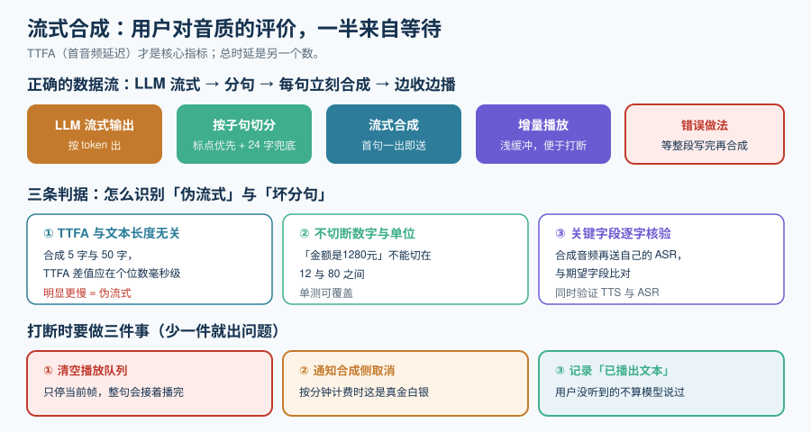

# 流式语音合成

合成这一环有个反直觉的事实：**用户对 TTS 的质量评价，主要不是由音质决定的，而是由「他等了多久才听到第一个音」决定的。** 一个音色普通但 80ms 出声的合成器，体感远好于一个音色惊艳但 900ms 才出声的合成器。

这一页讲**首包延迟（TTFA）**怎么抠出来、长文本怎么边合成边播、以及一个容易漏掉的问题——**音色从哪来、能不能用**。



## 一、TTFA：这一页唯一的核心指标

**TTFA（Time To First Audio，首音频延迟）** = 从「拿到要读的文本」到「播放出第一个音频样本」的时间。

它和「整句合成完的时间」（总时延）是两个完全不同的数：

| 指标 | 用户感知 | 优化手段 |
| --- | --- | --- |
| **TTFA** | **「它有没有在回应我」** | 流式合成、分句、首包优先 |
| 总时延 | 「它说完要多快」 | 吞吐、并发、更快的模型 |

::: danger 一个最常见的架构错误
**「等 LLM 把整段回复写完，再送给 TTS 合成」。** 这会把 LLM 的全部生成时间串在 TTS 前面——LLM 用了 3 秒生成 200 字，用户就要等 3 秒才听到第一个音。

正确做法：**LLM 流式输出 → 按标点分句 → 每句一出立刻送 TTS → TTS 流式返回 → 边收边播**。这样 TTFA 只取决于「第一句生成 + 第一句合成的前几十毫秒」，与整段长度无关。
:::

### 分句：TTFA 优化的关键动作

| 分句粒度 | 首包时机 | 风险 |
| --- | --- | --- |
| 整段 | 全部生成完 | **不可接受** |
| 按句（。！？） | 第一句生成完 | 长句仍然慢 |
| **按子句（。！？，；:）** | **第一个子句生成完** | 断句不当会破坏语调 |
| 按 N 个字符硬切 | 极快 | **会切断词组**，语调生硬，且可能切在数字中间 |

::: tip 实用规则
**优先在标点处切，同时设一个字符数上限兜底**（例如 24 个汉字）。兜底切分要避免切断：**数字与单位、成对符号、常见的「的/了/吗」结尾**。把「子句合并」也做上——太短的子句（< 6 字）应当与后一个子句合并后再送合成，否则会听到一串急促的短促语气。
:::

::: info 官方 API 侧的对应能力
Gemini Live 的原生音频输出是**持续流式的**（输出 24 kHz PCM）；它的「主动音频」能力还允许模型自己决定何时开口。这意味着在端到端链路上，TTFA 由模型直接决定，**你唯一能控制的是播放侧的缓冲深度**——这也是为什么[传输协议](../StreamingProtocols/index.md)那页的抖动缓冲在端到端架构下反而更重要。
:::

## 二、流式合成的三种返回形态

| 形态 | 接口形状 | TTFA | 适用 |
| --- | --- | --- | --- |
| **一次性返回整段音频** | 请求 → 等 → 完整 wav/mp3 | 差 | 离线场景、短提示音 |
| **分块流式（chunked stream）** | 请求 → 持续收音频分片 | **好** | **实时对话默认** |
| **双向流式（bidirectional）** | 边送文本边收音频，可中途取消 | **最好** | 需要中途改口、打断后立刻停止 |

::: warning 「分块流式」不等于「低 TTFA」
有些服务虽然返回 chunked stream，但**第一个 chunk 要等它内部合成完一整句才发出**。判断方法：**量「发出请求到收到第一个 chunk」的时间**，如果它与句子长度相关，那它的流式只是传输层的流式。

判据：**同一个模型，合成 5 字和合成 50 字，TTFA 应当基本一致**（差异应在几毫秒内）。如果 50 字明显更慢，那就是「伪流式」。
:::

## 三、播放侧：缓冲与打断

合成做完了，播放这一侧还有一半延迟没算。

| 播放缓冲 | 效果 | 风险 |
| --- | --- | --- |
| 极浅（< 30ms） | 延迟最低 | 网络一抖就爆音 |
| 中等（50~100ms） | 平衡 | 打断响应慢半拍 |
| 深（> 200ms） | 稳 | **打断时已经播出去的收不回来** |

::: danger 打断时最容易忽略的两个动作
用户打断时，要同时做三件事，少一件就会出问题：

1. **停止播放并清空播放队列**。只停当前播放不停队列，会把刚才那一整句在打断后接着播完——体感极差。
2. **通知合成侧取消**。继续合成只是浪费算力，但对**按分钟计费的模型**是实打实的钱。
3. **记录已播出的文本到「用户实际听到的内容」**。这决定了对话历史里应该记什么——**用户没听到的部分，不应该被当作「模型已经说过」**。这一点在下一节的会话状态里会用到。

```python
# barge_in.py —— 打断时的三件事（读者在自己工程里创建）
class PlaybackController:
    def __init__(self, session):
        self.session = session
        self.queue: list[bytes] = []
        self.played_text = ""     # 用户真的听到的部分

    async def on_user_speech_start(self):
        # ① 清空播放队列（不只是停当前帧）
        self.queue.clear()
        # ② 让合成侧取消后续请求，避免继续计费
        await self.session.cancel_pending_tts()
        # ③ 把「已播出的文本」落进会话，供历史与工具调用使用
        self.session.mark_heard(self.played_text)
```

## 四、音色：从哪来，能不能用

**音色（voice）是本专题里许可风险最集中的地方。** 技术上一分钟能克隆一个人的声音，法律上不一定能用。

| 音色来源 | 技术难度 | 许可风险 | 说明 |
| --- | --- | --- | --- |
| **厂商预置音色** | 无 | **低** | 但要看**其训练数据来源与使用条款**，部分厂商限制用于特定内容 |
| **自建录音棚音色** | 中 | **低**（有完整授权链） | 最稳，成本在录音与授权 |
| **少量样本克隆（few-shot）** | 低 | **高** | 需被克隆者的**明确、可撤回的授权**；且有被滥用的合规风险 |
| **公众人物 / 影视角色音色** | 低 | **极高** | 基本不可用；多国已有专门立法与判例 |

:::

::: danger 三条红线
1. **不要克隆任何未经书面授权的人的声音**，包括同事、客服录音里的客户。
2. **不要把预置音色当成「无限制」**。要读厂商条款里关于**内容类型**（如新闻、政治、医疗）与**用途**（如是否允许用于对外电话）的限制。
3. **要做「合成内容标识」**。多个法域要求 AI 生成音频在合适场景下**显式告知**对方（尤其是电话外呼），**这不是可选项**。
:::

## 五、质量：怎么在没有人工听的前提下判断

没有人能听完每一次合成。可自动化的检查：

| 检查项 | 判据 | 自动化程度 |
| --- | --- | --- |
| **是否为静音 / 空输出** | 输出 RMS 能量低于阈值 | 完全可自动 |
| **是否截断** | 输出时长与文本长度严重不符（例如 50 字只出 0.3 秒） | 完全可自动 |
| **是否复读 / 卡带** | 输出音频自相似度过高 | 可自动（较重） |
| **是否读错数字/单位** | 关键字段（金额、电话、单号）**逐字比对** | 可自动，**强烈建议做** |
| **自然度（MOS）** | 主观评分 | 只能抽样人工 |

::: tip 性价比最高的一条
**「关键字段逐字比对」是投入产出比最高的质检。** 客服、下单、通知类语音里，读错一个金额或单号的后果远大于语调不够自然。做法：给每个关键字段配一个「应该怎么读」的期望（如 `13800138000` → 「一三八零零一三八零零零」），合成后把音频送**你自己的 ASR**转回来做比对。这同时验证了 TTS 与 ASR 两个环节。
:::

## 六、成本：按字符还是按分钟

| 计费方式 | 代表 | 注意点 |
| --- | --- | --- |
| 按字符 | 多数 TTS API | **中文一个字与一个英文字母通常是不同单价**，换算时不要按字符数直接比 |
| 按音频时长 | 部分云厂商 | 语速设置会直接影响费用 |
| 按 token（音频 token） | Gemini 系列按分钟口径计 | 官方口径为**音频输入 $0.005/min、音频输出 $0.018/min** 级别（以官方定价页为准） |
| 自建（GPU 时长） | 自托管 TTS | 成本 = GPU 小时价 ÷ 并发路数；**利用率低时比自己想的贵** |

::: danger 一个会静默算错账的地方
**「打断后已发出但用户没听到的合成，仍然计费。」** 如果打断频繁，这部分浪费可能占到总费用的可观比例。做法：① 打断时立刻向合成侧发取消（能省则省）；② 在成本归因时，把「已合成时长」与「已播放时长」**分成两个字段记录**——两者的差额就是打断浪费，**这个数一旦变大，说明你的端点检测判早了**。
:::

## 七、可执行验证

```shell
# ① 静态：量 TTFA —— 同一个模型，短文本与长文本的「首 chunk 时间」应当接近
python3 - <<'PY'
import time, json, asyncio, websockets

async def ttfa(ws_url, text):
    async with websockets.connect(ws_url) as ws:
        await ws.send(json.dumps({"type": "tts.synthesize", "text": text}))
        t0 = time.perf_counter()
        n = 0
        while True:
            msg = await ws.recv()
            if isinstance(msg, (bytes, bytearray)):
                n += len(msg)
                if n > 0:
                    return (time.perf_counter() - t0) * 1000
asyncio.run(asyncio.wait_for(ttfa("ws://localhost:8080/v1/tts", "你好"), timeout=10))
PY
# 预期：短文本与长文本的 TTFA 差值应在个位数毫秒级；
#       若长文本明显更慢，该服务是「伪流式」

# ② 静态：分句器的单元验证（不依赖任何服务）
python3 - <<'PY'
import re
def split_sentences(text, hard_limit=24):
    parts = re.split(r'(?<=[。！？；!?;])', text)
    out = []
    for p in parts:
        while len(p) > hard_limit:                 # 兜底硬切，避免长句拖慢 TTFA
            out.append(p[:hard_limit]); p = p[hard_limit:]
        if p: out.append(p)
    return out
print(split_sentences("你好，请问需要办理什么业务？我们支持查询余额、转账和挂失。"))
# 预期：一个按标点切分、且每段不超过 24 字的列表
PY

# ③ 需要设备：关键字段读音核验
#    做法：把「合成后的音频」再送回你自己的 ASR，转写结果与期望字段逐字比对
#    预期：本机无音频设备时无法完成——按纪律标注为「未跑」而不是填期望值
```

## 参考资料

- Gemini Live API（原生音频输出与定价口径）：https://ai.google.dev/gemini-api/docs/live
- OpenAI Realtime API（音频输出与事件流）：https://platform.openai.com/docs/guides/realtime
- Opus 与音频格式基础（RFC 6716）：https://www.rfc-editor.org/rfc/rfc6716
- 相关专题：[流式语音识别](../StreamingASR/index.md)、[端到端语音到语音](../SpeechToSpeech/index.md)、[多模态应用 · 语音处理](../../Multimodal/SpeechProcessing/index.md)
