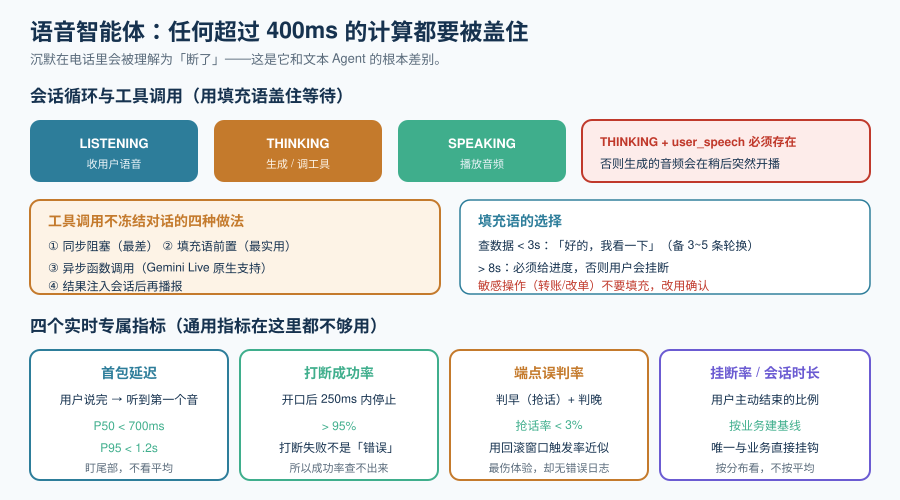

# 语音智能体工程

前四页解决了「音频怎么走」。这一页解决「**把它变成一个不会崩的产品**」。

语音智能体和文本 Agent 的差别不在智能，在**时间**：文本 Agent 可以慢慢想 10 秒再回答，用户在看转圈；语音 Agent 想 10 秒，用户听到的是**沉默**——而沉默在电话里会被理解为「断了」。所以这一页的核心命题是：**任何一段超过 400ms 的计算，都必须被「盖住」。**



## 一、会话状态机：把「记忆」和「连接」分开

语音会话的三层状态必须分开存放，否则滚动发布、断线重连、并发扩容都会出问题。

| 层 | 内容 | 存放位置 | 生命周期 |
| --- | --- | --- | --- |
| **连接态** | WebSocket/WebRTC 连接、音频编解码器状态 | 实例内存 | 秒~分钟（会断） |
| **会话态** | 对话历史、当前轮次、打断点、已播出文本 | **外置**（Redis / 数据库） | 分钟~小时 |
| **业务态** | 用户身份、订单、工单 | 业务系统 | 天~年 |

::: danger 三条纪律
1. **连接态绝不进会话态**。把「当前 WebSocket」写进会话，滚动发布时会话就废了。
2. **会话必须有业务主键**（`session_id`），并且**要能被显式结束**。忘记结束的会话会一直占着资源，也会让成本统计变成一个越来越大的黑洞。
3. **状态外置要考虑写入频率**。每收到一个音频分片就写一次 Redis，会把 Redis 打爆。**按轮次写、或按时间窗口批量写**，并且在断开前强制落盘。
:::

## 二、工具调用：不冻结对话的唯一办法

这是语音 Agent 最容易做坏的地方。

```text
用户：「帮我查一下上个月的账单」 → 工具调用 → 查库 3.2 秒 → 「上个月是 128 元」
                                        ↑
                              这三秒里用户听到的是死寂
```

| 方案 | 做法 | 用户感受 | 成本 |
| --- | --- | --- | --- |
| **同步阻塞** | 等工具返回再说话 | 3 秒死寂，用户会「喂？你在吗」 | 最低 |
| **填充语前置** | 立刻播「好的，我查一下」，再去调工具 | **自然** | 极低 |
| **异步函数调用** | 工具在后台跑，模型继续说话/听 | 最自然 | 需要模型支持 |
| **结果播报** | 结果回来后再插回会话播报 | 需要状态机支持「插入」 | 中 |

::: tip 别自己发明方案
**Gemini Live 的「异步函数调用」就是这个问题的官方解**：它允许在**后台执行工具**的同时，**继续把音频流返回给用户**；官方还提供「增量内容更新」，把实时的音频与结构化数据无缝合并成上下文相关的回答。同样地，**OpenAI 在 2026 年公布的 GPT-Live 架构里，「后台委派」也是同一条思路**（把重任务派给另一个模型，把答案编织回对话）。

**在级联链路上你要自己实现这个「填充语 + 结果注入」的机制；在端到端模型上，先看它的官方能力，能直接用就不要自建。**
:::

### 填充语的选择表

| 场景 | 填充语示例 | 注意 |
| --- | --- | --- |
| 查数据（< 3 秒） | 「好的，我看一下」 | 用多了机械，准备 3~5 条轮换 |
| 查数据（> 3 秒） | 「稍等，这个需要一点时间」+ 进度提示 | 超过 8 秒必须给进度，否则用户会挂断 |
| 无法完成的请求 | 直接说不能做，不要先填充再拒绝 | 「让我看看……不行」比「不行」更让人恼火 |
| 敏感操作（转账、改单） | **不要用填充语，改成确认** | 这里需要的是确认，不是安抚 |

## 三、长会话与上下文：会随时间恶化的性能

实时会话动辄十几分钟，上下文会持续增长。这带来一个**和文本链路完全不同**的取舍：**上下文越长，LLM 首 token 越慢**——而首 token 延迟就是你最贵的指标。

| 策略 | 做法 | 代价 |
| --- | --- | --- |
| **滑动窗口** | 只保留最近 N 轮原始对话 | 会丢掉远期信息 |
| **摘要压缩** | 把旧轮次压成摘要 | 需要一次额外调用；摘要本身有错 |
| **结构化记忆** | 把稳定事实（姓名、订单号、偏好）抽成字段，与对话历史分开存 | 实现复杂，但**实时场景最划算** |
| **不管理** | 全部保留 | **不可取**：性能单边恶化，且在长会话里会先超上下文 |

::: danger 长会话里最贵的一个错误
**把整段 ASR 部分结果也写进历史。** 部分结果是会变的，写进历史会同时污染语义与长度。**历史只写 final 文本**，且**只写「用户真的说过的」与「模型真的说出过的」**——被用户打断、没播出去的那半句，不要写进历史（这就是[流式语音合成](../StreamingTTS/index.md)里要记录「已播出文本」的原因）。
:::

## 四、四个实时专属指标

通用的 LLM 指标（成功率、token 成本、质量分）在这里都不够用。**下面四条是语音链路独有的**，也是这一页最值得带走的东西。

| 指标 | 定义 | 采集点 | 典型目标 |
| --- | --- | --- | --- |
| **首包延迟（P50 / P95）** | 用户说完 → 用户听到第一个音 | 端点判定输出 + 播放开始事件 | P50 < 700ms，P95 < 1.2s |
| **打断成功率** | 用户开口后，播放在一个短窗口（如 250ms）内停止的比例 | 用户人声开始事件 + 播放停止事件 | > 95% |
| **端点误判率** | 判早（抢话）+ 判晚（多等）的比例 | 人工抽样 + 回滚窗口触发率 | 抢话率 < 3% |
| **挂断率 / 有效会话时长** | 用户主动结束的比例与平均时长 | 会话结束事件 | 因业务而异，**要建立自己的基线** |

::: tip 怎么把这些指标采出来（不改架构也能做）
四类事件就够：`user_speech_start`、`agent_audio_start`、`agent_audio_stop_by_bargein`、`session_end`。把这四类事件带上 `session_id` 与时间戳落到日志，**离线算指标**——不需要实时大盘。

**这是投入产出比最高的一步**：先把这四类事件埋上，你才有资格谈优化。
:::

### 与观测体系的对接

这四个指标应当落进已有的观测体系，而不是另起一套：

- **Trace 模型**：一次会话是一棵 Span 树，每一轮是一个子 Span。参考 [AI 应用观测与评估 · Trace 模型](../../LLMObservability/Tracing/index.md)。
- **成本归因**：语音链路要**额外记录音频时长**，因为按分钟计费的成本模型与按 token 完全不同。参考 [成本与单位经济学](../../LLMObservability/Cost/index.md)。
- **告警**：首包延迟 P95 破线、打断成功率跌破阈值，都应当能告警。参考 [质量告警与漂移](../../LLMObservability/Alerting/index.md)。

## 五、成本：语音是「按持续时长」花的钱

| 成本构成 | 计费口径 | 可控手段 |
| --- | --- | --- |
| **实时模型费** | 按音频分钟（如 Gemini Live 的 $0.005/min 入 + $0.018/min 出级别） | 缩短会话、把静音期交给文本模型处理 |
| **ASR / TTS 费** | 按音频时长或字符 | 只在需要的环节用；静音不送合成 |
| **文本 LLM 费** | 按 token | 复用[文本链路](../../LLMApp/CostRateLimit/index.md)的全部手段 |
| **传输与并发** | 长连接占用实例资源 | **并发路数决定实例数**，这是自建的主要成本项 |

::: danger 三个会静默算错账的地方
1. **把「静音时长」也算进实时模型费**。用户思考、沉默、被静音的时间如果在计费区间内，就是纯浪费。做法：**检测到长时间静音时主动降级**（暂停实时会话，切到文本模式待命）。
2. **打断后已合成未播出的音频仍然计费**。要在成本字段里把「已合成时长」与「已播放时长」分开记，差额就是浪费（见[流式语音合成](../StreamingTTS/index.md)）。
3. **用「每分钟单价 × 会话数」估算，忽略尾长效应**。真实成本受**会话时长分布**影响极大：100 个 10 分钟会话和 1000 个 1 分钟会话，成本可能差一个量级。**按分布算，不按平均算。**
:::

## 六、并发与容量：算一次再上线

```text
所需实例数 ≈ (峰值并发会话数 × 单会话实测 CPU/内存占用) / (单实例容量 × 安全水位)
```

| 参数 | 怎么拿 | 常见的错 |
| --- | --- | --- |
| 峰值并发会话数 | 业务估算 × 1.5 | 用「日活」直接当并发 |
| 单会话资源占用 | **实测**（压测） | 用平均值代替（长会话会更高） |
| 单实例容量 | 实测到「再多一个就 P95 破线」 | 用 CPU 100% 当容量（其实早破了） |
| 安全水位 | 0.7 左右 | 不留水位，一次流量尖峰就全线坏 |

::: warning 实时语音的扩容比文本难
文本服务扩了就能用；**实时服务受「会话粘性」限制**——新扩的实例接不了已存在的会话。所以：
- 扩容要**提前**（按趋势预扩），不能等指标破了再扩；
- 滚动发布必须配**排空策略**（drain）；
- 会话状态外置是让扩容真正有效的**前提**。
:::

## 七、可执行验证

```shell
# ① 静态：四个实时指标的埋点是否齐全（检查你的代码里有没有这四类事件）
#    预期：四类事件名全部出现，且都带 session_id
grep -rn "user_speech_start\|agent_audio_start\|agent_audio_stop_by_bargein\|session_end" \
     app/ --include='*.ts' --include='*.py' -o | sort -u
# 若输出为空，说明指标还没埋——这是最该先补的一件事

# ② 静态：端点与并发容量探针（不产生音频，只测连接与握手开销）
python3 - <<'PY'
import asyncio, json, time, websockets

async def one(i):
    async with websockets.connect("ws://localhost:8080/v1/realtime") as ws:
        await ws.send(json.dumps({"type": "session.update", "session": {"instructions": "hi"}}))
        await asyncio.sleep(2.0)
    return i

async def main(n=20):
    t0 = time.perf_counter()
    await asyncio.gather(*(one(i) for i in range(n)))
    print(f"{n} 路并发握手+持仓 2s，总耗时 {time.perf_counter()-t0:.2f}s")
asyncio.run(main())
PY
# 预期：并发增加时总耗时不应线性爆炸；若明显劣化，说明服务端每会话开销过高

# ③ 需要设备：会话时长分布
#    做法：从业务日志里导出 session_end - session_start，画分布（而不是只看平均）
#    预期：本机无真实通话数据时无法完成——按纪律标注为「未跑」
```

## 参考资料

- Gemini Live API（异步函数调用、增量内容更新）：https://ai.google.dev/gemini-api/docs/live
- OpenAI Realtime API（函数调用与远程 MCP）：https://platform.openai.com/docs/guides/realtime
- LiveKit Agents（会话与轮次管理）：https://docs.livekit.io/agents/
- 相关专题：[端到端语音到语音](../SpeechToSpeech/index.md)、[AI 应用观测与评估](../../LLMObservability/index.md)、[大模型应用开发 · 成本核算与限流降级](../../LLMApp/CostRateLimit/index.md)
