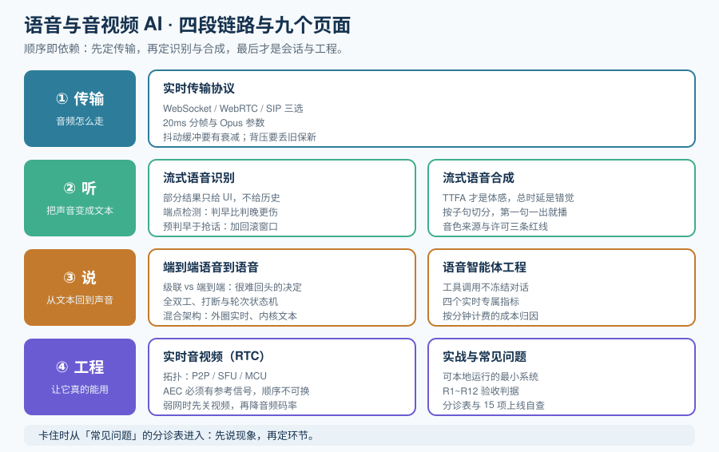

# 语音与音视频 AI

语音与音视频 AI 解决的是一类**只能边听边答**的问题：用户不是先说完、等你处理完再听，而是**说话的同时就在听你的回应**。这带来一个纯文本应用永远不会遇到的问题——**你的模型再强也没用，只要「首包」慢了，对话就是不成立的**。

本专题只讲一条链路：**实时、双工、可打断**。它和「把一段录音转成文字」是两件不同的事，后者属于离线批处理链路。

::: tip 一句话理解
离线语音链路的目标是**准确**（慢慢算，算准）；实时语音链路的目标是**及时**（**在用户开始怀疑之前出声**）。前者的预算是「几分钟」，后者的预算是「几百毫秒」——**预算变了，架构就必须跟着变**。
:::

## 与相邻专题的分工

本专题最容易和两处重复：**多模态应用的语音/视频页**（离线批处理）与**通用的 LLM 应用开发**。下表把边界一次写死。

| 专题 | 讲什么 | 与本专题的关系 |
| --- | --- | --- |
| 本专题 | **实时双向链路**：传输协议、流式 ASR/TTS、双工对话、语音智能体、RTC 工程 | —— |
| [多模态应用 · 语音处理](../Multimodal/SpeechProcessing/index.md) | **离线批处理**：VAD 切分、Whisper 系批量转写、TTS 文件合成、CER/WER 评测 | 那边回答「**一段录音怎么变成文本 / 一段文本怎么变成音频文件**」（**先有文件，再处理**）；本专题回答「**麦克风到扬声器之间这几百毫秒怎么抠出来**」（**没有文件，只有流**）。两边的 VAD、ASR、TTS 是**同一个模型家族的两种用法**，但延迟预算相差 2~3 个数量级 |
| [多模态应用 · 视频处理](../Multimodal/VideoProcessing/index.md) | **离线视频理解**：抽帧、时间戳映射、视频摘要、字幕生成 | 那边是「**把视频当作一堆可抽取的静态帧**」；本专题的「音视频」指**实时音视频通话（RTC）**——画面与声音同时流动、且延迟必须在人的感知阈值内 |
| [多模态应用 · 模型接入与选型](../Multimodal/ModelAccess/index.md) | 云 API / 自托管 / 本地三种接入形态 | 接入形态的选型方法论**不重复**；本专题只讲实时链路独有的「**协议与传输**」这一层选型 |
| [本地模型部署](../LocalModel/index.md) | 自建推理服务的部署、显存、压测 | 那边部署的是**请求-响应式**服务；实时语音需要的是**长连接 + 双工**，本专题的[端到端语音到语音](./SpeechToSpeech/index.md)会说明为什么这两者不能简单复用同一套服务化方案 |
| [大模型应用开发](../LLMApp/index.md) | 纯文本链路的 API 调用、工具调用、记忆、成本 | 本专题的 LLM 环节直接复用那边的结论；实时链路新增的是**「LLM 不是链路的第一段和最后一段」** |
| [AI 应用观测与评估](../LLMObservability/index.md) | Trace、在线评估、成本归因、质量告警 | 观测方法论不重复；本专题的[语音智能体工程](./VoiceAgent/index.md)只补**实时链路专属的四个指标**（首包、打断成功率、端点判决准确率、挂断率） |
| [Agent 应用](../Agent/index.md) / [Agent 框架深入](../AgentFramework/index.md) | Agent 原理、工具调用、编排、多智能体 | 那边是**文本 Agent**；语音 Agent 是「文本 Agent + 一个必须在 700ms 内闭合的语音外圈」，外圈工程在本专题 |
| [大模型微调](../FineTuning/index.md) | 权重侧训练与评测 | 语音模型的微调不在本专题范围；本专题的[流式语音识别](./StreamingASR/index.md)只讲**调用与调参**，不讲训练 |
| [提示词安全与评估](../PromptSecurity/index.md) | 注入、越狱、红队、回归门禁 | 语音链路多一个**攻击面**：音频本身（不可见字符在音频里的对应物是**听不清但会被转写的语音**），但防护方法论复用那边 |
| [运维 · 网络基础](../../Ops/Network/index.md) | TCP/UDP、协议基础 | 那边讲协议原理；本专题讲「**为什么实时音频不能走 TCP 的思路**」这一条具体推论 |
| [前端 · 浏览器原理](../../Frontend/Basic/Browser/index.md) | 浏览器渲染与能力 | 采集麦克风、`getUserMedia`、`AudioWorklet` 的浏览器侧细节，本专题只讲与延迟相关的部分 |

## 按环节找页面

不确定从哪页读起时，按自己卡住的环节对号入座：

| 环节 | 典型问题 | 去哪看 |
| --- | --- | --- |
| **整体判断** | 「我这个场景到底需不需要实时？」「要花多少钱？」 | [概述](./Overview/index.md) |
| **传输与协议** | WebSocket 还是 WebRTC？要不要上 SIP？音频怎么分帧？ | [实时传输协议](./StreamingProtocols/index.md) |
| **识别** | 要「边说边出字」；部分结果抖得厉害；不知道用户说完没有 | [流式语音识别](./StreamingASR/index.md) |
| **合成** | 首包太慢；声音不自然；长文本怎么边合成边播 | [流式语音合成](./StreamingTTS/index.md) |
| **双工对话** | 用户一打断就乱；模型抢话；不会「嗯」 | [端到端语音到语音](./SpeechToSpeech/index.md) |
| **上线工程** | 会话状态放哪？工具调用怎么不卡住对话？成本怎么算？ | [语音智能体工程](./VoiceAgent/index.md) |
| **音视频通话** | 回声、啸叫、音画不同步、弱网卡顿 | [实时音视频（RTC）](./RTC/index.md) |
| **动手做一遍** | 想有一个能本地跑起来、能验收的最小系统 | [实战](./Practice/index.md) |
| **排障** | 具体现象 → 原因 → 处置 | [常见问题与最佳实践](./FAQ/index.md) |

## 专题地图（页面清单）

| 页面 | 内容 | 适合谁读 |
| --- | --- | --- |
| [概述：从「文件进文件出」到「边说边出」](./Overview/index.md) | 四条边界、延迟预算分解、类级联/端到端两条路线、成熟度五档 | 所有人，先读 |
| [实时传输协议](./StreamingProtocols/index.md) | WebSocket / WebRTC / SIP 三选、Opus 与分帧、抖动缓冲、背压 | 定架构的人，**重点读** |
| [流式语音识别](./StreamingASR/index.md) | 部分结果与稳定性、端点检测、双工识别、延迟-准确率权衡 | 做识别环节的人 |
| [流式语音合成](./StreamingTTS/index.md) | 首包延迟（TTFA）、分句流式、音色与许可、双工播放与打断 | 做合成环节的人 |
| [端到端语音到语音](./SpeechToSpeech/index.md) | 级联 vs 端到端、全双工模型、打断与轮次、混合架构 | 想降低延迟的人，**重点读** |
| [语音智能体工程](./VoiceAgent/index.md) | 会话状态机、工具调用不卡对话、填充语、成本与并发 | 要做生产系统的人 |
| [实时音视频（RTC）](./RTC/index.md) | WebRTC 拓扑与 SFU、AEC/NS/AGC、音视频同步、弱网自适应 | 涉及视频通话的人 |
| [实战：可本地运行的实时语音对话服务](./Practice/index.md) | 从零到可验收的完整流程 + R1~R12 验收判据 | 想看完整落地的人 |
| [常见问题与最佳实践](./FAQ/index.md) | 分诊表、十二问、上线自查清单、术语表 | 所有人 |

## 事实与规格速览（2026-10 口径）

按各官方文档与项目仓库核对（检索日 **2026-10-13**）。**这张表是给你一个「当前时间点」的锚，不是选型结论**——这个领域的模型迭代以月计。

| 对象 | 当前状态 | 需要记住的一句话 |
| --- | --- | --- |
| **OpenAI Realtime API** | GA；当前旗舰 `gpt-realtime-2.1`（2026-08-21），成本档 `gpt-realtime-2.1-mini` | **三种传输合一**：WebRTC（浏览器/移动）、WebSocket（服务端编排）、SIP（电话）。**beta 线协议已于 2026-05-12 移除**（`OpenAI-Beta: realtime=v1` 请求头不再存在），事件已改名（`response.audio.delta` → `response.output_audio.delta`）——**网上 2025 年的示例多数已失效** |
| OpenAI 实时模型清单 | `gpt-realtime-2.1` / `-2.1-mini` / `-2` / `-1.5` 在册；`gpt-realtime-1.5` 与 `gpt-realtime-mini`（Deprecated）**2027-01-20 关停**；`gpt-4o-realtime-preview*` **2026-05-07 已关停**（返回错误，不是警告） | 迁移不是「换个参数」——模型换代时 **VAD 灵敏度与打断阈值必须重新标定** |
| OpenAI 专属实时能力 | 独立端点：`/v1/realtime/translations`（连续翻译，**不走 `response.create`**）；`gpt-realtime-whisper`、`gpt-live-transcribe`（流式转写，含可控 delay 旋钮） | 「对话」与「翻译」是**两条不同的会话生命周期**，不要按同一套状态机写 |
| **Gemini Live API** | `gemini-3.8-live`（GA，推荐）、`gemini-live-2.5-flash-native-audio`（GA）、`gemini-3.5-transcribe-live-preview`（仅转写） | 协议是**有状态 WebSocket（WSS）**。音频格式：**输入 16-bit PCM 16 kHz 小端；输出 24 kHz**。原生音频支持**异步函数调用**（后台执行工具、同时继续流式回音频）与**主动音频**（模型自己决定何时开口） |
| Gemini Live 定价口径 | 厂商公布约 **$0.005/min 音频输入 + $0.018/min 音频输出**（其换算基准为 $3/1M 输入、$12/1M 输出 token） | 计费单位是**分钟**而不是「次」——**长会话的成本与文本链路完全不是一个模型** |
| Gemini 3.5 Transcribe | WER **4.0%（流式）/ 2.6%（非流式）**，85+ 语言，支持**句内语言切换**与自定义词表 | 「流式 WER 比非流式高 1.4 个百分点」是**常态**，不是配置错误 |
| **Kyutai Moshi** | 全双工端到端语音模型，Apache-2.0；理论 160ms / 实测约 200ms；Mimi codec（12.5 Hz、1.1 kbps、80ms）+ Helium 7B + Inner Monologue | **唯一开箱即用的开源全双工**，但**发布节奏已停滞**（PyPI `moshi` 0.2.13 停在 2026-02-12，最新 commit 2026-05-16）；Kyutai 重心已转向 Unmute / Hibiki / MoshiRAG。**把它当研究基线，不要当生产依赖** |
| **LiveKit Agents** | v1.8.3（2026-09-23），**Apache-2.0**，约 14k stars | 许可有一处**容易漏读的例外**：**轮次检测模型 v1 不在 Apache-2.0 内**（LiveKit Model License，仅在部署到 LiveKit Cloud 时免费）；`v1-mini` 是开放权重、CPU 可跑 |
| **Pipecat** | v1.12.0（2026-09-26），**BSD-2-Clause**，约 16k stars | **传输无关**（transport-agnostic），可跑在 LiveKit / Daily / 电话 / 纯 WebSocket 上；轮次检测 `Smart Turn v3` 是**开放权重**、ONNX CPU 可跑、23 语言 |
| 托管语音平台 | Vapi（$0.05/min 平台费 + 组件透传）、Retell、LiveKit Cloud（约 $0.01/min 级，Scale $500/mo 起给 BAA） | 平台费看起来小，**真正的账单在模型侧**；低于约 1 万分钟/月时托管便宜，往上自建开始占优 |

::: danger 三个最容易踩的事实性错误
1. **拿 2025 年的 Realtime 示例直接跑**。beta 线协议已移除、事件已改名、`session.update` 的音频配置已嵌套成 `session.audio.input.*` / `session.audio.output.*`。**迁移时不要只改模型名**，先核对协议版本与本地的示例是哪一代。
2. **把「Gemini Live 是 WebSocket」当成「所以它和 OpenAI 的 WebSocket 模式可以互换代码」**。两者都是「有状态长连接」，但**配置结构、事件名、轮次生命周期完全不同**——一个是 `response.create` 驱动的回合制，另一个是**主动音频**式的连续流。共用抽象时，抽象层要建在**你自己的会话模型**上，不要建在厂商事件的形状上。
3. **以为「开源语音模型 = 全链路都可商用」**。框架许可（Apache-2.0 / BSD-2-Clause）与**权重、模型、轮次检测器**的许可是三件独立的事，且经常不同（LiveKit 轮次检测器就是典型）。上线前逐个模型打开模型卡确认。
:::

## 关于版本组织

本专题**不建大版本目录**。原因：实时语音领域的破坏性变化来自**线协议与模型代际**（Realtime API 的协议换代、Gemini Live 的 `2.5 → 3.8` 模型线），而不是「框架换代」这类清晰的主版本边界；而模型 ID 的有效期常常只有几个月，**为它建目录会比它存活得更久**。处理方式是在页内用 `::: info` 标注**生效时点与旧口径**，需要对比时并列写，旧口径不删除。

需要看「按大版本建目录」的范例，可参考 [Spring5 / Spring6](../../Backend/Java/Frame/Spring/Spring6/index.md)、[Vue2 / Vue3](../../Frontend/Frame/Vue/index.md)，以及 Spring Boot 的 [v2](../../Backend/Java/Frame/SpringBoot/v2/index.md) / [v3](../../Backend/Java/Frame/SpringBoot/v3/index.md) / [v4](../../Backend/Java/Frame/SpringBoot/v4/index.md)。

## 成熟度自评：你在哪一档

实时语音的成熟度不看「用了哪个模型」，只看一件事：**用户有没有在等。**

| 档位 | 特征 | 下一步 |
| --- | --- | --- |
| L0 回合式 | 录音 → 上传 → 等整段返回；一轮 2 秒以上 | 先把「整段等」改成流式，哪怕只是把 ASR 换成流式 |
| L1 能出声 | 有流式 ASR 与 TTS，但仍是「你说完我才能答」 | 补[端点检测](./StreamingASR/index.md)，把「等静音」的判据从固定时长换成模型 |
| L2 可打断 | 用户开口能打断模型；首包进入 1.2 秒内 | 补[会话状态机与填充语](./VoiceAgent/index.md)，让工具调用不冻结对话 |
| L3 自然 | 首包 < 700ms；支持轻微重叠与「嗯」；打断不丢上下文 | 补[四个实时专属指标](./VoiceAgent/index.md)，把「体感」变成可告警的数 |
| L4 可运营 | 首包、打断成功率、端点误判率、挂断率四线有 SLO 与责任人 | 保持，并按季度复核模型代际与线协议 |

## 学习路径

1. **先读[概述](./Overview/index.md)**：确认你的场景到底需不需要「实时」，这一步能省掉一半的无用功。
2. **精读[实时传输协议](./StreamingProtocols/index.md)**：传输层选错，后面所有优化都是在错误的基数上做减法。
3. **按你的环节读 [流式 ASR](./StreamingASR/index.md) 或 [流式 TTS](./StreamingTTS/index.md)**；两边都做就都读。
4. **读[端到端语音到语音](./SpeechToSpeech/index.md)**：决定你走级联还是端到端——**这是一个很难回头的决定**。
5. **读[语音智能体工程](./VoiceAgent/index.md)**：把前四步的能力组织成一个不会崩的会话。
6. **对照[实战](./Practice/index.md)完整走一遍**，最后通读[常见问题](./FAQ/index.md)收尾。

## 参考资料

- OpenAI Realtime API 文档：https://platform.openai.com/docs/guides/realtime
- Gemini Live API 文档：https://ai.google.dev/gemini-api/docs/live
- LiveKit Agents 文档：https://docs.livekit.io/agents/
- Pipecat 文档：https://docs.pipecat.ai/
- Kyutai Moshi 仓库：https://github.com/kyutai-labs/moshi
- WebRTC 规范（W3C）：https://www.w3.org/TR/webrtc/
- Opus 编解码器（RFC 6716）：https://www.rfc-editor.org/rfc/rfc6716
