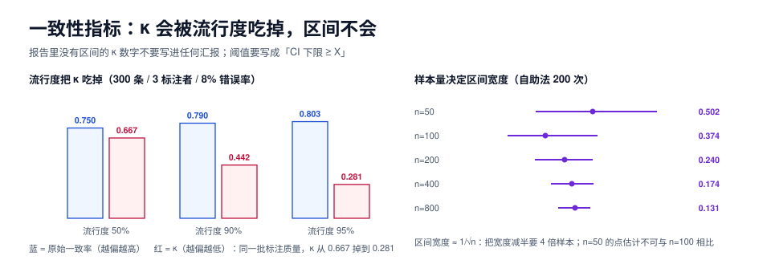

# 一致性度量：κ 会骗人，区间不会

本页判据族 `SYA-A` ~ `SYA-H`，共 8 条。

「我们的一致性 κ = 0.82，可以开工了」——这句话里有两个隐患：**κ 在标签分布不均衡时会大幅低估**（也可能高估），以及**0.82 这个点估计在小样本上可能有 ±0.15 的误差**。前者让你误判规范质量，后者让你误判「已经够好了」。

本页用本机实测把两件事钉死：同一批标注质量下，流行度从 50% 变到 95%，κ 从 0.667 掉到 0.281；样本量从 50 涨到 800，区间宽度从 0.502 收到 0.131。



## 一、三个指标，各管一段

设标注矩阵为「N 条样本 × m 个标注者」，每条样本的标签来自 K 个类别。

| 指标 | 适用 | 公式（名义尺度） | 局限 |
| --- | --- | --- | --- |
| **原始一致率** `p_o` | 快速体检 | 完全一致的样本数 / 总样本数 | 不扣除随机一致，**永远偏高** |
| **Cohen's κ** | 恰好 2 个标注者 | `(p_o − p_e) / (1 − p_e)`，`p_e` 为按边际分布算的期望一致率 | 只支持两人；对流行度极敏感 |
| **Fleiss' κ** | ≥ 2 个标注者、每人标全部样本、无缺失 | 由每条样本的 `P_i` 求平均 `P̄`，再与 `P_e` 比较 | 不支持缺失 |
| **Krippendorff's α** | 任意人数、允许缺失、多种尺度 | `1 − D_o / D_e`，`D_o` 为观测差异，`D_e` 为期望差异 | 计算稍复杂，但最通用 |

::: tip 选哪个
**默认用 Krippendorff's α。** 理由不是它更「高级」，而是它**允许缺失**——真实项目里总有人标了一半就走了，Fleiss 遇到缺失只能整条丢弃（丢掉的可能正是最难的样本）。Cohen's κ 只在「两个人、完整标注」的对照场景用（比如新旧规范对比）。
:::

## 二、实测：流行度怎么把 κ 吃掉

实验设置：300 条样本、3 个标注者、每人 8% 的概率标错，只改**正类流行度**。

| 正类流行度 | 原始一致率 | Cohen's κ（三人两两均值） | Fleiss' κ | Krippendorff's α |
| --- | --- | --- | --- | --- |
| 50% | 0.750 | **0.667** | 0.666 | 0.667 |
| 90% | 0.790 | **0.442** | 0.441 | 0.441 |
| 95% | **0.803** | **0.281** | 0.279 | 0.280 |

三个读数放在一起，结论有三层：

1. **原始一致率随流行度上升而上升**（0.750 → 0.803），因为它把「都标成多数类」也算成一致。
2. **κ 随流行度上升而暴跌**（0.667 → 0.281），因为 `p_e` 变大了，`1 − p_e` 变小，同样的 `p_o − p_e` 除以更小的分母……等等，分母变小应该让 κ 变大。真正的机制是反过来的：**`p_e` 接近 `p_o` 时，`p_o − p_e` 趋近 0**。流行度 95% 时，「全部标多数类」的期望一致率就是 0.905，而实际只有 0.803——**观测一致率比随机猜测还低**，κ 于是被压到 0.28。
3. **三个指标在名义尺度上几乎相同**（0.441 / 0.441 / 0.442 与 0.279 / 0.280），说明差异不在公式，而在「能不能处理缺失、能不能处理多人」。**选指标的收益远小于「报告区间」的收益。**

::: danger κ 的两个致命误用
1. **「κ < 0.6 就是标注质量差」**。在上表第三行，标注员的行为其实和第二行完全一样（都是 8% 错误率），只是数据本身更偏。**这不是标注质量问题，是任务本身的问题**——解决办法是**改变采样**（保证正负类均衡）或**改用 PABAK / Gwet's AC1** 这类对流行度不敏感的指标，而不是「重新培训标注员」。
2. **「κ 越高数据越好」**。两个人共享同一个错误理解时，κ 会很高，但数据是系统性错的。**只有黄金题和反向抽检能发现这种「共谋错误」**（见[质检](../QC/index.md)）。
:::

## 三、样本量：点估计不可比，区间才可比

同一份数据，只改样本量，κ 的点估计与 95% 区间（自助法，200 次重采样）：

| 样本量 | κ 点估计 | 95% 区间 | 区间宽度 |
| --- | --- | --- | --- |
| 50 | 0.560 | [0.324, 0.827] | **0.502** |
| 100 | 0.364 | [0.205, 0.579] | 0.374 |
| 200 | 0.442 | [0.320, 0.560] | 0.240 |
| 400 | 0.475 | [0.388, 0.563] | 0.174 |
| 800 | 0.485 | [0.418, 0.549] | 0.131 |

这张表有两个反直觉的地方：

- **n=50 的 κ 是 0.560，比 n=100 的 0.364 还高**。同样的标注质量，小样本的点估计纯粹是噪声。**拿两次不同规模的标注去比 κ，等于比运气。**
- **区间宽度大致按 `1/√n` 收缩**：50 → 800（16 倍），宽度 0.502 → 0.131（3.83 倍，接近 4 倍）。这意味着**把区间宽度减半需要 4 倍样本**。

::: tip 报告规范（建议直接抄进模板）
「一致性 α = 0.48，95% CI [0.42, 0.55]，n = 800，3 名标注者。」——**没有区间的 κ 数字不要写进任何汇报**。判据阈值也应该写成区间的下限，例如「α 的 CI 下限 ≥ 0.6」而不是「α ≥ 0.6」。
:::

### 需要多少样本才够

| 目标 | 需要的样本量（3 标注者，二分类） |
| --- | --- |
| 只想知道「是不是很差」（区分 0.3 与 0.6） | 100~150 |
| 判断「是否达到 0.6 门槛」（区间下限 ≥ 0.6） | 300~400 |
| 比较两版规范的优劣（差值 0.1 显著） | 600~800 |
| 分标签报告（每个标签都要区间） | 每标签 ≥ 150，总样本按标签数放大 |

## 四、多标注者与缺失怎么处理

```python
# Krippendorff's alpha（名义尺度），支持缺失与任意人数
def krippendorff_alpha_nominal(matrix):
    """matrix: list[list[int]]，每行一条样本，每列一个标注者，None 表示缺失"""
    units = [[v for v in row if v is not None] for row in matrix]
    total = sum(len(u) for u in units)
    # 观测差异 D_o
    do = 0.0
    for u in units:
        n = len(u)
        if n < 2:
            continue
        do += (n * n - sum(u.count(c) ** 2 for c in set(u))) / (n - 1)
    do /= total
    # 期望差异 D_e（按边际分布）
    marg = {}
    for u in units:
        for v in u:
            marg[v] = marg.get(v, 0) + 1
    de = (total * total - sum(c * c for c in marg.values())) / (total * (total - 1))
    return 1 - do / de
```

| 场景 | 处理 |
| --- | --- |
| 某人标了一半就走 | 用 α，缺失按「该样本少一个标注者」处理，不丢样本 |
| 三人中两人一致、一人不同 | α 会按 `n_i` 加权，不需要手工投票 |
| 争议样本需要裁决 | 裁决结果作为**第四条标注**加入矩阵，而不是替换原来的三条（否则一致性被抬高） |
| 多标签（每条可有多个标签） | 每个标签单独算一次 α，再按标签频次加权汇总 |

最后一行（裁决结果不能替换原标注）是被反复踩的坑：**把裁决当唯一真值重算一致性，等于用「已经拉齐过的数据」证明「不需要拉齐」**。

## 五、把一致性接进流水线

| 时点 | 算什么 | 阈值动作 |
| --- | --- | --- |
| 新标注员试标 50 条后 | 与老手的 Cohen's κ | < 0.6 不上线 |
| 每批 500 条完成后 | 三人 α + 区间 | CI 下限 < 0.6 → 停下来复查规范 |
| 每周 | 按标签分组的 α | 某标签 α 明显低 → 该条规则重写 |
| 规范变更后 | 新旧规范在同一批上各标一次 | 新规范 α 不得低于旧规范 |

第四条（新旧规范对照）是最有说服力的：**它把「规范改得好不好」变成了一个可测的数字**，而不是讨论。

## 六、本页判据

| 编号 | 判据 | 看什么现象 | 不满足时改哪里 |
| --- | --- | --- | --- |
| `SYA-A` | 主口径用 Krippendorff's α，允许缺失 | 报告首行指标名 | 换成 α；样本有缺失时 Fleiss 不可用 |
| `SYA-B` | 一致率与 κ/α **同时**报告 | 报告有三列 | 补原始一致率（用于解释 κ 的偏离） |
| `SYA-C` | 报告了标签流行度 | 报告有正类占比 | 补；否则 κ 无法解读 |
| `SYA-D` | 每个一致性数字都带 95% 区间与样本量 | 抽样看报告 | 加自助法区间 |
| `SYA-E` | 阈值写成「CI 下限 ≥ X」，不写「点估计 ≥ X」 | 验收文档 | 改判据写法 |
| `SYA-F` | 裁决结果作为额外标注，不替换原标注 | 一致性计算的输入 | 保留原始三条 |
| `SYA-G` | 按标签分组算 α，不只算总体 | 周报有分组列 | 补分组（一个坏标签会被总平均掩盖） |
| `SYA-H` | 规范变更前后用同一批样本做对照 | 变更记录 | 见第五节第四条 |

## 验证方式

```shell
# 1) 复跑流行度悖论（约 1 秒）
python3 - <<'PY'
import random, statistics
def cohen(a, b):
    n = len(a); po = sum(1 for x, y in zip(a, b) if x == y)/n
    pa = sum(a)/n; pb = sum(b)/n
    pe = pa*pb + (1-pa)*(1-pb)
    return (po-pe)/(1-pe), po
rnd = random.Random(7)
for prev in (0.5, 0.9, 0.95):
    truth = [1 if rnd.random() < prev else 0 for _ in range(300)]
    ann = [[t if rnd.random() > 0.08 else 1-t for t in truth] for _ in range(3)]
    ks = [cohen(ann[i], ann[j])[0] for i, j in ((0,1),(0,2),(1,2))]
    po = cohen(ann[0], ann[1])[1]
    print(f"prevalence={prev} po={po:.3f} kappa={statistics.mean(ks):.3f}")
PY
# 期望：0.5→0.667 / 0.9→0.442 / 0.95→0.281（数值随机略有浮动）

# 2) 区间：同一份数据只改样本量
#    见上文表格，自助法 200 次即可；期望 n=50 宽度约 0.5，n=800 约 0.13

# 3) 你的项目：确认报告里有这三样
grep -E "alpha|κ|CI" reports/agreement.md
# 期望：指标名 + 区间 + n 三样齐全
```

## 参考资料

- Cohen, J. (1960). *A coefficient of agreement for nominal scales*
- Fleiss, J. L. (1971). *Measuring nominal scale agreement among many raters*
- Krippendorff, K. (2019). *Content Analysis: An Introduction to Its Methodology*（第 4 版，α 的权威定义）
- *Kappa and Prevalence*：流行度对 κ 的影响与 PABAK / AC1 的替代方案
- 本仓库相邻专题：[标注规范](../Guideline/index.md)、[质检与抽检](../QC/index.md)、[评测统计](../../EvalEngineering/Statistics/index.md)
