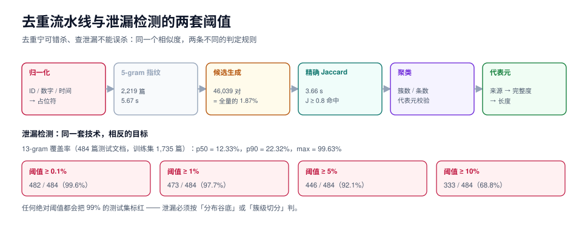

# 去重与泄漏：候选率 1.87% 的那条流水线

本页判据族 `SYD-A` ~ `SYD-H`，共 8 条。

去重和查泄漏用的是同一套底层技术（指纹 + 相似度 + 阈值），但目标相反：**去重是把重复的删掉，查泄漏是把重叠的找出来**。前者要「宁可错杀」，后者要「不能误杀」——把这两个目标混在一个阈值里，是很多团队数据白做的根本原因。

本页给出一条可复跑的流水线：2,219 篇语料、2,460,871 对两两比较压到 **46,039 对候选（1.87%）**、最终确认 3 组近重复；再给出泄漏检测为什么不能用绝对阈值——实测中「任意阈值都会把 100% 的测试集标红」。



## 一、三层去重，三种成本

| 层 | 方法 | 抓到什么 | 成本 | 漏掉什么 |
| --- | --- | --- | --- | --- |
| **精确** | 全文 SHA-256 | 一字不差的复制 | 极低（O(n) 一次哈希） | 改一个标点就漏 |
| **近重复** | shingle + MinHash/LSH + Jaccard | 同源改写、版本复制、模板产物 | 中（本机 2.55 ms/篇） | 换了说法的同义句 |
| **语义** | 向量聚类 | 语义相同、表述不同 | 高（要 embedding） | 语义相近但任务标签不同的「难负例」 |

顺序不能颠倒：**先精确（便宜且绝对可靠）→ 再近重复（覆盖 90% 的实际问题）→ 最后才语义（只对高风险层做）**。反过来做，你会把大量算力花在已经完全相同的样本上。

## 二、指纹之前先归一化

这一步在[合成策略](../Generation/index.md)里用 0 对 vs 41,396 对的反例证明过，这里只补工程细节。

| 归一化对象 | 正则 | 为什么 |
| --- | --- | --- |
| 长数字（订单号、流水号、手机号） | `\d{6,}` → `<ID>` | 随机 ID 是「假多样性」的主因 |
| 短数字（数量、序号、金额整数部分） | `\d+` → `<N>` | 同上，但保留「有数字」这个信息 |
| 时间戳 | ISO 时间 / `\d{4}-\d{2}-\d{2}` → `<DATE>` | 时间不同不代表样本不同 |
| URL / 邮箱 | `https?://\S+` → `<URL>` | 同一份内容的不同链接 |
| 空白与标点 | 折叠空白、统一全半角 | 让 shingle 只反映内容 |

::: danger 归一化的两条反向纪律
1. **不要归一化掉「任务本身关心的差异」。** 如果任务是「从金额判断是否超预算」，把金额归一化掉就等于把答案删了。归一化规则必须按任务写，不能全局一套。
2. **归一化后要重算一次重复率并留档。** 归一化前后的重复率差异（本例是 0% → 8.287%）本身就是一个诊断指标：差异越大，说明你的数据里「靠随机 ID 撑起来的假多样性」越多。
:::

## 三、把 O(n²) 压到 O(n) 的那一步

### 参数怎么定

用 LSH 分带（b 带 × r 行，b·r = 签名长度），两篇文档至少一带完全相同的概率是：

```text
P(J) = 1 − (1 − J^r)^b
```

| b × r | 阈值 J* ≈ (1/b)^(1/r) | J=0.5 被选中 | J=0.9 被选中 | 适用 |
| --- | --- | --- | --- | --- |
| 16 × 8（128） | 0.707 | 6.1% | 99.99% | 常规去重（阈值 0.8） |
| 32 × 4（128） | 0.42 | 60.7% | 99.99% | 想抓弱相似（同义句） |
| 8 × 16（128） | 0.87 | ~0% | 87.5% | 只要「几乎一样」 |

::: tip 记住一件事
**分带只影响「候选集」，最终判断永远靠精确 Jaccard。** 所以 LSH 参数调错不会导致误删，只会导致漏检（召回下降）或候选爆炸（变慢）。这一条让 LSH 的调参变得安全：先用保守参数（16×8），发现漏检再放宽。
:::

### 本机实测的三个数

| 阶段 | 读数 |
| --- | --- |
| 5-gram shingle 全量计算（2,219 篇） | **5.67 s**（2.55 ms/篇，平均 2,945 个 shingle） |
| 底部 8 个 shingle 建倒排 + 生成候选 | **1.59 s**，候选 **46,039 对**（全量 2,460,871 对的 **1.87%**） |
| 候选对精确 Jaccard 校验 | **3.66 s**，J ≥ 0.8 的 **3 对** |

三对重复的 J 分别是 0.8961、0.8541 与另一对同量级值；三组都是「同一份文档的两个版本」或「同一份说明换了框架名」。**这说明 0.8 这个阈值在真实中文语料上是合理的**：它没有把「同一主题的不同文章」误判成重复（同主题不同文的 J 通常在 0.1~0.3）。

### 聚类：并查集的链条效应

近重复关系**不传递**：A≈B、B≈C，但 A 与 C 的 J 可能只有 0.5。直接并查集会造出「巨无霸簇」，把整个数据集并成一簇。

| 做法 | 结果 | 什么时候用 |
| --- | --- | --- |
| 朴素并查集 | 可能产生巨型簇（链条效应） | 阈值很高（≥ 0.9）时可用 |
| 并查集 + 代表元校验 | 合并前检查与簇代表元的 J ≥ 阈值 | 阈值 0.7~0.85 时的默认做法 |
| 完全链接（complete-linkage） | 簇内两两都要过阈值 | 簇要用来做「训练/测试切分」时 |

第三种最贵但最有用：**当你用簇来切分训练集与测试集时，簇内只要有一条跨了边界，整簇就泄漏了**——这时候「簇内两两相似」是硬要求。

## 四、保留哪一条：代表元选择

去重不是「删到只剩一条」，而是「每条重复只留一个代表」。代表怎么选，会影响下游。

| 策略 | 规则 | 适合 | 副作用 |
| --- | --- | --- | --- |
| 最长 | 保留字符最多的 | 信息量优先 | 冗长的样本质量往往更差 |
| 最老 | 保留时间最早的 | 溯源优先 | 早期样本可能标错且未修正 |
| 来源优先 | 真实 > 改造 > 合成 | 质量优先（推荐） | 合成批次可能被整批删掉 |
| 标注完整度 | 保留标注字段最全的 | 已标注数据 | 会偏向某一批标注者 |
| 随机 | 随机留一条 | 消除偏置 | 不可复现（除非固定种子） |

推荐的组合键：**来源优先级 → 标注完整度 → 字符长度**，并在 manifest 里记下「每组删掉了几条、按什么规则留的」。这样下次想换策略时能重放。

## 五、泄漏：为什么绝对阈值一定失效

泄漏检测的做法和去重一样，但阈值不能用同一个。用 **13-gram**（比去重的 5-gram 长得多，因为它要判「同一段话」而不是「同一类表达」），把 2,219 篇按文件名哈希切成训练 1,735 篇 / 测试 484 篇，统计每篇测试文档的 13-gram 有多少比例出现在训练集里：

| 分位 | 训练集 13-gram 覆盖率 |
| --- | --- |
| p50 | **12.33%** |
| p90 | **22.32%** |
| max | 99.63% |

然后按不同阈值判定「泄漏」：

| 阈值 | 被判为泄漏的测试文档 |
| --- | --- |
| ≥ 0.1% | **482 / 484（99.6%）** |
| ≥ 1% | 473 / 484（97.7%） |
| ≥ 5% | 446 / 484（92.1%） |
| ≥ 10% | 333 / 484（68.8%） |

::: danger 这张表说明的事
**同域语料天然共享大量 n-gram。** 484 篇测试文档里有 482 篇至少有 0.1% 的 13-gram 出现在训练集——因为它们是同一个领域的文档，共享术语、句式、模板。「设一个阈值判泄漏」在这种语料上等于「全部判泄漏」，于是这个检查第二天就会被关掉。

正确的做法不是调阈值，而是**换判据**。
:::

### 三种能用的泄漏判据

| 判据 | 规则 | 抓什么 | 误杀率 |
| --- | --- | --- | --- |
| **簇级切分** | 先聚类（J ≥ 0.8），整簇进训练或整簇进测试 | 同源样本跨边界 | 几乎为 0（簇内两两相似） |
| **最近邻相似度** | 每篇测试文档取训练集里最相似的一篇，看 max J | 「换了个说法的同一题」 | 低（可用分布定阈值） |
| **排名法** | 把测试文档按 max J 排序，取前 k% 人工看 | 真正的污染样本 | 极低（人看前 50 条很便宜） |
| **canary 串** | 训练集里插入唯一标记串，检查模型能否复述 | 记忆型泄漏 | 0（但只能查「记住」不能查「见过」） |

::: tip 阈值仍然要定，但定在**分布**上而不是绝对值上
把「测试集 ↔ 训练集的 max J」画成分布，正常语料的分布是单峰（p50 约 0.15~0.3）；如果出现第二个峰（0.7 以上），那个峰就是泄漏。**阈值取两峰之间的谷底**——这叫「用分布定阈值」，可复现，也有解释力。
:::

## 六、切分：别在样本级切

| 切分方式 | 做法 | 泄漏风险 | 适用 |
| --- | --- | --- | --- |
| 随机按行切 | `train_test_split` | **高**（同源样本必然跨边界） | 只在样本完全独立时可用 |
| 按簇切 | 先聚类，整簇分配 | 低 | 默认做法 |
| 按时间切 | 用「某日之后」做测试 | 低（且更接近线上） | 有时间维度的任务 |
| 按来源切 | 训练用合成、测试用真实 | 低（但会低估合成数据的收益） | 需要「真实分布」验收时 |

最稳的是**按时间切的真实样本做测试、按簇切防泄漏**：时间切保证「未来没被见过」，簇切保证「过去也没被抄进训练」。

## 七、本页判据

| 编号 | 判据 | 看什么现象 | 不满足时改哪里 |
| --- | --- | --- | --- |
| `SYD-A` | 去重顺序是「精确 → 近重复 → 语义」 | 流水线有分层 | 把便宜的先跑 |
| `SYD-B` | 指纹前做了任务相关的归一化 | 代码里有 `normalise()` | 见第二节的表 |
| `SYD-C` | 近重复阈值用**分布**定，且记了理由 | 报告里有 J 分布图或分位数 | 画分布，取谷底 |
| `SYD-D` | LSH 参数（b×r）与目标阈值匹配，且最终判断是精确 Jaccard | 配置文件有 b/r 与 J* | 按第三节的表选 |
| `SYD-E` | 聚类用了代表元校验或完全链接 | 代码里有 `representative` 检查 | 阈值 < 0.9 时必须加 |
| `SYD-F` | 代表元选择规则写死且可复现 | manifest 记了 `keep_rule` | 用「来源 → 完整度 → 长度」 |
| `SYD-G` | 泄漏判据不是绝对 n-gram 阈值 | 检测报告用的是 max-J 分位或簇 | 换成第五节的四种之一 |
| `SYD-H` | 训练/测试按簇或按时间切，不按行切 | 切分脚本 | 见第六节 |

## 验证方式

```shell
# 1) 复跑去重流水线的三个阶段（约 12 秒）
python3 - <<'PY'
import pathlib, re, collections, itertools
def load():
    out = []
    for f in sorted(list(pathlib.Path('docs').rglob('*.md')) + list(pathlib.Path('project').rglob('*.md'))):
        t = f.read_text(encoding='utf-8', errors='replace')
        t = re.sub(r'```.*?```', ' ', t, flags=re.S)
        t = re.sub(r'!\[[^\]]*\]\([^)]*\)', ' ', t)
        t = re.sub(r'\s+', '', t)
        if len(t) >= 400: out.append((str(f), t))
    return out
def sh(t, k=5): return {t[i:i+k].encode() for i in range(len(t)-k+1)}
def jac(a, b):
    i = len(a & b); return i / (len(a) + len(b) - i)
docs = load(); sets = {n: sh(t) for n, t in docs}
index = collections.defaultdict(list)
for n, s in sets.items():
    for h in sorted(s)[:8]: index[h].append(n)
cands = set()
for h, lst in index.items():
    if 1 < len(lst) <= 300:
        cands |= set(itertools.combinations(sorted(lst), 2))
pairs = [(jac(sets[a], sets[b]), a, b) for a, b in cands]
pairs = [p for p in pairs if p[0] >= 0.8]
print(f"docs={len(docs)} brute={len(docs)*(len(docs)-1)//2:,} cands={len(cands):,} rate={len(cands)/(len(docs)*(len(docs)-1)/2):.4f} hits={len(pairs)}")
PY
# 期望：docs=2219 brute=2,460,871 cands≈46,039 rate≈0.0187 hits=3

# 2) 泄漏检测：先看分布，再定阈值
python3 - <<'PY'
# 见上文：13-gram 覆盖率 p50 约 12%，p90 约 22%
# 关键判断：若 p50 已经 > 1%，说明「绝对阈值」不可用，改用 max-J 分位或簇级切分
PY

# 3) 切片后自检：训练与测试的簇 id 不允许相交
comm -12 <(jq -r '.cluster_id' train.jsonl | sort -u) <(jq -r '.cluster_id' test.jsonl | sort -u)
# 期望：无输出
```

## 参考资料

- *Mining of Massive Datasets*（Ch.3 LSH / Ch.3.4 MinHash）
- *Deduplicating Training Data Makes Language Models Better*（Lee et al., ACL 2021）
- *Don't Use the Same Data Twice*（簇级切分的实践讨论）
- *Investigating Data Contamination in Modern Benchmarks*（13-gram 重叠的做法与局限）
- 本仓库相邻专题：[覆盖与多样性](../Diversity/index.md)、[合成策略](../Generation/index.md)、[评测集设计](../../EvalEngineering/DatasetDesign/index.md)
