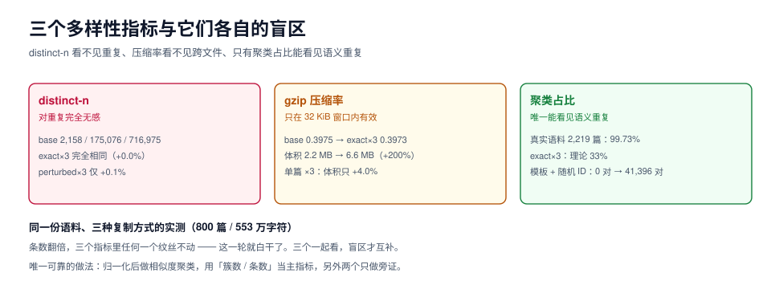

# 覆盖与多样性：三个指标的三个盲区

本页判据族 `SYC-A` ~ `SYC-H`，共 8 条。

「这批数据够不够多样」这个问题，绝大多数团队用错了一个指标来回答。常见的三个指标——**distinct-n、压缩率、聚类占比**——各自只能看见多样性的一面，而且它们的盲区正好互补。只用其中一个，你会在最需要报警的时候看到一片绿色。

本页把三个指标放在同一份语料上跑一遍，给出它们各自的失效边界，再给出一个「三个一起看」的操作方法。



## 一、三个指标量的到底是什么

| 指标 | 算法 | 它真正在量 | 计算成本 |
| --- | --- | --- | --- |
| **distinct-n** | 统计 n-gram 去重后的**种类数** | 字符组合的**种类丰富度** | 低（一次扫描） |
| **压缩率** | `compressed / raw` | 文本里的**可预测重复**（窗口内） | 低（zlib，线性） |
| **聚类占比** | 近重复聚类的**簇数 / 条数** | 语义层面的**独立性** | 中（要算相似度） |

直觉上三者应该同向变化：重复越多，三个指标都应该变差。实测不是。

## 二、同一份语料，三种复制方式

实验设置：取本仓库前 800 篇文档（约 553 万字符）作为 base，构造两个「三倍版」：

- **exact ×3**：把 800 篇原样再拼两遍（完全复制）
- **perturbed ×3**：每篇砍掉尾部 10% 字符再拼两遍（近似复制）

| 版本 | distinct-1 | distinct-2 | distinct-3 | gzip 压缩率 | gzip 体积 |
| --- | --- | --- | --- | --- | --- |
| base | 2,158 | 175,076 | 716,975 | 0.3975 | 2,200,683 B |
| exact ×3 | 2,158（+0.0%） | 175,076（+0.0%） | 716,975（+0.0%） | 0.3973（−0.05%） | 6,599,808 B（**+199.9%**） |
| perturbed ×3 | 2,158（+0.0%） | 175,326（+0.1%） | 717,797（+0.1%） | 0.3993（+0.5%） | — |

三个读数摆在一次，结论很不客气：

1. **distinct-n 对「重复」完全无感。** 内容翻了三倍，distinct-1/2/3 一个都没动——它数的是「有没有出现过」，重复出现一百次也只算一次。**它适合发现「词汇贫乏」，不适合发现「内容重复」。**
2. **压缩率在跨文件重复上失效。** exact ×3 的压缩率是 0.3973，和 base 的 0.3975 几乎没有区别；只有体积如实涨了三倍（2.2 MB → 6.6 MB）。原因很具体：**zlib 的窗口是 32 KiB**，而三份副本之间隔着约 2 MB，压缩器根本看不到前面的相同内容。
3. **只有把同一段内容放进同一个窗口，压缩率才会跳。** 单独拿一篇 4,389 字符的文档复制三遍：压缩后 2,677 B → 2,785 B，**只涨 4.0%**（内容涨了 200%）。这个 4% 就是压缩率能看见重复的证据。

再补一组对照，把「窗口」这件事钉死：

| 场景 | 原始内容 | 三倍后 | 压缩后体积变化 |
| --- | --- | --- | --- |
| 单篇文档 ×3（4.3 K 字符，窗口内） | 2,677 B | 2,785 B | **+4.0%** |
| 10 篇文档 ×3（约 44 K 字符，跨窗口） | 26,136 B | 73,539 B | **+181%**（接近线性） |

::: danger 由这三个读数直接推出来的三条纪律
1. **distinct-n 只能当「词汇健康度」，不能当去重指标。** 它永远不会因为你复制了数据而下降。
2. **压缩率只能当「局部重复」的探针**（同一窗口内、同一文件内），跨文件、跨批次的重复它看不见。想用它做全局判断，必须先把语料按内容排序（让相似内容相邻），这一步本身就等于去重了。
3. **语义级重复只有相似度聚类能看见。** 三条指标里只有聚类占比会随着「三倍复制」从 1.0 掉到 0.33——前提是你做了归一化（见[合成策略](../Generation/index.md)第二节的反例）。
:::

## 三、真实语料的聚类占比长什么样

同一套 5-gram + Jaccard 0.8 流程跑在本仓库 **2,219 篇文档**上：

| 读数 | 值 |
| --- | --- |
| 文档数 | 2,219 |
| 近重复簇数（≥ 2 篇） | 3 |
| 落在簇里的文档 | 6 |
| **聚类占比（1 − 簇内文档占比）** | **99.73%** |
| 最大簇大小 | 2 |

真实人工写作的语料，聚类占比通常在 97%~99.9%；**合成数据在 60%~85% 是常态**，如果低于 50%，基本上就是「模板 + 随机 ID」。

## 四、覆盖率：分层是分母，条数是分子

多样性还有另一个维度，聚类占比看不见：**「该有的场景有没有」**。

| 概念 | 定义 | 怎么算 |
| --- | --- | --- |
| 分层（stratum） | 任务的一个正交维度切片，如「渠道 × 意图 × 情绪」 | 人工定义，写进任务卡 |
| 覆盖率 | 有样本（≥ N 条）的分层数 / 定义的分层总数 | `count(distinct stratum) / total_strata` |
| 长尾配额 | 每个分层的最低条数 | 写死，如每层 ≥ 20 条 |
| 有效类别数 | `exp(熵)`，把分布压成一个「等效有几种」 | `exp(-Σ p_i ln p_i)` |

一个可执行的验收：

```sql
-- 假设样本表有 stratum 字段
select
  count(*)                                     as total,
  count(distinct stratum)                      as strata_covered,
  min(cnt)                                     as min_per_stratum,
  round(exp(-sum(p * ln(p))), 1)               as effective_strata
from (
  select stratum, count(*) cnt, count(*)::numeric / sum(count(*)) over () p
  from samples group by stratum
) t;
```

`effective_strata` 比「覆盖了多少层」更有用：40 层里 39 层各 1 条、1 层 9,961 条，覆盖率是 100%，但有效类别数只有 1.1——**模型看到的基本上只有那一层**。

## 五、三个指标怎么一起看

| 现象 | 大概率原因 | 处置 |
| --- | --- | --- |
| distinct-n 低、压缩率高、聚类占比低 | 词汇贫乏 + 内容重复（典型模板产物） | 加维度、换造法，见[合成策略](../Generation/index.md) |
| distinct-n 正常、压缩率正常、**聚类占比低** | 同义改写堆叠（广度演化的陷阱） | 按簇去重，配额按簇分配 |
| distinct-n 高、压缩率低、聚类占比正常 | 词汇丰富但结构套路化 | 检查是否「换词不换骨架」 |
| 三个都正常但**覆盖率低** | 采样偏置 | 按分层配额重采样 |
| 条数涨、三个指标都不动 | **根本没造新东西** | 回到去重那一步查归一化 |

::: tip 一个最低成本的日常巡检
每轮数据产出后跑三行：`distinct-1`（词汇）、`gzip 压缩率`（局部重复）、`J≥0.8 的簇数`（语义重复）。三个数都记进日报。**任何一个数在「条数翻倍」时纹丝不动，就是那一轮白干了。**
:::

## 六、长尾怎么保

| 手段 | 做法 | 代价 | 适用 |
| --- | --- | --- | --- |
| 分层定额 | 每层固定条数，不按自然频率采样 | 总条数膨胀 | 分层维度少（< 100 层） |
| 温度采样 | 按 `p^α`（α < 1）平滑分布 | 需要调 α | 分层多、想保留自然分布形状 |
| 难例优先 | 只对模型当前答错的样本扩增 | 需要一轮训练才能开始 | 已有基线模型 |
| 定向合成 | 对缺失层用模板/程序化造 | 人工写模板 | 层内答案可程序化判定 |

四种手段里，**定向合成是唯一能「补出原来不存在的东西」的**，但它的产物必须过最严的验证器——因为这一层的真实样本本来就少，验证器错了没人能发现。

## 七、本页判据

| 编号 | 判据 | 看什么现象 | 不满足时改哪里 |
| --- | --- | --- | --- |
| `SYC-A` | 分层维度写进了任务卡，且每层有最低条数配额 | 任务卡有分层表 | 补维度；没有分层就没有覆盖率 |
| `SYC-B` | 覆盖率与**有效类别数**都算，不只看覆盖率 | 报告里两个数都有 | 加 `exp(熵)` 一行 SQL |
| `SYC-C` | distinct-n 只用于词汇健康度，不用于判重 | 指标说明里写明用途 | 改指标定义 |
| `SYC-D` | 压缩率只用于局部重复，且说明了窗口限制 | 报告标注窗口大小 | 跨文件重复改用聚类 |
| `SYC-E` | 聚类占比 ≥ 0.95（真实语料基线）或 ≥ 0.7（合成批次） | 去重报告有簇数 | 归一化后重跑 |
| `SYC-F` | 「条数翻倍而三指标不动」被当作失败信号 | 日报有同比列 | 加同比列并设告警 |
| `SYC-G` | 长尾层有定向合成，且该层抽检比例高于平均 | 抽检计划按层分档 | 提高长尾层抽检比例 |
| `SYC-H` | 合成批次记录了「组合空间」与「簇数」两个上限值 | manifest 有这两项 | 见[版本化](../Versioning/index.md) |

## 验证方式

```shell
# 1) 复跑「三倍复制」实验（约 15 秒，纯标准库）
python3 - <<'PY'
import pathlib, re, zlib
def load(n=800):
    out = []
    for f in sorted(pathlib.Path('docs').rglob('*.md'))[:n]:
        t = f.read_text(encoding='utf-8', errors='replace')
        t = re.sub(r'```.*?```', ' ', t, flags=re.S)
        t = re.sub(r'\s+', '', t)
        if len(t) >= 400: out.append(t)
    return out
def dn(ts, n):
    s = set()
    for t in ts:
        for i in range(len(t)-n+1): s.add(t[i:i+n])
    return len(s)
def ratio(ts):
    raw = ''.join(ts).encode(); return len(zlib.compress(raw, 9)) / len(raw)
base = load()
for label, ts in (("base", base), ("exact x3", base*3)):
    print(f"{label:9s} d1={dn(ts,1)} d2={dn(ts,2)} d3={dn(ts,3)} gzip={ratio(ts):.4f}")
PY
# 期望：d1/d2/d3 两行完全相同，gzip 0.3975 → 0.3973（几乎不变）

# 2) 单篇文档复制三遍，压缩率才会动
python3 - <<'PY'
import zlib, pathlib
t = pathlib.Path('index.md').read_text(encoding='utf-8').encode()
print(len(zlib.compress(t,9)), len(zlib.compress(t*3,9)))
PY
# 期望：第二个数只比第一个大几个百分点（不是 3 倍）

# 3) 覆盖率与有效类别数（把 samples.jsonl 换成你的数据）
jq -r '.stratum' data/samples.jsonl | sort | uniq -c | sort -nr | head
# 期望：没有某一层占到 90% 以上；若占到，effective_strata ≈ 1
```

## 参考资料

- *Distinct-n* 与 Self-BLEU：生成多样性度量的经典做法与其局限
- zlib / DEFLATE 规范：32 KiB 滑动窗口（理解「压缩率为什么看不见跨文件重复」）
- *Deduplicating Training Data Makes Language Models Better*（Lee et al., 2021）
- 本仓库相邻专题：[合成策略](../Generation/index.md)、[去重与泄漏](../Dedup/index.md)、[常见问题](../FAQ/index.md)
