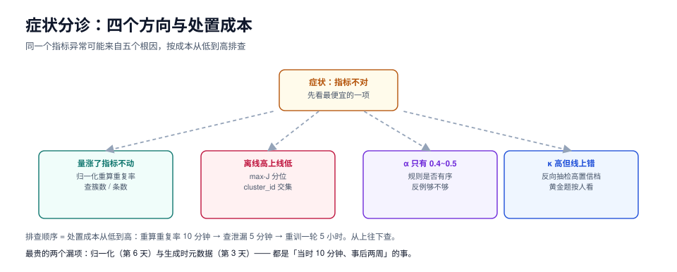

# 常见问题与分诊

本页判据族 `SYF-A` ~ `SYF-H`，共 8 条。

数据工程的问题几乎都以「指标不对」的形式出现，而同一个指标异常可能来自五个完全不同的根因。本页先给一张**按症状查**的分诊表，再回答六个被问得最多的问题，最后是一份开工前必须逐项打勾的自查清单。



## 一、分诊表：从症状到根因

| 症状 | 最可能的原因 | 先做什么 | 去哪个页 |
| --- | --- | --- | --- |
| 数据量翻了倍，指标一动不动 | 合成产物高度同质（模板/同提示词） | 归一化后重算重复率与簇数 | [合成策略](../Generation/index.md) |
| 去重脚本一直报 0 重复 | 没做 ID/数字归一化 | 加 `normalise()` 再跑 | [合成策略](../Generation/index.md) |
| distinct-n 正常但模型学不到新东西 | 同义改写堆叠（广度演化陷阱） | 算「簇数 / 条数」 | [覆盖与多样性](../Diversity/index.md) |
| 离线指标很高，上线就掉 | 训练-测试泄漏 | 算 max-J 分位、查 `cluster_id` 交集 | [去重与泄漏](../Dedup/index.md) |
| 一致性 α 只有 0.4~0.5 | 规范缺一条规则，或标签分布极偏 | 逐条看分歧样本；查正类流行度 | [标注规范](../Guideline/index.md) / [一致性度量](../Agreement/index.md) |
| κ 很高但线上仍错 | 共谋错误（人和模型错得一样） | 反向抽检高置信高分档 | [质检与抽检](../QC/index.md) |
| 一致性忽高忽低 | 样本量太小，点估计是噪声 | 报区间，不比点估计 | [一致性度量](../Agreement/index.md) |
| 抽检错误率忽高忽低 | 抽检没有分层，配额随意 | 按层分配配额 | [质检与抽检](../QC/index.md) |
| 某类意图总是标错 | 该类规则有歧义或样本太少 | 重写规则 + 定向补样本 | [标注规范](../Guideline/index.md) |
| 弃权率为 0 | 标注员在硬猜（没有弃权选项或不敢用） | 显式加 `UNKNOWN` 并说明允许 | [标注规范](../Guideline/index.md) |
| 两周后说不清这批数据哪来的 | 生成时没写元数据 | 只能整批重造（教训） | [版本化](../Versioning/index.md) |
| 回滚时发现数据没了 | 只存了 manifest，没存字节 | 立刻改全量/增量快照 | [版本化](../Versioning/index.md) |

::: tip 分诊的原则
**先查「最便宜的那一项」**。归一化重算重复率 10 分钟，查泄漏 5 分钟，重训一轮 5 小时。上表按「处置成本」从低到高排列，从上往下查，多数问题在前三行就能定位。
:::

## 二、六个高频问题

### Q1：合成数据到底能不能用？

能用，但要满足三个条件：**① 去重（归一化后）② 有真实数据配额 ③ 有验证器**。三者缺一，合成数据会以「指标涨了但线上没变」的方式白花钱。

一个可判定的说法：如果合成数据在**验收集（纯真实样本）**上带来的提升 ≥ 真实数据同等条数提升的 50%，它就值得用；低于 30% 就别造了，去捞真实数据。

### Q2：到底需要多少条？

按「每类 ≥ 700 条 + 弃权 ≥ 1,000 条」这个量级起步比较稳，但更本质的算法是：

```text
需要的条数 ≈ 类别数 × 每类最低条数 × (1 + 预期返工率)
每类最低条数 ≈ 该类的内部变体数 × 5
```

「内部变体数」指同一意图下表达方式的种类数（比如「催发货」有「什么时候发」「还没发」「催一下」等 10 种说法），乘以 5 是为了让模型见到足够多的组合。**12 类 × 10 变体 × 5 = 600 条/类**，这就是 700 这个数的来源。

### Q3：没有预算做双标怎么办？

双标的目的是**估计一致性**，不是「两个人标得更准」。预算不够时可以降级：

| 方案 | 成本 | 能回答什么 | 不能回答什么 |
| --- | --- | --- | --- |
| 全量双标 | 2× | 一致性 + 真值 | — |
| 抽样双标（20%） | 1.2× | 一致性的估计值（带区间） | 单条样本的真值 |
| 单标 + 10% 复核 | 1.1× | 错误率（有偏，只覆盖被复核的层） | 一致性 |
| 单标 + 黄金题 | 1.02× | 走神与作弊 | 规范层面的分歧 |

**最差的选择是「单标 + 不复核」**：它连错误率都估不出来。

### Q4：模型把合成数据「背下来」了怎么办？

三个信号：① 训练 loss 掉得异常低；② 对训练集原文的复述率 > 5%；③ 换一个同义表述就答错。处置顺序是**先去重、再降合成比例、最后才考虑正则化**——多数情况是重复样本太多导致的过拟合，不是模型容量问题。

### Q5：一致性一直上不去（α < 0.5）怎么办？

按这个顺序查，命中率从高到低：

1. **规则有没有序**？（多命中时两个人取不同规则）
2. **每类有没有 3 个反例**？（只有正例时边界全靠猜）
3. **标签是否互斥**？（两个标签语义重叠 → 永远吵）
4. **有没有 `UNKNOWN`**？（不给弃权，标注员只能硬选）
5. **样本本身是否有歧义**？（有些工单确实无法判定，这类应该进 `UNKNOWN` 而不是强行分类）

前四条都是规范问题，第五条是任务问题。**把它们混在一起谈，就会得出「标注员不行」的错误结论。**

### Q6：能不能用大模型直接标注，省掉人工？

可以，但要分清两件事：

| 用法 | 可行性 | 前提 |
| --- | --- | --- |
| 模型标注 + 人工抽检 20% | 可行 | 抽检必须含「模型高置信」档；且要用人工标注算一次 α 作基线 |
| 模型标注 + 人工抽检 2% | 高风险 | 只能用于「错了代价低」的类别 |
| 模型标注不抽检 | 不可行 | 无法估计错误率 |

模型标注的核心风险不是「错」，而是**错得一致**：同一个提示词下，模型对某一类会稳定地错，抽检如果只抽随机样本，很可能一条都抽不到。所以抽检要**按类别分层**，而不是均匀随机。

## 三、开工自查（12 项）

- [ ] 任务卡写明输出可判定，且列了「不做的维度」
- [ ] 分层维度可枚举，每层有配额
- [ ] 种子覆盖所有分层（每层 ≥ 3 条）
- [ ] 规范四段齐全（定义 / 规则 / 边界例 / 裁决）
- [ ] 每条规则有编号 + 正例 + 3 个反例，规则有序
- [ ] schema 是封闭枚举，含 `UNKNOWN`
- [ ] 双标方案定了（全量 / 抽样 / 单标 + 复核）
- [ ] 一致性指标定了（默认 α），且报告要带区间
- [ ] 去重流程含归一化，且会记录归一化前后的重复率差
- [ ] 泄漏判据用分布或簇，不用绝对 n-gram 阈值
- [ ] 合成样本生成时写元数据（model / revision / prompt_sha256）
- [ ] manifest + 数据卡 + 回滚演练排进了计划

十二项里，**第 9 项和第 11 项是最容易漏、也最贵的**：前者决定你的去重是不是白做，后者决定两周后你能不能解释这批数据。

## 四、本页判据

| 编号 | 判据 | 看什么现象 | 不满足时改哪里 |
| --- | --- | --- | --- |
| `SYF-A` | 问题先按「处置成本从低到高」排查 | 排查记录的顺序 | 按第一节的表从上往下 |
| `SYF-B` | 合成数据的效果用「纯真实验收集」衡量 | 验收报告的口径 | 建一个纯真实验收集 |
| `SYF-C` | 条数估算有公式，不是拍脑袋 | 数据计划 | 用 Q2 的三段式 |
| `SYF-D` | 预算不足时降级方案明确，且不选「单标不复核」 | 标注方案 | 见 Q3 的表 |
| `SYF-E` | 「模型背数据」先查重复，再谈正则 | 排查记录 | 回去重跑去重 |
| `SYF-F` | α 低时按「规则有序 → 反例 → 互斥 → 弃权 → 样本歧义」顺序查 | 复盘记录 | 见 Q5 |
| `SYF-G` | 用模型标注时，抽检按类别分层 | 抽检计划 | 改成分层抽检 |
| `SYF-H` | 开工自查 12 项逐项打勾后才开始标注 | 项目启动记录 | 缺项先补 |

## 验证方式

```shell
# 1) 「处置成本从低到高」的排查顺序（每一项都能独立跑）
python3 dedup.py    --input pool.jsonl --normalise --report pairs      # 10 分钟
python3 leak.py     --train train.jsonl --test test.jsonl --ngram 13   # 5 分钟
python3 diversity.py --input pool.jsonl --metrics distinct1,gzip,clusters
python3 agreement.py --input labeled.jsonl --metric krippendorff --bootstrap 400

# 2) 纯真实验收集是否存在（红线三的可执行检查）
jq -r 'select(.source=="real") | .id' eval.jsonl | wc -l
# 期望：>= eval 总条数 × 0.6

# 3) 开工自查是否真的做了（看有没有这四份文件）
ls tasks/*.md guideline-*.md schema.json gold.jsonl
# 期望：四类文件齐全
```

## 参考资料

- 本专题：[总览](../Overview/index.md)、[去重与泄漏](../Dedup/index.md)、[一致性度量](../Agreement/index.md)、[实战](../Practice/index.md)
- *Datasheets for Datasets*：数据卡七问
- 本仓库相邻专题：[评测集设计](../../EvalEngineering/DatasetDesign/index.md)、[大模型微调常见问题](../../FineTuning/FAQ/index.md)、[测试数据与仿真](../../../Tools/TestDataSimulation/index.md)
