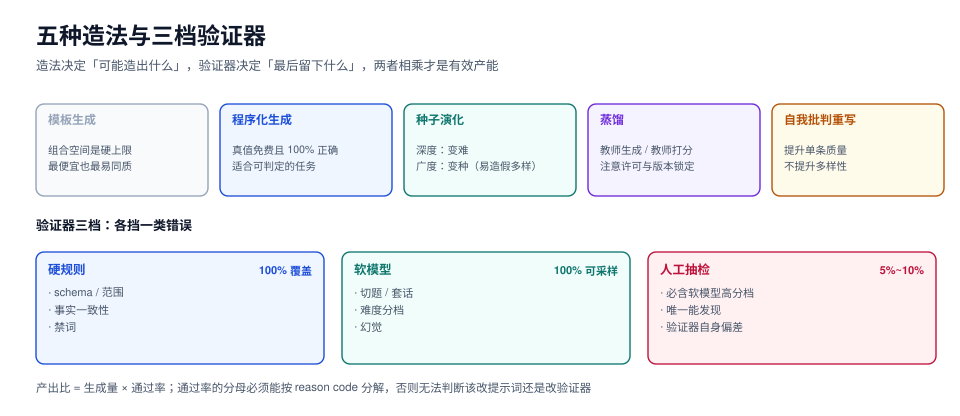

# 合成策略：五种造法与一个验证器

本页判据族 `SYG-A` ~ `SYG-H`，共 8 条。

合成数据的产出比（生成多少条、留下多少条）取决于两件事：**造法选得对不对**，以及**验证器写得够不够狠**。造法决定「可能造出什么」，验证器决定「最后留下什么」，两者相乘才是有效产能。

本页给出五种造法的适用边界、一个可以复跑的反例（模板生成 ± 随机 ID 如何把重复率从 100% 伪装成 0），以及验证器的三档写法。



## 一、五种造法，按「缺什么」选

| 造法 | 一句话 | 适合补什么 | 不适合 | 单条成本量级 |
| --- | --- | --- | --- | --- |
| **模板生成** | 固定骨架 + 槽位填充 | 格式规整的结构化表达（工单、SQL、配置） | 开放性回答 | 极低（纯本地） |
| **程序化生成** | 用模拟器/规则引擎造「有真值」的样本 | 需要精确答案的任务（算术、库存扣减、状态机） | 自然语言多样性 | 低（写模拟器一次性投入） |
| **种子演化** | 对真实种子做深度（变难）/广度（变种）演化 | 长尾、对抗样本、口语变体 | 完全没有种子的新领域 | 中（取决于教师模型） |
| **蒸馏** | 用强模型生成答案（或直接生成样本） | 需要高质量推理链 | 教师本身不会的领域；有许可限制时 | 中高（按 token 计费） |
| **自我批判重写** | 生成 → 按规则自评 → 不合格重写 | 提升单条质量、去除套话 | 提升多样性（同模型重写只会更同质） | 中（1.5~3 倍生成量） |

::: tip 选择的顺序
先问「这个任务的答案能不能用程序算出来」→ 能，用**程序化生成**（真值免费且 100% 正确）；不能，再问「有没有真实种子」→ 有，用**种子演化**；没有，才用**蒸馏**从零造。**模板是兜底，不是首选**——它最便宜，也最容易造出「看起来很多、其实只有 12 种」的数据。
:::

## 二、反例实测：随机 ID 如何把 100% 重复伪装成 0

这是本专题最重要的一个读数，因为它解释了「为什么很多团队的去重脚本一直报 0 重复」。

实验设置：一个三槽位模板，生成 1,000 条客服工单样本。

```text
模板：订单{n}的客户在{t}来电，{a}，请给出处理建议。
槽位：n = 8 位随机订单号（10,000,000~99,999,999）
      t ∈ {今天, 昨天}
      a ∈ {申请取消, 申请退款, 催发货, 要求改地址, 投诉物流, 询问发票}
语义组合数 = 2 × 6 = 12，样本数 = 1,000
```

对 1,000 条样本两两做 5-gram Jaccard（499,500 对），阈值 0.8：

| 指纹方式 | J ≥ 0.8 的对数 | 占全部对的比例 | 结论 |
| --- | --- | --- | --- |
| 原始文本直接指纹 | **0** | 0.000% | 「一条重复都没有」 |
| 先归一化 ID / 数字再指纹 | **41,396** | **8.287%** | 语义上只有 12 种，近 100% 重复 |

归一化只需要两行正则：

```python
import re

def normalise(text: str) -> str:
    text = re.sub(r"\d{6,}", "<ID>", text)   # 订单号、流水号、手机号
    text = re.sub(r"\d+", "<N>", text)       # 其余数字
    return text
```

::: danger 这条反例的三层含义
1. **随机 ID 是「假多样性」的最大来源。** 8 位随机数字在字符 5-gram 里占 8 个位置，足以把任意两条同模板样本的 Jaccard 压到 0.8 以下。凡是「编号 / 时间戳 / UUID / 金额」出现在正文里的任务，不归一化就等于没去重。
2. **去重必须在归一化之后做，且归一化规则要跟训练时的「模型看到的文本」一致。** 如果训练时模型看到的是原始 ID，那「语义重复」依然是重复——它只是学会了「忽略 ID」，样本多样性并没有增加。
3. **组合空间是硬上限。** 上面的例子有 12 种组合、生成 1,000 条，无论用多强的模型改写，实质多样性的天花板就是 12。**判断一个模板能造多少条，先算组合数，再算要不要加维度。**

对照：把槽位扩到 7 个（客户类型 4 × 时间 3 × 渠道 4 × 场景 4 × 诉求 6 × 历史联系次数 4 = **4,608 种组合**），同样 1,000 条样本，J ≥ 0.8 的对数是 **728 对（0.146%）**——重复率下降了两个数量级，但它仍然是「模板产物」：`distinct_chars` 只有 81 个字符，任何真实语料都在千级以上。
:::

## 三、同一个指标在真实语料上的对照

把同一套 5-gram + Jaccard 0.8 的流程，跑在本仓库 **2,219 篇真实 Markdown（783.7 万字符）**上：

| 指标 | 读数 |
| --- | --- |
| 真实文档数 | 2,219 |
| 每篇平均 shingle 数 | 2,945（中位 2,695，最大 43,473） |
| 暴力两两比较的对数 | 2,460,871 |
| 底部 8 个 shingle 建倒排后的候选对 | **46,039（1.87%）** |
| 候选对里 J ≥ 0.8 的 | **3 对**（3 组、每组 2 篇，最大簇 2 篇） |
| 这 3 对的 J | 均值 0.8961，最小 0.8541 |

三对重复的形态很典型，值得单独看一眼：

- `SpringCloud2020/Alibaba` 与 `SpringCloud2022/Alibaba`（同一文档的两个版本目录）
- `SpringCloud2020/Overview` 与 `SpringCloud2022/Overview`
- `fastify/Deployment` 与 `hapi/Deployment`（同一份部署说明换了框架名）

**这三种形态正好对应合成数据里最常见的三种伪重复**：版本复制、换名复制、模板复制。它们的共同点是「语义完全一致、字面略有差异」，也是 MinHash 唯一能抓、distinct-n 与压缩率都抓不到的那一类（见[多样性](Diversity/index.md)）。

::: warning 候选率 1.87% 的意义
2,460,871 对里只有 46,039（1.87%）需要做精确 Jaccard，这决定了去重能不能在「一万条」规模上跑得动：全量比较是 O(n²)，倒排 + 候选是 O(n) 建索引 + O(候选)。一万条时全量比较是 5,000 万对，按本机实测的候选率折算约 93 万对——仍然可行，但**十万条时全量比较就不可行了**（50 亿对），必须上 LSH 分带。
:::

## 四、种子演化：两个轴，两种代价

种子演化是「用少量真实样本撬动大量合成样本」的主力手段。

| 轴 | 做什么 | 例子 | 每条成本 | 风险 |
| --- | --- | --- | --- | --- |
| **深度演化** | 让同一条种子变难：加约束、加干扰、要求多步 | 「退这笔款」→「退这笔款，但其中一件已发货，且用户用了优惠券」 | 高（要保证新约束下答案仍可判定） | 造出「无解」的题 |
| **广度演化** | 让同一条种子变种：换说法、换角色、换渠道 | 「申请退款」→「我不想要了，钱退我」 | 低 | 变成同义句堆叠，多样性是假的 |

::: danger 广度演化的陷阱：同义句不是新样本
把「申请退款」改写成 50 种说法，模型学到的是「这 50 种说法都对应退款」——这是**同一个标签的 50 个表面形式**，对提升泛化几乎无用，但会显著抬高「数据量」这个指标。

判断方法：对演化产物做一次聚类（J ≥ 0.8），如果 50 条落在同一个簇里，说明你只造了 1 条。**广度演化的验收指标是「聚类后的簇数」，不是「条数」。**
:::

## 五、验证器：三档，缺一档就会漏

| 档位 | 谁来判断 | 判什么 | 覆盖比例 | 单条成本 |
| --- | --- | --- | --- | --- |
| **硬规则** | 代码 | schema、字段范围、事实一致性（金额/日期/ID 存在性）、禁词 | 100% | 微秒级 |
| **软模型** | LLM 打分或分类 | 是否切题、是否套话、是否有幻觉、难度分档 | 100%（可采样） | 毫秒~秒级 |
| **人工抽检** | 人 | 正确性、可用性、边界合理性 | 5%~10%，**必含软模型判为高分的样本** | 分钟级 |

三档的分工不是「层层加严」，而是**各挡一类错误**：

- 硬规则挡「格式对但内容不可能」（金额为负、时间倒流、引用了不存在的订单号）；
- 软模型挡「格式对、内容也像，但答非所问」；
- 人工挡「前两档都觉得好，其实不能用」——这一档的比例最低但最不能省，因为它是唯一能发现「验证器本身有系统性偏差」的手段。

### 淘汰原因必须分类计数

```python
REASONS = {
    "E_SCHEMA": "字段缺失/类型不符",
    "E_FACT": "与给定事实矛盾（金额、日期、ID）",
    "E_DUP": "归一化后与已有样本 J ≥ 0.8",
    "E_OFFTOPIC": "软模型判定不切题（score < 0.6）",
    "E_TOOEASY": "难度分档过低（与种子 J ≥ 0.95 且无新约束）",
    "E_UNSAFE": "命中禁词或敏感模式",
}
```

只留一个「淘汰 62%」的总数，等于放弃了诊断能力：你不知道该改提示词、改验证器，还是改任务定义。**有效产能 = 生成量 × 通过率，而通过率的分母必须可分解。**

## 六、蒸馏：两种用法与一条合规红线

| 用法 | 做法 | 用途 | 注意 |
| --- | --- | --- | --- |
| **教师生成** | 直接把强模型的输出当样本 | 冷启动、造推理链 | 必须去重 + 事实校验；教师的口头禅会被批量复制 |
| **教师打分** | 教师只做「合格/不合格」或排序 | 给自造样本做软模型档 | 打分比生成便宜一个量级，且偏差更可控 |

::: danger 蒸馏的三条纪律
1. **不许把「教师能答对」当成「样本正确」。** 教师答对的题可能表述有歧义，模型学到的可能是「猜」。抽样人工复核时，要专门抽教师「很自信」的那一档。
2. **许可条款要看清楚。** 很多商用模型的条款禁止用其输出训练竞品模型。这不是法律建议，但至少要在 manifest 里记下 `generator.license`，否则交付时无法回答「这批数据能不能商用」。
3. **教师版本必须锁死。** `model` 字段只写「gpt-4 类」等于没写——同一家模型隔三个月行为会变，manifest 要记 `revision` 或快照日期。
:::

## 七、防塌缩：三条在造数阶段就能执行的规则

| 规则 | 具体做法 | 可验证指标 |
| --- | --- | --- |
| 真实数据配额 | 每类任务保留纯真实样本，且**不参与训练**，只做验收 | 验收集真实占比 ≥ 60% |
| 去重先于扩增 | 每轮生成后先归一化去重，再进入下一轮 | 簇数 / 条数 ≥ 0.7（同一批内） |
| 难度分档 | 按「与种子的 Jaccard」和「约束条数」分三档，各档配额固定 | 三档条数比例写入 manifest |

第三档最容易漏：**只造简单变体，模型的错误会从「不会」变成「会但脆弱」**，表现是离线指标很好、线上遇到稍复杂的输入就崩。

## 八、本页判据

| 编号 | 判据 | 看什么现象 | 不满足时改哪里 |
| --- | --- | --- | --- |
| `SYG-A` | 造法选择有理由，且与「缺什么」对应 | 生成方案里有造法对照表 | 按第一节的矩阵重选 |
| `SYG-B` | 模板类造法算过**组合空间**，且组合数 ≫ 目标条数 | 方案里有一个乘法算式 | 加维度或改用演化/蒸馏 |
| `SYG-C` | 去重前做了 ID/数字归一化 | 指纹代码里有 `normalise()` | 补；否则重复率永远是 0 |
| `SYG-D` | 验证器三档齐全，且人工抽检包含软模型高分档 | 验证器清单 | 补人工档的高分抽样 |
| `SYG-E` | 淘汰原因按 reason code 分类计数 | 过滤报告有原因维度 | 给每条规则一个 code |
| `SYG-F` | 有效产能 = 生成量 × 通过率，且通过率可分解 | 日报里有这两个数 | 补通过率的分母 |
| `SYG-G` | 合成样本带 `generator.model/revision/prompt_sha256/license` | 抽样看元数据 | 生成阶段落库 |
| `SYG-H` | 有真实数据配额，且验收集真实占比有下限 | manifest 里的 source 分布 | 见[总览](../Overview/index.md)红线三 |

## 验证方式

```shell
# 1) 复跑「随机 ID 掩盖重复」的实验（纯标准库，约 20 秒）
python3 - <<'PY'
import random, re, itertools, hashlib
random.seed(42)
def sh(t, k=5): return {hashlib.blake2b(t[i:i+k].encode(), digest_size=8).digest() for i in range(len(t)-k+1)}
def jac(a, b):
    i = len(a & b); return i / (len(a) + len(b) - i)
def norm(t):
    t = re.sub(r"\d{6,}", "<ID>", t); return re.sub(r"\d+", "<N>", t)
acts = ["申请取消","申请退款","催发货","要求改地址","投诉物流","询问发票"]
tpl = "订单{n}的客户在{t}来电，{a}，请给出处理建议。"
data = [tpl.format(n=random.randint(10**7, 10**8-1), t=random.choice(["今天","昨天"]), a=random.choice(acts)) for _ in range(1000)]
for label, fn in (("原始文本", lambda x: x), ("归一化后", norm)):
    sets = [sh(fn(d)) for d in data]
    dup = sum(1 for a, b in itertools.combinations(range(1000), 2) if jac(sets[a], sets[b]) >= 0.8)
    print(f"{label}: dup_pairs={dup}")
PY
# 期望输出：原始文本: dup_pairs=0 / 归一化后: dup_pairs=41396

# 2) 你手上的数据：先算组合空间
#    把模板的每个槽位取值个数乘起来，与目标条数比较；比值 < 3 就必须加维度。

# 3) 去重后再看簇数（而不是条数）
#    python3 dedup.py --input pool.jsonl --threshold 0.8 --report clusters
#    期望：报告里的 clusters 不小于 目标条数 × 0.7，否则这条流水线在造同义句
```

## 参考资料

- Self-Instruct（arXiv 2212.10560）：种子 → 生成 → 过滤的三段式
- WizardLM / Evol-Instruct：深度演化与广度演化的原始定义
- *Text Generation from Templates*（模板生成的多样性上限讨论）
- 本仓库相邻专题：[覆盖与多样性](../Diversity/index.md)、[去重与泄漏](../Dedup/index.md)、[大模型微调](../FineTuning/index.md)
