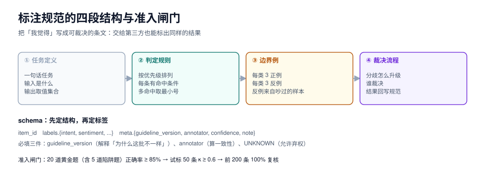

# 标注规范：把「我觉得」写成可裁决的条文

本页判据族 `SYU-A` ~ `SYU-H`，共 8 条。

标注规范不是「给标注员看的说明文档」，而是**一份可以被第三方复算的判定程序**。判断标准很朴素：把规范交给一个没参与讨论的人，他标出来的结果与老标注员的一致率，应该和两个老标注员之间的一致率差不多。做不到，规范就还没写完。

本页给出规范的四段结构、三类歧义的解法、schema 与导出格式、以及「新标注员准入」的可执行门槛。



## 一、规范的四段结构

| 段落 | 内容 | 缺了会怎样 |
| --- | --- | --- |
| **① 任务定义** | 一句话任务 + 输入是什么 + 输出是什么（取值集合） | 标注员各自理解任务 |
| **② 判定规则** | 按优先级排列的条文，每条给出「命中条件」 | 边界样本靠猜 |
| **③ 边界例** | 每类至少 3 个正例 + 3 个反例，**含「看起来像但不算」的** | 边界样本标错且一致（最危险） |
| **④ 裁决流程** | 分歧怎么升级、谁裁决、裁决结果怎么回写规范 | 分歧被投票掉，规范永远不改进 |

::: danger 最常见的写法错误
**把「定义」当成「规则」。** 「判断是否为投诉：用户表达不满即为投诉」是定义；「用户表达不满，且明确要求处理/赔偿/解释，且对象是平台或商家，判为投诉；仅表达情绪无诉求的判为反馈」才是规则。定义只能划出大方向，规则才能让两个人得出同一个答案。
:::

## 二、三类歧义，三种解法

| 歧义类型 | 现象 | 解法 | 落地形式 |
| --- | --- | --- | --- |
| **定义歧义** | 两个人对「这个标签是什么意思」理解不同 | 给每个标签写「是 / 不是 / 边界」三组例子 | 规范第 ③ 段 |
| **边界歧义** | 同一条样本落在两个标签的交界 | 写**优先级**：`A > B > C`，并给一条「同时满足时取 A」的例子 | 规范第 ② 段的条文顺序 |
| **优先级歧义** | 一条样本同时命中两条规则 | 规则必须**有序**，标注员按顺序取第一条命中 | 条文编号即优先级 |

第三条最容易被忽略。规范里写「以下情况判为退款：① 用户明确要求退款 ② 订单超时未发货 ③ 商品破损」，如果一条样本同时满足 ①②③，标注员可能标 ①，也可能标 ③。**规则有序 + 一条「多命中取最小号」的总则**，就能把这类分歧降到零。

## 三、条文怎么写：一张四列表

规范正文建议直接用表格，每一行是一条可裁决的条文：

| 编号 | 条文（命中条件） | 正例 | 反例（看起来像但不算） |
| --- | --- | --- | --- |
| `R-01` | 用户明确使用「退 / 退款 / 退钱 / 不要了」等表述，且指向已支付订单 | 「这单我不要了，钱退我」 | 「这个价格能退吗」（询价，未决策） |
| `R-02` | 订单超过承诺时效未发货，用户要求「催 / 什么时候发」 | 「下单三天了还没发」 | 「发什么快递」（物流咨询） |
| `R-03` | 商品描述与实物不符，用户要求换货或赔偿 | 「图片是纯棉，收到是化纤」 | 「颜色和图片有点不一样」（主观色差，无诉求） |
| `R-04` | 仅表达情绪、无具体诉求 | 「太失望了」 | 「太失望了，退款」（命中 R-01，按优先级取 R-01） |

反例列比正例列更重要：**正例告诉标注员「找什么」，反例告诉标注员「别被什么骗」**。每类标签至少 3 个反例，且反例要来自真实的分歧样本（第一批标注里吵过的那几条）。

## 四、schema：先定结构，再定标签

```json
{
  "item_id": "it000123",
  "text": "下单三天了还没发，什么时候能发？",
  "labels": {
    "intent": "URGE_SHIPMENT",
    "sentiment": "NEGATIVE",
    "contains_pii": false
  },
  "meta": {
    "guideline_version": "1.2.0",
    "annotator": "a07",
    "annotated_at": "2026-10-21T14:03:11+08:00",
    "confidence": 0.85,
    "note": "用户未要求退款，仅催发货"
  }
}
```

| 字段 | 必填 | 说明 |
| --- | --- | --- |
| `item_id` | 是 | 全局唯一，**不要用行号**（重排就乱） |
| `labels.*` | 是 | 每个维度一个键，取值必须在 schema 枚举内 |
| `guideline_version` | 是 | 缺了就无法解释「为什么这批标得不一样」 |
| `annotator` | 是 | 双标与一致性计算的前提 |
| `confidence` | 否 | 自评置信度，可用于抽检分层（低置信优先抽） |
| `note` | 否 | 分歧与边界样本必须写理由 |

::: tip 弃权选项要显式存在
schema 里要有 `UNKNOWN`（或 `ABSTAIN`），并规定「什么时候允许弃权」。没有弃权选项时，标注员在不确定时会**随便选一个**——这会污染一致性指标（看起来一致，其实是随机噪声被平均掉了）。允许弃权后，弃权率本身就是一个有用的信号：某一类弃权率 > 15%，说明规范里那一条写得不清楚。
:::

### 导出格式与校验

导出一律用 JSONL（一行一条），并在入库前做一次全量校验。本机实测这个校验的开销可以忽略：

| 项目 | 读数 |
| --- | --- |
| 记录数 | 50,000 |
| 全量字段校验（键白名单 + 类型 + 范围 + 主键去重） | **52 ms（967,044 条/秒）** |
| JSONL 体积 | 3.72 MiB |
| 违规条数 | 0 |

```python
import json

ALLOWED = {"item_id", "text", "labels", "meta"}

def validate(rec: dict, seen: set) -> list[str]:
    errs = []
    if set(rec) - ALLOWED:
        errs.append("E_EXTRA_KEY")
    key = (rec["item_id"], rec["meta"]["annotator"])
    if key in seen:
        errs.append("E_DUP_ANNOTATION")
    seen.add(key)
    if not 0 <= rec["meta"].get("confidence", 0) <= 1:
        errs.append("E_CONFIDENCE_RANGE")
    return errs
```

## 五、培训与准入：20 道黄金题

新标注员上线前必须过一道门槛，否则前 500 条基本是废的。

| 步骤 | 做法 | 通过标准 |
| --- | --- | --- |
| ① 读规范 | 30 分钟，含 3 个边界案例讨论 | — |
| ② 黄金题 | 20 道**已有标准答案**的题（含 5 道陷阱题） | 正确率 ≥ 85% |
| ③ 试标 | 50 条真实样本，与老手双标 | Cohen's κ ≥ 0.6 |
| ④ 复核 | 逐条看分歧，讲清依据 | 分歧 ≤ 10 条 |
| ⑤ 上线 | 前 200 条 100% 复核 | 错误率 ≤ 3% |

第二步的「陷阱题」是关键：**故意放 3 道「看起来像 A 其实是 B」的题**。如果一个人全对，可能是背了答案；如果全错，说明他没读反例。这两类都要单独聊一次。

## 六、规范的版本与回溯

规范会改，改了就要回答一个问题：**旧数据要不要重标？**

| 变更类型 | 例子 | 处置 |
| --- | --- | --- |
| 澄清（不改判定） | 把「已支付」写清楚是「支付成功且未退款」 | 不重标，只升版本号 |
| 收紧（原来算，现在不算） | 新增「无具体诉求不算投诉」 | **只重标受影响的样本**（用条文的命中条件反查） |
| 放宽（原来不算，现在算） | 新增一类边界情况 | 只重标「被弃权 + 被标为其它」的样本 |
| 重构（标签体系变了） | 合并两个标签 | 全量重标，且旧版本数据标记 `deprecated` |

::: danger 「全量重标」几乎总是错误的选择
它的成本是 O(全量)，而收益通常只有 O(受影响样本)。正确做法是**用条文反查受影响的样本**：每条条文都能写成一个可执行的过滤条件（关键词 + 结构条件），先跑一遍圈出候选，再人工确认。经验上「收紧一条规则」影响的是 3%~8% 的样本，全量重标是 20 倍的成本。
:::

## 七、本页判据

| 编号 | 判据 | 看什么现象 | 不满足时改哪里 |
| --- | --- | --- | --- |
| `SYU-A` | 规范四段齐全（定义 / 规则 / 边界例 / 裁决） | 规范目录 | 缺哪段补哪段 |
| `SYU-B` | 每条规则有编号、命中条件、正例、反例 | 规则表四列齐全 | 补反例（优先用吵过的样本） |
| `SYU-C` | 规则**有序**，且有「多命中取最小号」的总则 | 规则表有编号顺序 | 加总则 |
| `SYU-D` | schema 每个维度取值是封闭枚举，含 `UNKNOWN` | schema 定义 | 加弃权项与弃权规则 |
| `SYU-E` | 导出记录带 `guideline_version` 与 `annotator` | 抽样看字段 | 补字段（事后补不回来） |
| `SYU-F` | 入库前有全量校验（键白名单 / 类型 / 主键去重） | 校验脚本与日志 | 见第四节的 `validate()` |
| `SYU-G` | 新标注员有黄金题 + 双标 κ ≥ 0.6 的准入 | 准入记录 | 见第五节 |
| `SYU-H` | 规范变更分级处理，只重标受影响样本 | 变更记录里有影响面估算 | 用条文反查，别全量重标 |

## 验证方式

```shell
# 1) 规范是否「可裁决」：找 3 个没参与讨论的人，各标 30 条
#    计算三人与「标准答案」的一致率，任一人 < 80% → 规范第 ② 段有问题

# 2) schema 校验（本机实测 5 万条 52 ms）
python3 - <<'PY'
import json, time
ALLOWED = {"item_id", "text", "labels", "meta"}
recs = [json.loads(l) for l in open("data/annotations.jsonl", encoding="utf-8")]
t0 = time.time(); seen = set(); bad = 0
for r in recs:
    if set(r) - ALLOWED: bad += 1
    key = (r["item_id"], r["meta"]["annotator"])
    if key in seen: bad += 1
    seen.add(key)
print(f"records={len(recs)} bad={bad} {(time.time()-t0)*1000:.0f}ms")
PY
# 期望：bad=0，耗时在几十毫秒量级

# 3) 弃权率按标签统计：>15% 的标签说明条文不清楚
jq -r '.labels.intent' data/annotations.jsonl | sort | uniq -c | sort -nr | head

# 4) 版本覆盖：不允许出现「同一批数据两个 guideline_version」
jq -r '.meta.guideline_version' data/annotations.jsonl | sort | uniq -c
```

## 参考资料

- *Datasheets for Datasets*：标注来源与流程的必填项
- *Annotation Guidelines for Natural Language Processing*（规范写法的实践总结）
- Cohen's κ（1960）：两人一致性的原始定义，见[一致性度量](../Agreement/index.md)
- 本仓库相邻专题：[一致性度量](../Agreement/index.md)、[质检与抽检](../QC/index.md)、[人工对齐](../../EvalEngineering/HumanAlignment/index.md)
