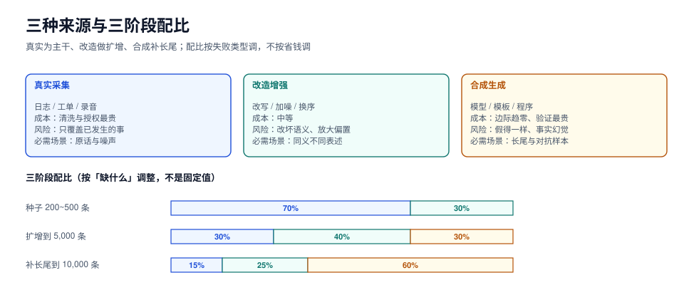

# 总览：三种来源、四类失败与三条红线

本页判据族 `SYN-A` ~ `SYN-H`，共 8 条。

「数据不够」通常不是「数量不够」，而是**「某一种情况下的例子不够」**。所以造数据之前要先回答：缺的是哪一种？如果答不上来，造出来的东西会全部落在已有的分布里，数量翻了十倍、效果一动不动。

本页给出一张来源地图、四类失败的判别表、三条不可谈判的红线，以及一条六步流水线。后面每一章都落在这张图的某一格上。



## 一、三种来源，三种成本结构

| 来源 | 怎么来 | 单条成本 | 主要风险 | 什么时候必须用它 |
| --- | --- | --- | --- | --- |
| **真实采集** | 日志、工单、录音、页面 | 采集近乎免费，**清洗与授权最贵** | 分布偏（只覆盖已发生的事）、隐私 | 需要「真实用户怎么说」的原话、需要真实的噪声与错别字 |
| **合成生成** | 用模型/模板/程序造 | 边际成本趋零，**验证成本最高** | 模式塌缩（假得一样）、事实幻觉 | 缺长尾、缺对抗样本、缺「标准答案明确」的推理链 |
| **改造增强** | 对真实样本做改写、加噪、换序、翻译 | 中等 | 改坏语义、放大原样本的偏差 | 已有真实样本但需要更多「同义不同表述」 |

三种来源不是互斥的，本专题推荐的配比是**真实为主干、改造做扩增、合成补长尾**：

| 阶段 | 真实 | 改造 | 合成 |
| --- | --- | --- | --- |
| 种子（第一批 200~500 条） | 70% | 30% | 0% |
| 扩增（到 5,000 条） | 30% | 40% | 30% |
| 补长尾（到 10,000 条） | 15% | 25% | **60%** |

::: danger 三个关于「配比」的想当然
1. **「合成比例越高越省钱」**。省的是生成费，花的是验证费与返工费。经验上一条合成样本要过 2~3 道自动校验 + 5%~10% 人工抽检，折下来并不比改造便宜多少。
2. **「真实数据一定更好」**。真实数据带着采集时的偏置，而且**没有标准答案**——你仍然要标注，标注成本一分不少。
3. **「配比是个固定值」**。配比是**按任务的失败类型**定的：如果模型错在「边界条件」，就要提高合成的对抗样本比例；如果错在「口语表达」，合成帮不上忙，得去捞真实语料。
:::

## 二、四类失败，每一种都有自己的检测手段

数据工程的失败几乎不会以「报错」的形式出现。它们以「指标涨了但线上没变」「评测很好线上很糟」的形式出现。

| 失败 | 现象 | 根因 | 检测手段 | 对应章节 |
| --- | --- | --- | --- | --- |
| **假得一样** | 数据量翻倍、指标不动 | 同一模板/模型/提示词生成的样本高度同质 | MinHash 近重复 + 三个多样性指标交叉 | [去重](Dedup/index.md) / [多样性](Diversity/index.md) |
| **一致地标错** | 一致性指标很高、模型学错了 | 标注规范本身有歧义，所有人按同一个错误理解标 | 黄金题 + 反向抽检 + 与真实分布对照 | [标注规范](Guideline/index.md) / [质检](QC/index.md) |
| **训练-测试泄漏** | 离线指标虚高、上线即掉 | 同源样本同时进了训练与评测 | 13-gram 重叠率分布 + 聚类去重 | [去重与泄漏](Dedup/index.md) |
| **分布错位** | 离线好、线上差，且差在特定人群/场景 | 造数据时按「容易造」采样，不是按「线上会遇到」采样 | 线上样本回放 + 分层覆盖率 | [多样性](Diversity/index.md) |

四类里最难发现的是**「一致地标错」**：它同时骗过一致性指标和人工复核，因为复核的人和标注的人共享同一个错误理解。

本机实测过一个能说明问题的最小例子（语料来自本仓库 2,219 篇文档）：

```text
流行度 50% 时：原始一致率 75.0%，Cohen's κ 0.667
流行度 95% 时：原始一致率 80.3%，Cohen's κ 0.281
```

第二行是**原始一致率更高、κ 更低**——因为大部分样本都是同一个标签，「都标成多数类」就能拿到 80% 的一致率。详见[一致性度量](Agreement/index.md)。

## 三、三条红线

这三条不是「最佳实践」，是**一旦破了就没法补救**的三件事。

### 红线一：每一条合成样本必须可追溯到「哪个模型、哪个提示词、哪一版」

不可追溯的合成数据在出问题时无法定位：你不知道该重跑哪一批、该删哪一批、该向谁解释。落地要求只有一条——**生成时就写进元数据**，别等事后补。

```json
{
  "id": "syn-000123",
  "text": "订单支付成功后 30 分钟未发货，用户要求取消，应如何回复？",
  "source": "synthetic",
  "generator": { "model": "internal-gen-7b", "revision": "2026-09-14", "prompt_id": "p-cancel-03", "prompt_sha256": "9f2c…" },
  "seed_id": "real-000871",
  "verified_by": ["rule:amount-consistency", "llm:judge-v3"],
  "created_at": "2026-10-20T11:02:31+08:00"
}
```

### 红线二：验证器先于生成器

先写「怎么判断这条数据是合格的」，再写「怎么造」。反过来做，你会得到一万条「看起来像」的数据，然后花两周讨论它们哪里不对。

一条可用的验证器至少要有**三档**：硬规则（能自动判死的，如 JSON schema、字段范围、事实一致性）、软模型（LLM 打分，带阈值与抽样复核）、人工抽检（按比例，且**抽检样本要包含模型判为「高分」的那一档**）。

### 红线三：真实数据配额写进合同式的判据

无论合成比例多高，**每一类任务都要保留一批纯真实样本**，且这批样本只用于验收、不参与训练。理由不是「更真」，而是当合成数据把模型带偏时，只有这批样本能告诉你偏了多少。

::: tip 一个可执行的配额写法
「每一类任务，验收集里真实样本占比 ≥ 60%，且验收集与训练集的重叠率（13-gram 级别）≤ 1%。」这两条都能用脚本算，见[去重与泄漏](Dedup/index.md)的验证节。
:::

## 四、六步流水线

| 步骤 | 产出 | 这一步骤唯一不能错的事 | 常见跳过后果 |
| --- | --- | --- | --- |
| ① 任务卡 | 一句话任务 + 输入/输出 schema + 3 个正例 3 个反例 | 输出必须是**可判定的**（能写出对错判据） | 标到一半发现「这个任务没有标准答案」 |
| ② 种子 | 200~500 条真实样本 + 分层标签 | 种子要覆盖**所有已知分层**，哪怕每层只有 3 条 | 扩增后长尾彻底消失 |
| ③ 生成/改造 | 候选池（通常是目标量的 1.5~3 倍） | 每条带完整元数据 | 出问题无法定位批次 |
| ④ 过滤/验证 | 合格池 + 淘汰原因统计 | 淘汰原因要分类计数，不能只留一个总数 | 不知道是「生成差」还是「验证器太严」 |
| ⑤ 标注 | 带标注的数据 + 一致性报告 | 双标 + 裁决的样本要留痕 | 无法复算一致性 |
| ⑥ 验收与版本 | manifest + 数据卡 + 快照 | 快照可回滚、manifest 可复算 | 两周后没人知道这批数据是哪个版本 |

六步里最容易被压缩的是 ④ 和 ⑥——它们不产生「新数据」，所以在赶进度时最先被砍。而**四类失败里有三类要靠这两步才能被发现**。

## 五、成本账：返工比标注贵

一个常被忽略的算术：标注 1 万条的单价如果是 3 元/条，总价 3 万元；如果标注规范有歧义导致 30% 需要返工，返工成本不是 0.9 万元，而是 **0.9 万元的标注费 + 重新拉齐理解的时间 + 已经训完一轮的算力**。

| 项目 | 单价 | 数量 | 小计 |
| --- | --- | --- | --- |
| 双标（两人各标一遍） | 3 元/条 | 10,000 | 30,000 元 |
| 裁决（分歧样本 20%） | 6 元/条 | 2,000 | 12,000 元 |
| 抽检（10%，含黄金题） | 8 元/条 | 1,000 | 8,000 元 |
| **规范返工（30% 重标）** | 9 元/条 | 3,000 | **27,000 元** |

最后一行不是「额外成本」，是「本可以避免的成本」——它约等于整个标注预算的 40%。[标注规范](Guideline/index.md)那一章就是为了把这 40% 压到 5% 以内。

## 六、本页判据

| 编号 | 判据 | 看什么现象 | 不满足时改哪里 |
| --- | --- | --- | --- |
| `SYN-A` | 任务卡写明了**可判定的输出**（能列出对错判据） | 任务卡有「输出 schema + 判定规则」两节 | 补判定规则；写不出来的任务先改任务定义 |
| `SYN-B` | 种子集覆盖了所有已知分层，每层有标签 | 分层表逐行有样本数 | 补种子；某层为 0 就先别扩增 |
| `SYN-C` | 三种来源的配比是按**失败类型**定的，不是拍脑袋 | 有配比表且写明理由 | 按第二节的失败表反推配比 |
| `SYN-D` | 每条合成样本带模型/提示词/种子的可追溯字段 | 抽样看元数据完整率 | 在生成阶段落库，事后补不回来 |
| `SYN-E` | 验证器有硬规则、软模型、人工三档 | 验证器清单三档齐全 | 补最弱的一档（通常是人工抽检的正样本） |
| `SYN-F` | 验收集里真实样本占比有下限并写死 | 验收集统计能算出该比例 | 见第三节红线三 |
| `SYN-G` | 淘汰原因分类计数，不是一个总数 | 过滤报告有原因维度 | 给验证器每条规则一个 reason code |
| `SYN-H` | 交付物含 manifest 与数据卡，且可回滚 | 有版本号与快照路径 | 见[版本化](Versioning/index.md) |

## 验证方式

```shell
# 1) 本次实测的语料规模（读者可在任意 Markdown 语料上复跑）
cd docs-website
python3 - <<'PY'
import pathlib, re
files = list(pathlib.Path('docs').rglob('*.md')) + list(pathlib.Path('project').rglob('*.md'))
docs = []
for f in files:
    t = f.read_text(encoding='utf-8', errors='replace')
    t = re.sub(r'```.*?```', ' ', t, flags=re.S)
    t = re.sub(r'\s+', '', t)
    if len(t) >= 400:
        docs.append(t)
print(f"docs={len(docs)} chars={sum(len(t) for t in docs):,}")
PY
# 期望输出：docs=2219 chars=7,836,960（与本页口径一致）

# 2) 自检：你的数据集有没有「可判定输出」
#    把任务卡里的判定规则抄成 5 条 if 语句，随机取 20 条样本逐条跑，
#    如果 >3 条无法判定 → 任务定义有问题，先别开始标注。

# 3) 三种来源的配比是否落到了元数据里
jq -r '.source' data/*.jsonl | sort | uniq -c
# 期望：三行（real / augmented / synthetic），且比例与配比表一致
```

## 参考资料

- Self-Instruct: *Aligning Language Models with Self-Generated Instructions*（arXiv 2212.10560）
- WizardLM / Evol-Instruct: *Evolving Instructions for Large Language Models*（2023）
- Constitutional AI: *Harmlessness from AI Feedback*（arXiv 2212.08073）
- *Datasheets for Datasets*（Gebru et al., CACM 2021）
- MLCommons **Croissant** 数据集元数据规范
- *AI dataset collapse*（Shumailov et al., Nature 2024）
- 本仓库相邻专题：[大模型微调](../FineTuning/index.md)、[评测集设计](../EvalEngineering/DatasetDesign/index.md)、[测试数据与仿真](../Tools/TestDataSimulation/index.md)
