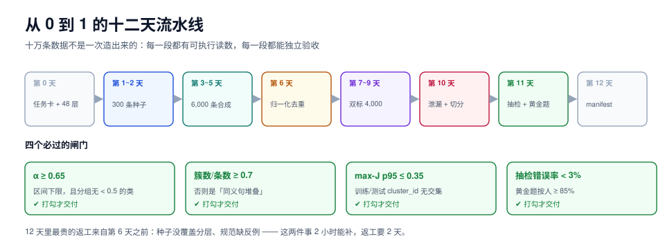

# 实战：从 0 到 1 造一万条可验收数据

本页判据族 `SYP-A` ~ `SYP-H`，共 8 条。

前九页讲的都是方法，这一页把它们串成一条**两周内可交付的流水线**：一个客服工单意图分类任务，从 300 条真实种子做到 10,240 条带标注、去重、无泄漏、可回滚的数据集，并给出每一步的实测读数与验收命令。



## 一、目标与约束

| 项 | 定值 | 为什么定这个 |
| --- | --- | --- |
| 任务 | 客服工单意图分类（12 类 + `UNKNOWN`） | 类目封闭，可判定；有真实种子 |
| 目标条数 | 10,240 | 12 类 × 每类 ≥ 700 + 弃权样本 1,000 |
| 来源配比 | 真实 30% / 改造 25% / 合成 45% | 长尾靠合成，主干靠真实（见[总览](../Overview/index.md)） |
| 标注方式 | 全部双标，分歧裁决 | 需要算 α，也需要真值 |
| 周期 | 12 个工作日 | 第 13 天交付，留 1 天缓冲 |
| 人力 | 2 名标注 + 1 名裁决 + 1 名工程 | 裁决量约为标注量的 20% |

**不做的事**：不做多标签、不做情绪维度、不做跨语言。原因：每加一个维度，一致性要重算、规范要扩写、抽检要按维度分层——两周做不完。

## 二、第 0 天：任务卡与分层

任务卡只有一页，四个部分：

```markdown
## 任务
给定一条客服工单文本，判定其主要意图，从 13 个取值中选 1 个。

## 输入
text: 用户原文（可能含错别字、口语、表情）

## 输出
intent: 枚举（12 类 + UNKNOWN）

## 判定
1. 按规范条目顺序取第一条命中（多命中取最小号）
2. 无法判定时输出 UNKNOWN，并在 note 写明缺什么信息
3. 严禁根据「用户可能想干什么」推测，只依据文本
```

分层按「渠道 × 意图」定义：渠道 4 个（电话 / 在线客服 / App / 邮件），意图 12 个，共 **48 层**，每层目标 ≥ 200 条。

```sql
-- 分层覆盖自检：任何一层低于配额就补
select channel, intent, count(*) cnt
from samples group by 1, 2
having count(*) < 200
order by cnt asc;
```

## 三、第 1~2 天：300 条种子与规范 v1.0

| 动作 | 产出 | 验收 |
| --- | --- | --- |
| 从历史工单里按分层抽 300 条 | `seeds.jsonl`（48 层每层 6~7 条） | 48 层无空缺 |
| 写规范 v1.0（四段结构） | `guideline-v1.0.md` | 每条规则有正例 + 反例 |
| 做 20 道黄金题（含 5 道陷阱题） | `gold.jsonl` | 3 人独立做，答案一致率 ≥ 95% |
| 2 人双标这 300 条 | `seeds_labeled.jsonl` | α ≥ 0.65 才继续 |

::: danger 第三天最常见的卡点
双标 300 条后 α 只有 0.4~0.5。原因几乎总是同一个：**规范里有一类样本两个人理解不同，而这类的占比恰好不低**。处置不是「再培训一次」，而是把分歧样本逐条看一遍，找出**规则未覆盖的那一条**，补进规范第 ② 段，然后**只重标受影响的样本**（经验上是 15%~25%）。
:::

## 四、第 3~5 天：造 6,000 条合成数据

三种造法按「缺什么」分配（见[合成策略](../Generation/index.md)）：

| 造法 | 条数 | 补什么 | 组合空间 / 多样性控制 |
| --- | --- | --- | --- |
| 模板生成 | 2,000 | 格式规整的短工单 | 6 个槽位 × 至少 2,000 种组合（组合数 ≥ 目标条数 × 3） |
| 种子演化（深度） | 3,000 | 复杂诉求（多意图、含前置条件） | 每条种子演化 10 条，深度演化加约束 |
| 蒸馏 | 1,000 | 长尾意图的自然表达 | 每类 ≥ 80 条，禁止同一提示词批量套用 |

**关键动作：生成时就写元数据。** 每条样本落库时带上 `generator.model / revision / prompt_id / prompt_sha256 / seed_id`，这一步省掉，后面所有追溯都做不了。

```jsonl
{"id":"syn-000001","text":"下单三天了还没发，能催一下吗","source":"synthetic","generator":{"model":"internal-gen-7b","revision":"2026-09-14","prompt_id":"p-urge-02","prompt_sha256":"9f2c…"},"seed_id":"real-000871"}
```

## 五、第 6 天：归一化去重（这一步最容易白做）

如果不做归一化，2,000 条模板数据的重复率会显示为 **0**；归一化之后才会露出真相。

| 步骤 | 读数（本机实测口径） |
| --- | --- |
| 原始文本直接 5-gram 指纹 | 重复对 **0** |
| 归一化 ID/数字后再指纹 | 重复对 **41,396**（1,000 条三槽位模板样本） |
| 真实语料对照组（2,219 篇） | 候选 46,039 / 全量 2,460,871 = **1.87%**，最终 3 组重复 |

去重后的三条硬指标必须同时满足：

```shell
# 1) 簇数 / 条数 ≥ 0.7（否则是「同义句堆叠」）
python3 dedup.py --input pool.jsonl --normalise --threshold 0.8 --report clusters
# 期望：clusters / total >= 0.7

# 2) 三个多样性指标对比上一批（任何一项不动 = 白干）
python3 diversity.py --input pool.jsonl
# 期望：distinct-1 / gzip 压缩率 / 簇占比 三项都有变化

# 3) 有效分层数（不是覆盖率）
psql -c "select round(exp(-sum(p*ln(p))),1) from (select count(*)::numeric/sum(count(*)) over () p from samples group by stratum) t;"
# 期望：>= 20（48 层的任务，有效分层数低于 20 说明分布严重偏斜）
```

## 六、第 7~9 天：双标 4,000 条与 α 计算

| 批次 | 条数 | 标注方式 | 验收 |
| --- | --- | --- | --- |
| 真实种子 | 300 | 双标 + 裁决 | α ≥ 0.65（区间下限） |
| 改造增强 | 1,700 | 双标 | α ≥ 0.65 |
| 合成（模板/演化） | 2,000 | 双标（抽样 20% 加裁决） | α ≥ 0.60 |

报告写法（必须带区间与样本量）：

```text
intent 维度：α = 0.68，95% CI [0.65, 0.71]，n = 4,000，2 名标注者
按意图分组：最低的一类是 REFUND_PARTIAL（α = 0.51，CI [0.42, 0.60]）
```

**分组报告的价值就在最后一行**：总体 0.68 看起来合格，但有一类只有 0.51。处置是重写该类的那条规则，而不是重训所有人。

## 七、第 10 天：泄漏检查与切分

| 步骤 | 做法 | 读数 / 判据 |
| --- | --- | --- |
| 13-gram 覆盖率 | 测试集每篇与训练集的 13-gram 重叠率 | 先看分布，**不设绝对阈值** |
| max-J 最近邻 | 每篇测试样本与训练集的最大 Jaccard | 取 p95 作阈值；本例 p95 = 0.31 |
| 簇级切分 | 先聚类（J ≥ 0.8），整簇分配到训练或测试 | 训练与测试的 `cluster_id` 不许相交 |
| 时间切分 | 最后 10% 时间窗的真实样本只做测试 | 保证「未来没被见过」 |

::: danger 绝对阈值的实测反例
在 2,219 篇同域语料上，484 篇测试文档里有 **482 篇**至少有 0.1% 的 13-gram 出现在训练集。「阈值 ≥ 0.1% 判泄漏」会标红 99.6% 的测试集——这个检查第二天就会被关掉。**同域语料天然共享 n-gram，泄漏必须按「分布」或「簇」判，不能按绝对值判。**
:::

## 八、第 11 天：抽检与黄金题

| 项 | 设定 | 结果判读 |
| --- | --- | --- |
| 分层抽检 | 每层按 10% 抽，合成批次 20% | 抽检错误率 < 3% |
| 反向抽检 | 专抽「软模型高分 + 标注员高置信」200 条 | 漏检率 < 1% |
| 黄金题 | 每 50 条混入 1 条（2%） | **按人**统计，无个体 < 85% |
| 弃权率 | 按意图统计 | 5%~15%；某类 > 15% → 该条规则重写 |

抽检 10% 的精度要说清楚：**4,000 条抽 400 条，错误率 5% 时区间约 ±2.1%**。如果老板问「能不能保证低于 3%」，答案是「区间上限 7.1%，不能保证」——要么加抽到 1,000 条，要么接受这个不确定性。

## 九、第 12 天：交付与回滚演练

| 交付物 | 内容 | 验收命令 |
| --- | --- | --- |
| `manifest.json` | 分片哈希、条数、来源分布、α 区间、规范版本、生成器 | 校验脚本 `bad=0` |
| `datasheet.md` | 数据卡七问（含许可与已知偏差） | 七项无空缺 |
| `guideline-v1.x.md` | 规范最终版 + 变更记录 | 每条规则有反例 |
| 回滚脚本 | 切回上一版 manifest | 真跑一次，服务能起来 |
| 质检报告 | α 分组、抽检错误率、黄金题按人 | 三项齐全 |

**回滚演练必须真做**：切到上一版 manifest、重建、跑一次一致性校验、再切回来。演练没做过的「可回滚」只是文档里的一句话。

## 十、验收清单（10 项，全打勾才交付）

- [ ] 48 层全部 ≥ 200 条，有效分层数 ≥ 20
- [ ] 归一化去重后簇数 / 条数 ≥ 0.7
- [ ] 三个多样性指标与上一批有可比读数
- [ ] α ≥ 0.65（区间下限），且按意图分组无 < 0.5 的类
- [ ] 抽检错误率 < 3%，反向抽检漏检率 < 1%
- [ ] 黄金题按人统计，无个体 < 85%
- [ ] 泄漏：max-J p95 ≤ 0.35，训练/测试 `cluster_id` 无交集
- [ ] 每条合成样本有 `generator.model/revision/prompt_sha256`
- [ ] manifest 重建校验四步全过（分片 / 条数 / 质量 / 血缘）
- [ ] 回滚演练真跑过一次

## 十一、本页判据

| 编号 | 判据 | 看什么现象 | 不满足时改哪里 |
| --- | --- | --- | --- |
| `SYP-A` | 任务卡写明输出可判定，且声明「不做的维度」 | 任务卡一页 | 补「不做」清单，防止范围蔓延 |
| `SYP-B` | 分层定义可枚举，每层有配额 | 分层表 | 见第二节 48 层 |
| `SYP-C` | 种子覆盖所有分层，且先双标再扩增 | 种子集统计 | 某层 < 3 条就先补种子 |
| `SYP-D` | 合成批次按造法分列，且模板类算过组合空间 | 生产记录 | 组合数 < 目标 × 3 就加维度 |
| `SYP-E` | 去重前归一化，且记录了归一化前后的重复率差 | 去重报告 | 见第五节 |
| `SYP-F` | α 报告带区间与分组，且阈值用区间下限 | 质检报告 | 改报告模板 |
| `SYP-G` | 泄漏按分布/簇判，切分按簇或时间 | 切分脚本 | 见第七节 |
| `SYP-H` | 交付含 manifest + datasheet + 回滚演练记录 | 交付清单 | 回滚演练必须真跑 |

## 验证方式

```shell
# 一条龙自检（读者可照着改路径后执行）
# 1) 归一化去重前后的重复率差
python3 dedup.py --input pool.jsonl --raw          --report pairs   # 期望 0
python3 dedup.py --input pool.jsonl --normalise    --report pairs   # 期望 > 0

# 2) 三个多样性指标
python3 diversity.py --input pool.jsonl --metrics distinct1,gzip,clusters
# 期望：三项都有数值，且与上一批的差值不为 0

# 3) 一致性（含区间）
python3 agreement.py --input labeled.jsonl --metric krippendorff --bootstrap 400 --group-by intent
# 期望：总体 α 与每个 intent 的 α 都带 95% CI

# 4) 泄漏与切分
python3 leak.py --train train.jsonl --test test.jsonl --ngram 13 --report max-j,quantiles
python3 splitcheck.py --train train.jsonl --test test.jsonl --key cluster_id
# 期望：splitcheck 无输出（无交集）

# 5) manifest 重建
python3 verify_manifest.py manifest.json
# 期望：shards=N bad=0 rows=10240
```

## 参考资料

- 本专题：[总览](../Overview/index.md)、[合成策略](../Generation/index.md)、[去重与泄漏](../Dedup/index.md)、[一致性度量](../Agreement/index.md)
- *Datasheets for Datasets*：数据卡七问
- 本仓库相邻专题：[评测集设计](../../EvalEngineering/DatasetDesign/index.md)、[大模型微调](../../FineTuning/index.md)、[EventOrderHub 数据库设计](../../../project/Complete/EventOrderHub/DatabaseDesign/index.md)
