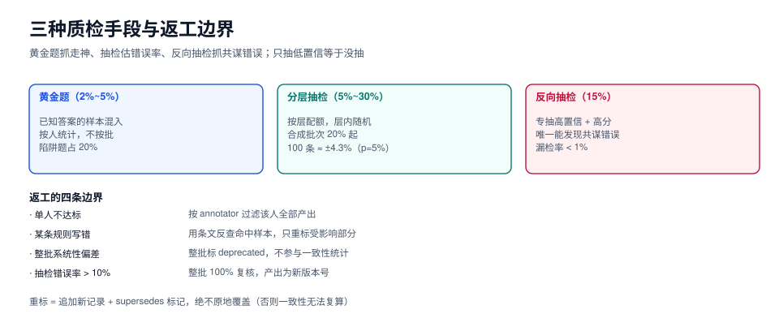

# 质检与抽检：黄金题、陷阱题与返工

本页判据族 `SYQ-A` ~ `SYQ-H`，共 8 条。

质检要回答的不是「这批数据错了几条」，而是**「这批数据能不能用，以及我有多大把握这么说」**。这两句话的差别，就是「抽了 100 条错了 3 条」与「错误率的 95% 区间是 [1.0%, 8.5%]」的差别。

本页给出三种质检手段的分工、抽检比例的算法、返工的边界，以及一个反直觉的结论：**只抽低置信样本的抽检，等于没抽**。



## 一、三种手段，各挡一类错误

| 手段 | 做法 | 能发现 | 不能发现 | 成本占比 |
| --- | --- | --- | --- | --- |
| **黄金题**（金标注入） | 把已知答案的样本混进正常批次 | 标注员走神、理解偏差、作弊 | 规范本身的错误（黄金题的答案也是人定的） | 5% |
| **分层抽检** | 按置信度/标签/来源分层，各抽一定比例 | 错误率的**估计值**、批次间差异 | 极罕见的系统性错误 | 80% |
| **反向抽检** | 专抽「软模型判高分 + 标注员高置信」的样本 | **共谋错误**（人和模型错得一样） | 低频错误 | 15% |

第三种是绝大多数团队缺失的一档，也是「κ 很高但线上很糟」的唯一解释来源。

::: danger 只抽低置信样本 = 自欺
置信度低的样本错误率当然高，抽它们能抓到很多错，但**你得不出总体错误率**——因为你没抽高置信样本，不知道那一档错多少。

一个真实的数量关系：如果低置信样本占 20%、错误率 25%，高置信样本占 80%、错误率 3%，只抽低置信 100 条，你看到的错误率是 25%，会得出「这批数据不能用」的结论；而实际总体错误率是 `0.2×25% + 0.8×3% = 7.4%`。反过来，如果只抽 100 条高置信，你看到 3%，会得出「很好」的结论，漏掉了全部 25% 的低置信错误。

**正确做法：按层分配配额，每层都抽，且层内随机。**
:::

## 二、抽检比例怎么定

抽检比例不是拍脑袋的「10%」，它由三件事决定：**错误的代价**、**批次的来源风险**、**你要的区间宽度**。

| 批次来源 | 基础比例 | 触发加严的条件 | 加严后 |
| --- | --- | --- | --- |
| 真实采集 + 老标注员 | 5% | 上一批错误率 > 3% | 10% |
| 真实采集 + 新标注员（前 200 条） | **100%** | — | — |
| 改造增强 | 8% | 改动幅度 > 30%（字符级） | 15% |
| 合成（已验证） | 10% | 验证器淘汰率 < 30%（可能太松） | 15% |
| 合成（新提示词/新模型） | **20%** | 首轮必抽 100 条以上 | 30% |
| 定向补长尾 | **30%** | 该层真实样本 < 20 条 | 50% |

### 用区间反推样本量

抽检的目的是估计错误率 `p`，其 95% 区间宽度约 `±1.96·√(p(1−p)/n)`：

| 期望精度（±） | p ≈ 5% 时需要的 n | p ≈ 10% 时需要的 n |
| --- | --- | --- |
| ±5% | 73 | 138 |
| ±3% | 203 | 384 |
| ±1% | 1,825 | 3,457 |

**这就是「抽 100 条」的实际精度：错误率 5% 时，区间是 [1.5%, 8.5%]。** 想分辨「这批比上批好 2 个点」，100 条是不够的。

## 三、黄金题：注入的比例与判读

| 参数 | 建议值 | 理由 |
| --- | --- | --- |
| 注入比例 | 2%~5% | 太低发现不了走神，太高标注员会警觉（反而失真） |
| 题目来源 | 已有裁决结论的样本 | 答案必须无争议 |
| 陷阱题占比 | 20%（即总量的 0.4%~1%） | 专门测「有没有读反例」 |
| 判读方式 | **按人**统计，不按批 | 某个人的黄金题正确率 < 85% 就要单独谈话 |

黄金题的正确用法是**按标注员统计**，而不是算一个批次平均分。批次平均 95% 可能掩盖「一个人 60%、四个人 100%」——而那个人产出的数据要么重标，要么整批作废。

## 四、返工：范围、成本与一致性重算

| 情况 | 返工范围 | 一致性怎么处理 |
| --- | --- | --- |
| 单个标注员黄金题不达标 | 该人全部产出（按 `annotator` 过滤） | 用其余标注者重算，被替换的样本记为「重标」 |
| 某条规则被判定写错 | 命中该规则的样本（用条文反查） | 规范升版本，只对受影响样本重算 |
| 整批出现系统性偏差 | 整批 | 旧批次标记 `deprecated`，不参与一致性统计 |
| 抽检错误率 > 10% | 整批 100% 复核 | 复核后的数据作为新批次（新版本号） |

::: warning 「重标」不能覆盖原记录
返工的正确做法是**追加一条新记录并标记 `supersedes`**，而不是原地改。原因有两个：① 一致性指标要用原始标注才能复算；② 当有人问「为什么这 300 条和上一版不一样」时，你需要证据链。
:::

## 五、恶意与敷衍标注的四个信号

| 信号 | 判定规则 | 处置 |
| --- | --- | --- |
| 速度异常 | 单条耗时 < 中位数的 1/5，且持续 50 条以上 | 抽样复核该人产出 |
| 标签单一化 | 某人的标签熵 < 0.3（几乎全选一类） | 强制看黄金题 |
| 黄金题异常 | 正确率 < 85%，或陷阱题全错 | 下线重训 |
| 与多数人系统性反向 | 与其余人的一致率 < 0.2（不是随机，是反向） | 检查是否理解反了某条规则 |

第四条要特别注意：**随机标注的一致率约等于按边际分布算的期望值，而「理解反了」的一致率会更低**。两者处置完全不同——前者是敷衍，后者是规范没讲清楚（要改规范，不是换人）。

## 六、质量指标看板

| 指标 | 定义 | 健康区间 |
| --- | --- | --- |
| 抽检错误率 | 抽检中判错的条数 / 抽检条数 | < 3% |
| 漏检率 | 反向抽检发现的错误 / 该层抽检条数 | < 1% |
| 弃权率 | `UNKNOWN` / 总条数 | 5%~15%（过低说明在硬猜，过高说明规范不清） |
| 黄金题正确率（按人） | 每人单独统计 | ≥ 85%，且无个体 < 70% |
| 返工率 | 被重标的条数 / 总条数 | < 5% |
| 吞吐 | 条/人/小时 | 与任务复杂度相关，用于发现异常快/慢 |

`弃权率` 是最被低估的指标：它同时反映规范清晰度和标注员的诚实度。**弃权率 0% 通常不是好事**——要么任务太简单，要么标注员在硬猜。

## 七、本页判据

| 编号 | 判据 | 看什么现象 | 不满足时改哪里 |
| --- | --- | --- | --- |
| `SYQ-A` | 三种手段齐全，含反向抽检 | 质检方案目录 | 补反向抽检（抽高置信高分档） |
| `SYQ-B` | 抽检按层分配配额，层内随机 | 抽检计划表 | 改成分层配额，见第二节 |
| `SYQ-C` | 抽检比例与「要的区间宽度」匹配 | 方案里有精度与 n 的对应 | 用区间公式反推 |
| `SYQ-D` | 黄金题按人统计，不按批平均 | 质检报告维度 | 加 `annotator` 维度 |
| `SYQ-E` | 返工是「追加新记录 + supersedes」，不原地改 | 数据表结构 | 改写入方式 |
| `SYQ-F` | 有恶意/敷衍标注的四个信号与处置 | 监控项 | 见第五节 |
| `SYQ-G` | 弃权率在 5%~15%，过低要查是否硬猜 | 质量看板 | 补弃权统计 |
| `SYQ-H` | 抽检错误率 > 10% 时整批 100% 复核 | 返工记录 | 写进流程，不要临场决定 |

## 验证方式

```shell
# 1) 抽检精度自检：你的 n 能分辨多大的差异
python3 - <<'PY'
import math
for n in (100, 200, 400, 1000):
    for p in (0.03, 0.05, 0.10):
        half = 1.96 * math.sqrt(p * (1 - p) / n)
        print(f"n={n:4d} p={p:.2f} 95%CI=±{half*100:.1f}%")
PY
# 期望：n=100/p=0.05 时 ±4.3%（即区间宽约 8.6 个点）

# 2) 分层抽检是否真的分层了（每层都要有配额）
jq -r '.stratum' sampled.jsonl | sort | uniq -c | sort -nr
# 期望：层数与总层数一致，且没有某层为 0

# 3) 黄金题按人统计
jq -r 'select(.is_gold) | "\(.meta.annotator) \(.correct)"' gold.jsonl \
  | awk '{t[$1]++; if($2=="true") c[$1]++} END {for (a in t) printf "%s %.1f%% (%d)\n", a, c[a]*100/t[a], t[a]}'
# 期望：每行 ≥ 85%，且无个体 < 70%

# 4) 返工是否留痕
jq -r 'select(.supersedes != null) | .item_id' data/*.jsonl | wc -l
# 期望：与返工记录条数一致（不是 0）
```

## 参考资料

- *Datasheets for Datasets*：数据质量与抽检的披露项
- *Quality Assurance in Crowdsourced Annotation*（黄金题与陷阱题的实践）
- Krippendorff's α：返工后一致性重算的口径，见[一致性度量](../Agreement/index.md)
- 本仓库相邻专题：[标注规范](../Guideline/index.md)、[一致性度量](../Agreement/index.md)、[测试数据与仿真](../../../Tools/TestDataSimulation/index.md)
