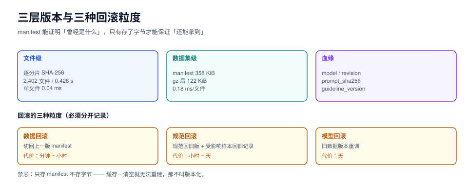

# 版本化与血缘：一万条数据的可回滚快照

本页判据族 `SYV-A` ~ `SYV-H`，共 8 条。

「上周那版数据比这版好」——如果你回不到上周那版，这句话就只是感觉。数据版本化要解决的问题很具体：**任意时刻，能用一个标识符把那批数据一字不差地重建出来，并说清它是怎么来的。**

本页给出三层版本（文件 / 数据集 / 血缘）、manifest 的必填字段、快照的成本读数，以及回滚的三种粒度。



## 一、三层版本，三种问题

| 层 | 标识什么 | 实现 | 解决什么问题 |
| --- | --- | --- | --- |
| **文件级** | 每个分片的字节内容 | 逐文件 SHA-256 + 字节数 | 「这个分片有没有被改过」 |
| **数据集级** | 一批文件 + 元数据 + 规范版本 | 目录级 manifest（含文件清单的哈希） | 「怎么一字不差地重建这一版」 |
| **血缘** | 每个分片来自哪批种子/哪个模型/哪版规范 | 生成时写入的元数据字段 | 「这版为什么和上版不一样」 |

三层缺一不可。只有文件级哈希，你回答不了「为什么变了」；只有血缘，你无法证明「就是这批字节」。

## 二、manifest：一次算清，之后只做比对

本机实测（对 2,402 个 Markdown 文件全量 SHA-256）：

| 指标 | 读数 |
| --- | --- |
| 文件数 | 2,402 |
| 全量哈希耗时 | **0.426 s**（0.18 ms/文件） |
| manifest 体积（JSON，含路径 + 哈希 + 字节数） | **358.1 KiB**（gzip 后 122.3 KiB） |
| 二次全量校验（缓存热） | 0.132 s |
| 单文件校验 | 0.04 ms |

::: tip 这组数字的用途
它证明了「全量哈希」在万级规模上是**每轮都能跑的**，不需要「只哈希改过的文件」这种优化。十万级文件约 4 s，仍然可以放进 CI。真正需要注意的是 manifest 体积：**2,402 条 = 358 KiB，约 152 字节/条**，一万条样本如果逐条记 manifest 就是 1.5 MB——所以清单的粒度应该是**分片**（每个 JSONL 一个哈希），不是每条样本。
:::

### manifest 的必填字段

```json
{
  "dataset": "cs-intent-v3",
  "version": "2026.10.22",
  "created_at": "2026-10-22T02:10:00+08:00",
  "guideline_version": "1.2.0",
  "counts": { "total": 10240, "real": 3120, "augmented": 2560, "synthetic": 4560 },
  "quality": { "alpha": 0.71, "alpha_ci": [0.66, 0.76], "dup_clusters": 812, "effective_strata": 23.4 },
  "shards": [
    { "path": "shards/part-0000.jsonl", "sha256": "3f9a…", "bytes": 1048576, "rows": 2048 }
  ],
  "generators": [
    { "model": "internal-gen-7b", "revision": "2026-09-14", "prompt_id": "p-cancel-03", "license": "internal" }
  ],
  "sources": { "seed_batch": "real-2026-09", "leak_check": "max_j_p95=0.31" },
  "manifest_sha256": "b71c…"
}
```

| 字段 | 为什么必填 |
| --- | --- |
| `version` | 一切讨论的锚点；建议 `YYYY.MM.DD` 或语义化版本 |
| `guideline_version` | 数据变了但规范没变，和规范变了但数据没变，是两件事 |
| `counts` | 三种来源的分布是红线的证据（见[总览](../Overview/index.md)） |
| `quality` | α 的**区间**、聚类数、有效分层数——下一版对比的基线 |
| `shards[].sha256` | 可重建、可校验 |
| `generators[]` | 血缘；含 `license` 才能回答商用问题 |
| `manifest_sha256` | 清单自身的哈希，防止清单被改 |

## 三、快照：存什么、不存什么

| 策略 | 存什么 | 成本 | 适用 |
| --- | --- | --- | --- |
| **全量快照** | 每版完整数据 | 线性增长 | 数据量 < 1 GB，最省心 |
| **增量 + 基线** | 首版全量，之后只存 diff | 低 | 数据量大、变更局部 |
| **内容寻址** | 按内容哈希存储，重复内容只存一份 | 最低（天然去重） | 有大量跨版本重复分片 |
| **只存 manifest** | 只记哈希，数据靠下游缓存 | 极低 | **不要用**——缓存一清空就重建不了 |

::: danger 「只存 manifest」是伪版本化
它假设「数据还在某处」。而真实情况是：清洗脚本重跑一次、临时目录被清、上游改了一次生成，那批字节就没了。**manifest 只能证明「曾经是什么」，不能保证「还能拿到」。**
:::

## 四、回滚的三种粒度

| 粒度 | 场景 | 操作 | 代价 |
| --- | --- | --- | --- |
| **数据回滚** | 新一批数据质量不达标 | 切回上一版 manifest 指向的分片 | 分钟级（若全量快照）/ 小时级（若增量） |
| **规范回滚** | 新规范导致一致性下降 | 规范回到旧版本 + 受影响样本的标注回到旧记录 | 小时~天级（要重算一致性） |
| **模型回滚** | 用新数据训出来的模型更差 | 训练配置回到旧数据版本重训 | 天级（算力） |

三者要分开记录。最常见的混乱是：**模型变差了，团队先怀疑数据，其实是规范变了导致重标范围判断错**。把三者分开记，一次 `git log` 式的对比就能定位。

## 五、数据卡（datasheet）与合规披露

对外交付或对外声明训练数据时，数据卡是事实标准。本专题把它的必填项落成 manifest 的字段，避免「写文档时再回忆」。

| datasheet 问题 | 对应 manifest 字段 | 备注 |
| --- | --- | --- |
| 数据由谁、为什么创建 | `dataset`、`purpose` | 一句话目的，别写「提升效果」 |
| 数据包含什么 | `counts`、`shards` | 条数与字段 schema |
| 怎么采集/生成 | `counts.real/augmented/synthetic`、`generators` | 三种来源的比例 |
| 是否含个人信息 | `compliance.pii` | 与[标注规范](../Guideline/index.md)的字段白名单对应 |
| 许可与限制 | `generators[].license`、`license` | **商用与否必须写明** |
| 已知偏差与限制 | `quality`、`limitations` | 分层覆盖缺口要写 |
| 维护与联系方式 | `owner`、`contact` | 谁负责下一版 |

::: info 合规提示（非法律意见）
EU AI Act 对通用模型施加了「训练数据摘要」的公开义务，自 2025-08-02 起适用。它的具体模板仍在演进，但**manifest 里的 `counts` / `generators` / `sources` 三项正好是摘要的主要内容**——把这三项在造数时就记下来，比事后补写便宜一个数量级。
:::

## 六、复现：从 manifest 重建

一个能用的重建流程只有四步，任何一步缺失都不算「可复现」：

```shell
# 1) 校验分片完整
python3 - <<'PY'
import json, hashlib, pathlib
man = json.load(open("manifest.json"))
bad = []
for s in man["shards"]:
    p = pathlib.Path(s["path"])
    h = hashlib.sha256(p.read_bytes()).hexdigest()
    if h != s["sha256"] or p.stat().st_size != s["bytes"]:
        bad.append(s["path"])
print(f"shards={len(man['shards'])} bad={len(bad)}")
PY
# 期望：bad=0

# 2) 校验条数
wc -l shards/*.jsonl | tail -1
# 期望：等于 manifest.counts.total

# 3) 校验质量基线（重算 α / 聚类数，与 manifest 比对）
#    允许 ±0.02 的浮点误差；超出说明数据被动过

# 4) 校验血缘完整
jq -r '.generators[].model' manifest.json
# 期望：每一项都有 model + revision + license
```

## 七、本页判据

| 编号 | 判据 | 看什么现象 | 不满足时改哪里 |
| --- | --- | --- | --- |
| `SYV-A` | 三层版本齐全（文件哈希 / 数据集 manifest / 血缘） | manifest 结构 | 缺血缘就补生成时字段（事后补不回） |
| `SYV-B` | manifest 粒度是分片，不是逐条 | `shards[].sha256` | 把逐条清单换成分片清单 |
| `SYV-C` | manifest 含 `guideline_version` 与 `quality.alpha_ci` | 字段检查 | 补；没有区间无法比较两版 |
| `SYV-D` | 快照可离线重建（不依赖下游缓存） | 用 manifest 重建一次 | 见第三节「伪版本化」 |
| `SYV-E` | 回滚三种粒度分开记录 | 变更日志有三个维度 | 分开记，别混 |
| `SYV-F` | 数据卡字段能从 manifest 直接生成 | 生成脚本 | 按第五节映射 |
| `SYV-G` | 重建流程有四步校验（分片 / 条数 / 质量 / 血缘） | 重建脚本 | 补最弱的「质量基线」 |
| `SYV-H` | 每版 `manifest_sha256` 入库且不可变 | 版本库 | 清单本身也要防篡改 |

## 验证方式

```shell
# 1) 本机读数复跑：全量哈希的成本与 manifest 体积
python3 - <<'PY'
import pathlib, hashlib, json, time, zlib
files = sorted(list(pathlib.Path('docs').rglob('*.md')) + list(pathlib.Path('project').rglob('*.md')))
t0 = time.time()
man = [{"path": str(f), "sha256": hashlib.sha256(f.read_bytes()).hexdigest(), "bytes": f.stat().st_size} for f in files]
blob = json.dumps({"files": man}, ensure_ascii=False).encode()
print(f"files={len(files)} time={time.time()-t0:.3f}s manifest={len(blob)/1024:.1f}KiB gz={len(zlib.compress(blob,9))/1024:.1f}KiB")
PY
# 期望：files=2402 time≈0.43s manifest≈358KiB gz≈122KiB

# 2) 重建校验（把 manifest.json 换成你的）
#    期望每一步都输出 bad=0 / 条数相等 / 质量差 < 0.02

# 3) 回滚演练：切到上一版 manifest，确认服务能起来
#    这一步必须真做一次，否则「可回滚」只是文档里的一句话
```

## 参考资料

- *Datasheets for Datasets*（Gebru et al., CACM 2021）：数据卡的原始问题清单
- MLCommons **Croissant**：数据集元数据交换格式
- EU AI Act 通用模型条款（训练数据摘要义务，2025-08-02 起适用）
- *Reproducibility Checklist*（NeurIPS）：可复现性的检查项
- 本仓库相邻专题：[质检与抽检](../QC/index.md)、[实战](../Practice/index.md)、[EventOrderHub 数据库设计](../../../project/Complete/EventOrderHub/DatabaseDesign/index.md)
