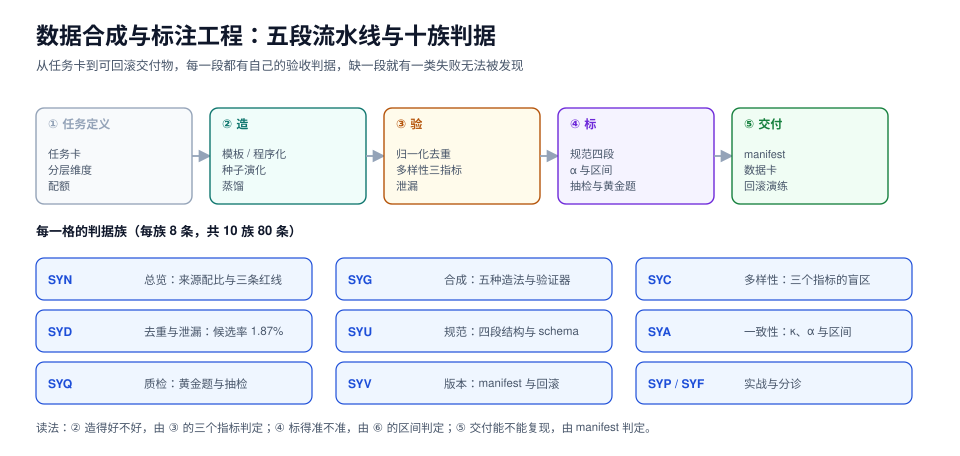

# 数据合成与标注工程

模型能力的上限由数据决定，而「好数据」几乎从来不是收集来的——它是**造出来的、标出来的、验出来的**。造（合成）解决「没有」和「不够难」，标（标注）解决「没有标准答案」，验（去重、泄漏、一致性、抽检）解决「看起来对」。

本专题面向要在一个季度内把某类任务的训练/评测数据从零做到上万条的人：把「怎么造、怎么标、怎么证明它没被污染、怎么证明两个人标得一样、怎么回滚到上一版」讲成能算、能跑、能验收的十件事。

::: tip 一句话理解
合成数据的风险不在「假」，而在**「假得一样」**：一千条由同一个模板、同一个模型、同一个提示词生成的数据，统计上约等于一条。所以合成之后第一件事不是训练，是**去重 + 测多样性 + 查泄漏**。
:::

::: info 本专题与相邻专题的分工
- **训练集怎么用来微调、LoRA 怎么配** → [大模型微调](../FineTuning/index.md)：那里管「拿到数据之后怎么训」，本专题管「数据怎么来、怎么算合格」。
- **评测集怎么设计、指标怎么定** → [评测集设计](../EvalEngineering/DatasetDesign/index.md)：那里是从「我们要测什么」倒推样本，本专题是从「手上有什么」正向造样本；两边的**泄漏检查共用一套方法**（见[去重与泄漏](Dedup/index.md)）。
- **人工对齐（RLHF/DPO）的偏好标注** → [人工对齐](../EvalEngineering/HumanAlignment/index.md)：那里讲偏好对的构造与标注协议，本专题讲**标注规范怎么写、一致性怎么算**，是它的前置。
- **统计显著性与置信区间** → [评测统计](../EvalEngineering/Statistics/index.md)：本专题只讲「一致性指标的区间怎么来」，其余统计推断去那页。
- **LLM-as-judge 的校准** → [判据校准](../EvalEngineering/JudgeCalibration/index.md)：模型当裁判的偏差校准在那页，本专题管「人当裁判时人自己一致不一致」。
- **线上效果的离线复现** → [离线评估](../LLMObservability/OfflineEval/index.md)：那里复现线上分布，本专题负责把那份分布造成可标注的样本。
- **测试数据脱敏、数据工厂** → [测试数据与仿真](../../Tools/TestDataSimulation/index.md)：那是**测试**用途的造数（要真值、要可重复），本专题是**训练/评测**用途的造数（要分布、要多样），两者都会用模板与脱敏，但验收标准完全不同。
- **训练数据里的个人信息与版权** → [AI 安全与合规](../AISecurityCompliance/index.md)：那里管合规边界，本专题在[标注规范](Guideline/index.md)里给出「哪些字段一开始就不该采」的落地清单。
- **合成数据把模型训崩（model collapse）** → [微调常见问题](../FineTuning/FAQ/index.md)：现象与缓解在那页，本专题负责给出「怎么在造数阶段就把塌缩按住」的判据。
- **周期 7 项目的九张表与不变量** → [EventOrderHub 数据库设计](../../../project/Complete/EventOrderHub/DatabaseDesign/index.md)：项目侧的造数脚本必须满足业务不变量，与本专题的「数据验收」是同一套思路的两种用法。
:::

## 目录

- [总览：三种来源、四类失败与三条红线](Overview/index.md)
- [合成策略：五种造法与一个验证器](Generation/index.md)
- [覆盖与多样性：三个指标的三个盲区](Diversity/index.md)
- [去重与泄漏：候选率 1.87% 的那条流水线](Dedup/index.md)
- [标注规范：把「我觉得」写成可裁决的条文](Guideline/index.md)
- [一致性度量：κ 会骗人，区间不会](Agreement/index.md)
- [质检与抽检：黄金题、陷阱题与返工](QC/index.md)
- [版本化与血缘：一万条数据的可回滚快照](Versioning/index.md)
- [实战：从 0 到 1 造一万条可验收数据](Practice/index.md)
- [常见问题与分诊](FAQ/index.md)

## 专题地图

## 判据纪律

沿用全库写法：**每页 8 条，编号形如 `SYN-A`**，逐页前缀唯一，可被 `utils/audit` 下的判据类巡检机械核对。每条判据都要能回答三件事：**看什么现象、判成什么、不满足时改哪里**。

| 页 | 判据族 | 这一族管什么 | 条数 |
| --- | --- | --- | --- |
| 总览 | `SYN-A` ~ `SYN-H` | 来源分类、失败模式、红线与角色 | 8 |
| 合成策略 | `SYG-A` ~ `SYG-H` | 造法选择、验证器、蒸馏、成本 | 8 |
| 覆盖与多样性 | `SYC-A` ~ `SYC-H` | 分层覆盖、指标盲区、长尾配额 | 8 |
| 去重与泄漏 | `SYD-A` ~ `SYD-H` | 指纹、阈值、聚类、污染判定 | 8 |
| 标注规范 | `SYU-A` ~ `SYU-H` | 条文、边界例、裁决、schema | 8 |
| 一致性度量 | `SYA-A` ~ `SYA-H` | κ/α、流行度、样本量、区间 | 8 |
| 质检与抽检 | `SYQ-A` ~ `SYQ-H` | 黄金题、抽检比例、返工、封禁 | 8 |
| 版本化与血缘 | `SYV-A` ~ `SYV-H` | 快照、manifest、血缘、回滚 | 8 |
| 实战 | `SYP-A` ~ `SYP-H` | 流水线、验收、日报、交付 | 8 |
| 常见问题 | `SYF-A` ~ `SYF-H` | 症状分诊与开工自查 | 8 |

合计 **10 族 80 条**。

## 事实与版本速览（2026-10 核对）

| 项 | 现状 | 对本专题的影响 |
| --- | --- | --- |
| Self-Instruct（arXiv 2212.10560） | 2022-12 公开，是「用模型造指令数据」的起点 | 「种子 + 生成 + 过滤」三段式至今没变，本专题的[合成策略](Generation/index.md)以它为骨架 |
| Evol-Instruct / WizardLM | 2023-04 提出「深度演化 + 广度演化」 | 「让同一条种子变难」比「多写一千条种子」便宜，是长尾覆盖的主要手段 |
| Constitutional AI（arXiv 2212.08073） | 2022-12，用原则集替代大量人工反馈 | 标注规范（[Guideline](Guideline/index.md)）与「AI 反馈」的接口就在这里 |
| Datasheets for Datasets（CACM 2021） | 数据集「说明书」的事实标准 | 本专题的[版本化](Versioning/index.md)把 datasheet 落成 manifest 的必填字段 |
| Croissant（MLCommons） | 数据集元数据的交换格式，1.0 已发布 | 对外交付数据时用它描述资源与字段，别自创格式 |
| EU AI Act 通用模型义务 | **2025-08-02 起适用** | 训练数据摘要（training data summary）成为对外义务，本专题的 manifest 直接是它的证据 |
| Cohen's κ (1960) / Fleiss' κ (1971) / Krippendorff's α | 三套一致性指标，α 可处理缺失与多标注者 | [一致性度量](Agreement/index.md)以 α 为主口径，κ 只用于两人对照 |
| Model collapse（Nature, 2024） | 递归用合成数据训练会丢尾部 | [合成策略](Generation/index.md)的「真实数据配额」与[多样性](Diversity/index.md)的「长尾保留率」就是对着它写的 |

::: warning 关于「版本目录」这个决定
本库对**两代技术栈并存**的主题按版本建目录（`Spring5/` 与 `Spring6/`、`MySQL57/` 与 `MySQL84/`）。本专题**不按版本建目录**，三条理由：

1. **它是一套方法，不是两代 API。** 「Spring 5 怎么写」和「Spring 6 怎么写」是两套可独立阅读的用法；而「2023 年怎么造指令数据」和「2026 年怎么造」共享同一套骨架（种子 → 生成 → 过滤 → 去重 → 标注 → 验收），差异只在工具与成本，写两套目录会立刻产生两份 90% 重复的正文。
2. **换代的是工具，不是判据。** `SYD-C`（阈值必须用分布定，不能用直觉定）在 2023 年成立，在 2026 年也成立；把判据按年份分家，等于让读者以为旧判据过期了。
3. **旧内容不覆盖。** 库内已有的合成数据相关段落（`FineTuning/Dataset`、`EvalEngineering/DatasetDesign` 等）**一条都没有删改**，本专题只在需要时追加「与本专题的分工」一节。
:::

::: info 关于实测的诚实标注
本专题的读数分三档，页面里逐处标注：

1. **本机语料实测**：把本仓库 **2,219 篇 Markdown（783.7 万字符）**当作一份「无标注中文语料」，在这份语料上跑 MinHash 去重、13-gram 泄漏检测、distinct-n 与压缩率对比、κ/α 与自助法区间。语料是真实的，方法与线上完全一致；**它不是模型生成的数据集**，所以「近重复率 3 组」是这份语料的属性，不是任何模型输出的属性。
2. **本机数据库实测**：PostgreSQL **18.6** 容器，10 万订单 / 30 万明细 / 6 万支付 / 4 万预留，用于项目侧的造数验收（见[实战](Practice/index.md)与 EventOrderHub 数据库设计）。
3. **文档结论（未实测）**：Self-Instruct 的原始流程、EU AI Act 的条文、Croissant 的字段定义——按官方文档与论文编写，页面内不写实测读数。

所有数字都可复跑：语料类读数只需 Python 3 标准库（`hashlib` / `zlib` / `random`），数据库类读数只需一个 `docker run postgres:18`。
:::
