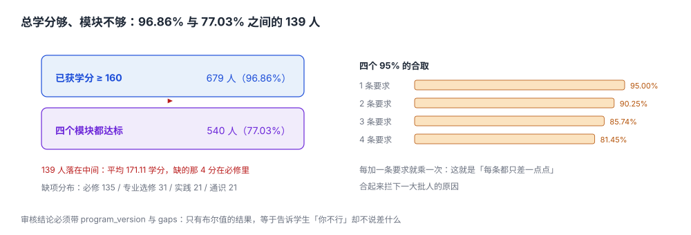

# 学分构成与毕业审核：总学分够、模块不够，是最贵的一种「够」

毕业审核只有两周窗口。系统跑完 701 个毕业班学生，输出一张表：

| 结论 | 人数 |
| --- | --- |
| 可毕业 | 540 |
| 不可毕业 | 161 |
| 其中「总学分已达标」的 | **139** |

这 139 人是最难解释的：他们不缺学分（平均 171.11 学分，比要求的 160 多 11 分），缺的是**某个模块里的 4 个学分**。学生问「我多修的不算吗」，答案是「算总学分，不算这个模块」——而这句话在任何一个页面上都没有写过。

::: tip 一句话理解
毕业审核不是「一条判断」，是**四条判断的合取**：总学分够、每个模块都够、学位课绩点够、没有阻断性处分；四条里任何一条不成立，结论就是「不可毕业」，而系统只输出一个布尔值时，你永远不知道是哪一条。
:::



## 一、四个口径，四次收紧

| 口径 | 判定 | 本机读数（701 人） | 与上一个的差 |
| --- | --- | --- | --- |
| 已获学分 ≥ 160 | `SUM(学分) >= 160` | 679（**96.86%**） | —— |
| 每个模块都达标 | 四模块各自 ≥ 要求 | 540（**77.03%**） | **−139 人** |
| 学位课绩点 ≥ 2.0 | 只算学位课 | 本机不建模 | —— |
| 无阻断性处分 | 处分表 | 本机不建模 | —— |

96.86% 与 77.03% 之间的 19.83 个点，就是「总学分」这个口径的盲区。**它不是误差，是结构**：

| 缺项 | 人数 | 说明 |
| --- | --- | --- |
| 必修 | 135 | 挂了必修没补上，用选修学分顶上总学分 |
| 专业选修 | 31 | 选修集中在某几门，模块内学分不够 |
| 实践 | 21 | 实习/毕设未完成 |
| 通识 | 21 | 通识学分不足 |

## 二、为什么「四条 95% 的达标率」只剩 81%

这是这一页最反直觉的一段。假设每个模块的达标率都是 95%，四条独立：

```text
四条全达标 = 0.95 × 0.95 × 0.95 × 0.95 = 0.8145
```

**95% 的四个条件合取，只有 81.45%。** 每加一条要求，通过率就乘一次——这就是为什么「看起来每条都只差一点点」的规则，合起来会拦下一大批人。

| 条件数 | 每条 95% | 每条 98% |
| --- | --- | --- |
| 1 | 95.00% | 98.00% |
| 2 | 90.25% | 96.04% |
| 3 | 85.74% | 94.12% |
| 4 | **81.45%** | **92.24%** |

工程上的推论有三条：

1. **每一条新增要求都要评估「乘一次」的代价**：把「实践学分 ≥ 18」改成「实践学分 ≥ 20」，看似只提高 2 分，实际可能让 3% 的学生不达标。
2. **审核结果必须给出缺口，而不是只给布尔值**：`gaps` 里写 `{"必修": 4}` 才能让人知道该补什么。
3. **规则变更必须能预演**：新规则先在上一届数据上跑一遍，看差集有多大，再决定是否执行。

## 三、换版：同一批人，327 人的结论翻转

| 方案 | 必修 | 专业选修 | 通识 | 实践 | 合计 | 可毕业 |
| --- | --- | --- | --- | --- | --- | --- |
| 2022 版 | 96 | 30 | 16 | 18 | 160 | 540 |
| 2026 版 | 92 | 34 | 16 | 18 | 160 | 213 |

两版总学分相同，可毕业人数差 **327**——绝大多数是因为「选修要求 30 → 34」，而这批学生的选修学分集中在 30~33。

这张表在[培养方案页](../Program/index.md)出现过一次，在这里出现第二次是有意的：**同一个现象，从方案侧看是「版本管理」，从审核侧看是「结论翻转」**。两侧都要能算，才叫「换版可控」。

## 四、审核必须落表：三个字段决定能不能举证

```sql
-- 审核结果：一次审核一行，永久保留
CREATE TABLE audit_result (
  audit_id        INTEGER PRIMARY KEY,
  student_id      TEXT NOT NULL,
  program_id      TEXT NOT NULL,
  program_version TEXT NOT NULL,          -- 按哪一版方案判的
  rule_version    TEXT NOT NULL,          -- 按哪一版审核规则判的
  run_at          TEXT NOT NULL,
  passed          INTEGER NOT NULL CHECK (passed IN (0,1)),
  total_credit    REAL NOT NULL,
  gaps_json       TEXT NOT NULL,          -- {"必修":4,"专业选修":0,"通识":0,"实践":0}
  UNIQUE (student_id, program_version, rule_version, run_at)
);

-- 模块学分：审核的输入，必须能一条 SQL 重算
CREATE TABLE credit_summary (
  student_id TEXT NOT NULL,
  module     TEXT NOT NULL,
  earned     REAL NOT NULL CHECK (earned >= 0),
  required   REAL NOT NULL CHECK (required >= 0),
  PRIMARY KEY (student_id, module)
);
```

三个字段缺一不可：

- **`program_version`**：没有它就说不清「当时按哪版方案判的」。本机两版差 327 人。
- **`rule_version`**：方案没变但审核规则变了（比如「实践学分是否含军训」），同样会翻结论。
- **`gaps_json`**：只有布尔值的审核结果，等于告诉学生「你不行」，却不说「差什么」。

::: danger 审核结果不能「每次现算、不落表」
现算的审核有三个后果：
1. **不能举证**：学生申诉时，你无法证明「上周给你看的结论」与「现在算出来的结论」是同一套规则。
2. **不能预演**：想评估新规则影响面，只能拿历史数据重算，而历史数据的方案版本可能已经被覆盖。
3. **不能追责**：谁在什么时候改了口径，没有记录。
:::

## 五、审核 SQL：一条查询算出四个缺口

```sql
-- 模块缺口：每个模块一行，缺多少一目了然
WITH earned AS (
  SELECT g.student_id, pc.module, SUM(pc.credit) AS got
    FROM (SELECT student_id, course_id, MAX(score) AS score
            FROM grade WHERE state = 'scored' GROUP BY student_id, course_id) g
    JOIN program_course pc
      ON pc.course_id = g.course_id
     AND pc.program_id = :pid AND pc.version = :ver
   WHERE g.score >= 60
   GROUP BY g.student_id, pc.module
)
SELECT s.student_id, pr.module,
       COALESCE(e.got, 0) AS earned,
       pr.min_credit      AS required,
       MAX(0, pr.min_credit - COALESCE(e.got, 0)) AS gap
  FROM student s
  JOIN program_requirement pr
    ON pr.program_id = s.program_id AND pr.version = s.program_version
  LEFT JOIN earned e ON e.student_id = s.student_id AND e.module = pr.module
 WHERE s.student_id IN (SELECT student_id FROM graduate_candidate)
 ORDER BY s.student_id, pr.module;
```

注意 `JOIN` 的条件：`pr.version = s.program_version`，不是 `MAX(version)`。这一行就是「锁旧不追新」的全部实现——**写错这一行，327 人的结论就变了**。

## 六、毕业证与学位证：两个结论，两套条件

| 结论 | 条件 | 谁发 | 常见混淆 |
| --- | --- | --- | --- |
| 毕业 | 学分与模块达标 + 完成毕设 | 学校 | 以为「学分够就毕业」 |
| 学位 | 毕业 + 学位课绩点 ≥ 2.0 + 无严重处分 | 学位委员会 | 以为「毕业就有学位」 |

两个结论必须**分别落表**（`audit_result.kind = 'graduation' | 'degree'`）。把它们合成一个 `passed` 字段的系统，最终一定会出现「毕业了但没学位」的学生在系统里查不到原因的情况。

## 七、本页判据族

本页判据族 `AFC-A` ~ `AFC-H`，共 8 条。

| 判据 | 要求 | 验证方式 |
| --- | --- | --- |
| `AFC-A` | 审核同时判「总学分」与「模块学分」，两者分别可见 | 输出含 `total_credit` 与四个模块行 |
| `AFC-B` | 审核按学生绑定的方案版本判，不取最新版 | `JOIN ... AND pr.version = s.program_version` |
| `AFC-C` | 审核结果落表，含 `program_version`、`rule_version`、`run_at` | 三列非空且进唯一键 |
| `AFC-D` | 缺口以结构化形式输出（模块 → 差多少） | `gaps_json` 可解析且键与模块一致 |
| `AFC-E` | 毕业与学位是两个结论，分别落表 | `audit_result.kind` 两值 |
| `AFC-F` | 换版影响面可预演（新旧规则差集） | 同一批数据跑两版，输出差异名单 |
| `AFC-G` | 模块学分的来源可追溯到课程行 | `credit_summary` 的每一分都能回到 `grade` |
| `AFC-H` | 审核不可在「无方案版本」的数据上给出通过 | 缺 `program_version` 时直接拒绝，不允许默认值 |

## 八、验证方式

```shell
# 1. 四个 95% 的合取（期望：81.45 92.24）
python3 -c "
for p in (0.95, 0.98):
    print(round(p**4*100, 2), end=' ')
print()"

# 2. 总学分达标 vs 模块达标（期望：396 77 319）
python3 - <<'PY'
import random
random.seed(20261105)
plan = {"必修": 96, "专业选修": 30, "通识": 16, "实践": 18}
n = 701
stu = []
for _ in range(n):
    got = {"必修": random.randint(84, 104), "专业选修": random.randint(24, 38),
           "通识": random.randint(14, 20), "实践": random.randint(14, 24)}
    stu.append(got)
total_ok = sum(1 for g in stu if sum(g.values()) >= 160)
struct_ok = sum(1 for g in stu if all(g[k] >= plan[k] for k in plan))
print(total_ok, struct_ok, total_ok - struct_ok)
PY
```

第 1 步的两个数是这一页的核心算术：**95% 的四次方是 81.45%**。

第 2 步的三个数是 `396 77 319`，它比正文的 `679 540 139` 苛刻得多——**这正是「独立假设」与「真实相关」的差别**：脚本里四个模块的学分各自独立随机，于是「必修缺的人」和「实践缺的人」几乎不重叠，四条合取的概率被压到 11%；真实数据里学生按方案修课，四类之间有强相关（必修没修满的人，选修往往也多修），合取概率反而升到 77%。

所以这一页要记住的不是某个数，而是：**用独立假设去估「合取达标率」，一定会低估**。要真实数字，只能用真实数据跑。

## 参考资料

- 《普通高等学校学生管理规定》（教育部令第 41 号）第三章第五节：毕业与结业。
- 《学士学位授权与授予管理办法》（学位〔2019〕20 号）：学位授予条件与学位课要求。
- 各高校《学分制学籍管理规定》：模块学分、必修与选修的最低要求。
- 与本页相邻：[培养方案与课程库](../Program/index.md)、[成绩、重修与绩点换算](../Grade/index.md)、[实战：建库与断言](../Practice/index.md)。
