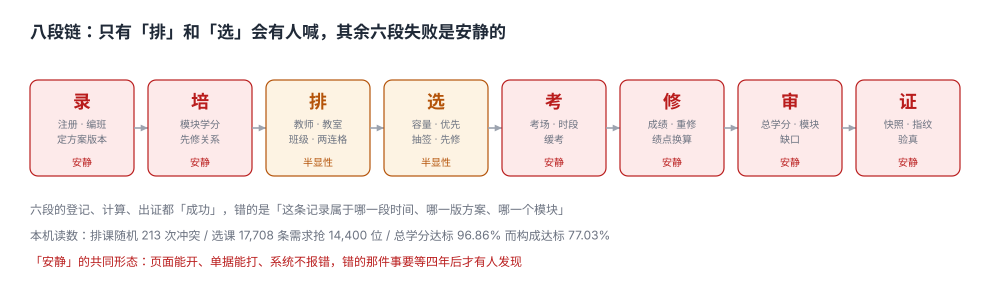

# 总览：八段链与三个「过了没有」

一个学生挂了大二的一门必修，暑期重修考了 71 分。开学后他发现三件事同时成立：

- 成绩单上这门课**只有一行**，71 分，看不出重修；
- 教务系统里他的**总学分**比上学期多了 4 分；
- 学院审核页上，「必修模块」那一格**还是缺 4 分**。

**三个系统、三份数据、三个结论。** 谁都没算错：成绩单按「取最高」只显示一次；总学分按「已获学分」累计；审核页按「模块内学分」统计——而重修那门的学分被归到了「暑期重修班」这个临时模块里。

::: tip 一句话理解
学籍系统的核心不是「存了多少条数据」，而是**每一条数据属于哪一段时间、哪一版方案、哪一个模块**——归属错了，数字照样能加，结论一定是错的。
:::

## 一、八段链的分工

| 段 | 输入 | 判据落点 | 这一段失败时的样子 |
| --- | --- | --- | --- |
| ① 录 | 录取名单、身份证、入学年份 | 学籍状态只能沿合法边迁移 | 退学了还能选课，系统不报错 |
| ② 培 | 方案文本、课程库、先修关系 | 模块学分与先修边可计算 | 方案换版，旧生被按新版判 |
| ③ 排 | 教师、教室、班级、周次 | 三资源在同一个两连格上不重叠 | 冲突要等开学第一周才有人喊 |
| ④ 选 | 容量、优先级、志愿 | 容量不被超发，中签规则可复算 | 超选（45 个位坐了 120 人）没人发现 |
| ⑤ 考 | 选课名单、考场、监考 | 座位数 ≥ 考生数，同时段不撞车 | 两门考试撞车，考前一夜学生自己发现 |
| ⑥ 修 | 成绩录入、补考、重修 | 同一门课多次成绩的取舍口径固定 | 口径一改，全院排名重排 |
| ⑦ 审 | 成绩、方案、学位课 | 模块构成 × 方案版本 | 总学分够、模块不够，毕业前两周才暴露 |
| ⑧ 证 | 审核结果、成绩明细 | 出证内容与当时系统一致 | 打印后改成绩，纸上那张不会变 |



**六段的失败是安静的**：录、培、考、修、审、证。它们的共性是「数据都在、页面能开、单据能打」，错的是归属与口径。

## 二、三个「过了没有」，本机读数

本机的模拟数据集：3,000 名学生（2022~2025 四个年级）、260 门课、320 个开课班、150,096 条成绩（另有 12,565 条重修与刷分记录）。

| 口径 | 算法 | 本机读数 | 与上一个口径的差 |
| --- | --- | --- | --- |
| 这门课过了 | `score >= 60` | 4.84% 不及格（7,869 条） | —— |
| 这个模块修满了 | 模块内已获学分 ≥ 方案要求 | 构成达标 77.03%（540/701） | 比总学分口径少 **19.83 个点** |
| 这个人能毕业 | 构成达标 + 学位课 + 无处分 | 77.03%（本机未叠加学位课与处分） | —— |
| （对照）总学分够 | 已获学分 ≥ 160 | 96.86%（679/701） | 比构成口径多 **139 人** |

**139 人**就是「总学分够、模块不够」的那批人。他们的平均总学分是 171.11，比要求的 160 多 11 分——多出来的全在选修里，而缺的那 4 分在必修里。

::: danger 「总学分」是最容易被当成结论的那个数
1. **它是唯一一个「加了就对」的数**：把所有及格课程的学分加起来，不需要任何归属判断，所以它最先被做出来、也最先被信任。
2. **它掩盖结构**：本机 96.86% 的学生总学分达标，但其中 139 人模块不达标。用总学分做毕业判定，等于把这 139 人放进毕业名单。
3. **它对方案换版不敏感**：总学分要求从 160 改到 160（只调结构），总学分口径下一个人都不变；模块口径下变了 **327 人**。
:::

## 三、四个「不算数」

「修了但不算」有四种形态，处理方式完全不同：

| 形态 | 例子 | 该记在哪 | 别记成 |
| --- | --- | --- | --- |
| 没过 | 正考 52 分 | 成绩行，`passed=0` | 「缺考」（缺考是另一种状态，补考资格不同） |
| 过了但不计模块 | 选修课抵了必修 | `credit_recognize`（认定记录） | 直接把课程类型改掉 |
| 计了但不算毕业 | 超出方案要求的任选课 | 学分累计但不进模块 | 从成绩单里删掉 |
| 整段不算 | 休学期内产生的成绩 | `status_interval` 与成绩的交集应为空 | 手工删行（删了就无法举证） |

本机在 210 名休学生里，**12 人**（5.71%）在休学区间内仍有成绩记录。这 12 条不会让任何页面报错，只会让「休学一年为什么还多出 4 学分」在三年后变成一场说不清的申诉。

## 四、数据模型：三段必须分开存

```sql
-- 学籍：状态不是字段，是区间。当前状态是「最后一条区间的 to 为空」的那条
CREATE TABLE student_status (
  student_id TEXT NOT NULL,
  status     TEXT NOT NULL CHECK (status IN ('在籍','休学','复学','转专业','退学','毕业')),
  from_date  TEXT NOT NULL,
  to_date    TEXT,                        -- NULL = 至今
  reason     TEXT,
  CHECK (to_date IS NULL OR to_date > from_date)
);
CREATE UNIQUE INDEX ux_status_open ON student_status(student_id) WHERE to_date IS NULL;

-- 成绩：追加式，同一门课允许多次；attempt_no 区分正考/补考/重修/刷分
CREATE TABLE grade (
  grade_id    INTEGER PRIMARY KEY,
  student_id  TEXT NOT NULL,
  course_id   TEXT NOT NULL,
  attempt_no  INTEGER NOT NULL,           -- 1 正考、2 补考、3 重修、4 刷分
  term        TEXT NOT NULL,
  score       REAL NOT NULL CHECK (score BETWEEN 0 AND 100),
  passed      INTEGER GENERATED ALWAYS AS (score >= 60) VIRTUAL,
  UNIQUE (student_id, course_id, attempt_no)
);

-- 审核结果：必须带方案版本，否则第二年说不清「当时凭什么判他过」
CREATE TABLE audit_result (
  student_id      TEXT NOT NULL,
  program_version TEXT NOT NULL,
  run_at          TEXT NOT NULL,
  passed          INTEGER NOT NULL,
  gaps            TEXT,                   -- JSON：{"必修": 4, "实践": 0}
  PRIMARY KEY (student_id, program_version, run_at)
);
```

三张表的共同点：**都不允许用「当前值」覆盖历史**。`student_status` 用区间、`grade` 用 `attempt_no`、`audit_result` 用 `run_at`——这三列看起来是「多余的主键」，其实是「能不能举证」的分界线。

## 五、本页判据族

本页判据族 `AFO-A` ~ `AFO-H`，共 8 条。

| 判据 | 要求 | 验证方式 |
| --- | --- | --- |
| `AFO-A` | 学籍状态以区间存储，当前状态由「`to_date IS NULL`」推出 | `ux_status_open` 唯一索引存在，同一学生最多一条开放区间 |
| `AFO-B` | 状态迁移只允许走合法边，非法迁移在库层被拒 | 触发器或应用层校验覆盖六态九边，负向用例返回非 0 |
| `AFO-C` | 成绩表追加式，同一课多次成绩用 `attempt_no` 区分 | `UNIQUE(student_id, course_id, attempt_no)` |
| `AFO-D` | 毕业审核必须落表，且带 `program_version` 与 `run_at` | `audit_result` 三个字段非空 |
| `AFO-E` | 「总学分」与「模块学分」是两个查询，不共用一个数 | 两条 SQL 各自可执行，结果可不同 |
| `AFO-F` | 休学区间与成绩记录的交集必须为空 | 一条 `EXISTS` 查询返回 0 |
| `AFO-G` | 每一条「不算数」都有对应记录，而不是删行 | 认定表 / 状态区间 / 成绩行三者可追溯 |
| `AFO-H` | 方案换版后，存量学生仍按入学年份的方案判 | 审核查询必须 `JOIN program_requirement` 的版本，而非取 `MAX(version)` |

## 六、验证方式

```shell
# 1. 建表（期望：3 张表 + 1 个索引，无报错）
python3 - <<'PY'
import sqlite3
c = sqlite3.connect(":memory:")
c.executescript('''
CREATE TABLE student_status(student_id TEXT, status TEXT, from_date TEXT, to_date TEXT);
CREATE UNIQUE INDEX ux_status_open ON student_status(student_id) WHERE to_date IS NULL;
CREATE TABLE grade(grade_id INTEGER PRIMARY KEY, student_id TEXT, course_id TEXT,
                   attempt_no INTEGER, term TEXT, score REAL,
                   UNIQUE(student_id, course_id, attempt_no));
CREATE TABLE audit_result(student_id TEXT, program_version TEXT, run_at TEXT,
                          passed INTEGER, gaps TEXT,
                          PRIMARY KEY(student_id, program_version, run_at));
''')
print(len(c.execute("SELECT name FROM sqlite_master WHERE type='table'").fetchall()))
print(len(c.execute("SELECT name FROM sqlite_master WHERE type='index' AND name LIKE 'ux_%'").fetchall()))
PY

# 2. 同一学生两条开放区间必须失败（期望：IntegrityError）
python3 - <<'PY'
import sqlite3
c = sqlite3.connect(":memory:")
c.executescript('''CREATE TABLE student_status(student_id TEXT, status TEXT, from_date TEXT, to_date TEXT);
CREATE UNIQUE INDEX ux_status_open ON student_status(student_id) WHERE to_date IS NULL;
INSERT INTO student_status VALUES('S1','在籍','2022-09-01',NULL);''')
try:
    c.execute("INSERT INTO student_status VALUES('S1','休学','2023-03-01',NULL)")
    print("NO_ERROR")            # 期望不出现这一行
except sqlite3.IntegrityError:
    print("IntegrityError")      # 期望
PY
```

第 1 步期望输出 `3` 与 `1`；第 2 步期望 `IntegrityError`，若输出 `NO_ERROR`，说明部分唯一索引没建成，状态区间就退化成了一堆可以随便插入的行。

## 参考资料

- 《普通高等学校学生管理规定》（教育部令第 41 号）第三章：学籍管理，含休学、复学、退学的条件与年限。
- 教育部《教育管理信息化标准 第 1 部分：学校管理信息标准》：学籍与成绩数据元。
- IMS Global *OneRoster 1.2* 规范：`enrollment` 与 `result` 的资源模型。
- 与本页相邻：[培养方案与课程库](../Program/index.md)、[学分构成与毕业审核](../CreditAudit/index.md)、[实战：建库与断言](../Practice/index.md)。
