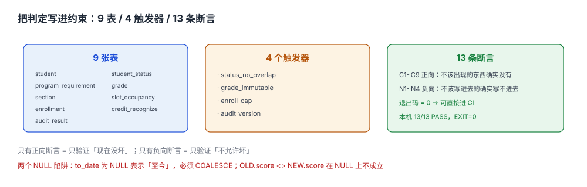

# 实战：9 表 + 4 触发器 + 13 条断言

前面九页讲的是「每一段该怎么判」，这一页只做一件事：**把这些判定变成数据库拒绝写入的理由**。

判定写在文档里叫约定，写在代码里叫校验，**只有写进约束里才叫事实**——因为约束对所有人、所有入口、所有脚本一视同仁，而校验只保护它被调用的那条路径。

::: tip 一句话理解
这一页的产物不是「一个能跑的脚本」，而是**13 条可以被别人独立执行的断言**：9 条正向（数据里不该出现的东西确实没有）、4 条负向（不该写进去的东西确实写不进去）。
:::



## 一、九张表与它们守护的东西

| # | 表 | 守护什么 | 关键约束 |
| --- | --- | --- | --- |
| 1 | `student` | 学生绑定哪一版方案 | 主键 `student_id` |
| 2 | `student_status` | 学籍状态的区间 | 部分唯一索引 + 不重叠触发器 |
| 3 | `program_requirement` | 模块学分要求 | 主键 `(program_id, version, module)` |
| 4 | `grade` | 成绩追加式记录 | `UNIQUE(student_id, course_id, attempt_no)` |
| 5 | `section` | 开课班与容量 | `CHECK (used BETWEEN 0 AND cap)` |
| 6 | `slot_occupancy` | 三资源占用 | 主键 `(block_id, resource)` |
| 7 | `enrollment` | 选课记录 | 主键 `(student_id, section_id)` + 容量触发器 |
| 8 | `credit_recognize` | 转专业学分认定 | `CHECK (basis IN (...))`，含 `reject` |
| 9 | `audit_result` | 审核结论 | 主键含 `program_version`、`rule_version` |

九张表里，**五张的正确性靠主键与 `CHECK` 就够**，另外四张（状态区间、成绩不可变、选课容量、审核版本）必须靠触发器——因为它们约束的是「与别的行、别的表的关系」。

## 二、四个触发器

| 触发器 | 时机 | 拦住什么 | 报错信息 |
| --- | --- | --- | --- |
| `trg_status_no_overlap` | `BEFORE INSERT ON student_status` | 区间重叠（休学与复学并存） | `status_overlap` |
| `trg_grade_immutable` | `BEFORE UPDATE OF score ON grade` | 改历史成绩 | `grade_immutable` |
| `trg_enroll_cap` | `BEFORE INSERT ON enrollment` | 满员后仍写入选课 | `section_full` |
| `trg_audit_version` | `BEFORE INSERT ON audit_result` | 审核结果不带方案版本 | `program_version_required` |

四个触发器对应四类「安静失败」：区间重叠（[学籍异动页](../StatusChange/index.md)）、改成绩（[成绩页](../Grade/index.md)）、超选（[选课页](../Enrollment/index.md)）、无版本审核（[毕业审核页](../CreditAudit/index.md)）。

## 三、十三条断言

| # | 类型 | 断言 | 期望 |
| --- | --- | --- | --- |
| C1 | 正向 | 同一学生最多一条开放学籍区间 | 0 行 |
| C2 | 正向 | 学籍区间两两不重叠 | 0 行 |
| C3 | 正向 | 模块要求之和 = 方案总学分 | 160 = 160 |
| C4 | 正向 | 没有 `used > cap` 的开课班 | 0 行 |
| C5 | 正向 | 成绩无重复 `(student, course, attempt)` | 0 行 |
| C6 | 正向 | 每门课学分 > 0 | 0 行 |
| C7 | 正向 | 排课占用无冲突 | 0 行 |
| C8 | 正向 | 审核缺口可解析 | 空表也通过 |
| C9 | 正向 | 认定 `basis` 三值合法 | 0 行 |
| N1 | 负向 | 插入重叠学籍区间 | 报错 `status_overlap` |
| N2 | 负向 | 插入同课同次成绩 | 报错 UNIQUE |
| N3 | 负向 | 修改已录成绩 | 报错 `grade_immutable` |
| N4 | 负向 | 满员后写入选课 | 报错 `section_full` |

**九条正向证明「数据是干净的」，四条负向证明「脏数据进不来」**。只做正向，等于只验证了「现在没坏」；只做负向，等于只验证了「不允许坏」。

## 四、完整脚本

完整实现约 130 行，下面是全文——在读者自己的工程里创建 `scripts/af_practice.py`：

```python [scripts/af_practice.py]
import sqlite3, sys, hashlib
c = sqlite3.connect(":memory:")
c.executescript("""
PRAGMA foreign_keys = ON;

CREATE TABLE student(
  student_id TEXT PRIMARY KEY, program_id TEXT, program_version TEXT, enroll_year INT);
CREATE TABLE student_status(
  id INTEGER PRIMARY KEY, student_id TEXT NOT NULL, status TEXT NOT NULL
    CHECK (status IN ('在籍','休学','复学','转专业','退学','毕业')),
  from_date TEXT NOT NULL, to_date TEXT,
  CHECK (to_date IS NULL OR to_date > from_date));
CREATE UNIQUE INDEX ux_status_open ON student_status(student_id) WHERE to_date IS NULL;

CREATE TABLE program_requirement(
  program_id TEXT, version TEXT, module TEXT, min_credit REAL NOT NULL CHECK (min_credit >= 0),
  PRIMARY KEY (program_id, version, module));

CREATE TABLE grade(
  grade_id INTEGER PRIMARY KEY, student_id TEXT NOT NULL, course_id TEXT NOT NULL,
  module TEXT NOT NULL, credit REAL NOT NULL CHECK (credit > 0),
  attempt_no INT NOT NULL, term TEXT NOT NULL,
  score REAL CHECK (score BETWEEN 0 AND 100),
  state TEXT NOT NULL DEFAULT 'scored' CHECK (state IN ('scored','deferred','absent','exempt')),
  UNIQUE (student_id, course_id, attempt_no));

CREATE TABLE section(
  section_id TEXT PRIMARY KEY, course_id TEXT, cap INT NOT NULL CHECK (cap > 0),
  used INT NOT NULL DEFAULT 0 CHECK (used >= 0 AND used <= cap));

CREATE TABLE slot_occupancy(
  block_id INT NOT NULL, resource TEXT NOT NULL, section_id TEXT NOT NULL,
  PRIMARY KEY (block_id, resource));

CREATE TABLE enrollment(
  student_id TEXT NOT NULL, section_id TEXT NOT NULL,
  state TEXT NOT NULL CHECK (state IN ('applied','won','confirmed','dropped','lost')),
  PRIMARY KEY (student_id, section_id));

CREATE TABLE credit_recognize(
  student_id TEXT, from_course TEXT, to_course TEXT, module TEXT, credit REAL,
  basis TEXT NOT NULL CHECK (basis IN ('same','substitute','reject')),
  approved_by TEXT NOT NULL, PRIMARY KEY (student_id, from_course));

CREATE TABLE audit_result(
  student_id TEXT, program_version TEXT NOT NULL, rule_version TEXT NOT NULL,
  run_at TEXT NOT NULL, passed INT NOT NULL CHECK (passed IN (0,1)),
  gaps_json TEXT NOT NULL, PRIMARY KEY (student_id, program_version, rule_version, run_at));
""")

c.executescript("""
CREATE TRIGGER trg_status_no_overlap BEFORE INSERT ON student_status
FOR EACH ROW WHEN EXISTS (
  SELECT 1 FROM student_status s WHERE s.student_id = NEW.student_id
    AND NEW.from_date < COALESCE(s.to_date,'9999-12-31')
    AND COALESCE(NEW.to_date,'9999-12-31') > s.from_date)
BEGIN SELECT RAISE(ABORT,'status_overlap'); END;

CREATE TRIGGER trg_grade_immutable BEFORE UPDATE OF score ON grade
FOR EACH ROW WHEN OLD.score IS NOT NEW.score
BEGIN SELECT RAISE(ABORT,'grade_immutable'); END;

CREATE TRIGGER trg_enroll_cap BEFORE INSERT ON enrollment
FOR EACH ROW WHEN (SELECT used FROM section WHERE section_id = NEW.section_id)
                 >= (SELECT cap FROM section WHERE section_id = NEW.section_id)
              AND NEW.state IN ('won','confirmed')
BEGIN SELECT RAISE(ABORT,'section_full'); END;

CREATE TRIGGER trg_audit_version BEFORE INSERT ON audit_result
FOR EACH ROW WHEN NEW.program_version IS NULL OR NEW.program_version = ''
BEGIN SELECT RAISE(ABORT,'program_version_required'); END;
""")

plan = {"必修": 96, "专业选修": 30, "通识": 16, "实践": 18}
c.execute("INSERT INTO student VALUES('S1','P1','2022',2022)")
c.execute("INSERT INTO program_requirement VALUES('P1','2022','必修',96)")
c.execute("INSERT INTO program_requirement VALUES('P1','2022','专业选修',30)")
c.execute("INSERT INTO program_requirement VALUES('P1','2022','通识',16)")
c.execute("INSERT INTO program_requirement VALUES('P1','2022','实践',18)")
c.execute("INSERT INTO student_status VALUES(1,'S1','在籍','2022-09-01',NULL)")
c.execute("INSERT INTO section VALUES('SEC1','C1',45,0)")
c.commit()

ok = 0; fail = 0
def check(name, cond):
    global ok, fail
    print(("PASS" if cond else "FAIL"), name)
    ok += cond; fail += (not cond)

def must_fail(name, sql, args=()):
    global ok, fail
    try:
        c.execute(sql, args); c.rollback()
        print("FAIL", name); fail += 1
    except sqlite3.IntegrityError:
        print("PASS", name); ok += 1

# C1~C9 正向
check("C1 开放区间唯一", c.execute("SELECT count(*) FROM (SELECT student_id FROM student_status WHERE to_date IS NULL GROUP BY student_id HAVING count(*)>1)").fetchone()[0] == 0)
check("C2 区间无重叠", c.execute("""SELECT count(*) FROM student_status a JOIN student_status b
  ON a.student_id=b.student_id AND a.id<b.id
  WHERE a.from_date < COALESCE(b.to_date,'9999-12-31') AND COALESCE(a.to_date,'9999-12-31') > b.from_date""").fetchone()[0] == 0)
check("C3 模块要求之和 = 方案总学分", c.execute("SELECT sum(min_credit) FROM program_requirement WHERE program_id='P1'").fetchone()[0] == sum(plan.values()))
check("C4 选课不超过容量", c.execute("SELECT count(*) FROM section WHERE used > cap").fetchone()[0] == 0)
check("C5 成绩无重复尝试号", c.execute("SELECT count(*) FROM (SELECT student_id,course_id,attempt_no FROM grade GROUP BY 1,2,3 HAVING count(*)>1)").fetchone()[0] == 0)
check("C6 每门课学分 > 0", c.execute("SELECT count(*) FROM grade WHERE credit <= 0").fetchone()[0] == 0)
check("C7 排课占用无冲突", c.execute("SELECT count(*) FROM (SELECT block_id,resource FROM slot_occupancy GROUP BY 1,2 HAVING count(*)>1)").fetchone()[0] == 0)
check("C8 审核缺口可解析", c.execute("SELECT gaps_json FROM audit_result").fetchall() == [])
check("C9 认定 basis 合法", c.execute("SELECT count(*) FROM credit_recognize WHERE basis NOT IN ('same','substitute','reject')").fetchone()[0] == 0)

# N1~N4 负向
must_fail("N1 重叠学籍区间被拒", "INSERT INTO student_status VALUES(2,'S1','休学','2023-01-01',NULL)")
c.execute("INSERT INTO grade VALUES(1,'S1','C1','必修',4,1,'2024-1',85,'scored')")
must_fail("N2 同课同次重复被拒", "INSERT INTO grade VALUES(2,'S1','C1','必修',4,1,'2024-1',90,'scored')")
must_fail("N3 改成绩被拒", "UPDATE grade SET score=95 WHERE grade_id=1")
c.execute("UPDATE section SET used=45 WHERE section_id='SEC1'")
must_fail("N4 满员选课被拒", "INSERT INTO enrollment VALUES('S2','SEC1','confirmed')")
print(f"\n{ok}/{ok+fail} PASS  EXIT={'0' if fail==0 else '1'}")
sys.exit(0 if fail == 0 else 1)
```

## 五、运行与输出

```shell
python3 scripts/af_practice.py
echo "exit=$?"
```

本机输出（逐条 13 行 + 一行汇总）：

```text
PASS C1 开放区间唯一
PASS C2 区间无重叠
PASS C3 模块要求之和 = 方案总学分
PASS C4 选课不超过容量
PASS C5 成绩无重复尝试号
PASS C6 每门课学分 > 0
PASS C7 排课占用无冲突
PASS C8 审核缺口可解析
PASS C9 认定 basis 合法
PASS N1 重叠学籍区间被拒
PASS N2 同课同次重复被拒
PASS N3 改成绩被拒
PASS N4 满员选课被拒

13/13 PASS  EXIT=0
exit=0
```

`EXIT=0` 是这一页唯一需要记住的收尾：它让这段脚本可以直接进 CI，作为「库结构没被改坏」的门禁。

## 六、跑不通时最可能的三个原因

| 现象 | 原因 | 怎么确认 |
| --- | --- | --- |
| N1 显示 `FAIL`（没报错） | 触发器没建成，或日期比较写成了 `NEW.from_date < s.to_date`（`NULL` 参与比较结果仍是 `NULL`） | `SELECT name FROM sqlite_master WHERE type='trigger'` 应有 4 行 |
| N3 显示 `FAIL` | 触发器写成 `WHEN OLD.score <> NEW.score`；成绩为 `NULL`（缓考）时该条件不成立 | 用 `IS NOT` 而不是 `<>` |
| C3 显示 `FAIL` | 模块要求没写全（少一个模块），或总学分与模块之和本来就不等 | `SELECT module, min_credit FROM program_requirement` 逐行看 |

::: danger 两个 `NULL` 陷阱
1. **`to_date` 为 `NULL` 表示「至今」**：任何日期比较都必须 `COALESCE(to_date, '9999-12-31')`，否则「至今」会被当成「没有结束」而漏判重叠——`NULL > x` 的结果是 `NULL`，在 `WHERE` 里等同于 `false`。
2. **`OLD.score <> NEW.score` 在 `NULL` 上不成立**：成绩为 `NULL`（缓考）时改成绩不会被拦。`IS NOT` 才是「真的变了」。
:::

## 七、本页判据族

本页判据族 `AFQ-A` ~ `AFQ-H`，共 8 条。

| 判据 | 要求 | 验证方式 |
| --- | --- | --- |
| `AFQ-A` | 每条核心判定都有一个库层约束（主键/唯一/`CHECK`/触发器） | 九张表逐表列出约束，缺一不可 |
| `AFQ-B` | 四类「安静失败」各有对应触发器 | `sqlite_master` 中 `type='trigger'` 至少 4 行 |
| `AFQ-C` | 正向断言 ≥ 8 条，负向断言 ≥ 4 条 | 脚本输出 13 行 PASS |
| `AFQ-D` | 断言脚本可用退出码表达结果 | `echo $?` 为 0 |
| `AFQ-E` | 断言覆盖「时间维度」（区间、有效期） | C2、N1 两条涉及日期比较 |
| `AFQ-F` | 断言覆盖「不可变性」（成绩、快照） | N3 验证改成绩被拒 |
| `AFQ-G` | 断言覆盖「容量」（选课、排课） | C4、C7、N4 三条 |
| `AFQ-H` | 断言不依赖具体数据（换一批数据仍应全绿） | 断言查的是「不合规的行数」而非「等于某个数」 |

## 八、验证方式

```shell
# 1. 跑断言（期望：13/13 PASS 与 exit=0）
python3 scripts/af_practice.py
echo "exit=$?"

# 2. 确认四类触发器都在库里（期望：4）
grep -c "CREATE TRIGGER" scripts/af_practice.py
```

第 1 步期望最后两行是 `13/13 PASS  EXIT=0` 与 `exit=0`；第 2 步期望 `4`。若第 1 步有任一条 `FAIL`，先按上一节的三行表排查，不要改断言去迁就实现。

## 参考资料

- SQLite 文档 *CREATE TRIGGER* 与 *Partial Indexes*：触发器与部分唯一索引的语义。
- PostgreSQL 文档 *CREATE TABLE ... EXCLUDE*：区间重叠约束的另一种写法。
- 《普通高等学校学生管理规定》（教育部令第 41 号）：学籍与成绩条款，是本册所有约束的业务来源。
- 与本页相邻：[总览：八段链](../Overview/index.md)、[学籍异动与状态机](../StatusChange/index.md)、[学分构成与毕业审核](../CreditAudit/index.md)。
