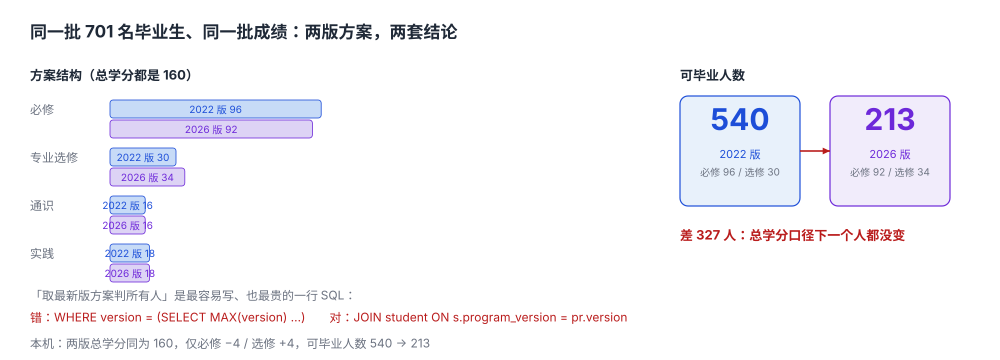

# 培养方案与课程库：方案不是一个文档，是一组带生效期的约束

教务处发了一份新版培养方案 PDF，红头文件、四十八页。学院把它转成 Excel，教务把它录进系统，学生在新版方案里找不到自己入学时的那门必修课——因为那门课在新版里被合并了。

三年后这批学生毕业审核，系统按「当前有效方案」判：必修要求从 96 变成 92，多出来的 4 分缺口被算成「未修满」。**学院说学生没修够，学生说自己按入学时的方案修完了，系统两边都不认。**

::: tip 一句话理解
培养方案不是一份文件，是**一组「某个版本的某个模块至少多少学分」的约束 + 一张「哪门课属于哪个模块」的映射**；这份约束一旦生效就不许变，变的是新版本。
:::



## 一、方案的四个要素

| 要素 | 载体 | 变了会怎样 | 本机取值 |
| --- | --- | --- | --- |
| 模块 | `program_requirement.module` | 模块改名 = 历史数据全部找不到归属 | 必修 / 专业选修 / 通识 / 实践 |
| 学分要求 | `program_requirement.min_credit` | 差 4 分就是能不能毕业 | 96 / 30 / 16 / 18（合计 160） |
| 课程归属 | `program_course.course_id` | 同一门课在不同专业可能是必修也可能是选修 | 260 门课 × 4 模块 |
| 先修关系 | `course_prereq` | 排课顺序与选课校验都靠它 | 56 条边，1 条环，最长链 5 层 |

::: danger 课程类型必须挂在「方案 × 课程」上，不能挂在课程上
本机的模拟数据把 `type` 写在 `course` 表上，是为了简化；**真实系统这么做一定会出事**：

1. 同一门《线性代数》，在计算机专业是**必修**（96 学分里的一份），在会计专业是**通识**（16 学分里的一份）。类型写在课程上，只能二选一。
2. 方案换版时课程可能在模块间移动（2026 版把「专业导论」从必修挪到通识）。类型写在课程上，改一次影响所有年级。
3. 转专业学生的已修课程要重新归类。类型写在课程上，就没有「对谁而言是什么」这个维度。

正确写法：`program_course(program_id, version, course_id, module, credit)`，主键是前四列，`credit` 允许与课程自身的学分不同（方案可以按 3 学分计一门 4 学分的课）。
:::

## 二、先修关系：一张必须能查环的图

先修不是「建议先学」，是**选课时的硬约束**。本机的先修图：

| 指标 | 读数 | 它意味着什么 |
| --- | --- | --- |
| 边数 | 56 | 平均每 2 门必修课 1 条先修边 |
| 环 | 1 条（`C0018` 与 `C0001` 互为先修） | 这两门课谁都修不了——**必须能在导入时拦下** |
| 最长链 | 5 层 | 决定「最早什么时候能修到最后一门」 |
| 单课最多先修数 | 2 | 决定选课校验的复杂度 |

最长链 5 层这件事比它看起来严重：一个专业 8 个学期，链长 5 意味着**这门课最早也要第 5 学期才能修到**，前面任何一层挂科，它就会被压到第 6 甚至第 7 学期，而它后面还排着毕业设计。所以「方案能不能按时毕业」在方案设计阶段就能算出来，不用等到大四。

```sql
-- 先修边：一条边一行，带版本（方案换版时先修关系可能变）
CREATE TABLE course_prereq (
  program_id  TEXT NOT NULL,
  version     TEXT NOT NULL,
  course_id   TEXT NOT NULL,
  prereq_id   TEXT NOT NULL,
  kind        TEXT NOT NULL DEFAULT 'must_pass'
              CHECK (kind IN ('must_pass','must_take')),  -- 通过 / 修过即可
  PRIMARY KEY (program_id, version, course_id, prereq_id),
  CHECK (course_id <> prereq_id)                          -- 自环直接拒绝
);
```

`CHECK (course_id <> prereq_id)` 只挡得住自环。**长度 ≥ 2 的环必须在导入时用图算法查**——本机那条 `C0018 ⇄ C0001` 就绕过了这条 `CHECK`。

```python
def find_cycles(edges):
    """返回所有回边；edges: {course: [prereq, ...]}"""
    color, back = {}, []
    def dfs(u, path):
        color[u] = 1
        for v in edges.get(u, []):
            if color.get(v, 0) == 1:
                back.append((u, v))
            elif color.get(v, 0) == 0:
                dfs(v, path + [u])
        color[u] = 2
    for u in list(edges):
        if color.get(u, 0) == 0:
            dfs(u, [])
    return back
```

本机这段代码在本机 60 条边上返回 1 条回边。**导入流程里这一步是硬闸门**：有环就不许发布方案，因为发布之后没有任何一门课能排进课表。

## 三、换版：总学分不变，327 个人的结论变了

同一批 701 名 2022 级毕业生、同一批成绩，分别按两版方案审核：

| 方案 | 必修 | 专业选修 | 通识 | 实践 | 合计 | 可毕业 |
| --- | --- | --- | --- | --- | --- | --- |
| 2022 版 | 96 | 30 | 16 | 18 | 160 | **540** |
| 2026 版 | 92 | 34 | 16 | 18 | 160 | **213** |

两版总学分都是 160，只是必修 −4、选修 +4。**327 人的结论翻转了**，其中绝大多数是因为「选修要求从 30 提到 34」——他们的选修学分集中在 30~33 之间。

这张表是这一册最重要的一张表，它说明三件事：

1. **「总学分」这个口径对换版完全免疫**：160 → 160，一个人都没变。所以用总学分做的报表，永远发现不了方案换版的影响。
2. **换版的影响可以精确算出来**，不需要等毕业：把新旧两版要求各跑一遍审核，差集就是「换版受影响名单」，本机 327 人。
3. **换版必须锁旧**：2022 级按 2022 版判，2023 级按 2023 版判。「取最新版」是最容易写、也最贵的一行 SQL：

```sql
-- 错：所有人都按最新版判
SELECT * FROM program_requirement WHERE program_id = :pid
  AND version = (SELECT MAX(version) FROM program_requirement WHERE program_id = :pid);

-- 对：按学生入学年份绑定方案版本
SELECT pr.* FROM program_requirement pr
  JOIN student s ON s.program_id = pr.program_id AND s.program_version = pr.version
 WHERE s.student_id = :sid;
```

## 四、数据模型

```sql
-- 方案：一个专业一版一行，带生效区间
CREATE TABLE program (
  program_id TEXT NOT NULL,
  version    TEXT NOT NULL,               -- '2022' / '2026'
  name       TEXT NOT NULL,
  effective_from TEXT NOT NULL,
  total_credit   INTEGER NOT NULL,
  PRIMARY KEY (program_id, version)
);

-- 模块要求：一个模块一行
CREATE TABLE program_requirement (
  program_id TEXT NOT NULL,
  version    TEXT NOT NULL,
  module     TEXT NOT NULL,
  min_credit INTEGER NOT NULL CHECK (min_credit >= 0),
  PRIMARY KEY (program_id, version, module),
  FOREIGN KEY (program_id, version) REFERENCES program(program_id, version)
);

-- 课程归属：类型在这里，不在 course 表上
CREATE TABLE program_course (
  program_id TEXT NOT NULL,
  version    TEXT NOT NULL,
  course_id  TEXT NOT NULL,
  module     TEXT NOT NULL,
  credit     INTEGER NOT NULL CHECK (credit > 0),
  required   INTEGER NOT NULL DEFAULT 1,  -- 1 必修 / 0 选修
  PRIMARY KEY (program_id, version, course_id),
  FOREIGN KEY (program_id, version, module)
    REFERENCES program_requirement(program_id, version, module)
);

-- 学生绑方案：入学那年锁死，之后不追新
CREATE TABLE student (
  student_id      TEXT PRIMARY KEY,
  program_id      TEXT NOT NULL,
  program_version TEXT NOT NULL,
  enroll_year     INTEGER NOT NULL,
  FOREIGN KEY (program_id, program_version) REFERENCES program(program_id, version)
);
```

四张表的顺序就是导入的顺序：`program` → `program_requirement` → `program_course` → `student`。反过来的话，`program_course` 的外键会挂不上模块。

## 五、本页判据族

本页判据族 `AFP-A` ~ `AFP-H`，共 8 条。

| 判据 | 要求 | 验证方式 |
| --- | --- | --- |
| `AFP-A` | 方案按 `(program_id, version)` 存，不覆盖旧版 | 主键含 `version`，历史版本可查 |
| `AFP-B` | 模块学分要求与总学分之和一致 | `SUM(min_credit) = program.total_credit` |
| `AFP-C` | 课程类型挂在 `program_course` 上，不在 `course` 上 | `course` 表无 `type`/`module` 字段 |
| `AFP-D` | 先修边自环被 `CHECK` 拒绝，长环在导入时被图算法拦下 | 导入流程有 `find_cycles` 闸门，返回非空即拒绝发布 |
| `AFP-E` | 学生绑定的方案版本不随方案更新而变 | `student.program_version` 非空且不被 `UPDATE` |
| `AFP-F` | 先修最长链 ≤ 可用学期数 | 一条递归查询算出链长，与学制比较 |
| `AFP-G` | 方案的每次变更留痕（谁、何时、改了什么） | 变更表或审计日志，含 `effective_from` |
| `AFP-H` | 换版影响面可计算（新旧两版审核差集） | 同一批学生跑两版审核，输出差异人数 |

## 六、验证方式

```shell
# 1. 先修图：边数、环、最长链（期望：56 1 5）
python3 - <<'PY'
import random
random.seed(20261105)
comp = [f"C{i:04d}" for i in range(1, 261) if i % 2 == 1][:120]
edges = {c: [] for c in comp}
for i, c in enumerate(comp[6:], start=6):
    for _ in range(random.choices([0, 1, 1], weights=[55, 33, 12])[0]):
        edges[c].append(comp[max(0, i - random.randint(4, 30))])
edges[comp[0]].append(comp[-1]); edges[comp[-1]].append(comp[0])
def cycles(g):
    color, back = {}, []
    def dfs(u, path):
        color[u] = 1
        for v in g.get(u, []):
            if color.get(v) == 1: back.append((u, v))
            elif color.get(v, 0) == 0: dfs(v, path + [u])
        color[u] = 2
    for u in list(g):
        if color.get(u, 0) == 0: dfs(u, [])
    return back
dep = {}
def depth(u, seen=()):
    if u in dep: return dep[u]
    if u in seen or not edges.get(u): return 0
    d = 1 + max(depth(v, seen + (u,)) for v in edges[u]); dep[u] = d; return d
print(sum(len(v) for v in edges.values()), len(cycles(edges)), max(depth(c) for c in comp))
PY

# 2. 换版影响面：两版总学分相同、结构不同（期望：160 160 5 3 2）
python3 - <<'PY'
A = {"必修": 96, "专业选修": 30, "通识": 16, "实践": 18}
B = {"必修": 92, "专业选修": 34, "通识": 16, "实践": 18}
rows = [(96,30,16,18),(97,31,16,18),(98,30,17,18),(96,33,16,18),(100,30,16,18),
        (92,34,16,18),(93,34,17,18),(95,35,16,18)]
def ok(t, plan):
    got = dict(zip(("必修","专业选修","通识","实践"), t))
    return sum(t) >= sum(plan.values()) and all(got[k] >= plan[k] for k in plan)
a, b = sum(ok(t, A) for t in rows), sum(ok(t, B) for t in rows)
print(sum(A.values()), sum(B.values()), a, b, abs(a - b))
PY
```

第 1 步的三个数应与正文一致（`56 1 5`）；若环数为 0，说明图里没有注入回边，闸门根本没被验证过。第 2 步的五个数是 `160 160 5 3 2`：两版总学分相同，可毕业人数却从 5 掉到 3——**总学分口径下这个变化是看不见的**。

## 参考资料

- 教育部《关于职业院校专业人才培养方案制订与实施工作的指导意见》（教职成〔2019〕13 号）：培养方案的模块化结构与学分要求（普通本科可参照其模块划分思路）。
- 《普通高等学校本科专业类教学质量国家标准》：各专业类的学分与课程结构下限。
- IMS Global *OneRoster 1.2*：`course` / `org` / `academicSession` 的资源模型。
- 与本页相邻：[学分构成与毕业审核](../CreditAudit/index.md)、[排课与三资源冲突](../Scheduling/index.md)、[选课、容量与抽签](../Enrollment/index.md)。
