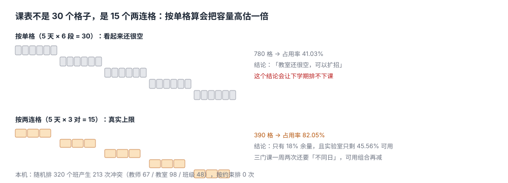

# 排课与三资源冲突：课表不是 30 个格子，是 15 个两连格

开学第一周，教务处的电话没停过：一位老师说自己周二上午同时有两门课，一个班说周三下午被排了两门必修，还有一间实验室被两个班同时占着。

排课系统里一切正常——每条记录都只有一个时间、一个教室、一个教师，没有一条数据是「错」的。**错的是它们之间的关系**：三类资源（教师、教室、班级）在同一个时间格上各自被占用了两次。

::: tip 一句话理解
排课是**在三张占用表上做区间着色**：教师不能被两个班同时占用，教室不能被两门课同时占用，班级不能被两门课同时占用；任何一维撞车，课表就是废的，而每一条记录本身都合法。
:::



## 一、30 个格子与 15 个两连格

一门课一学期通常排 2 学时连上（一次两节）。这意味着它占的不是「两个单格」，而是**一个两连格**：

| 口径 | 一周可用格 | × 26 间教室 | 本机 320 个班的占用率 | 与现实的关系 |
| --- | --- | --- | --- | --- |
| 按单格算 | 5 天 × 6 段 = 30 | 780 | 41.03% | **高估 390 格**，排出来的表上不了 |
| 按两连格算 | 5 天 × 3 对 = 15 | 390 | 82.05% | 真实上限 |

同一批 320 个班，两种口径给出 41% 与 82% 两个占用率。**用错那个数，决策就反了**：41% 看起来「教室很空」，于是继续批扩招；82% 才是「再加 30 个班就没地方放」的真相。

本机教室结构：120 座 6 间、60 座 10 间、40 座 10 间，其中 6 间是实验室。

::: danger 三个容易算错的地方
1. **把「学时」当「节次」**：一门 48 学时的课不是 48 个格子，是 24 个两连格（每周 2 个）。按学时算容量，可用格数会放大一倍。
2. **忽略「同一门课的两次课不同日」**：一门课一周上两次通常要求分在两天。加上这条约束，可选组合从「15 个两连格任选 2」变成必须跨天，实际可用组合大幅减少。
3. **忽略教室类型**：本机 41 个实践班只能进实验室，可用格 6 间 × 15 = 90，占用率 **45.56%**；而普通课能进所有 26 间。**总体 82.05% 的占用率掩盖了实验室的紧与 40 座小教室的空**。
:::

## 二、冲突有三种，报错只有一种

| 冲突类型 | 判定 | 随机排课 | 按约束排课 | 谁会先发现 |
| --- | --- | --- | --- | --- |
| 教师冲突 | 同一 `teacher_id` 同一 `(day, pair)` 出现 ≥2 次 | 67 | 0 | 教师本人（上课前一天） |
| 教室冲突 | 同一 `room_id` 同一 `(day, pair)` 出现 ≥2 次 | 98 | 0 | 保洁，或第一个到的班 |
| 班级冲突 | 同一 `group_id` 同一 `(day, pair)` 出现 ≥2 次 | 48 | 0 | 学生（开学第一周） |
| 合计 | —— | **213** | **0** | —— |

随机排课 320 个班产生 213 次冲突，平均每班 0.67 次。**教室冲突（98）比教师冲突（67）多**：教室 26 间、教师 45 位，教室是更紧的那一维。排课优化的重点永远是「最紧的那一维」，不是「数量最多的那一维」。

按约束贪心排（大班优先、教室从小到大、两连格顺序扫描）：**320/320 全部排下，冲突 0**。这不是「算法很强」，是这组数据的容量刚好够——390 个格装 320 个班，留了 18% 的余量。

```text
贪心的失败模式（换个数据就会出现）：
  先排大班 → 大班吃掉 120 座教室 → 需求 110 的班只剩 60 座可用 → 排不下
本机没有触发，是因为 320 个班的需求上限 58，最大教室 120 座，永远不会「大班占错房」。
一旦加入「合班上课」（两个班合并成一节 110 人），贪心立刻开始失败。
```

## 三、为什么必须把冲突做成「写不进去」

排课结果如果只是「先查一遍再插入」，就和选课超选是同一类问题：查与插之间有时间窗，两个人同时排就都通过了。**排课写的不是一条记录，是三条占用记录**（教师、教室、班级），更要一次落库。

```sql
-- 时间格：一天三段，每段是一个两连格
CREATE TABLE time_block (
  block_id INTEGER PRIMARY KEY,
  day      INTEGER NOT NULL CHECK (day BETWEEN 1 AND 5),
  pair_no  INTEGER NOT NULL CHECK (pair_no BETWEEN 1 AND 3),
  start_at TEXT NOT NULL,
  end_at   TEXT NOT NULL,
  UNIQUE (day, pair_no)
);

-- 开课班：一门课在一个学期的一次开设
CREATE TABLE section (
  section_id  TEXT PRIMARY KEY,
  course_id   TEXT NOT NULL,
  term        TEXT NOT NULL,
  teacher_id  TEXT NOT NULL,
  group_id    TEXT NOT NULL,            -- 行政班或教学班
  expect_size INTEGER NOT NULL CHECK (expect_size > 0),
  need_lab    INTEGER NOT NULL DEFAULT 0
);

-- 占用表：一列 resource 把三类资源摊平，主键即约束
CREATE TABLE slot_occupancy (
  block_id   INTEGER NOT NULL REFERENCES time_block(block_id),
  resource   TEXT NOT NULL,             -- 'teacher:T01' / 'room:R03' / 'group:G07'
  section_id TEXT NOT NULL REFERENCES section(section_id),
  PRIMARY KEY (block_id, resource)      -- 同一格同一资源只能有一个班
);
```

`PRIMARY KEY (block_id, resource)` 是这一页最重要的一行：它把「三资源冲突」从一个**需要运行时检查的业务规则**变成一条**写不进去的物理约束**。代价是每个班每次课写 3 行占用，换来的是「任何路径都撞不了车」——包括手工调课、批量导入、脚本补录。

::: warning 「resource」这一列是刻意的反范式
它把 `teacher:T01`、`room:R03`、`group:G07` 塞进同一列，破坏了第一范式：没法对教师建外键，也没法按教室统计。换来的是**一条主键同时管住三类冲突**。如果一定要规范化成三张表，就要写三个触发器，每个触发器都要在 `INSERT` 前查一遍另外两维——代码量翻三倍，且容易漏。
:::

## 四、排课问题的三种解法与边界

| 解法 | 做法 | 优点 | 什么时候不够用 |
| --- | --- | --- | --- |
| 贪心 | 按优先级逐个找第一个可行格 | 秒级出结果，易解释 | 约束紧时「卡住」，先排大的会把大教室占完 |
| 回溯 + 剪枝 | 排不下就退回去换格 | 能救回大部分贪心死角 | 320 班 × 390 格时指数爆炸，必须限时 |
| 整数规划 | 「班-格-室」建成 0/1 变量求可行解 | 能回答「最少加几间教室」 | 建模成本高，改一条约束要重跑 |

工程上的常见做法是**贪心出初稿 + 人工微调**，并把「排不下」的班做成一张待办清单交给教务。本机这张清单是空的，但判据要求它必须存在——**判据不是为今天的数据准备的，是为那天的数据准备的**。

## 五、本页判据族

本页判据族 `AFS-A` ~ `AFS-H`，共 8 条。

| 判据 | 要求 | 验证方式 |
| --- | --- | --- |
| `AFS-A` | 时间以「两连格」为单位建模，不以单节为单位 | `time_block` 每行覆盖 2 节，`(day, pair_no)` 唯一 |
| `AFS-B` | 三资源占用落在一张 `(block, resource)` 唯一的表上 | 主键 `(block_id, resource)`，重复插入报错 |
| `AFS-C` | 教室有容量与类型两个属性，排课时都参与判定 | `room.capacity`、`room.is_lab` 非空且被使用 |
| `AFS-D` | 排不下时输出「待办班」清单，不静默丢弃 | 排课结果含 `unplaced` 集合，数量可查 |
| `AFS-E` | 同一门课一周两次课不同日 | 校验 `COUNT(DISTINCT day) = 2` |
| `AFS-F` | 占用率按「可用格」算，分母含教室类型过滤 | 报表分别给总体与实验室两个占用率 |
| `AFS-G` | 排课结果可回滚到上一版（人工微调前留快照） | 版本表或 `published_at` + 归档表 |
| `AFS-H` | 教师单日课时上限可配置并被校验 | 一条 `GROUP BY teacher, day HAVING` 查询 |

## 六、验证方式

```shell
# 1. 随机排课的三类冲突 + 按约束排课（期望：67 98 48 213 / 320 0 0 0 0）
python3 - <<'PY'
import random
from collections import Counter
random.seed(20261105)
PAIRS = [(d, k) for d in range(5) for k in range(3)]
rooms = [{"id": f"R{i:02d}", "cap": random.choices([40, 60, 120], weights=[45, 35, 20])[0],
          "lab": i < 6} for i in range(26)]
secs = [{"id": f"SEC{i+1:03d}", "teacher": f"T{random.randint(1,45):02d}",
         "group": f"G{random.randint(1,60):02d}", "expect": random.randint(18, 58),
         "lab": random.random() < 0.12} for i in range(320)]
def conf(a):
    t, r, g = Counter(), Counter(), Counter()
    for s in secs:
        if s["id"] not in a: continue
        d, k, rm = a[s["id"]]
        t[(s["teacher"], d, k)] += 1; r[(rm, d, k)] += 1; g[(s["group"], d, k)] += 1
    f = lambda c: sum(v - 1 for v in c.values() if v > 1)
    return f(t), f(r), f(g)
rand = {s["id"]: (*random.choice(PAIRS), random.choice(rooms)["id"]) for s in secs}
x, y, z = conf(rand)
print(x, y, z, x + y + z)
a, tu, ru, gu = {}, set(), set(), set()
for s in sorted(secs, key=lambda x: -x["expect"]):
    ok = False
    for (d, k) in PAIRS:
        if (s["teacher"], d, k) in tu or (s["group"], d, k) in gu: continue
        for r in sorted(rooms, key=lambda x: x["cap"]):
            if r["cap"] < s["expect"] or (s["lab"] and not r["lab"]): continue
            if (r["id"], d, k) in ru: continue
            a[s["id"]] = (d, k, r["id"]); tu.add((s["teacher"], d, k))
            ru.add((r["id"], d, k)); gu.add((s["group"], d, k)); ok = True; break
        if ok: break
print(len(a), 320 - len(a), *conf(a))
PY

# 2. 两连格与单格的容量差（期望：390 780 390）
python3 -c "print(5*3*26, 5*6*26, 5*6*26-5*3*26)"
```

第 1 步第一行四个数是随机排课的读数、第二行四个数是贪心排课的读数；若教师冲突为 0，说明教师数量远大于班数，这组数据验证不了「最紧的那一维」这个结论。第 2 步的 `780` 是「按单格算」的幻觉容量，`390` 才是真实上限。

## 参考资料

- 教育部《普通高等学校本科专业类教学质量国家标准》：实践教学环节的学时占比要求。
- 区间图着色可用贪心求最优解的证明：*Introduction to Algorithms*（CLRS, 4th ed.）第 16 章「贪心算法」中的区间调度与区间图着色。
- 课程标准中「理论课与实验课分别编排」的通行做法：各高校《排课管理办法》，通常要求实验课连排、理论课分散。
- 与本页相邻：[培养方案与课程库](../Program/index.md)、[选课、容量与抽签](../Enrollment/index.md)、[考试安排与考场容量](../Exam/index.md)。
