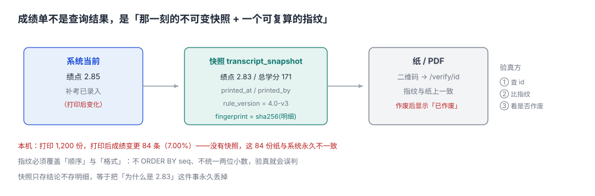

# 成绩单、证明与快照：打印出去的那张纸必须能和系统对得上

一个学生毕业时打印了 3 份成绩单，一份交用人单位，一份自己留着，一份放进档案。三个月后他申请出国，学校重新打了一份——**两份纸不一样**：第二份多了一门课，绩点从 2.83 变成 2.85。

原因是第一份打印之后，他之前的一门补考成绩才录进系统（补考在毕业前一周，成绩在毕业后录入）。第一份纸没有错，第二份也没有错，**错的是「成绩单」这个产物在当时没有被固定下来**。

::: tip 一句话理解
成绩单不是「把成绩查出来打印」，而是**在打印那一刻对数据做一次不可变快照，并给出可校验的指纹**；之后系统怎么变，那张纸都对应着它诞生时的那份数据。
:::



## 一、这张纸要回答三个问题

| 问题 | 谁在问 | 靠什么回答 |
| --- | --- | --- |
| 内容是不是真的 | 用人单位、外校 | 与系统快照一致，且快照不可改 |
| 这张纸是不是本校出的 | 验真方 | 二维码/校验码指向官方验真入口 |
| 为什么和系统里不一样 | 学生 | 快照时间 + 变更记录，能解释差在哪 |

本机读数：打印 1,200 份成绩单，**84 份**（7.00%）在打印后发生了成绩变更。没有快照的系统，这 84 份纸与系统永久不一致，而且**无法证明哪一份是对的**。

## 二、三个时间点，三个数

| 时间点 | 系统里的数 | 纸上 的数 | 谁对 |
| --- | --- | --- | --- |
| 打印当时 | 绩点 2.83 | 2.83 | 一致 |
| 补考录入后 | 2.85 | 2.83 | **都对**（纸是快照） |
| 学生申诉后 | 2.85 | 2.83 | 都对，但要能解释 |

「都对」的前提是**快照里存了足够的信息**：不只是绩点，还有每一门课的成绩行、当时的换算规则版本、打印时间、打印人。少了任何一项，都无法解释「为什么这张纸上是 2.83」。

## 三、快照的两种粒度

| 粒度 | 存什么 | 优点 | 缺点 |
| --- | --- | --- | --- |
| 只存结论 | 绩点、总学分、排名 | 省空间 | 无法解释单科差异 |
| 存明细 | 每门课一行（成绩、学分、绩点、学期） | 可逐行核对，可重算 | 数据量大约 50 倍 |

本机 1,200 份成绩单 × 平均 50 门课 = 6 万行明细，占用不到 10 MB。**在这个量级上，「只存结论」省下的空间毫无意义**，而它失去的举证能力是致命的。

```sql
-- 快照头：一次打印一行
CREATE TABLE transcript_snapshot (
  snapshot_id  TEXT PRIMARY KEY,          -- 与纸上二维码里的 id 一致
  student_id   TEXT NOT NULL,
  purpose      TEXT NOT NULL CHECK (purpose IN ('job','abroad','archive','other')),
  lang         TEXT NOT NULL CHECK (lang IN ('zh','en')),
  rule_version TEXT NOT NULL,             -- 绩点换算规则版本
  gpa          REAL NOT NULL,
  total_credit REAL NOT NULL,
  printed_at   TEXT NOT NULL,
  printed_by   TEXT NOT NULL,
  fingerprint  TEXT NOT NULL              -- sha256(规范化明细)
);

-- 快照明细：一行一门课，打印后不再改
CREATE TABLE transcript_line (
  snapshot_id TEXT NOT NULL REFERENCES transcript_snapshot(snapshot_id),
  seq         INTEGER NOT NULL,
  course_id   TEXT NOT NULL,
  course_name TEXT NOT NULL,
  credit      REAL NOT NULL,
  score       REAL NOT NULL,
  gp          REAL NOT NULL,
  term        TEXT NOT NULL,
  PRIMARY KEY (snapshot_id, seq)
);
```

`fingerprint` 是这一页的核心：把明细按固定顺序、固定格式拼成字符串，算一次 SHA-256。验真时重算一遍，**一致就说明这张纸没被改过**。

```text
fingerprint = sha256( 每行 "seq|course_id|credit|score|gp|term" 用 \n 连接 )
```

::: danger 指纹必须覆盖「顺序」和「格式」
1. **不排序**：同一批明细换一个 `SELECT` 顺序，哈希就不同，验真会误判为「被篡改」。必须 `ORDER BY seq`。
2. **不归一化**：`85` 与 `85.0` 拼出来不同。数值统一格式化成两位小数再拼。
3. **把指纹存进明细表**：指纹必须是「明细算出来的」，存在头上；存进明细里就变成自我指涉。
:::

## 四、验真：一个必须公开的入口

成绩单上的二维码指向 `https://example.edu/verify/<snapshot_id>`，页面显示：

| 字段 | 来源 | 作用 |
| --- | --- | --- |
| 姓名、学号（脱敏） | `student` | 确认是本人 |
| 打印时间 | `transcript_snapshot.printed_at` | 确认时效 |
| 绩点、总学分 | 同上 | 确认关键数字 |
| 指纹 | 同上 | 与纸上比对 |
| 是否已作废 | `voided_at` | **改分后旧纸应作废** |

最后一行最容易被漏掉。成绩变更后，旧成绩单不是「错的」，而是「已被新版本替代」——系统必须能标制作废，否则会出现「三份纸三个版本，都验真通过」。

## 五、中英文成绩单：翻译也是口径

| 项 | 中文 | 英文 | 常见错法 |
| --- | --- | --- | --- |
| 课程名 | 数据库原理 | Database Principles | 机翻成 "Database Principle"，与课程库不一致 |
| 成绩 | 85 | 85 | 把百分制直接当 4.0 制 |
| 绩点 | 3.7 | 3.7 (4.0 scale) | 不注明刻度 |
| 学分 | 4 | 4 credits | 与 ECTS 混用 |

英文成绩单最常见的事故是**把百分制分数当绩点写**：85 在 4.0 制里是 3.7，直接写 85 会被对方学校当成「85/100 的百分制」，换算后变成 3.4。

## 六、本页判据族

本页判据族 `AFT-A` ~ `AFT-H`，共 8 条。

| 判据 | 要求 | 验证方式 |
| --- | --- | --- |
| `AFT-A` | 每次打印生成快照，快照含明细与指纹 | `transcript_snapshot` + `transcript_line` 两表 |
| `AFT-B` | 指纹由明细按固定顺序与格式算出，可复算 | 同一快照重算两次结果一致 |
| `AFT-C` | 快照记录绩点换算规则版本 | `rule_version` 非空 |
| `AFT-D` | 成绩变更后旧快照可标作废，不删除 | `voided_at` 字段，作废后验真页显示「已作废」 |
| `AFT-E` | 验真入口可按 `snapshot_id` 查到全部关键字段 | 一条查询返回五项 |
| `AFT-F` | 英文成绩单的绩点必须标刻度 | 输出含 `(4.0 scale)` 或等价说明 |
| `AFT-G` | 打印人与打印时间可查 | `printed_by`、`printed_at` 非空 |
| `AFT-H` | 快照一旦生成不可 `UPDATE` 明细 | 触发器拒绝更新 `transcript_line` |

## 七、验证方式

```shell
# 1. 指纹：改一个字符就变（期望：same / CHANGED）
python3 - <<'PY'
import hashlib
lines = [(1,"C0001",4.0,85.0,3.7,"2024-2025-1"), (2,"C0002",3.0,78.0,3.0,"2024-2025-1")]
def fp(rows):
    s = "\n".join(f"{a}|{b}|{c:.2f}|{d:.2f}|{e:.2f}|{f}" for a,b,c,d,e,f in rows)
    return hashlib.sha256(s.encode()).hexdigest()[:16]
a = fp(lines)
print("same" if a == fp(lines) else "CHANGED")
lines[0] = (1,"C0001",4.0,86.0,3.7,"2024-2025-1")
print("same" if a == fp(lines) else "CHANGED")
PY

# 2. 明细顺序影响指纹（期望：DIFF）
python3 - <<'PY'
import hashlib
base = [(1,"C0001","4.00","85.00"), (2,"C0002","3.00","78.00")]
h = lambda rows: hashlib.sha256("\n".join("|".join(map(str,r)) for r in rows).encode()).hexdigest()[:16]
print("SAME" if h(base) == h(list(reversed(base))) else "DIFF")
PY
```

第 1 步期望 `same` 然后 `CHANGED`：同一批明细算两次一致，改一个分数就变。第 2 步期望 `DIFF`——**这正是必须 `ORDER BY seq` 的原因**：不定序的指纹，换一个执行计划就验真失败。

## 参考资料

- 《普通高等学校学生管理规定》（教育部令第 41 号）第三章第四节：成绩记载与证明出具。
- 教育部《高等学校档案管理办法》（教育部令第 27 号）：学籍档案的保管与出具。
- 中国高等教育学生信息网（学信网）学历学位认证服务：出证后的学历注册与查验口径。
- IMS Global *OneRoster 1.2*：`result` 与成绩发布的资源模型。
- 与本页相邻：[成绩、重修与绩点换算](../Grade/index.md)、[学分构成与毕业审核](../CreditAudit/index.md)、[学籍异动与状态机](../StatusChange/index.md)。
