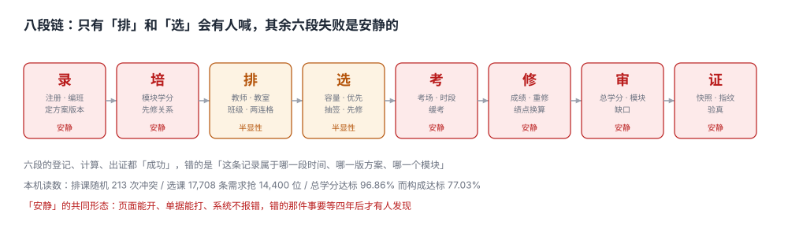

# 学籍、选课与排课工程

<p style="text-align:center;"></p>

毕业前两周，一个学生拿着打印好的成绩单来找教务：「我总学分 172，比要求的 160 多 12 分，为什么系统说我不能毕业？」窗口调出审核页，只有一行字：**必修模块缺 4 学分**。

学生不服：「我多修的那 12 分选修不算吗？」——不算。教务也说不清：「系统里就是这么判的。」

**这件事的每一方都没有说谎，也都不解决问题。** 因为「毕业」这个词在三处指的不是一件事：学生算的是**总学分**，系统判的是**模块构成**，而学院看的是**学位课绩点**。三个口径各有各的定义，任何一个被单独拿出来当结论，都会得出相反的答案。

::: tip 一句话理解
学籍系统管的不是「一个人现在是什么状态」，而是**一段时间里他属于哪个方案、修了哪些课、这些课算不算数**——任何一段的归属错了，系统都不会报错，只会在四年后的某一天拦下他。
:::

## 一、这个专题讲什么

从新生注册到毕业出证，一次判定要走八段：

| 段 | 这一段在做什么 | 产物 | 失败是否安静 |
| --- | --- | --- | --- |
| ① 录 | 注册、编班、建学籍、定方案版本 | `student` + `student_status` | **安静**（状态位不进约束，退学了还能选课） |
| ② 培 | 培养方案：模块、学分要求、先修关系 | `program` + `course_prereq` | **安静**（方案换版，旧生按新版判） |
| ③ 排 | 排课：教师、教室、班级三资源 | `section` | 半显性（冲突要等开学才有人喊） |
| ④ 选 | 选课：容量、优先级、抽签、先修校验 | `enrollment` | 半显性（爆满学生会喊，超选不会） |
| ⑤ 考 | 考试：考场容量、同时段冲突、缓考 | `exam` | **安静**（两门撞车，考前一天才发现） |
| ⑥ 修 | 成绩：录入、重修、绩点换算 | `grade` + `gpa_snapshot` | **安静**（重修覆盖口径一变，排名全变） |
| ⑦ 审 | 学分审核：总学分、模块构成、学位课 | `audit_result` | **安静**（总学分够 ≠ 构成够） |
| ⑧ 证 | 成绩单、证明、学历注册 | `transcript_snapshot` | **安静**（打印后改成绩，纸上那张不会变） |



八段里**六段的失败是安静的**。它们的共同形态是：页面能打开、单据能打印、系统不报错，错的是「这条判定能不能被独立复核」。

本机在一组 3,000 名学生 / 260 门课 / 320 个开课班 / 150,096 条成绩的模拟数据上跑出来的读数，正好把这八段的裂缝摊开：

| 视角 | 读数 | 它回答的问题 |
| --- | --- | --- |
| 排课冲突 | 随机排 207 次 vs 按约束排 0 次 | 课表能不能自动排出来 |
| 选课容量 | 17,708 条需求抢 14,400 个位，满足 61.43% | 想上的课能不能选上 |
| 绩点四口径 | 2.750 / 2.749 / 2.888 / 78.86 | 「成绩好不好」有四个答案 |
| 毕业审核 | 总学分达标 96.86%，构成达标 77.03% | 「能不能毕业」有两个答案 |

同一批数据，四个视角四个答案。这一册的每一页，都是把其中一个视角拆到能复算。

## 二、三个「过了没有」

| 口径 | 定义 | 谁在关心 | 常见错法 |
| --- | --- | --- | --- |
| 这门课过了 | 成绩 ≥ 60，或补考/重修后 ≥ 60 | 学生、任课教师 | 用「最高分」算绩点，却用「最新分」算学分 |
| 这个模块修满了 | 该模块已获学分 ≥ 方案要求 | 学院、教务 | 只看总学分，不看模块 |
| 这个人能毕业 | 模块全满 + 学位课绩点 + 无处分 | 学位委员会 | 把「学分够」当「可毕业」 |

三者的关系是一条单向链：**课过了 ≠ 模块满了**（挂一门必修，多修十门选修也补不上），**模块满了 ≠ 能毕业**（学位课绩点不够照样只发毕业证不发学位证），**能毕业 ≠ 学分够**（反过来不成立，本机 139 人总学分够、构成不够）。

::: danger 三件事必须写进数据模型，不能留给「报表时再算」
1. **成绩行不能被覆盖**：`grade` 表必须是追加式的，同一 `(student_id, course_id)` 允许多行（正考、补考、重修、刷分），用 `attempt_no` 区分。一旦用 `UPDATE` 覆盖，就再也回答不了「这次 85 分是第几次考的」。
2. **方案的模块要求必须按版本存**：`program_requirement(program_id, version, module, min_credit)`。2022 版和 2026 版的必修要求不同，学生入学那年锁定哪一版，要能查出来。
3. **审核结果必须落表并带方案版本**：`audit_result(student_id, program_version, run_at, passed, gaps)`。只把结论写在页面上的系统，第二年换版就说不清「当时为什么判他过」。
:::

## 三、专题地图


按「一次判定的生命周期」读：

| 阶段 | 页面 | 一句话 |
| --- | --- | --- |
| 读 | [总览：八段链与三个「过了没有」](Overview/index.md) | 先看整条链在哪一段会「安静地失败」，再逐段拆 |
| 培 | [培养方案与课程库](Program/index.md) | 方案不是一个文档，是一组带版本与生效期的约束 |
| 排 | [排课与三资源冲突](Scheduling/index.md) | 课表不是 30 个格子，是 15 个两连格 |
| 选 | [选课、容量与抽签](Enrollment/index.md) | 抢课的失败不只在「超选」，还在「中签规则没人写得清」 |
| 考 | [考试安排与考场容量](Exam/index.md) | 同时段两门考试，只有学生自己知道 |
| 修 | [成绩、重修与绩点换算](Grade/index.md) | 四个绩点口径，四个排名 |
| 审 | [学分构成与毕业审核](CreditAudit/index.md) | 总学分够、模块不够，是最贵的一种「够」 |
| 录 | [学籍异动与状态机](StatusChange/index.md) | 休学一年，学籍停在原地，成绩还在往里写 |
| 证 | [成绩单、证明与快照](Transcript/index.md) | 打印出去的那张纸，必须能和系统对得上 |
| 实战 | [实战：建库与断言](Practice/index.md) | 9 表 + 4 触发器 + 13 条断言，把口径落成约束 |

## 四、与相邻专题的分工

这一册刻意**不讲**下面这些内容，它们各有归属：

| 判什么 | 归属专题 | 本册只借什么 |
| --- | --- | --- |
| 培训项目、上岗资质、证书有效期 | [TrainingQualification](../../Backend/TrainingQualification/index.md) | 「资质」与「学分」的区别 |
| 入职后的组织归属与任职异动 | [OrgPeople](../../Backend/OrgPeople/Overview/index.md) | 层级与生效期的建模方法 |
| 审批流（学籍异动、免修申请） | [WorkflowEngine/ApprovalFlow](../../Backend/WorkflowEngine/ApprovalFlow/index.md) | 审批通过后的状态落库 |
| 请求级幂等（重复提交选课） | [IdempotencyStateMachine/IdempotencyKey](../../Backend/IdempotencyStateMachine/IdempotencyKey/index.md) | 幂等键的选择 |
| 定时任务（选课开放、成绩发布） | [DistributedScheduling/Overview](../../Backend/DistributedScheduling/Overview/index.md) | 到点触发的可靠性 |
| 并发扣减（容量、库存） | [Ecommerce/Inventory](../../Backend/Ecommerce/Inventory/index.md) | 条件更新与唯一键两种写法 |
| 数据质量维度（完整性、一致性） | [DB/DataGovernance/DataQuality](../../DB/DataGovernance/DataQuality/index.md) | 「同一口径」的检查思路 |
| 报表与指标口径治理 | [MetricPlatform](../../Backend/MetricPlatform/index.md) | 「同名不同义」的登记方式 |

::: info 为什么不并入 TrainingQualification
那一册讲的是「**这个人有没有资格干这件事**」——证书、有效期、复审，判据围绕「资质」；这一册讲的是「**这个人在这所学校里的这几年算不算数**」——归属、学分、构成，判据围绕「记录」。前者的产物是资质台账，后者的产物是学籍档案。两者都会用到「有效期」三个字，但一个是资格的有效期，一个是**归属**的有效期。
:::

## 五、本专题的判据族

十个页面各有一族八条判据，共 **80 条**，全部可以单独判定：

| 页面 | 判据族 | 条数 |
| --- | --- | --- |
| 总览 | `AFO` | 8 |
| 培养方案与课程库 | `AFP` | 8 |
| 排课与三资源冲突 | `AFS` | 8 |
| 选课、容量与抽签 | `AFE` | 8 |
| 考试安排与考场容量 | `AFX` | 8 |
| 成绩、重修与绩点换算 | `AFG` | 8 |
| 学分构成与毕业审核 | `AFC` | 8 |
| 学籍异动与状态机 | `AFN` | 8 |
| 成绩单、证明与快照 | `AFT` | 8 |
| 实战 | `AFQ` | 8 |

## 六、版本组织

本专题**不建版本目录**，三条理由：

1. 换代的是**方案文本**而不是判据：2022 版与 2026 版的学分要求不同，但「模块学分 ≥ 方案要求」这条判据一字未变。方案版本已经在数据模型里（`program_requirement.version`），不需要再复制一套目录。
2. 并存差异是**同一所学校的两届学生**，不是两个技术代际：差异体现在数据行上，不体现在写法上。用目录分版本，反而会把「同一批学生套哪一版」这个真问题藏起来。
3. 真正需要版本目录的是「**同一份代码两套写法**」——比如 [Java/Frame/Spring/Spring5](../Java/Frame/Spring/Spring5/index.md) 与 [Spring6](../Java/Frame/Spring/Spring6/index.md)、[Frontend/Frame/Vue/Vue2](../../Frontend/Frame/Vue/Vue2/index.md) 与 [Vue3](../../Frontend/Frame/Vue/Vue3/index.md)，旧版本保留并标注状态，不覆盖旧内容。

::: warning 方案换版必须「锁旧不追新」
学生入学那年锁定一版方案，之后学校改方案，**老生按老版判、新生按新版判**。本机用同一批 701 名毕业生的成绩，分别按 2022 版与 2026 版审核：可毕业人数 **540 → 213**，差 **327 人**。两个版本总学分都是 160，只是必修 −4、选修 +4——**总学分不变，结构一变，327 个人的结论就变了**。用「最新版方案」去判所有学生，是这类系统最常见也最难发现的事故。
:::

## 七、怎么读这一册

- **要接教务系统**：先读 [培养方案与课程库](Program/index.md)，它是所有判定的上游；方案读错，下游全错。
- **要上线选课**：先读 [选课、容量与抽签](Enrollment/index.md)，再看 [排课](Scheduling/index.md)。顺序反了会得到一个「能选但排不下」的系统。
- **被学生投诉成绩**：从 [成绩、重修与绩点换算](Grade/index.md) 倒着读，先确认「这一分算第几次」，再谈对错。
- **要做毕业审核**：读 [学分构成与毕业审核](CreditAudit/index.md)，那一页只有一句话是给学位委员会听的。

## 八、验证方式

```shell
# 1. 目录与章节齐全（期望：11）
find docs/Backend/AcademicAffairs -name index.md | wc -l

# 2. 十族判据各 8 条，共 80 条（期望：80）
grep -rho "AF[A-Z]-[A-H]" docs/Backend/AcademicAffairs | wc -l

# 3. 配图全部落地且是合法 XML（期望：11 0）
python3 - <<'PY'
import glob, xml.etree.ElementTree as ET
fs = sorted(glob.glob("docs/Backend/AcademicAffairs/assets/af-*.svg"))
bad = []
for f in fs:
    try:
        ET.fromstring(open(f, encoding="utf-8").read())
    except Exception:
        bad.append(f)
print(len(fs), len(bad))
PY
```

第 2 步的期望是 **80**；如果得到 72 或 88，说明有一页多写或少写了一条判据。

## 参考资料

- 《普通高等学校学生管理规定》（教育部令第 41 号，2017 年 2 月 4 日发布）：学籍、休学复学、退学与毕业的法定条件。
- 《学士学位授权与授予管理办法》（学位〔2019〕20 号）：学位授予条件与学位课要求。
- 教育部《教育管理信息化标准 第 1 部分：学校管理信息标准》（教发〔2002〕27 号）：学籍、课程、成绩的数据元定义。
- IMS Global *OneRoster 1.2*：`course` / `class` / `enrollment` / `result` 的资源模型，用于对照本册的表结构。
- 与本专题相邻：[TrainingQualification](../../Backend/TrainingQualification/index.md)、[OrgPeople](../../Backend/OrgPeople/Overview/index.md)、[WorkflowEngine/ApprovalFlow](../../Backend/WorkflowEngine/ApprovalFlow/index.md)。
