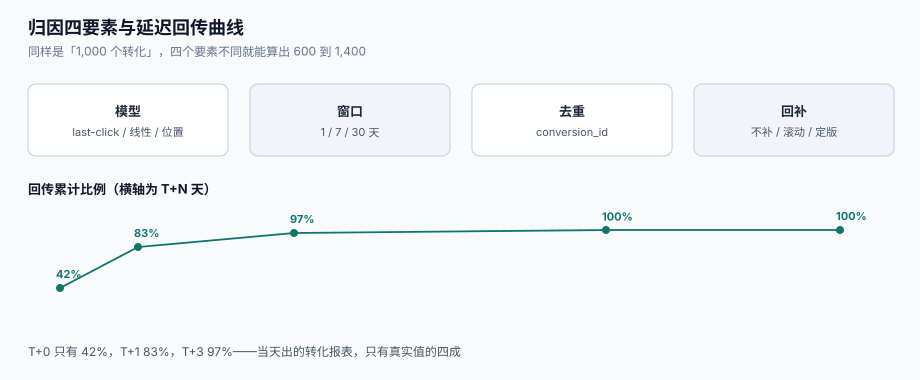

# 归因与回传：窗口、延迟与丢失

「这次投放带来了 1,000 个转化」这句话，只有在说清四件事之后才有意义：**算给谁（模型）、算多久（窗口）、算哪次（去重）、算到几号（回补）**。四个要素任意一个没写死，同一批数据就能算出 600 到 1,400 之间的任何数字，而且每个数字都能自圆其说。

这一页讲归因窗口的实测量级、四种归因模型的取舍、延迟回传为什么会让日报系统性偏低，以及跨设备与去重的边界。



本页判据族 `ADT-A` ~ `ADT-H`，共 8 条。定义表在第六节。

## 一、归因的四要素

| 要素 | 回答什么 | 取值 | 选错的后果 |
| --- | --- | --- | --- |
| **模型**（model） | 功劳算给谁 | last-click / first-click / 线性 / 位置 / 数据驱动 | 「品牌词抢自然流量」的第一大原因 |
| **窗口**（window） | 回溯多久 | 1 / 7 / 30 天（点击）；1 天（曝光） | 本机 1 天 vs 30 天差 **51.72%** |
| **去重**（dedup） | 同一次转化算几次 | 单次归因 / 可重复归因 | 重复归因让总数超过真实转化 |
| **回补**（backfill） | 迟到的转化怎么进报表 | 不补 / 滚动补 / 定版 | 不补 = 日报永远偏低 |

四者**必须写进同一份配置**，并且**报表页脚要显示这四个值**。只写「转化数 1,024」而不写口径，等于没写。

## 二、窗口：1 天与 30 天差一半

本机模拟（50,000 次点击、转化延迟服从均值 36 小时的指数分布、整体转化率 3%）：

| 窗口 | 归因到的转化数 | 相对 30 天口径 |
| --- | --- | --- |
| 1 天（点击） | **773** | 少记 **51.72%** |
| 7 天（点击） | 1,589 | 少记 **0.75%** |
| 30 天（点击） | 1,601 | 基准 |

注意 1,601 是「30 天内发生的全部转化」，不是「总转化」——超过 30 天的尾部没算。这也是为什么**所有窗口口径都要写「≤N 天」**，而不是「全部」。

::: danger 注意
1. **不要用「当天」当默认窗口**。按日记账很自然，但它把「今天点击、明天购买」的转化全部漏掉；电商大类里这个比例通常在 30%~55%。
2. **不要让不同渠道用不同窗口还放在一张表里比**。搜索 30 天、信息流 1 天，放在一起排序等于「谁窗口长谁赢」。
3. **不要把曝光窗口与点击窗口混成一个数**。曝光归因（view-through）通常只有 1 天，点击归因 7~30 天；混在一起会让「没点也归因」的比例失控。
:::

## 三、模型：四种常见口径的取舍

| 模型 | 规则 | 适合 | 最大的坑 |
| --- | --- | --- | --- |
| **末次点击**（last-click） | 100% 给最后一次点击 | 直接响应类（搜索、CPC） | 品牌词吃掉自然流量的功劳 |
| **首次点击**（first-click） | 100% 给第一次 | 拉新评估 | 老客复购的功劳全给拉新 |
| **线性**（linear） | 平均分给路径上每个触点 | 多渠道预算分配 | 把「曝光」与「点击」等同 |
| **位置**（position-based） | 首末各 40%、中间分 20% | 长决策链 | 参数拍脑袋，不可解释 |

::: tip 一条务实建议
**模型不是越先进越好，而是要「能解释」**。数据驱动模型（DDA）在预算分配上更准，但广告主问「为什么这个渠道降了 30%」时你答不出来，续约就会掉。生产上常见做法是：**结算用末次点击（可解释），内部优化用 DDA（更准），两者并列展示**。
:::

## 四、延迟回传：日报为什么永远偏低

转化不是即时上报的：用户下单后可能过几分钟才付款、退款要等 7 天、线下核销要等更久。本机按典型电商形态设定的回传累计比例：

| 时间点 | 已回传比例 | 当天报表会显示的转化 |
| --- | --- | --- |
| T+0（当天） | **42.00%** | 只有 42% |
| T+1 | 83.00% | 83% |
| T+3 | 97.00% | 97% |
| T+7 | 99.50% | 99.5% |
| T+30 | 100% | 定版 |

也就是说：**任何一份「当天出、当天看」的转化报表，都只有真实值的四成左右**。而它是优化师每天唯一会看的报表。

### 4.1 三种回补机制

| 机制 | 做法 | 优点 | 缺点 |
| --- | --- | --- | --- |
| **不补** | 报表按「事件发生日」记账，之后不再改 | 简单、可审计 | 日报永久偏低，越好越明显 |
| **滚动补** | 每天回刷最近 N 天的数据 | 近期准确 | 历史数字会「变」，被质疑 |
| **定版**（T+N 冻结） | T+7 定版，之后不再改 | 可比、可结算 | 需要两套数（实时 / 定版） |

工业界常见的是「**两套数并存**」：实时看板（滚动补，用于优化）+ 结算报表（定版，用于收钱）。关键是**页面上标清楚这是哪一套**，否则同一天两个页面显示两个转化数，信任立刻崩塌。

## 五、去重与跨设备

| 场景 | 现象 | 后果 | 处理 |
| --- | --- | --- | --- |
| 同一转化被多渠道回传 | 广告平台与媒体各记一次 | 总转化 > 真实转化 | 以广告主侧 `conversion_id` 为准，做全局去重 |
| 同一用户多设备 | 手机点击、平板下单 | 归因丢失或重复 | 登录态优先；无登录态时不做强归因 |
| 退款/取消 | 转化发生后又撤销 | 归因偏高 | 引入「有效转化」状态，退款后扣减 |
| 归因回传重试 | 同一 `conversion_id` 到两次 | 转化翻倍 | 回传接口幂等，按 ID 去重 |

跨设备在隐私收紧后基本只能靠**登录态**。没有登录态时，「跨设备归因」在技术上做不到，产品上就不要承诺——**承诺了做不到，比不承诺更贵**。

## 六、本页判据

| 判据 | 看什么现象 | 判成什么 | 不满足时改哪里 |
| --- | --- | --- | --- |
| `ADT-A` | 每个转化指标都能说出模型 / 窗口 / 去重 / 回补四个值 | 口径可解释 | 报表页脚输出四元组，缺一项则该指标不上线 |
| `ADT-B` | 点击窗口 ≥ 7 天（或与合同一致），且不超过 30 天 | 不漏主要转化 | 配置项 `click_window_days`，默认 7，上限 30 |
| `ADT-C` | 曝光归因（view-through）单独配置，不与点击窗口混用 | 归因不虚高 | 拆成两个字段 `vt_window` 与 `click_window` |
| `ADT-D` | 回传接口按 `conversion_id` 幂等 | 不重复计数 | 唯一索引 + `on conflict do nothing` |
| `ADT-E` | 有「定版」机制（T+N 冻结），且实时数与定版数并列展示 | 结算可复现 | 建 `report_snapshot(stat_date, version)`，定版写 `final=1` |
| `ADT-F` | 退款/取消会扣减归因转化，且有状态字段 | 不虚报效果 | 加 `conversion_status`，退款写 `REFUNDED` 并冲销 |
| `ADT-G` | 无登录态时不做跨设备强归因 | 不承诺做不到的 | 归因逻辑里按 `has_login` 分流 |
| `ADT-H` | 报表显示「截至 T+N 的回传率」 | 读者知道数据成熟度 | 加一列 `backfill_rate`，与转化数并列 |

## 七、验证方式

`ADT-D`（回传幂等）与 `ADT-B`（窗口影响）各一条：

```shell
# 1) 回传幂等：同一 conversion_id 到两次，只计一次
python3 - <<'PY'
import sqlite3
db = sqlite3.connect(":memory:")
db.execute("create table conv(conversion_id text primary key, value_cents int)")
for cid, v in [("cv-1", 19900), ("cv-1", 19900)]:
    db.execute("insert or ignore into conv values (?,?)", (cid, v))
print(db.execute("select count(*), sum(value_cents) from conv").fetchone())
PY
```

预期输出：`(1, 19900)`。若输出 `(2, 39800)`，回传接口不幂等，**转化金额直接翻倍**。

```shell
# 2) 窗口影响：同一批延迟分布下，1/7/30 天各归因多少
python3 - <<'PY'
import random
r = random.Random(20261026)
delays = [r.expovariate(1/36.0) for _ in range(50000)]          # 均值 36 小时
conv = [d for d in delays if r.random() < 0.03]
for w in (1, 7, 30):
    print(w, sum(1 for d in conv if d <= 24*w), end="  ")
print("total", len(conv))
PY
```

预期输出大约为 `1 773  7 1589  30 1601  total 1601`（固定种子下完全一致）。**1 天窗口只记得住 48.28%**——这就是「日报转化总比周报少一半」的原因。

```shell
# 3) 回传率与报表成熟度：T+0 的报表应显示回传率，而非「最终值」
python3 - <<'PY'
cum = {0: 0.42, 1: 0.83, 3: 0.97, 7: 0.995}
for t, v in cum.items():
    print(f"T+{t}: {v:.1%}")
PY
```

预期输出：`T+0: 42.0%` 到 `T+7: 99.5%`。若你的报表在 T+0 就给出「最终转化数」，它一定偏低 58%。

## 八、参考资料

- IAB Europe《Retail Media Measurement Standards》（30 天点击回看为默认，可按品类收窄）：<https://iabeurope.eu/wp-content/uploads/IAB-Europe_Retail-Media-Measurement-Standards-2024.pdf>
- IAB/MRC《Viewable Ad Impression Measurement Guidelines》（曝光与可见曝光的定义）：<https://www.iab.com/guidelines/iab-measurement-guidelines/>
- Google Ads 帮助《归因模型与归因路径》：<https://support.google.com/google-ads/answer/1722022>
- Apple《AdAttributionKit》（隐私受限环境下的聚合归因）：<https://developer.apple.com/documentation/adattributionkit>
- IAB Tech Lab《Event & Conversion API》（转化事件的标准结构）：<https://iabtechlab.com/standards/>
