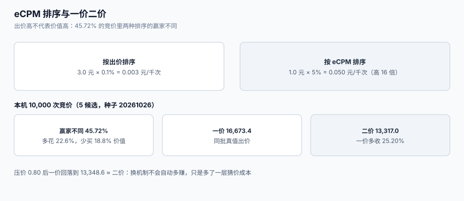

# 竞价与排序：eCPM、一价二价与压价

「谁出价高谁赢」是竞价系统里最贵的一句话。一次展示对媒体的价值不是出价，而是**出价 × 预期点击 × 预期转化**——一个出价 3 元、点击率 0.1% 的广告，对媒体的真实价值是 0.003 元/千次；一个出价 1 元、点击率 5% 的广告，价值是 0.05 元/千次，**后者高 16 倍**。按出价排序，媒体把库存卖给了前者。

这一页讲清楚排序键、两种定价机制、以及为什么会「自己压自己的价」，最后给出超时与并列这两种边界情况的处理。



本页判据族 `ADA-A` ~ `ADA-H`，共 8 条。定义表在第六节。

## 一、排序键是 eCPM，不是出价

对**按展示计费**的广告，排序键是：

```text
eCPM = bid_cpm × pCTR × pCVR × 1000      # 元/千次；pCTR/pCVR 为 0~1
```

对按点击计费（CPC）的广告，`bid_cpm` 先换算：

```text
bid_cpm = bid_cpc × pCTR × 1000
eCPM    = bid_cpm × pCVR = bid_cpc × pCTR × pCVR × 1000
```

本机模拟（10,000 次竞价、每次 5 个候选、出价对数正态、真实 pCTR 服从 Beta(1.2, 18)）：

| 指标 | 按出价排序 | 按 eCPM 排序 |
| --- | --- | --- |
| 赢家不同 | —— | **4,572 / 10,000 = 45.72%** |
| 总花费（相对单位） | 35,561 | 29,008 |
| 买到的 eCPM 价值 | 2,217 | 2,729 |

即：**按出价排序多花 22.6% 的钱，买到 18.8% 更少的价值**。这不是「效果差一点」，是「钱花反了方向」。

::: danger 注意
1. **不要把 `pCTR` 当排序里的「锦上添花」**。只让 6 个候选里的 2 个（模拟新广告冷启动乐观）pCTR 高估 **1.5 倍**，**14.09%** 的 top1 就被改写了——每 7 次展示就有 1 次买错人。
2. **不要用「历史 CTR」直接当 pCTR**。历史 CTR 的方差随曝光量下降，新广告的 CTR 是「0/5」还是「0/5000」在小样本下都会算出 0，必须做平滑（贝叶斯平滑或置信下界），否则新广告永远拿不到量。
3. **不要在排序里混用不同币种的 `bid`**。多币种场景下 `bid` 必须先在**同一次竞价内**换成同一币种再排序，否则汇率 1% 的差异就能改变赢家。
:::

## 二、一价与二价：结算价不是出价

| 机制 | 赢家付多少 | 优点 | 缺点 |
| --- | --- | --- | --- |
| **一价**（first price） | 自己的出价 | 简单、收入高 | 广告主必须猜对手，猜错就「赢家的诅咒」 |
| **二价**（second price） | 第二名的出价（通常 +0.01） | 出真值是最优策略 | 收入偏低、易被「出价策略」套利 |
| **二价带底价**（soft floor） | `max(second, floor)` | 保护媒体收益 | 底价定高会直接杀填充率 |

本机模拟（20,000 次、5 个候选、估值服从 U(0,1)、所有买方按真值出价）：

| 机制 | 媒体收入（相对单位） |
| --- | --- |
| 一价 | 16,673.4 |
| 二价 | 13,317.0 |

一价比二价**多收 25.20%**——这正是平台想换一价的原因，也是广告主反弹的原因。

### 2.1 为什么会「自己压自己的价」

一价下，若所有买方都知道是一价、且估值独立同分布 U(0,1)、对手数 `k`，则对称均衡的出价是：

```text
bid = (k-1)/k × value        # k=5 时，压到 0.80
```

本机把出价统一乘 0.80 后，一价收入变成 **13,348.6**——几乎正好回到二价的 **13,317.0**。

::: tip 这条读数的含义
**换成一价并不会自动多赚 25%**。短期（对手还没适应）会多收；中期所有 DSP 都学会压价后，收入回到二价水平，而**市场多了一层「猜价」成本**（谁猜得准谁占便宜，与广告效果无关）。所以「一价还是二价」不是纯技术选择，它决定了你要不要建一套压价模型。
:::

## 三、压价：把「猜对手」变成可算的函数

一价下 DSP 的核心问题：给定自己的估值 `v` 与对手出价分布 `F`，出多少能最大化期望收益？

```text
期望收益 = (v − b) × P(win | b)
P(win | b) = F(b)^(k-1)                # k-1 个对手都低于 b
对 b 求导取零 → b* = v − F(b*)/F'(b*)
```

工程上不需要解解析式，用**分位数回归**就够：拿过去 30 天的赢价分布，取目标胜率对应的分位点，再乘一个安全系数。

| 策略 | 胜率 | 单位收益 | 适用 |
| --- | --- | --- | --- |
| 出真值（`b = v`） | 最高 | 最低（赢家诅咒） | 二价、或预算极充裕 |
| 固定压价（`b = 0.8v`） | 中 | 中 | 对手少、分布稳定 |
| 分位数压价（`b = Q_{1-α}(win)`） | 可控（≈α） | 高 | 生产环境默认 |
| 按库存类型分桶压价 | 分桶内可控 | 最高 | 需要足够样本 |

::: danger 注意
1. **不要用「昨天的赢价」直接压今天的价**。大促、周末、早晚高峰的赢价分布完全不同；用错分布会把胜率压到个位数，而报表上只表现为「今天没量」。
2. **不要把压价和「预算不足」混成一个开关**。预算不足应该少参与竞价（见[预算与平滑](../Pacing/index.md)），而不是把出价压低——压价会让你在**所有**竞价里都输，包括那些本该赢的。
3. **不要在二价环境里也压价**。二价下出真值是最优策略，压价只会降低胜率而不降低成交价（成交价由对手决定），**纯亏**。
:::

## 四、底价与保留价：媒体的另一把刀

底价（floor）不是「价格」，是**媒体的退出选项**：低于底价宁可不卖。三种写法差别很大：

| 写法 | 语义 | 后果 |
| --- | --- | --- |
| 硬底价（hard floor） | 低于此价一律不出 | 填充率下降，但单价上升 |
| 软底价（soft floor） | 低于此价仍可成交，但按底价结算 | 兼容填充与单价，实现复杂度最高 |
| 动态底价（dynamic floor） | 按流量价值实时算 | 收益最高，但**必须能解释**（广告主会问「为什么这次底价高」） |

底价与 `bidfloor` 的关系：`bidfloor` 是**请求里带的**（买方能看到），动态底价通常是**卖方内部逻辑**（买方看不到）。两者不一致时，以「买方能看到的那一个」为竞价约束，以「卖方内部的那一个」为成交门槛——**这是对账差异的高发点**（同一批展示，DSP 算出该赢 100 次，媒体账上只成交 92 次）。

## 五、并列、超时与「赢家确定」

这三个边界情况合起来造成的差异，往往比排序算法本身更大：

| 情况 | 常见做法 | 问题 | 建议 |
| --- | --- | --- | --- |
| 两个 bid eCPM 完全相等 | 按到达顺序 / 随机 | 不可复现，同一请求重算结果不同 | 用 `(eCPM desc, bid_id asc)` 做**确定性**打破并列 |
| `tmax` 内未回包 | 直接丢弃 | 丢弃率被算进「无需求」 | 单独统计 `timeout_rate`，并区分「超时」与「无候选」 |
| 赢家素材渲染失败 | 仍记为一次曝光 | 广告主为看不到的展示付费 | 渲染回调后才计曝光（见[出价与计费](../Bidding/index.md)） |
| 多 `imp` 同请求 | 一次请求多个广告位 | 部分成功时「填充率」怎么算 | 按 `imp` 计填充率，不按请求 |

本机延迟读数（5,000 次模拟竞价，五段耗时相加）：

| 段 | 均值（ms） | 说明 |
| --- | --- | --- |
| 请求解码 | 0.50 | 反序列化 + 校验 |
| 定向匹配 | 2.80 | 人群/上下文过滤 |
| 特征拉取 | 8.96 | 最大不确定源（远端 KV / 特征库） |
| 模型推理 | 10.98 | pCTR / pCVR |
| 竞价决策 | 0.30 | 排序 + 定价 |
| **合计** | **23.53** | p50 **23.57**、p99 **32.67** |

把预算压到 **30 ms** 时，**5.06%** 的请求会因为超过 `tmax` 被丢弃。这 5% 不是均匀丢的——**它们集中在特征拉取最慢的那批请求上**，也就是「画像最丰富、最可能被定向命中」的用户。丢得越狠，效果越差，而报表只显示「填充率 95%」。

## 六、本页判据

| 判据 | 看什么现象 | 判成什么 | 不满足时改哪里 |
| --- | --- | --- | --- |
| `ADA-A` | 排序键是 `bid × pCTR × pCVR`（或等价 eCPM），不是裸 `bid` | 排序正确 | 排序函数只接受 eCPM；裸 bid 排序仅用于调试开关 |
| `ADA-B` | 定价机制在请求/合同中明确（一价或二价），代码只有一条路径 | 结算可预期 | 用配置项 `pricing_model` 显式声明，禁止「按对手数猜」 |
| `ADA-C` | 二价实现里成交价 = `min(second_price, bid) + tick`，且不超过赢家出价 | 不出现「成交价高于出价」 | 加断言 `settle <= winner_bid`，违反即拒绝该次竞价 |
| `ADA-D` | 一价环境下有压价策略，且压价系数可按库存类型分桶 | 收益可控 | 用赢价分位数替代固定系数，按小时/版位分桶 |
| `ADA-E` | 并列时用确定性规则打破（如 `bid_id` 升序） | 可复现 | 在排序比较器末尾加第三键 |
| `ADA-F` | `timeout_rate` 与 `no_candidate_rate` 分开统计 | 失败可归因 | 回包状态码区分 `TIMEOUT` / `NO_BID` / `NO_CANDIDATE` |
| `ADA-G` | `bidfloor` 与内部底价不一致时有对账记录 | 差异可解释 | 落 `floor_snapshot`，记录两侧底价 |
| `ADA-H` | 竞价结果可按 `request_id` 重放出同一赢家与同一价格 | 可追责 | 记录参与排序的全部候选（脱敏后）与各自 eCPM |

## 七、验证方式

`ADA-C`（成交价不得高于出价）与 `ADA-E`（并列可复现）都可以用一段脚本验证：

```shell
# 1) 二价结算：成交价必须 <= 赢家出价，且 >= 第二名
python3 - <<'PY'
tick = 0.01
bids = [{"id": "a", "ecpm": 1.20}, {"id": "b", "ecpm": 2.00}, {"id": "c", "ecpm": 3.50}]
ranked = sorted(bids, key=lambda x: (-x["ecpm"], x["id"]))
winner, second = ranked[0], ranked[1]
settle = min(winner["ecpm"], second["ecpm"] + tick)
print("winner:", winner["id"], "settle:", round(settle, 2), "ok:", second["ecpm"] <= settle <= winner["ecpm"])
PY
```

预期输出：`winner: c settle: 2.01 ok: True`。**如果 `ok` 是 `False` 或出现 `settle > 3.50`，说明二价实现把「第一名出价」当成了成交价**——这是最贵的一类 bug。

```shell
# 2) 并列可复现：两个候选 eCPM 完全相同，跑三次看赢家是否一致
python3 - <<'PY'
bids = [{"id": "z9", "ecpm": 1.0}, {"id": "a1", "ecpm": 1.0}]
for _ in range(3):
    w = sorted(bids, key=lambda x: (-x["ecpm"], x["id"]))[0]
    print("winner:", w["id"])
PY
```

预期输出三行都是 `winner: a1`。若出现 `z9`，说明排序不稳定（例如用了 `set` 或未指定第三键），同一请求重算会换赢家。

```shell
# 3) 排序键自检：按出价排序 vs 按 eCPM 排序，赢家是否不同
python3 - <<'PY'
c = [("A", 3.0, 0.001), ("B", 1.0, 0.05)]      # (广告, 出价元/千次, pCTR)
by_bid = max(c, key=lambda x: x[1])[0]
by_ecpm = max(c, key=lambda x: x[1] * x[2])[0]
print("by_bid:", by_bid, "by_ecpm:", by_ecpm)
PY
```

预期输出：`by_bid: A by_ecpm: B`。这就是本页主张的最小反例——出价高 3 倍的广告，真实价值只有对方的 1/16。

## 八、参考资料

- IAB Tech Lab《OpenRTB 2.6》（`at` 字段的竞价类型、`bidfloor` 语义）：<https://github.com/InteractiveAdvertisingBureau/openrtb2.x>
- Prebid 文档《Auction 与价格规则》（header bidding 下的排序与底价实现）：<https://docs.prebid.org/prebid-server/endpoints/openrtb2.html>
- Vickrey, W.《Counterspeculation, Auctions, and Competitive Sealed Tenders》（1961，二价拍卖的原始论述）：<https://doi.org/10.1111/j.1540-6261.1961.tb02789.x>
- Myerson, R.《Optimal Auction Design》（1981，保留价与最优机制）：<https://doi.org/10.1287/moor.6.1.58>
- IAB Tech Lab《Supply Chain Foundations》（底价与链路透明的关系）：<https://iabtechlab.com/standards/supply-chain-foundations/>
