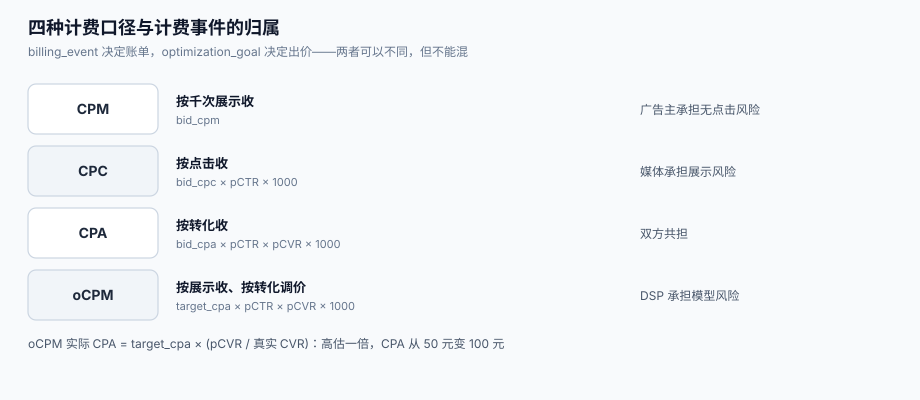

# 出价与计费：CPM、CPC 与 oCPM

「出价」和「计费」是两件事，但代码里最容易被写成一件。出价是**你愿意为一次机会付多少**，计费是**这一次机会最后按什么事件收钱**。CPM 按展示收、CPC 按点击收、oCPM 按展示收但**用转化调价**——三者的出价公式完全不同，而账单只有一张。

这一页讲四种计费口径的换算、oCPM 为什么会让实际 CPA 翻倍、计费事件的幂等键怎么设计，以及点击去重为什么能让账单少付 8%。



本页判据族 `ADB-A` ~ `ADB-H`，共 8 条。定义表在第六节。

## 一、四种计费口径与它们的换算

| 口径 | 按什么收钱 | 出价含义 | 换算成 eCPM 的公式 | 谁承担「无点击」的风险 |
| --- | --- | --- | --- | --- |
| **CPM** | 千次展示（固定价或竞价） | 千次展示多少钱 | `bid_cpm` | 广告主 |
| **CPC** | 每次点击 | 每次点击多少钱 | `bid_cpc × pCTR × 1000` | 媒体（展示不收费） |
| **CPA** | 每次转化 | 每次转化多少钱 | `bid_cpa × pCTR × pCVR × 1000` | 媒体 + DSP 共担 |
| **oCPM** | 千次展示（**按转化目标优化**） | 目标转化成本 | `target_cpa × pCTR × pCVR × 1000` | DSP（承诺优化，不承诺结果） |

关键差别在**风险落点**：CPC 下媒体承担「展示了没人点」的风险；oCPM 下媒体仍按展示收钱，但 DSP 承诺「按转化优化」，于是**风险转移到 DSP 的模型上**——模型高估转化率，DSP 就按高价买垃圾流量。

::: danger 注意
1. **不要把 oCPM 出价写成 `target_cpa × pCTR`**。漏掉 `pCVR` 会让出价在同一目标成本下**放大 1/pCVR 倍**；`pCVR=0.02` 时就是 50 倍。
2. **不要用「目标 CPA」当「实际 CPA」汇报**。本机读数：目标 CPA 50 元、pCVR 高估 2 倍，实际 CPA 变成 **100 元**（+100.00%）——而系统里所有配置项都写着 50。
3. **不要在 CPC 与 oCPM 之间直接比较「出价」**。一个是元/点击、一个是元/千次展示，量纲不同；比较必须统一到 eCPM 或统一到「单位转化成本」。
:::

## 二、oCPM 的算法：为什么 pCVR 一错就翻倍

```text
出价（元/千次） = target_cpa × pCTR × pCVR × 1000
实际 CPA        = 消耗 / 转化数
                = (展示数 / 1000 × 出价) / (展示数 × pCTR × 真实CVR)
                = target_cpa × (pCVR / 真实CVR)
```

也就是说：**实际 CPA 与 `pCVR/真实CVR` 成正比**。本机读数：

| 场景 | target_cpa | pCVR 估计 | 真实 CVR | 实际 CPA | 偏差 |
| --- | --- | --- | --- | --- | --- |
| 校准准确 | 50 | 0.02 | 0.02 | 50.0 | 0 |
| 高估 1 倍 | 50 | 0.04 | 0.02 | **100.0** | +100.00% |
| 低估一半 | 50 | 0.01 | 0.02 | **25.0** | −50.00% |

高估的后果不只是「贵」，还有**逆向选择**：愿意接受 100 元 CPA 的流量，往往是「看起来会转化、实际不转化」的那批（例如误点、诱导下载）。所以 oCPM 系统必须有**校准层**（isotonic / Platt scaling），并按周对拍「预估 vs 实际」。

### 2.1 计费口径与出价口径不一致时

最常见的事故：**按 oCPM 出价，但按 CPC 结算**。此时账单 = 点击 × `bid_cpc`，而出价是按 `target_cpa × pCTR × pCVR` 算的，两者不通。工程上必须显式声明两层：

```text
billing_event = IMPRESSION | CLICK | CONVERSION     # 按什么收钱
optimization_goal = CLICK | CONVERSION | VALUE      # 按什么调价
```

`billing_event` 决定账单，`optimization_goal` 决定出价。两者可以不同（oCPM = 按展示收钱、按转化调价），但**不能混为一谈**，否则「优化目标改成转化」会顺带把账单改成按转化收。

## 三、计费事件与幂等：一次展示只能收一次钱

计费事件的唯一键不是「请求 ID」，而是**「哪一次展示、哪一个计费事件」**：

| 事件 | 唯一键 | 为什么不能用别的 |
| --- | --- | --- |
| 曝光 | `impression_id` | 用 `request_id` 会把「一次请求多个广告位」算成一次 |
| 点击 | `click_id`（或 `impression_id + seq`） | 用户双击会产生两个 `click_id`，必须去重 |
| 转化 | `conversion_id`（广告主侧） | 用时间窗去重会把「同一用户两次真实购买」合并 |

三类重复来源，机制完全不同：

1. **客户端重试**：SDK 上报失败后重发，同一 `event_id` 到达两次。→ 靠唯一索引 `insert or ignore`。
2. **双击/误触**：用户在 300 ms 内点了两次，产生两个不同的 `click_id`。→ 靠「同一 `impression_id` 在 T 秒内只计一次」。
3. **监测链多跳**：媒体监测 → 第三方监测 → DSP 监测，每一跳都记一次。→ 靠 `event_id` 全程透传，**不许各跳自造 ID**。

本机读数（200,000 次真实曝光、CTR 1.20%、点击重复率 8%）：

| 指标 | 按点击日志 | 按去重后 |
| --- | --- | --- |
| 点击行数 | 2,592 | 2,400 |
| CTR | **1.27%** | **1.20%** |
| 按 0.5 元/点击计费 | **1,296 元** | 1,200 元 |

**相对虚高 5.88%，账单多付 8.0%。**

::: danger 注意
1. **不要在计费链路里用「应用层先查后改」做去重**。20 线程并发下先查后改会漏；必须用数据库唯一约束或分布式锁，判据见[实战](../Practice/index.md)的 `ADX-D`。
2. **不要把「退款/调整」当成新事件写进流水**。调整是**对已有事件的更正**（负数冲销），要引用原 `impression_id`；写成新事件会让「曝光数」跟着变化，导致历史报表不可比。
3. **不要在曝光回调里计费，除非素材确实渲染了**。素材 404、被浏览器拦截、容器尺寸为 0 时仍回调曝光，是「为看不到的展示付费」的主要来源。
:::

## 四、点击去重：三种窗口与它们的边界

| 去重策略 | 规则 | 漏判（该去的没去） | 误判（不该去的去了） |
| --- | --- | --- | --- |
| 同 `impression_id` 只计一次 | 最严格 | 少 | **多**：用户真点了两次只算一次 |
| 同 `impression_id` + 300 ms 窗口 | 时间窗 | 少 | 少（更贴近「双击」的真实形态） |
| 同 `user_id` + 1 s 窗口 | 跨广告位 | 中 | 中：同一用户在两个广告位各点一次是合法的 |

工程默认取第二种，并把「被去重的次数」单独计数——它本身是一个质量指标：**去重率突然升高，通常意味着前端有重试风暴或有人在刷**。

## 五、计费上限与超投保护

预算只约束「总量」，不约束「单次」。两类上限必须分开设：

| 上限 | 作用 | 设错的后果 |
| --- | --- | --- |
| **日预算** | 一天的总额 | 设太小：下午断量；设太大：超投 |
| **出价上限**（bid cap） | 单次竞价的最高出价 | 设太高：一次异常流量吃掉半天预算 |
| **小时预算** | 晚间高峰的配额 | 不设：早高峰把钱花光 |
| **账户级上限** | 多计划共享 | 不设：一个计划跑飞拖垮整个账户 |

超投（花超预算）通常来自三处：**并发扣减**（两个请求同时读到「还剩 10 元」）、**延迟计费**（曝光先发生、扣费后到）、**时区错位**（预算按 UTC 重置而报表按本地时区）。三处都要有独立判据，见[预算与平滑](../Pacing/index.md)。

## 六、本页判据

| 判据 | 看什么现象 | 判成什么 | 不满足时改哪里 |
| --- | --- | --- | --- |
| `ADB-A` | `billing_event` 与 `optimization_goal` 两个字段分开配置、分别落库 | 收钱与调价解耦 | 建 `campaign_billing` 表，两列都要有值且有枚举约束 |
| `ADB-B` | oCPM 出价公式含 `pCVR`，且 `pCVR` 有校准记录 | 实际 CPA 可控 | 加校准层，按周输出「预估 vs 实际」报告 |
| `ADB-C` | 计费事件有唯一键，重复写入不改变金额 | 计费可重放 | 唯一索引 + `on conflict do nothing`，金额只在首次插入时写 |
| `ADB-D` | 点击去重按 `impression_id` + 时间窗，被去重次数单独统计 | 去重可观测 | 加 `deduped_clicks` 指标，按小时看趋势 |
| `ADB-E` | 曝光只在素材渲染回调后计费 | 不为空展示付费 | 把曝光上报从「响应返回」挪到「渲染完成」 |
| `ADB-F` | 账单可按 `impression_id` 追溯到请求、出价、成交价、计费价 | 可自证 | 建 `billing_detail` 宽表，字段齐全 |
| `ADB-G` | 退款/冲销是对原事件的负数更正，引用原 ID | 历史可比 | 加 `adjustment_of` 字段，禁止无源冲销 |
| `ADB-H` | 出价上限（bid cap）与日预算分别生效，且都有超限拒绝日志 | 不跑飞 | 竞价前双重检查，超限返回 `NO_BID` 并计 `capped` 计数 |

## 七、验证方式

`ADB-C`（计费幂等）与 `ADB-B`（CPA 偏差）各有一条可跑的命令：

```shell
# 1) 计费幂等：同一 impression 的点击事件灌两次，金额只加一次
python3 - <<'PY'
import sqlite3
db = sqlite3.connect(":memory:")
db.execute("create table click_billing(click_id text primary key, impression_id text, cost_cents int)")
rows = [("c-1", "imp-1", 50), ("c-1", "imp-1", 50)]      # 同一次点击上报两次
for r in rows:
    db.execute("insert or ignore into click_billing values (?,?,?)", r)
print(db.execute("select count(*), sum(cost_cents) from click_billing").fetchone())
PY
```

预期输出：`(1, 50)`。若输出 `(2, 100)`，说明唯一键建在了 `impression_id` 之外的列上，或压根没建。

```shell
# 2) oCPM 的 CPA 偏差：pCVR 高估 2 倍，实际 CPA 翻倍
python3 - <<'PY'
target, pctr, true_cvr, est_cvr = 50.0, 0.01, 0.02, 0.04
bid = target * pctr * est_cvr * 1000          # 元/千次
imp = 1_000_000
conv = imp * pctr * true_cvr
print("bid:", round(bid, 2), "cpa:", round(imp/1000*bid/conv, 1))
PY
```

预期输出：`bid: 20.0 cpa: 100.0`。目标 50 元、实际 100 元——**如果只看配置项，这个偏差永远不会被发现**。

```shell
# 3) 点击去重的边界：同一 impression 两次点击（间隔 200ms）应只计一次
python3 - <<'PY'
events = [("imp-1", 0), ("imp-1", 200), ("imp-1", 900)]
WIN = 300
kept, last = [], {}
for imp, ts in events:
    if imp not in last or ts - last[imp] > WIN:
        kept.append((imp, ts)); last[imp] = ts
print("kept:", kept)
PY
```

预期输出：`kept: [('imp-1', 0), ('imp-1', 900)]`——间隔 200 ms 的那次被去掉，间隔 900 ms 的那次保留（用户确实又点了一次）。

## 八、参考资料

- IAB Tech Lab《OpenRTB 2.6》（`at` 竞价类型、`billing` 相关字段）：<https://github.com/InteractiveAdvertisingBureau/openrtb2.x>
- IAB/MRC《Ad Impression Measurement Guidelines》（impression 的定义：开始渲染）：<https://www.iab.com/guidelines/iab-measurement-guidelines/>
- 国家市场监督管理总局《互联网广告管理办法》（第十一条诱导点击、第十四条档案三年）：<https://www.gov.cn/gongbao/2023/issue_10506/202306/content_6885261.html>
- Google Ads 帮助《关于出价策略与目标转化成本》：<https://support.google.com/google-ads/answer/6268632>
- Prebid 文档《Price Buckets 与计费口径》：<https://docs.prebid.org/>
