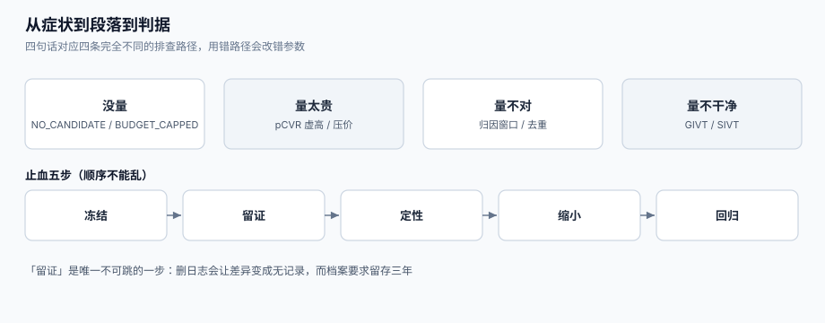

# 常见问题与分诊

投放系统出问题时，症状通常只有四句话：「没量」「量太贵」「量不对」「量不干净」。这四句话各自对应完全不同的排查路径，而**用错路径的代价是改错参数**——把「没量」当「出价低」去加价，往往只是在为无效流量多付钱。

这一页给一张十二行分诊表、十二个高频问题的结论、一份止血顺序、一份八问合规自查，以及术语对照。



本页判据族 `ADQ-A` ~ `ADQ-H`，共 8 条。定义表在第六节。

## 一、十二行分诊表

| 症状 | 先看哪里 | 最可能的原因 | 常见误判 | 去哪一页 |
| --- | --- | --- | --- | --- |
| 完全没有量 | `auction_log.outcome` | `NO_CANDIDATE`（定向太窄）/ `BUDGET_CAPPED` | 「出价太低」 | [预算与平滑](../Pacing/index.md) |
| 上午有量、下午没量 | 分小时花费曲线 | 预算无平滑，14 点烧完 | 「流量变差」 | [预算与平滑](../Pacing/index.md) |
| 有量但没点击 | 曝光分母与素材 | 曝光含预加载/未渲染 | 「素材不行」 | [报表与对账](../Reporting/index.md) |
| CTR 突然翻倍 | 点击去重率 | 前端重试或刷量 | 「素材爆了」 | [出价与计费](../Bidding/index.md) |
| 转化数日报偏低 | 回传率 | 归因窗口 1 天 + 无回补 | 「效果变差」 | [归因与回传](../Attribution/index.md) |
| 转化数比广告主多一倍 | 归因模型与去重 | 多渠道重复归因 | 「广告主统计错了」 | [归因与回传](../Attribution/index.md) |
| 消耗超预算 | `reserved_cents` | 缺冻结额 / 并发扣减 | 「媒体多算」 | [预算与平滑](../Pacing/index.md) |
| 成交价高于出价 | 定价实现 | 把一价写成二价、或 tick 加错 | 「交易所坑人」 | [竞价与排序](../Auction/index.md) |
| 同一用户反复看到 | 四层频控 | 只做了单计划层 | 「频控没生效」 | [定向与频控](../Targeting/index.md) |
| 人群规模预估离谱 | 估算口径 | 用乘积代替采样 | 「DMP 数据不准」 | [定向与频控](../Targeting/index.md) |
| 媒体说我们没回包 | `timeout_rate` | `tmax` 太紧、特征拉取慢 | 「网络问题」 | [竞价与排序](../Auction/index.md) |
| 广告主投诉广告不可关闭 | 前端渲染 | 关闭按钮样式/层级问题 | 「浏览器兼容」 | 本页第四节 |

## 二、十二个高频问题

**Q1：出价提高 20% 为什么量只涨 3%？**
因为赢的是**边际竞价**：第 1 名与第 2 名的价差往往很小，提价 20% 只能多赢那些「原本差一点」的竞价，而这部分占比很小。要显著增量，通常要动**定向**（扩大候选）或**预算**（别在下午烧完），而不是出价。

**Q2：为什么 CPC 单价降了，总成本反而升了？**
CPC 降会带来更多点击，但**转化率不一定同比例上升**。检查 `pCVR` 是否被低质流量拉低：本机读数里，pCVR 高估 1 倍会让实际 CPA 从 50 元涨到 100 元。看「单位转化成本」，不要看「点击单价」。

**Q3：一价还是二价？**
短期一价多收（本机 +25.20%），中期所有买方学会压价后回到二价水平（0.80 压价后 13,348.6 vs 13,317.0）。**如果对手都是成熟 DSP，一价不会让你多赚，只会让市场多一层猜价成本。**

**Q4：为什么同一批数据算出两个 CTR？**
去重口径不同。本机：按日志 **1.27%**、按去重 **1.20%**，相对差 5.88%。报表必须标口径，否则两个都对、两个都不能用。

**Q5：曝光数和媒体账单差 2% 正常吗？**
正常，属于「口径差」里的重复上报（预加载、iframe 重载）。**超过 5% 就要查**，通常是监测像素在多处重复触发。

**Q6：可见曝光一定要买吗？**
不一定，但**合同必须写清按哪个结算**。可见标准是 50% 像素 ≥1 秒（视频 ≥2 秒，超大位 30% ≥1 秒），两个数通常差 30% 以上；混报会让结算无法核对。

**Q7：频控做了三层，为什么用户还是看很多次？**
三层如果各存各的计数，就会「层层合规、总量超标」。四层必须共享同一份计数存储与同一个 `user_key`。

**Q8：为什么跨零点会多投？**
自然日固定窗口在零点清零。本机：12 次跨零点请求，固定窗口放行 **4** 次、滑动窗口 **3** 次。改用滑动窗口或按用户时区对齐。

**Q9：归因窗口选 7 天还是 30 天？**
看决策周期。本机模拟：1 天只记得住 48.28%，7 天 99.25%。**默认 7 天，长决策品类用 30 天**，并在报表页脚写明。

**Q10：转化延迟回传要不要补？**
要。T+0 只有 42%、T+1 83%、T+3 97%。不补的话每天的日报都系统性偏低，且**越到月末越显得「效果变差」**。

**Q11：无效流量要过滤掉多少？**
不设目标值。目标是**让过滤可见**：GIVT/SIVT 分列、过滤量单独出表、原始日志不删。本机 2% 的设备能抬高 CTR 62.43%，说明「少量作弊就能显著污染指标」。

**Q12：预算花不完怎么办？**
先分清是「没需求」（`NO_CANDIDATE`）还是「没赢」（`NO_BID` 占比高）。前者扩定向/提底价，后者查出价与压价策略；**不要一律加预算**。

## 三、止血五步

出事时的顺序不能乱，因为后面的步骤依赖前面的数据：

1. **冻结**：暂停出问题的计划或把预算调到 0，**先止血再定位**。
2. **留证**：导出最近 6 小时的 `auction_log` 与 `billing_detail`，**不要删日志**。
3. **定性**：用分诊表定位到「段」，再定位到「判据编号」（如 `ADB-C` 计费幂等）。
4. **缩小**：能否只影响一个渠道/一个版位/一个定向包？能缩小就先缩小，别整体回滚。
5. **回归**：修复后跑 P1~P12 负向用例 + Q1~Q6 验收 SQL，两条都为 0 才恢复。

::: danger 注意
1. **不要用「删数据」止血**。删掉异常曝光会让「差异」变成「无记录」，监管与广告主都会追问原始数据（《互联网广告管理办法》第十四条要求电子数据保存不少于三年）。
2. **不要先改出价**。「没量」的默认动作如果是加价，你会在原因还没查清时把预算花在更贵的流量上。
3. **不要跳过留证**。绝大多数「说不清」的事故，都是因为事发时把日志清了。
:::

## 四、合规自查八问（中国境内投放）

依据《互联网广告管理办法》（市场监管总局令第 72 号，2023-05-01 施行）：

| # | 自查问题 | 对应条款 | 工程落点 |
| --- | --- | --- | --- |
| 1 | 广告是否有显著「广告」标识，与自然内容可区分？ | 第九条 | 渲染模板强制带标识位，竞价结果里不可关闭 |
| 2 | 竞价排名结果是否显著标「广告」并与自然结果分开？ | 第九条第二款 | 搜索结果页的广告位单独组件，禁用「伪装成自然结果」的样式 |
| 3 | 弹窗/开屏是否**一键关闭**，且不属于五种违规情形？ | 第十条 | 关闭按钮尺寸、层级、无二次确认，写进前端规范 |
| 4 | 是否存在虚假更新/报错/奖励等诱导点击？ | 第十一条 | 素材审核规则 + 创意模板白名单 |
| 5 | 广告档案（主体验证、内容核对、投放记录）是否留存 ≥3 年？ | 第十四条 | 建 `ad_archive`，与投放日志同生命周期 |
| 6 | 算法推荐广告的规则与投放记录是否入档？ | 第十五条 | 定向与出价策略版本号写入档案 |
| 7 | 未成年人场景是否排除了禁用品类？ | 第十二条 | 定向层按受众年龄强制排除，且不可被计划覆盖 |
| 8 | 是否在政务服务类结果中插入了竞价排名广告？ | 第十七条 | 版位白名单里直接禁用该类页面 |

::: warning 一条经验
**合规项不要做成「文案提醒」**，要做成**渲染层的硬约束**：标识位由模板注入、关闭按钮尺寸由组件库固定、未成年人排除由定向服务强制叠加。做成「运营记得勾选」，就一定会有一次忘勾。
:::

## 五、术语表

| 中文 | 英文 | 一句话解释 |
| --- | --- | --- |
| 千次展示成本 | CPM | 每一千次展示的价格 |
| 单次点击成本 | CPC | 每一次点击的价格 |
| 目标转化成本 | target CPA | oCPM 的出价目标 |
| 有效千次展示收益 | eCPM | `bid × pCTR × pCVR × 1000`，排序键 |
| 实时竞价 | RTB | 每次展示单独拍卖 |
| 供给方平台 | SSP | 代表媒体卖库存 |
| 需求方平台 | DSP | 代表广告主买流量 |
| 广告交易平台 | ADX | 撮合买卖的交易所 |
| 供应链对象 | schain | 声明这次请求经过了谁 |
| 一般无效流量 | GIVT | 爬虫、机房 IP 等可规则识别的无效流量 |
| 复杂无效流量 | SIVT | 设备农场、点击劫持等需行为分析的无效流量 |
| 可见曝光 | viewable impression | 50% 像素 ≥1 秒（视频 ≥2 秒） |
| 归因窗口 | attribution window | 点击/曝光后多久内的转化算功劳 |
| 预算平滑 | pacing | 控制预算在时间上的分布 |

## 六、本页判据

| 判据 | 看什么现象 | 判成什么 | 不满足时改哪里 |
| --- | --- | --- | --- |
| `ADQ-A` | 每种「没量/没效果」的报障都能落到分诊表的某一行 | 分诊可用 | 补 `outcome` 枚举，让症状有数据支撑 |
| `ADQ-B` | 止血流程含「冻结 → 留证 → 定性 → 缩小 → 回归」五步 | 不乱改参数 | 写进值班手册，配一键冻结开关 |
| `ADQ-C` | 事故期间原始日志不被删除，只改状态 | 可审计 | 过滤只写 `traffic_status`，禁止 `delete` |
| `ADQ-D` | 广告标识由渲染模板注入，不依赖运营配置 | 合规兜底 | 模板层强制加标识，配置项不可关闭 |
| `ADQ-E` | 弹窗/开屏的关闭按钮符合「一键关闭」且无五种违规形态 | 合规底线 | 组件库固定尺寸与层级，走视觉验收 |
| `ADQ-F` | 广告档案（主体、内容、投放记录）留存 ≥3 年 | 可举证 | 建归档表与冷存储策略，定期抽检 |
| `ADQ-G` | 未成年人场景的品类排除是强制的、不可被计划覆盖 | 合规硬约束 | 定向服务里叠加系统级排除规则 |
| `ADQ-H` | 事故复盘产出的是「判据编号 + 修复项」，不是「加强管理」 | 可落地 | 每条结论必须挂一个判据 ID |

## 七、验证方式

```shell
# 1) 分诊可用性：给一个「下午没量」的样本，脚本必须指到 pacing
python3 - <<'PY'
log = [("10", 120), ("11", 140), ("12", 130), ("13", 90), ("14", 10), ("15", 0), ("16", 0)]
early, late = sum(v for h, v in log if int(h) <= 12), sum(v for h, v in log if int(h) >= 15)
print("early:", early, "late:", late, "diagnosis:", "PACING_BURNED_OUT" if late == 0 and early > 0 else "CHECK_TARGETING")
PY
```

预期输出：`early: 390 late: 0 diagnosis: PACING_BURNED_OUT`。若输出 `CHECK_TARGETING`，说明分诊规则把「烧完」误判成「定向太窄」。

```shell
# 2) 合规自查：渲染模板必须带广告标识，缺了就构建失败
python3 - <<'PY'
templates = {"banner_300x250": "ad-label", "native_feed": "", "splash": "ad-label"}
missing = [k for k, v in templates.items() if v != "ad-label"]
print("missing_label:", missing)
PY
```

预期输出：`missing_label: ['native_feed']`——原生信息流最容易漏标识，而它恰恰最需要（第九条要求与自然内容可区分）。

```shell
# 3) 归档留存：抽查 3 年前的档案是否可查
python3 - <<'PY'
import datetime as dt
today = dt.date(2026, 10, 26)
archive = {"ad-2023-05-01": dt.date(2023, 5, 1), "ad-2024-02-10": dt.date(2024, 2, 10)}
print({k: (today - v).days >= 365 * 3 for k, v in archive.items()})
PY
```

预期输出：`{'ad-2023-05-01': True, 'ad-2024-02-10': False}`——第一条已满 3 年（仍需保留，条款是「不少于三年」），第二条未满。**如果归档系统里两条都查不到，就是合规缺口**。

## 八、参考资料

- 国家市场监督管理总局《互联网广告管理办法》（第九、十、十一、十二、十四、十五、十七条）：<https://www.gov.cn/gongbao/2023/issue_10506/202306/content_6885261.html>
- IAB/MRC《Viewable Ad Impression Measurement Guidelines》：<https://www.iab.com/guidelines/iab-measurement-guidelines/>
- MRC《Invalid Traffic Detection and Filtration Guidelines》：<https://mediaratingcouncil.org/guidelines>
- IAB Tech Lab《OpenRTB 2.6》与 Supply Chain Foundations：<https://iabtechlab.com/standards/supply-chain-foundations/>
- IAB Europe《Transparency & Consent Framework》（同意状态与定向退化）：<https://iabeurope.eu/transparency-consent-framework/>
