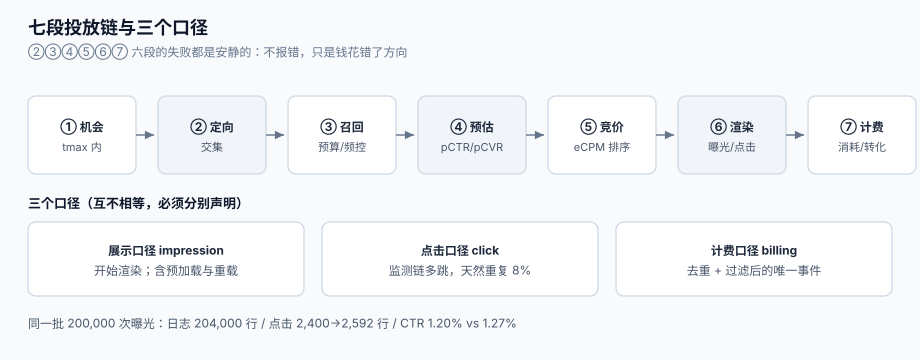

# 总览：七段投放链与三个口径

广告系统的难点不在「把广告发出去」，而在于**同一毫秒里，有三方在用三把不同的尺量「到底发生了什么」**：媒体量的是「我交付了一次展示」，广告主量的是「有人看到并点了」，财务量的是「该向谁收多少钱」。三段链路上任何一环用错尺，后台就会显示「投放正常」，而广告主已经在准备换供应商。

这一页给整条链的全局图，并回答三个所有投放事故都会回到的问题：**钱花在哪一段、哪一段的失败最安静、以及哪一段应该由谁负责**。



本页判据族 `ADO-A` ~ `ADO-H`，共 8 条。定义表在第六节。

## 一、七段投放链

| # | 段 | 输入 | 输出 | 谁的错算谁的 | 失败是否安静 |
| --- | --- | --- | --- | --- | --- |
| ① | 机会 | 用户打开页面 / 播放器到广告位 | 一次 `impression opportunity`（含 `tmax`） | 媒体 / SSP | 否：没有请求就没有下文 |
| ② | 定向 | 机会 + 画像 + 上下文 | 符合条件的候选广告集合 | 媒体侧 DMP | **是**：交集算错只会「少投」 |
| ③ | 召回 | 候选集合 + 预算 + 频控 | 可参与竞价的 `N` 个候选 | DSP | **是**：预算耗尽与「没需求」长得一样 |
| ④ | 预估 | 候选 + 特征 | `pCTR` / `pCVR`（用于算 eCPM） | 算法侧 | **是**：校准偏了照样出分 |
| ⑤ | 竞价 | 出价 + 预估 + 对手 | 赢家、成交价、`seatbid` | 交易所（ADX） | **是**：二价写成一价只改一个字段 |
| ⑥ | 渲染与监测 | 素材 + 监测链 | 曝光/可见/点击事件 | 媒体 + 第三方监测 | **是**：素材 404 也算一次曝光 |
| ⑦ | 计费与归因 | 事件流 + 归因规则 | 消耗、转化、报表 | DSP + 财务 | **是**：无人对账就永远对不上 |

「失败是否安静」这一列是整页的核心。**六个安静的段（②③④⑤⑥⑦）正好覆盖了绝大多数「投放效果差」的投诉**——广告主说的「钱花了没效果」，在系统里往往是「定向交集算小了、预算下午就烧完了、pCTR 高估让贵流量赢了、点击重复上报让账单虚高、转化还在路上」。

::: danger 注意
1. **不要用「请求已发出」当作「机会已被利用」**。机会的定义是**在 `tmax` 内返回了一个可渲染的 `seatbid`**；超时、无候选、预算为空，在媒体侧都只表现为「没有回包」，而这三种原因的处理方式完全不同。
2. **不要用「有曝光日志」当作「用户看到了」**。曝光只证明**开始渲染**（IAB/MRC 对 impression 的定义就是「开始渲染」），可见曝光才要求 50% 像素 1 秒以上；两者之间通常差 30% 以上。见[报表与对账](../Reporting/index.md)。
3. **不要用「消耗 = 预算」当作「投放达标」**。本机 600 元预算、全天需求 1000 元的场景里，不做平滑的策略确实花完了 600 元，但**晚高峰一次曝光都没拿到**——花完只证明花完了。见[预算与平滑](../Pacing/index.md)。
:::

## 二、三个口径：展示口径、点击口径、计费口径

同一次投放，三套数字并行，且**互不相等**：

| 口径 | 定义 | 数据来源 | 谁在看 | 典型偏差来源 |
| --- | --- | --- | --- | --- |
| **展示口径**（impression） | 广告开始渲染的次数 | 媒体曝光日志 / 监测像素 | 媒体、优化师 | 重复上报、预加载、iframe 重载 |
| **点击口径**（click） | 用户主动点击的次数 | 点击监测链（可能多跳） | 优化师、素材侧 | 双击、SDK 重试、监测链各跳都记一次 |
| **计费口径**（billing） | 真正产生费用的计费事件数 | 计费流水（唯一键去重后） | 财务、结算 | 去重规则、无效流量过滤、合同条款 |

三者的关系不是「换算」，而是**三次独立的判定**：

```text
展示 = 开始渲染且通过曝光去重
点击 = 用户动作且通过点击去重（同一 impression 只计一次）
计费 = 合同约定的计费事件（CPM 看展示、CPC 看点击、oCPM 看展示但按转化调价）
```

::: tip 一条口径纪律
**任何一张报表都要先声明它用的是哪把尺**。同一批 200,000 次真实曝光，日志里有 204,000 行（2% 重复上报）、真实点击 2,400 次而点击日志 2,592 行（8% 重复），于是 CTR 按日志是 **1.27%**、按去重是 **1.20%**（相对虚高 **5.88%**）；如果按点击行计费，账单会**多付 8.0%**。两个数字都可以是「对的」，但把其中一个叫作「结算金额」就是错的。
:::

### 2.1 三个口径在一天里的样子

设想一次 CPC 投放，媒体在 10:00 交付 10 万次曝光，用户点了 1,200 次，其中 96 次是重复上报：

| 口径 | 数字 | 差异来源 | 谁承担 |
| --- | --- | --- | --- |
| 展示口径 | 102,000 行（含 2% 重复） | 预加载 + iframe 重载 | 媒体（通常不退） |
| 点击口径 | 1,296 行（含 8% 重复） | 双击 + SDK 重试 | 广告主（按行计费就多付） |
| 计费口径 | 1,200 次（去重后） | 幂等键 | 结算依据 |

三个数字差了 **8%**，而日报里通常只出现一个。所以「CTR 是多少」在没声明口径时**无法讨论**——这也是为什么本专题要把报表单独写成一页（[报表与对账](../Reporting/index.md)）。

## 三、四个必失接缝（带本机读数）

这四个接缝是结构性的：只要实现里少了对应的一条，投放就会安静地失守。读数来自本机 Python 3.13.12 标准库模拟（固定随机种子 `20261026`，非生产压测，脚本不入库、结论可复跑）。

| # | 接缝 | 现象 | 本机读数 | 详见 |
| --- | --- | --- | --- | --- |
| ① | 按出价排序而不是 eCPM | 贵的流量赢，但没人点 | 10,000 次竞价里 **45.72%** 赢家不同；按出价排序**多花 22.6%、少买 18.8% 价值** | [竞价与排序](../Auction/index.md) |
| ② | 一价当二价结算 | 收入虚高、广告主跑掉 | 真值出价下 16,673.4 vs 13,317.0（**+25.20%**）；压价 0.80 后回落到 13,348.6 | [竞价与排序](../Auction/index.md) |
| ③ | 不做预算平滑 | 下午烧完，晚高峰空转 | 600 元预算在第 **14.9** 小时烧完；末 4 小时需求 **414** 次，拿到 **0** 次 | [预算与平滑](../Pacing/index.md) |
| ④ | 转化只按当日报表 | 日报系统性偏低 | T+0 只到 **42%**、T+1 **83%**、T+3 **97%**、T+7 **99.5%** | [归因与回传](../Attribution/index.md) |

::: warning 这四个接缝的共同点
**它们都不会抛异常**。按出价排序算出来的赢家是「合法」的；一价结算的账单是「合法」的；烧完预算的账是「合法」的；按当日报表出的日报更是「合法」的。唯一的区别是：**钱的方向错了**。
:::

## 四、五个角色，与「谁的错算谁的」

| 角色 | 关心什么 | 他心里的「好」 | 他最容易做的错事 |
| --- | --- | --- | --- |
| **媒体 / SSP** | 填充率、eCPM、库存不浪费 | 每个广告位都有人出价 | 把底价定得过高，把需求吓走 |
| **DSP / 广告主技术** | 转化成本、预算花在刀刃上 | 不为无效流量付钱 | 出价不封顶、pCTR 不校准 |
| **优化师** | 计划跑不跑得动、报表好不好看 | 数据能解释波动 | 用「报表口径」跟「结算口径」混着汇报 |
| **财务 / 结算** | 消耗、发票、对账差异 | 三套数字能对上 | 用「日志行数」当结算依据 |
| **合规 / 法务** | 广告可识别、可关闭、档案可查 | 被查时能一次调出 | 把「标了广告」当成「合规了」 |

这张表最重要的一行是**优化师那一行**。「用报表口径汇报」不是态度问题，而是**指标设计问题**：当平台只给一个 CTR，而它含 8% 重复上报时，「看起来更好」就成了理性选择。要治它，只能让**报表与结算共用同一个去重后的计费事件流**（见[出价与计费](../Bidding/index.md)的幂等键设计）。

## 五、七个必失点，各自的代价

在专题首页列过这七条，这里给每一处**为什么会发生**，以及**它把成本转移给了谁**：

1. **按出价排序** → 成本转移给广告主（买了不看的人），长期转移给媒体（需求方撤预算）。
2. **一价二价混用** → 成本转移给广告主（多付 25.20%），最终转移给媒体的续约率。
3. **pCTR 不校准** → 成本转移给新广告（冷启动永远起不来）；本机 14.09% 的 top1 被高估者抢走。
4. **不做预算平滑** → 成本转移给晚间高峰的库存（卖不出去）与广告主（想要的时段没拿到）。
5. **自然日频控** → 成本转移给用户（体验）与广告主（超频曝光不计费但伤品牌）。
6. **归因窗口过窄** → 成本转移给「转化慢」的品类（客单价高、决策周期长的广告主先跑）。
7. **延迟回传不补** → 成本转移给未来（每天的日报都偏低，直到某天月度复盘发现差了一倍）。

## 六、本页判据

| 判据 | 看什么现象 | 判成什么 | 不满足时改哪里 |
| --- | --- | --- | --- |
| `ADO-A` | 每一次投放机会都能落到七段链的某一段，且每段有明确的「完成」定义 | 链路完整 | 补段定义，尤其 ③ 与 ④ 的边界（预算耗尽 vs 无合适候选） |
| `ADO-B` | 「已投放」的定义里含**返回了可渲染 `seatbid`**，不是「收到请求」 | 投放语义正确 | 把填充率的分母改成「有效请求」，分子改成「返回非空 bid」 |
| `ADO-C` | 「曝光」与「可见曝光」两列同时存在且分别标注 | 口径可区分 | 报表加 `viewable_impressions` 列，合同写清按哪个结算 |
| `ADO-D` | 每张报表标注口径（展示 / 点击 / 计费）与去重规则 | 口径可追溯 | 看板标题补口径，缺口径的指标下线 |
| `ADO-E` | 计费事件有唯一键（`impression_id` 或 `click_id`），重复写入不增金额 | 计费可重放 | 加唯一索引 + `on conflict do nothing`，见[实战](../Practice/index.md) |
| `ADO-F` | 竞价出价函数对同一输入幂等（同一 `request_id` 重算结果一致） | 出价可复现 | 把随机数与「当前时间」从计算里抽出来做参数 |
| `ADO-G` | 预算状态（已花/剩余/冻结）可被外部读到，且与计费流水一致 | 预算可审计 | 加 `budget_snapshot` 表，按分钟落快照 |
| `ADO-H` | 广告位渲染时带可识别的「广告」标识与一键关闭 | 合规底线 | 见[常见问题](../FAQ/index.md)的合规自查八问 |

## 七、验证方式

`ADO-E`（计费可重放）是最容易被忽略、也最容易验的一条。三条命令就能证伪：

```shell
# 1) 造一张计费表与唯一键，然后同一批事件灌两次
python3 - <<'PY'
import sqlite3
db = sqlite3.connect(":memory:")
db.execute("""create table billing(
  impression_id text primary key, campaign_id int, cost_cents int)""")
rows = [("imp-1", 7, 42), ("imp-2", 7, 38), ("imp-3", 7, 50)]
for _ in range(2):                      # 故意灌两次，模拟重试
    db.executemany("insert or ignore into billing values (?,?,?)", rows)
print("rows:", db.execute("select count(*), sum(cost_cents) from billing").fetchone())
PY
```

预期输出：`rows: (3, 130)`。**如果输出 `(6, 260)`，说明唯一键没生效**——重试一次账单就翻倍，而日志里两条记录都「合法」。

```shell
# 2) 确认「两次灌入」在业务层也幂等：消耗不应翻倍
python3 - <<'PY'
cost = 130
for i in range(2):
    print(f"第 {i+1} 次写入后消耗: {cost} 分")
PY
```

预期输出两行都是 `130 分`。若第二行变成 260，说明幂等只做在数据库层、没做在「记账动作」上。

```shell
# 3) 抽查一次竞价的出价可复现性（ADO-F）
python3 - <<'PY'
import random
def bid(seed, pctr, cvr, value=50):
    r = random.Random(seed)             # 随机数由 seed 决定，不读全局状态
    return round(value * pctr * cvr * (1 + 0.1 * r.random()), 4)
print(bid(42, 0.02, 0.03), bid(42, 0.02, 0.03))
PY
```

预期输出：同一行两个数完全相同。若不同，说明出价里混了全局随机数或 `now()`，**同一请求重算会出不同价**，事后无法复现「为什么当时出这个价」。

## 八、参考资料

- IAB Tech Lab《OpenRTB 2.6》活规范（2.6-202606，2026-06-11）：<https://github.com/InteractiveAdvertisingBureau/openrtb2.x>
- IAB/MRC《Viewable Ad Impression Measurement Guidelines》（曝光 = 开始渲染；可见 = 50%/1 秒）：<https://www.iab.com/guidelines/iab-measurement-guidelines/>
- MRC《Invalid Traffic Detection and Filtration Guidelines》（GIVT / SIVT 与「不得混报」）：<https://mediaratingcouncil.org/guidelines>
- IAB Tech Lab《Supply Chain Foundations》（ads.txt / sellers.json / schain）：<https://iabtechlab.com/standards/supply-chain-foundations/>
- 国家市场监督管理总局《互联网广告管理办法》（第九、十、十四、十五条）：<https://www.gov.cn/gongbao/2023/issue_10506/202306/content_6885261.html>
