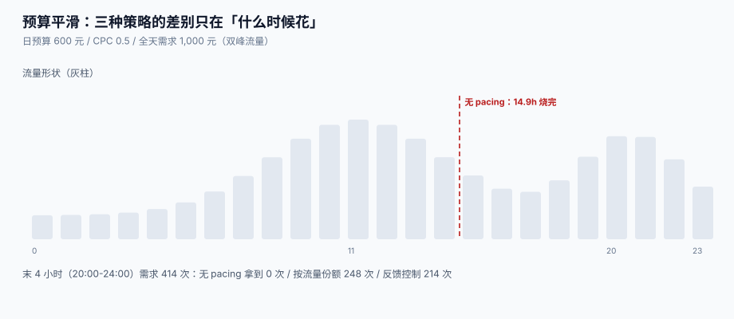

# 预算与平滑：烧完、均匀与反馈

预算是一个**只约束总量、不约束节奏**的约束。这在工程上意味着：只要你不管，系统就会用「最快能花完的速度」把钱花光——因为每一次竞价单独看都是划算的。于是最常见的事故不是「超预算」，而是**下午三点烧完，晚上八点的黄金时段一次曝光都没有**，而报表上写着「预算 100% 执行」。

这一页讲预算的四层结构、三种平滑策略的实测差别、超投的三条路径，以及为什么「花完」和「花对」是两个指标。



本页判据族 `ADP-A` ~ `ADP-H`，共 8 条。定义表在第六节。

## 一、预算的四层结构

| 层 | 作用 | 重置周期 | 与下层的关系 |
| --- | --- | --- | --- |
| **账户预算** | 一个广告主的总额 | 月 / 日 | 所有计划之和的上限 |
| **计划预算**（campaign） | 一个活动的额度 | 日 / 总 | ≤ 账户剩余 |
| **广告组预算**（ad set） | 一个策略组合的额度 | 日 | ≤ 计划剩余 |
| **出价上限**（bid cap） | 单次竞价的最高价 | 不重置 | 不消耗预算，只限制单次 |

四层是**串联扣减**，顺序错了会出现「下层还有钱、上层已经空了」的尴尬：

```text
可花 = min(账户剩余, 计划剩余, 广告组剩余) − 已冻结
```

`已冻结`（reserved）是第三个数：**竞价赢了但还没计费**的金额。少了这一项，两个并发请求会同时看到「还剩 10 元」，各花 8 元，**超投 60%**。

## 二、三种平滑策略，实测差多少

本机模拟：日预算 **600 元**、CPC **0.5 元**、全天需求 **2,000 次点击（=1,000 元）**，流量按双峰曲线分布（11 点小峰、20:30 主峰）。

| 策略 | 花掉 | 烧完时间 | 末 4 小时（20:00-24:00）拿到的曝光 |
| --- | --- | --- | --- |
| **无 pacing**（能买就买） | 600 元 | **第 14.9 小时** | **0** 次（需求 414 次） |
| **按预测流量份额分配** | 600 元 | 全天 | **248** 次 |
| **反馈控制**（剩余/剩余时间 + 偏差修正） | 600 元 | 全天 | **214** 次 |

三者的**花费完全一样**（都是 600 元，预算执行率 100%），差别全在**什么时候花**。而「什么时候花」直接决定了两件事：晚间高峰的库存有没有人买、广告主有没有拿到他想要的时段。

::: danger 注意
1. **不要用「预算执行率」当健康指标**。100% 执行率在无 pacing 下同样成立——它只证明钱花完了，不证明花对了。要看的是**分小时的花费曲线与流量曲线的相关性**。
2. **不要用「剩余预算 / 剩余小时」做朴素均匀**。它假设流量在一天里是平的；真实流量在 20 点能到凌晨的 5 倍，朴素均匀会在低谷时段买一堆没人看的量。
3. **不要在没有预算的时候还参与竞价**。预算为 0 仍发 `bid response`，赢了之后再丢弃，会让媒体的填充率统计虚高、让你自己的胜率统计虚高，两边都被污染。
:::

### 2.1 反馈控制怎么写才不震荡

朴素 PID 在预算平滑上会震荡，因为**被控对象是延迟的**（花的钱要过几秒才落账）。工程上常用的简化形式：

```text
每小时速率 = (剩余预算 / 剩余小时) / CPC × (1 − k × 偏差)
偏差       = (已花 − 理想已花) / 总预算      # 正 = 花快了
k          ≈ 0.6                            # 修正系数，>1 会震荡
```

本机按 `k=0.6` 跑出的结果就是上表的「反馈控制」：末 4 小时 214 次，比按流量份额略少（因为它不知道流量形状），但比无 pacing 好得多。

## 三、超投的三条路径

| 路径 | 机制 | 现象 | 修法 |
| --- | --- | --- | --- |
| **并发扣减** | 两个请求同时读到同一份剩余额度 | 实际花费 > 预算，超投比例随 QPS 上升 | 用数据库原子扣减或 Redis Lua，禁用「读-改-写」 |
| **延迟计费** | 曝光先发生、计费事件后到 | 预算看起来还有，实际已透支 | 引入 `reserved` 冻结额，按预估价冻结、计费后释放 |
| **时区错位** | 预算按 UTC 重置、报表按本地时区 | 每天固定时段「多出」一笔额度 | 统一到账户时区，且写进合同 |

第三条最隐蔽：东八区用户在每天 08:00 会看到「预算已重置」，而 UTC 的重置点在 08:00——如果两处口径不同，就会出现**每天早高峰超投一次**的规律性现象，看起来像「早高峰流量质量好」，实际是账没对上。

## 四、暂停、冻结与「立即生效」

广告主点「暂停」时，期望是**下一次请求就不再出现**。而实际链路里至少有四个地方缓存了「这个计划是活跃的」：

| 位置 | 缓存时长 | 暂停后仍会投放的窗口 |
| --- | --- | --- |
| 竞价服务的本地计划缓存 | 30~60 s | ≤ 1 分钟 |
| 召回索引（倒排） | 分钟级 | ≤ 5 分钟 |
| 预算服务 | 秒级 | ≤ 10 秒 |
| 素材 CDN | 小时级 | 素材仍在，但不再被选 |

所以「暂停」的真实语义应该是**「在 N 秒内停止竞价」**，这个 N 要写进产品文档。做不到「立即」不是 bug，**不告诉广告主才是**。

::: tip 一条产品纪律
把「暂停生效时间」做成可见文案（例如「预计 1 分钟内停止投放」），比事后解释「缓存导致」便宜得多。同一句话也适用于「预算调整」「出价修改」「素材替换」——**所有配置变更都有生效窗口**。
:::

## 五、小时配额与峰谷

按流量份额分配预算的前提是**你能预测流量形状**。三种预测口径：

| 口径 | 数据来源 | 优点 | 缺点 |
| --- | --- | --- | --- |
| 历史同星期 | 过去 4 周同一星期几的分时曲线 | 稳定 | 遇到大促/节假日失效 |
| 实时反馈 | 最近 15 分钟的到达量 | 自适应 | 冷启动差、易震荡 |
| 混合 | 历史曲线 × 实时修正系数 | 兼顾 | 实现复杂，参数要调 |

大促当天的流量形状与平时完全不同（零点开抢、整点峰值），**只用历史曲线会在零点前把预算花光**。可行的折中是：大促日**强制关闭按份额分配，改为按小时硬配额**，并在活动开始前 2 小时把配额曲线人工确认一遍。

## 六、本页判据

| 判据 | 看什么现象 | 判成什么 | 不满足时改哪里 |
| --- | --- | --- | --- |
| `ADP-A` | 可花额度 = min(各层剩余) − 已冻结，且冻结额有独立记录 | 不超投 | 建 `budget_reservation` 表，竞价成功即冻结、计费后释放 |
| `ADP-B` | 额度扣减是原子操作（DB 条件更新或 Lua），不是「读-改-写」 | 并发安全 | 改成 `update ... where spent + ? <= total`，检查影响行数 |
| `ADP-C` | 有平滑策略且按流量形状分配，不是朴素「剩余/剩余小时」 | 预算花在高峰 | 接入分时流量曲线，按份额分配 |
| `ADP-D` | 预算耗尽后返回 `NO_BID` 并计数，不是「赢了再丢」 | 统计不污染 | 竞价前检查，超限直接返回空响应 |
| `ADP-E` | 账户时区与报表时区一致，且写进配置 | 不出现规律性超投 | 统一 `account_timezone`，报表按同一时区切日 |
| `ADP-F` | 暂停/改预算/改出价的生效窗口有明确上限并对外可见 | 承诺可兑现 | 缓存 TTL ≤ N 秒，产品文案写明 N |
| `ADP-G` | 分小时花费曲线与流量曲线的相关系数被监控 | 平滑有效 | 加一条日报指标 `pace_corr`，低于阈值告警 |
| `ADP-H` | 大促日有独立的配额策略，不复用日常曲线 | 大促不失控 | 建 `promotion_calendar`，命中即切硬配额 |

## 七、验证方式

`ADP-B`（并发扣减）与 `ADP-A`（冻结额）各一条：

```shell
# 1) 先查后改 vs 条件更新：20 个并发、预算只够 5 次
python3 - <<'PY'
import sqlite3, threading
def run(atomic):
    db = sqlite3.connect(":memory:", check_same_thread=False)
    db.execute("create table b(id int primary key, spent int, total int)")
    db.execute("insert into b values (1, 0, 500)")
    ok = []
    lock = threading.Lock()
    def worker():
        for _ in range(1):
            if atomic:
                cur = db.execute("update b set spent = spent + 100 where id=1 and spent + 100 <= total")
                if cur.rowcount == 1: ok.append(1)
            else:
                spent, total = db.execute("select spent, total from b where id=1").fetchone()
                if spent + 100 <= total:
                    db.execute("update b set spent = spent + 100 where id=1"); ok.append(1)
    ts = [threading.Thread(target=worker) for _ in range(20)]
    [t.start() for t in ts]; [t.join() for t in ts]
    spent = db.execute("select spent from b").fetchone()[0]
    return len(ok), spent
print("non-atomic:", run(False))
print("atomic    :", run(True))
PY
```

预期输出：`atomic    : (5, 500)`——条件更新下 20 个并发里只有 5 个成功、花费正好 500。`non-atomic` 那一行通常成功数 **> 5**（读到同一份剩余额度），花费超过 500，**这就是超投**。

```shell
# 2) 冻结额：赢了但未计费的钱必须占住额度
python3 - <<'PY'
total, spent, reserved = 600, 480, 100
print("available:", total - spent - reserved)     # 不扣冻结额会算成 120
PY
```

预期输出：`available: 20`。若你的实现算成 120，下一次竞价会再花 100 元，**超投 80 元**。

```shell
# 3) 平滑效果：末 4 小时的曝光占比
python3 - <<'PY'
none_tail, share_tail, demand = 0, 248, 414
print(f"no-pacing {none_tail/demand:.0%} / by-share {share_tail/demand:.0%}")
PY
```

预期输出：`no-pacing 0% / by-share 60%`。这 60% 就是「按流量份额分配」在晚高峰拿到的份额（预算 600 / 需求 1000 = 60%）。

## 八、参考资料

- Google Ads 帮助《预算与「加速投放 / 标准投放」的区别》：<https://support.google.com/google-ads/answer/6385083>
- Meta 广告帮助《Campaign Budget Optimization 与 pacing》：<https://www.facebook.com/business/help/1535148504205088>
- IAB Tech Lab《OpenRTB 2.6》（`bidfloor`、`tmax` 与预算相关的请求字段）：<https://github.com/InteractiveAdvertisingBureau/openrtb2.x>
- 国家市场监督管理总局《互联网广告管理办法》（第十四条：广告档案保存不少于三年）：<https://www.gov.cn/gongbao/2023/issue_10506/202306/content_6885261.html>
