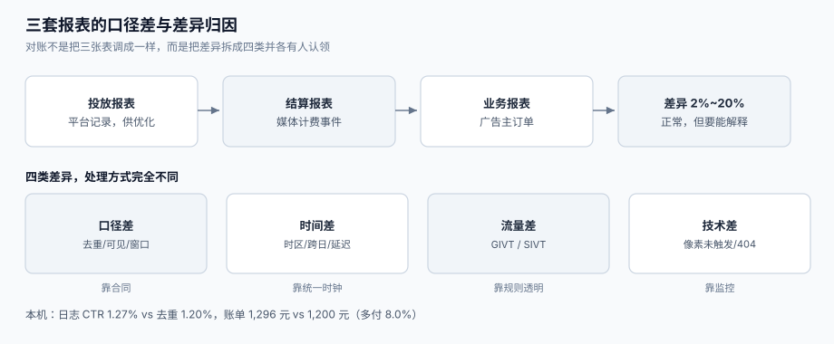

# 报表与对账：三套口径的差

媒体给 DSP 的账单、DSP 给广告主的账单、广告主自己 BI 里的数字——这三份数在**同一天、同一个计划**上通常不一致，差异幅度 2%~20% 都算正常。不正常的是：**没人能说清差在哪**。

这一页讲三套数为什么必然不同、漏斗里四个分母陷阱、差异的四类归因，以及结算单要写清的五件事（时区、币种、含税、可见口径、无效流量处理）。



本页判据族 `ADR-A` ~ `ADR-H`，共 8 条。定义表在第六节。

## 一、三套数，三种「正确」

| 报表 | 谁出 | 分子 | 分母 | 典型用途 | 天然偏差 |
| --- | --- | --- | --- | --- | --- |
| **投放报表** | DSP / 平台 | 平台记录的曝光/点击 | 平台记录 | 优化师日常看 | 含重复上报、含未过滤流量 |
| **结算报表** | 媒体 / SSP | 媒体侧的计费事件 | 媒体侧 | 收钱 | 以媒体日志为准，可能含预加载 |
| **业务报表** | 广告主 BI | 自家订单/注册 | 自家口径 | 老板看 | 归因窗口、退款、跨设备 |

三者的关系不是「谁对谁错」，而是**三个不同的观测点**。对账的目标不是把三张表调成一样，而是**把差异拆成可解释的几类，并让每一类都有人认领**。

## 二、漏斗与四个分母陷阱

```text
请求 → 填充 → 渲染 → 可见 → 点击 → 转化
```

每一步都有「该用哪个分母」的争议，四个最常见的陷阱：

| 指标 | 常见错误分母 | 正确分母 | 差多少 |
| --- | --- | --- | --- |
| **填充率** | 请求数（含重复、含无效） | 有效请求数（去重、去预加载） | 通常高估 5%~15% |
| **CTR** | 日志行数 | 去重后的曝光数 | 本机 **1.27% vs 1.20%（+5.88%）** |
| **可见率** | 曝光数（含未渲染完成） | 渲染完成的曝光数 | 通常高估 3%~10% |
| **转化率** | 点击数（含重复点击） | 去重后的点击数 | 与点击去重率同幅 |

本机读数（200,000 次真实曝光、CTR 1.20%、曝光重复 2%、点击重复 8%）：

| 指标 | 按日志 | 按去重 | 相对差 |
| --- | --- | --- | --- |
| 曝光行数 | 204,000 | 200,000 | +2.0% |
| 点击行数 | 2,592 | 2,400 | +8.0% |
| CTR | **1.27%** | **1.20%** | **+5.88%** |
| 按 0.5 元/点击的消耗 | **1,296 元** | 1,200 元 | **+8.0%** |

::: danger 注意
1. **不要在漏斗里混用「行数」与「去重数」**。上一步用行数、下一步用去重数，会算出 >100% 的转化率，然后被当成「数据 bug」放过去。
2. **不要把「可见曝光」当「曝光」汇报**。IAB/MRC 的可见标准是 **50% 像素 ≥1 连续秒**（视频 50% ≥2 秒，超大位 30% ≥1 秒）；两个数差 30% 以上是常态，混报会让合同履约无法核对。
3. **不要用「平台报表」做结算**。结算必须用**计费事件流**（去重 + 过滤后），平台报表是给人看的，不是给钱看的。
:::

## 三、差异的四类来源

对账时把差异归到这四类，每一类都有明确的处理方式：

| 类别 | 典型幅度 | 例子 | 处理 |
| --- | --- | --- | --- |
| **口径差** | 2%~10% | 去重规则、可见标准、窗口 | 合同里写死口径，不靠「沟通」 |
| **时间差** | 1%~5% | 时区、跨日边界、延迟回传 | 统一时区，结算按「事件发生时间」而非「入账时间」 |
| **流量差** | 1%~30% | 无效流量过滤、预加载 | 过滤规则双向可见，过滤量单独出表 |
| **技术差** | 0.1%~3% | 监测像素未触发、SDK 版本旧、素材 404 | 建「丢失率」指标，按渠道拆分 |

**四类的处理方式完全不同**：口径差靠合同、时间差靠统一时钟、流量差靠规则透明、技术差靠监控。把它们混成「对不上账」，就只能每次开会吵。

## 四、结算单要写清的五件事

| 项 | 为什么必须写 | 写错的后果 |
| --- | --- | --- |
| **时区** | 「一天」的定义 | 每天固定时段多/少一笔 |
| **币种与汇率** | 跨境投放必遇 | 汇率 1% 的差能吃掉毛利 |
| **含税/不含税** | 发票金额 | 财务无法入账 |
| **可见口径** | 按曝光还是可见曝光结算 | 结算基数差 30% |
| **无效流量处理** | 扣量规则与举证责任 | 双方各执一词，账期拖长 |

一个可直接抄的结算单字段清单：

```text
stat_date            统计日（含时区，如 2026-10-25 +08:00）
currency             币种（CNY / USD）
amount_ex_tax        不含税金额
tax_rate             税率
amount_inc_tax       含税金额
billing_event        IMPRESSION | CLICK | CONVERSION
countable_events     计费事件数（去重后）
filtered_events      被过滤数（GIVT / SIVT 分列）
viewability_basis    SERVED | VIEWABLE
```

## 五、时区、币种与含税：三个「小问题」

| 问题 | 现象 | 修法 |
| --- | --- | --- |
| 时区错位 | 每天 08:00 出现「预算重置」 | 账户时区统一，报表按同一时区切日 |
| 币种混用 | 同一报表里 CNY 与 USD 直接相加 | 落库时存「原币 + 汇率 + 本位币」，报表只用本位币 |
| 含税口径 | 媒体报不含税、广告主按含税预算 | 结算单双列（不含税/含税），合同写明 |

这三件事都不是「技术难题」，但**每一个都能让账期拖一个月**。

## 六、本页判据

| 判据 | 看什么现象 | 判成什么 | 不满足时改哪里 |
| --- | --- | --- | --- |
| `ADR-A` | 每张报表的页脚写明口径（分子/分母/去重规则/时区） | 口径可追溯 | 报表模板加页脚字段，缺失则该报表不上线 |
| `ADR-B` | 漏斗每一步用同一种计数方式（全去重或全不去重） | 不出现 >100% | 漏斗统一从 `billing_event` 派生 |
| `ADR-C` | 可见曝光与曝光分列，且标注可见标准 | 合同可核对 | 加 `viewable_impressions` 与 `viewability_std` 两列 |
| `ADR-D` | 无效流量过滤量单独出表，分 GIVT / SIVT | 扣量可举证 | 报表加 `filtered_givt` / `filtered_sivt` |
| `ADR-E` | 结算用计费事件流，不用平台报表 | 结算可复现 | 结算任务只读 `billing_detail` |
| `ADR-F` | 结算单含时区、币种、汇率、含税、可见口径五个字段 | 财务可入账 | 按第四节清单补齐 |
| `ADR-G` | 差异按四类（口径/时间/流量/技术）归因，每类有负责人 | 对账不吵架 | 建 `recon_diff` 表，差异必须打标签 |
| `ADR-H` | 差异率超过阈值（如 2%）自动告警并冻结结算 | 不带着差异付款 | 加对账任务，输出 `diff_rate` 并阻断 |

## 七、验证方式

`ADR-B`（漏斗不出现 >100%）与 `ADR-E`（结算只读计费流）各一条：

```shell
# 1) 混用行数与去重数会算出 >100% 的转化率
python3 - <<'PY'
clicks_rows, clicks_dedup, conv = 2592, 2400, 2450
print("mixed :", f"{conv/clicks_rows:.1%}")     # 用日志行数当分母
print("dedup :", f"{conv/clicks_dedup:.1%}")    # 用去重后当分母
PY
```

预期输出：`mixed : 94.5%`、`dedup : 102.1%`——**两个都荒谬**。正确做法是先确认「转化 2,450」这个数本身是否已去重；漏斗里任何一步混用口径，比例就会失真。

```shell
# 2) 结算只读计费流：同一天，平台报表与计费流必须能对上「金额」
python3 - <<'PY'
import sqlite3
db = sqlite3.connect(":memory:")
db.execute("create table billing(click_id text primary key, cost_cents int)")
db.executemany("insert or ignore into billing values (?,?)",
               [(f"c-{i}", 50) for i in range(2400)] + [(f"c-{i}", 50) for i in range(192)])  # 后 192 条重复
print(db.execute("select count(*), sum(cost_cents) from billing").fetchone())
PY
```

预期输出：`(2400, 120000)`，即 **1,200 元**。若输出 `(2592, 129600)`（1,296 元），说明结算读了点击日志而不是计费流，**多付 8%**。

```shell
# 3) 差异归因：四类差异之和必须等于总差异
python3 - <<'PY'
total = 1296 - 1200
parts = {"口径差": 0, "时间差": 0, "流量差": 96, "技术差": 0}
print("total:", total, "sum(parts):", sum(parts.values()), "ok:", total == sum(parts.values()))
PY
```

预期输出：`total: 96 sum(parts): 96 ok: True`。若 `ok` 为 `False`，说明差异里还有未归类的部分——**这部分不能带进结算**。

## 八、参考资料

- IAB/MRC《Viewable Ad Impression Measurement Guidelines》（50%/1 秒、50%/2 秒、超大位 30%）：<https://www.iab.com/guidelines/iab-measurement-guidelines/>
- MRC《Invalid Traffic Detection and Filtration Guidelines》（未过滤指标须单独标注）：<https://mediaratingcouncil.org/guidelines>
- IAB Tech Lab《OpenRTB 2.6》（`cur` 币种字段与多 `imp` 的计费边界）：<https://github.com/InteractiveAdvertisingBureau/openrtb2.x>
- IAB Europe《Retail Media Measurement Standards》（口径与回看窗口的行业默认）：<https://iabeurope.eu/wp-content/uploads/IAB-Europe_Retail-Media-Measurement-Standards-2024.pdf>
- 国家市场监督管理总局《互联网广告管理办法》（第十四条：档案与电子数据保存三年）：<https://www.gov.cn/gongbao/2023/issue_10506/202306/content_6885261.html>
