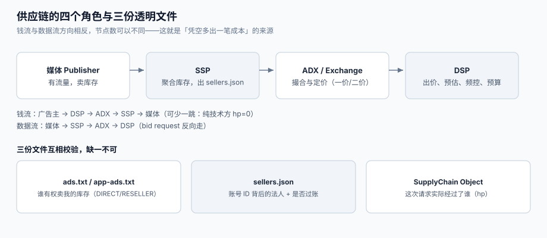

# 供应链：SSP、DSP 与 ads.txt 三角

一次程序化展示背后通常有 **4~8 个法人主体**：媒体把库存交给 SSP，SSP 转给 ADX，ADX 分发给若干 DSP，DSP 代表广告主出价——中间任何一层都可以合法地「加价转卖」。于是买家看到的 `bid request` 里，**只有一部分是自己的直接合作方**。供应链工程的全部意义就是：**让买家能证明「这一条请求是谁卖的、卖的是不是他有权卖的」**。

这一页讲三件事：谁在链路的哪一段、三份透明文件的互相引用关系、以及怎么用可计算的判据把「伪造的曝光与点击」挡在计费之前。



本页判据族 `ADS-A` ~ `ADS-H`，共 8 条。定义表在第六节。

## 一、四个角色与两条结算线

| 角色 | 替谁办事 | 收谁的钱 | 关键技术物 | 最容易被误解的地方 |
| --- | --- | --- | --- | --- |
| **媒体 / Publisher** | 自己有流量 | 向 SSP 收 | 广告位定义、`ads.txt` | 「我的库存我做主」——但价格常由 SSP 的底价决定 |
| **SSP**（Supply-Side Platform） | 媒体 | 从媒体分成 | 接 SDK/JS、聚合 ADX、`sellers.json` | 它同时是「技术方」与「收款方」，两个角色要分别声明 |
| **ADX / Exchange** | 撮合买卖 | 向 DSP 收（或向 SSP 返点） | 竞价引擎、`tmax`、二价/一价规则 | 「交易所」不等于「卖方」，`schain` 里的 `hp` 标的是**是否参与付款** |
| **DSP**（Demand-Side Platform） | 广告主 | 向广告主收服务费 | 出价、预估、频控、预算 | 「出价高就赢」——实际按 eCPM 排序，见[竞价与排序](../Auction/index.md) |

两条结算线必须分开看，否则对账永远对不上：

```text
钱流：广告主 → DSP → ADX → SSP → 媒体
数据流：媒体 → SSP → ADX → DSP（bid request 反向走）
```

**钱流与数据流方向相反，且节点数可以不同**。最常见的事故是「数据链路 4 跳、付款链路 3 跳」——中间那家只做技术转售不碰钱，于是它在 `sellers.json` 里的 `seller_type` 与 `schain` 里的 `hp` 必须写成 `INTERMEDIARY` + `hp=0`。写错会让买家把它当成收款方，链路上少一层，**对账时凭空多出一笔成本**。

## 二、OpenRTB：一次机会的报文长什么样

OpenRTB 2.6.x 是**活规范**：按日期发布非破坏性更新（最新 `2.6-202606`），所以集成时必须写死「支持到哪个日期版本」，否则对方新增的枚举值会被你静默丢弃。

一个最小的 `bid request`（省略了大量可选字段）：

```json
{
  "id": "req-7f3c",
  "tmax": 120,
  "at": 1,
  "imp": [
    {
      "id": "1",
      "banner": { "w": 300, "h": 250, "pos": 1 },
      "bidfloor": 0.35,
      "secure": 1
    }
  ],
  "site": { "domain": "news.example", "page": "https://news.example/a/42" },
  "device": { "ua": "Mozilla/5.0 ...", "ip": "203.0.113.9", "devicetype": 1 },
  "user": { "id": "u-88213" },
  "source": { "pchain": "p-001", "schain": { "complete": 1, "nodes": [] } }
}
```

字段含义与陷阱：

| 字段 | 含义 | 陷阱 |
| --- | --- | --- |
| `id` | 请求唯一标识 | **必须原样回传**；自己重生成会让日志无法 join |
| `tmax` | 允许的响应毫秒数 | 它是**总预算**，不是「网络超时」；本机读数 p99 已 32.67 ms，压到 30 ms 就有 **5.06%** 请求被丢弃 |
| `imp[].bidfloor` | 底价（元/千次） | 币种由 `cur` 决定；缺省 USD，人民币场景必须显式写 `"cur": ["CNY"]` |
| `imp[].secure` | 是否要求 HTTPS 素材 | 混内容（HTTP 素材进 HTTPS 页面）会被浏览器拦，但**竞价照样成交** |
| `source.schain` | 供应链节点 | `complete=1` 表示「我知道完整链路」；不知道却写 1 是**伪证** |

::: danger 注意
1. **不要用 `tmax` 当网络超时**。`tmax` 是从「请求发出」到「响应可用」的总预算，包含你自己的排队、特征拉取、模型推理。把它只配在网络层，等于允许「总耗时 200 ms 而 `tmax=120`」。
2. **不要给 `schain` 填一个猜出来的 `complete=1`**。规范里 `complete=1` 的含义是「本节点声明自己知道全部上游」；写错会被下游校验器判为不完整链路，直接丢请求——比不填更糟。
3. **不要忽略 `bidfloor` 的币种**。`bidfloor: 0.35` 在 USD 下是 2.5 元左右，在 CNY 下是 0.35 元，**差 7 倍**；底价读错是「明明能赢却一直不赢」的第一大原因。
:::

## 三、三份透明文件与它们的互相引用

`ads.txt` / `app-ads.txt`、`sellers.json`、SupplyChain Object 是同一套规范的三部分，**任何一份单独存在都没有校验价值**：

| 文件 | 谁发布 | 回答什么问题 | 关键字段 |
| --- | --- | --- | --- |
| `ads.txt` / `app-ads.txt` | 媒体（放自己域名根目录；App 放开发者网站） | 「哪些卖家有权卖我的库存」 | 域名、发布方账号 ID、`DIRECT` / `RESELLER` |
| `sellers.json` | 卖家（SSP/ADX） | 「这个账号 ID 背后的法人是谁、是不是过账方」 | `seller_id`、`seller_type`、`is_passthrough`、`name`、`domain` |
| SupplyChain Object（`schain`） | 每一跳都能追加 | 「这一次请求实际经过了谁」 | `asi`、`sid`、`hp`、`complete` |

`ads.txt 1.1`（2022-08）新增的两个指令值得单独记：

```text
OWNERDOMAIN=news.example      # 库存所有者的业务域名
MANAGERDOMAIN=ssp.example     # 独占管理该库存变现的域名
```

它们的作用是**把 `ads.txt` 与 `sellers.json` 真正连起来**：有了 `OWNERDOMAIN`，买家才能确认「这条 `DIRECT` 行声明的卖家，服务的确实是我这个域名」；没有它，一个 `DIRECT` 行只能证明「某个账号声称自己是直客」。

三条互相校验规则（写成代码就是[实战](../Practice/index.md)里的 `check_schain()`）：

1. **`ads.txt` 里的每一行 `seller_id`，必须能在对应 `sellers.json` 里找到同名记录**，否则该行无效。
2. **`schain.nodes` 里每个节点的 `(asi, sid)` 必须能在该 `asi` 的 `sellers.json` 里找到**；找不到即「未申报节点」。
3. **`hp`（是否参与付款）与 `seller_type`/`is_passthrough` 必须一致**：`hp=1` 的节点得是实际收款方；纯技术方要 `hp=0`。

## 四、流量质量：把「伪造」挡在计费之前

MRC/IAB 把无效流量分成两类，且明确要求**未过滤的指标必须单独标注、不得与过滤后混报**：

| 类别 | 全称 | 典型形态 | 能不能靠规则抓 |
| --- | --- | --- | --- |
| **GIVT** | General Invalid Traffic | 已知爬虫 UA、机房 IP 段、预加载/预渲染、明显异常的请求频率 | 能：名单 + 规则即可 |
| **SIVT** | Sophisticated Invalid Traffic | 设备农场、模拟器群、点击劫持、Cookie  stuffing、真机人工刷 | 难：要设备聚集、行为序列、图分析 |

本机模拟（20,000 台设备，其中 **400 台（2%）** 是点击农场，每台每次展示的点击率 0.55、其余设备 0.012）：

| 指标 | 未过滤 | 过滤后 | 差 |
| --- | --- | --- | --- |
| 曝光 | 1,400,000+ | 同 | —— |
| CTR | **1.95%** | **1.20%** | 相对虚高 **62.43%** |

也就是说：**2% 的设备可以把 CTR 抬高六成**。而按 CPC 结算时，这六成是**真金白银**。

::: tip 一条可落地的判据
不要追求「识别所有作弊」，先做到「**让作弊在报表上无法隐藏**」：曝光/点击比、单设备日点击上限、点击间隔分布、UA 与 IP 的聚集度，四个指标里任意两个异常就单独出一张「待核流量」报表，**不计入结算但不删日志**。删日志等于销毁证据，监管与广告主都会问「原始数据在哪」。
:::

## 五、本页判据

| 判据 | 看什么现象 | 判成什么 | 不满足时改哪里 |
| --- | --- | --- | --- |
| `ADS-A` | 每个交易对手都能归到「技术方 / 收款方 / 两者兼有」三类之一 | 角色清晰 | 在对接文档里给每个伙伴标 `seller_type` 与 `is_passthrough` |
| `ADS-B` | 集成文档写明支持的 OpenRTB 日期版本与已知枚举差异 | 协议可对齐 | 在 `README` 里写死 `2.6-202606`，并在 CI 里比对新旧字段 |
| `ADS-C` | `bid request` 的所有必填字段（`id`/`imp`/`tmax`）在响应里被正确回传 | 可 join | 响应构造时从请求对象取值，禁止重新生成 |
| `ADS-D` | `ads.txt` 每一行 `seller_id` 都能在 `sellers.json` 命中 | 声明可校验 | 上线前跑一次三项交叉校验，失败的行走告警 |
| `ADS-E` | `schain.complete=1` 只在「确实知道全部上游」时才写 | 不伪证 | 不确定时写 `0`，并在日志里记录「链路不完整」计数 |
| `ADS-F` | 每个节点的 `hp` 与 `seller_type` / `is_passthrough` 一致 | 付款链可还原 | 建一张 `seller_map(asi, sid, hp, passthrough)` 做一致性校验 |
| `ADS-G` | 无效流量有独立的「待核」状态，且**不删原始日志** | 可审计 | 加 `traffic_status` 枚举，过滤只改状态不改行 |
| `ADS-H` | 报表区分 GIVT 与 SIVT 的过滤量，并单独标注未过滤指标 | 符合 MRC 口径 | 报表加 `filtered_givt` / `filtered_sivt` 两列 |

## 六、验证方式

`ADS-D`（`ads.txt` ⇄ `sellers.json` 交叉校验）可以用一段脚本完整验证：

```shell
# 1) 准备两份最小样例文件，故意留一条「对不上」的 seller_id
python3 - <<'PY'
open("/tmp/sellers.json", "w").write('''{"sellers":[
 {"seller_id":"pub-001","seller_type":"PUBLISHER","name":"News Example"},
 {"seller_id":"ssp-777","seller_type":"INTERMEDIARY","is_passthrough":1,"name":"SSP"}]}''')
open("/tmp/ads.txt", "w").write("""news.example, pub-001, DIRECT
news.example, ssp-777, RESELLER
news.example, ssp-999, RESELLER
""")
print("written")
PY
```

预期输出：`written`。

```shell
# 2) 逐行校验，并打印「声明了但卖家未申报」的行
python3 - <<'PY'
import json
sellers = {s["seller_id"] for s in json.load(open("/tmp/sellers.json"))["sellers"]}
bad = []
for line in open("/tmp/ads.txt"):
    parts = [p.strip() for p in line.split(",")]
    if len(parts) >= 2 and parts[1] not in sellers:
        bad.append(parts[1])
print("checked:", len(open("/tmp/ads.txt").read().strip().splitlines()), "missing:", bad)
PY
```

预期输出：`checked: 3 missing: ['ssp-999']`。**如果 `missing` 为空，说明你把 `ads.txt` 全部当成了有效声明**——那行 `ssp-999` 会变成一条「谁都能用」的漏洞。

```shell
# 3) 校验 schain 的 hp 与 passthrough 一致（ADS-F）
python3 - <<'PY'
nodes = [{"asi": "ssp.example", "sid": "ssp-777", "hp": 1}]
seller = {"seller_type": "INTERMEDIARY", "is_passthrough": 1}
ok = (nodes[0]["hp"] == 0) if seller["is_passthrough"] else (nodes[0]["hp"] == 1)
print("consistent:", ok)
PY
```

预期输出：`consistent: False`——因为该节点是 `is_passthrough=1`（不过账），`hp` 却写了 1。改 `hp=0` 后再跑应输出 `True`。

## 七、参考资料

- IAB Tech Lab《Supply Chain Foundations》（ads.txt 1.1 于 2022-08，`OWNERDOMAIN`/`MANAGERDOMAIN`）：<https://iabtechlab.com/standards/supply-chain-foundations/>
- IAB Tech Lab《OpenRTB 2.6》与按日期发布的版本（2.6-202606）：<https://github.com/InteractiveAdvertisingBureau/openrtb2.x>
- IAB Tech Lab《AdCOM 1.0》（`seller_type`、`is_passthrough` 等对象词汇）：<https://iabtechlab.com/standards/adcom/>
- MRC《Invalid Traffic Detection and Filtration Guidelines》（GIVT/SIVT 分类与标注要求）：<https://mediaratingcouncil.org/guidelines>
- Prebid 文档《Supply Chain Object》（`schain` 实现与 `complete` 语义）：<https://docs.prebid.org/prebid-server/modules/schain.html>
