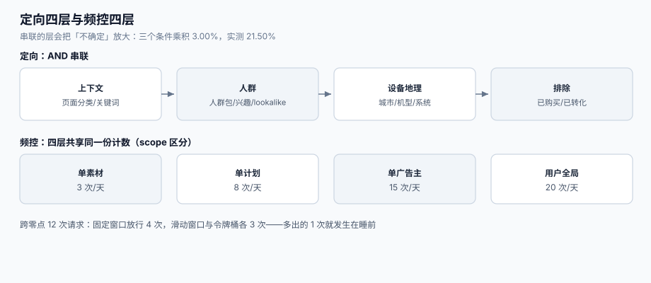

# 定向与频控：交集、四层窗口与隐私

定向系统最容易犯的错，是**把「条件命中率相乘」当成「人群大小」**。三个条件各自命中 30%、25%、40%，工程师会算 3%——但如果这三个条件描述的是同一群人（一线城市 + 高消费 + 母婴），真实交集可能是 **21.5%**，差 **7.2 倍**。预估错 7 倍，出价、预算、频控全部跟着错。

这一页讲定向的四层结构、交集估算的三种口径、频控为什么要分四层，以及跨零点那一小时为什么是频控的坟场。



本页判据族 `ADF-A` ~ `ADF-H`，共 8 条。定义表在第六节。

## 一、定向的四层结构

| 层 | 例子 | 数据来源 | 变化频率 | 出错形态 |
| --- | --- | --- | --- | --- |
| **上下文**（contextual） | 页面分类、关键词、内容体裁 | 实时解析页面 | 每次请求 | 分类器把「母婴」判成「育儿知识」 |
| **人群**（audience） | 人群包、兴趣标签、lookalike | DMP / 离线计算 | 天级 | 人群包过期，投给了三个月前的人 |
| **设备 / 地理** | 城市、运营商、机型、系统版本 | 请求头 / IP 库 | 实时 | IP 库过期，城市判错 |
| **排除**（negative） | 已购买、已转化、竞品员工 | 广告主回传 | 天级 | 回传延迟导致「刚买完还在推」 |

四层是**串联**（AND），层内是**并联**（OR）。串联时，任何一层的「不确定」都会放大：

```text
可投人群 = 上下文命中 ∩ 人群命中 ∩ 设备命中 − 排除命中
```

::: danger 注意
1. **不要在「排除」层用「可能」判定**。已购买用户被继续投放，是最伤品牌的一类错误；宁可漏排除（多投一次），不可错排除（把潜客永久拉黑）。
2. **不要用「离线人群包」做实时竞价而不加 TTL**。人群包从生成到生效常有 6~24 小时延迟，过期包会让「昨天已转化」的用户继续看到广告。
3. **不要把「设备 ID 变化」当成「新用户」**。iOS 限制追踪后设备标识不稳定，同一人可能被算成 3 个新用户，定向频次天然翻倍。
:::

## 二、交集估算：为什么能错 7 倍

三种口径，差别巨大：

| 口径 | 算法 | 1,000,000 人、三条件 30%/25%/40% 的交集 | 何时可用 |
| --- | --- | --- | --- |
| **独立性假设** | `0.30 × 0.25 × 0.40` | **30,000（3.00%）** | 条件彼此无关（如「安卓」与「母婴」） |
| **历史上限** | 取最小命中率 | 250,000（25.00%） | 条件强相关时的上界 |
| **采样实测** | 从人群库抽样 10 万算实际交集 | **215,000（21.50%）** | **默认应该用这个** |

本机用一组高相关条件（一线城市 + 高消费 + 母婴）实测得到 **21.50%**，与独立性假设的 3.00% 相差 **7.2 倍**。

::: tip 一条工程纪律
**任何「预估人群规模」的数字，必须标注口径**：`independent` / `upper_bound` / `sampled`。三个数字都能出现在报表上，但只有 `sampled` 能用来定预算。用 `independent` 定预算的后果是：**预算按 3% 的人分，实际有 21.5% 的人来抢，于是 5 分钟烧完**。
:::

## 三、人群包与隐私：没有标识符时怎么退化

| 场景 | 可用信号 | 定向退化方式 | 归因退化方式 |
| --- | --- | --- | --- |
| 有同意 + 有标识符 | 全量 | 人群包、跨设备 | 点击/曝光归因 |
| 有同意 + 无稳定标识符 | 上下文 + 粗地理 | 上下文定向 | 聚合归因（SKAdNetwork 类） |
| 无同意 | **只能用上下文** | 关键词/分类 | 不做个体归因，只做增量实验 |

三条硬规矩：

1. **同意状态必须随请求传递**，不能「在 DSP 侧再查一次」——那次查询本身可能就是违规的。
2. **撤回同意后，历史数据不得继续用于定向**。工程上是「从人群包剔除 + 模型侧不再用该样本」，不是「打个标继续用」。
3. **聚合归因的样本量门槛要写死**（例如单群 ≥ 100 次转化才出数），否则「聚合」等于「个体」。

## 四、频控：四层窗口，缺一层就漏

| 层 | 控制什么 | 典型值 | 漏掉的后果 |
| --- | --- | --- | --- |
| **单素材**（creative） | 同一张图别重复 | 3 次/天 | 用户记住的是「这张图」，不是「这个品牌」 |
| **单计划**（campaign） | 同一活动别轰炸 | 8 次/天 | 预算集中在少数人身上 |
| **单广告主**（advertiser） | 同一品牌别跨计划叠加 | 15 次/天 | 三个计划各 8 次 = 24 次 |
| **用户全局**（user） | 一屏最多几条广告 | 20 次/天 | 体验崩坏，且平台被投诉 |

四层是**串联**（都要满足），且**计数必须共享同一份存储**。分开存四张表、各自计数，是「三层都合规、用户看到 24 次」的根因。

## 五、窗口边界：跨零点那一小时

频控窗口有三种实现，差别只在边界：

| 实现 | 规则 | 跨零点行为 | 本机读数（3 次/天、12 次请求横跨 23:50→00:10） |
| --- | --- | --- | --- |
| **固定窗口**（自然日） | 按 `date` 分组计数 | 零点清零，**可以在零点前后各看满 3 次** | 放行 **4 / 12** |
| **滑动窗口**（24h） | 回看最近 24 小时 | 严格连续 | 放行 **3 / 12** |
| **令牌桶** | 按速率回填 | 平滑，允许短时突发 | 放行 **3 / 12** |

固定窗口多放行的那 1 次，正好落在**用户最可能连续刷手机的时间段**（睡前）。而这一小时的曝光，广告主照付钱、用户照烦，**平台两头不讨好**。

::: danger 注意
1. **不要用「本地时区」算自然日**。用户在 UTC+8、服务器在 UTC，零点会差 8 小时，频控窗口跟着错位；必须用**用户所在时区**或统一用滑动窗口。
2. **不要把频控计数放在「广告位」维度**。同一个用户在同页三个广告位各看一次，是「同一屏三条同品牌」，体验上等于超频。
3. **不要在频控命中时返回「空」**。应该返回「下一个候选」，否则填充率会被频控拖死——用户看不到广告，媒体少赚钱，而广告主并没多曝光。
:::

## 六、本页判据

| 判据 | 看什么现象 | 判成什么 | 不满足时改哪里 |
| --- | --- | --- | --- |
| `ADF-A` | 人群规模预估标注了口径（independent / upper_bound / sampled） | 估算可解释 | 报表加 `estimation_method` 列，缺省 `sampled` |
| `ADF-B` | 多条件交集用采样实测，不用乘积 | 预算不被高估 | 建 `audience_sample` 表，按条件组合缓存实测值 |
| `ADF-C` | 每个人群包有 `expire_at`，过期包不参与竞价 | 不投给过期人群 | 竞价前校验 `now() < expire_at`，过期返回「不匹配」 |
| `ADF-D` | 排除层（negative）优先于包含层（positive） | 不重复打扰 | 匹配顺序写死：先算排除，再算包含 |
| `ADF-E` | 四层频控共享同一份计数存储，且有统一的 `user_key` | 频控不叠加穿透 | 用一张 `frequency_counter` 表，`(user_key, scope, scope_id)` 做键 |
| `ADF-F` | 频控窗口用滑动窗口或令牌桶，不用自然日固定窗口 | 跨零点不越界 | 换实现，或至少把「窗口对齐到用户时区 + 首次曝光」 |
| `ADF-G` | 频控命中时返回下一候选，不返回空 | 填充率不受损 | 候选排序后逐个试，全部超频才返回 `NO_BID` |
| `ADF-H` | 无同意时只使用上下文与粗地理，且历史数据不回流 | 隐私合规 | 请求里带 `consent` 标志，DSP 侧按标志切分支 |

## 七、验证方式

`ADF-B`（交集估算）与 `ADF-F`（窗口边界）各一条：

```shell
# 1) 独立性假设 vs 采样实测：差多少倍
python3 - <<'PY'
sel = [0.30, 0.25, 0.40]
indep = 1
for s in sel:
    indep *= s
sampled = 0.215                      # 从人群库抽样得到的实测交集
print(f"independent={indep:.4f} sampled={sampled:.4f} ratio={sampled/indep:.1f}x")
PY
```

预期输出：`independent=0.0300 sampled=0.2150 ratio=7.2x`。**按 3% 定预算的系统，会在 5 分钟内把预算烧完**。

```shell
# 2) 固定窗口 vs 滑动窗口：跨零点放行次数
python3 - <<'PY'
DAY, LIMIT = 86400, 3
times = [23*3600 + 50*60 + i*600 for i in range(12)]      # 23:50 起每 10 分钟
fixed = {}; n_fixed = 0
for t in times:
    d = t // DAY
    if fixed.get(d, 0) < LIMIT:
        fixed[d] = fixed.get(d, 0) + 1; n_fixed += 1
win = []; n_slide = 0
for t in times:
    win = [x for x in win if t - x < DAY]
    if len(win) < LIMIT:
        win.append(t); n_slide += 1
print("fixed:", n_fixed, "sliding:", n_slide)
PY
```

预期输出：`fixed: 4 sliding: 3`。差的那 1 次，就是跨零点「白送」的曝光。

```shell
# 3) 频控命中后必须换候选（ADF-G）
python3 - <<'PY'
cands = [("ad-a", 2.0), ("ad-b", 1.6), ("ad-c", 1.2)]
freq = {"ad-a": 3}                     # ad-a 已达上限
LIMIT = 3
chosen = next((c for c, _ in cands if freq.get(c, 0) < LIMIT), None)
print("chosen:", chosen)
PY
```

预期输出：`chosen: ad-b`。若输出 `None`，说明实现是「首选超频就返回空」，填充率会平白掉一截。

## 八、参考资料

- IAB Tech Lab《Audience Taxonomy》（人群属性命名规范，跨平台对齐的前提）：<https://iabtechlab.com/standards/audience-taxonomy/>
- IAB Tech Lab《Content Taxonomy 3.1》（上下文分类，CTV 场景细分）：<https://iabtechlab.com/standards/content-taxonomy/>
- IAB Europe《Transparency & Consent Framework》（同意状态的传递）：<https://iabeurope.eu/transparency-consent-framework/>
- Apple《App Tracking Transparency》（标识符受限后的定向退化）：<https://developer.apple.com/documentation/apptrackingtransparency>
- 国家市场监督管理总局《互联网广告管理办法》（第十五条：算法推荐广告须记录投放规则与记录）：<https://www.gov.cn/gongbao/2023/issue_10506/202306/content_6885261.html>
