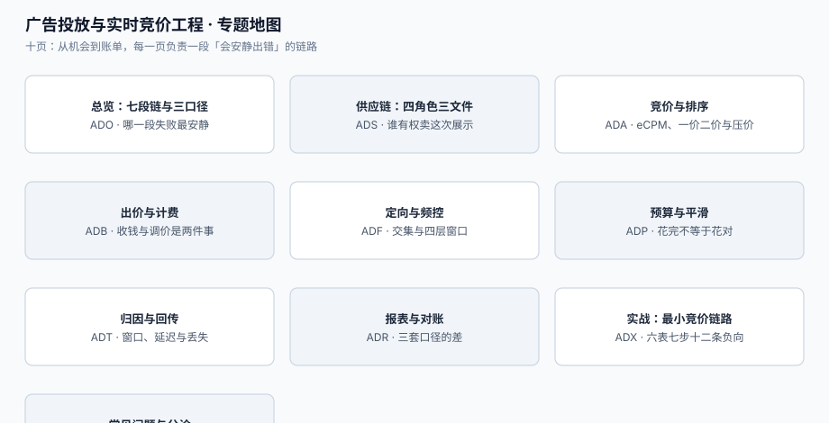

# 广告投放与实时竞价工程

一次广告展示的机会窗口只有 **100 毫秒**：从媒体把「这个用户正在看这个页面」发出去，到广告主的机器决定「我出 0.42 元、投这张图」，中间要完成定向、召回、预估、竞价、渲染与计费。整条链上没有一次数据库事务能覆盖它，也没有一个环节会「报错」——**失败的形态永远是「少赚了」或「多付了」**，而报表上两者都显示为正常。

本专题讲**一条广告从机会到账单的完整链路**：媒体怎么把库存卖出去、DSP 怎么算出该出多少钱、预算怎么平滑、频控怎么不越界、归因怎么算、报表为什么三套口径对不上、以及在中国的合规红线在哪里。它不讲「怎么在投放后台点计划」（那是工具层的事），只讲**这条链路上哪些地方一定会安静地错**。

::: tip 一句话理解
广告系统的失败**不抛异常**：竞价赢了、广告渲染了、点击上报了、账单生成了——但**赢的可能是一文不值的流量，收的可能是不存在的点击，算的可能是三个月后才回传的转化**。
:::

::: info 本专题与相邻专题的分工
- **推荐系统的排序与混排** → [推荐系统工程](../RecommenderSystems/index.md)：那边优化「用户想不想看」，本专题优化「**这一次展示值多少钱、该向谁收钱**」；广告要混排进推荐流，但收益口径完全不同（那边是 CTR/时长，这边是 eCPM 与结算）。
- **营销计价与优惠分摊** → [营销计价与优惠分摊](../PricingPromotion/index.md)：那边算「用户实付多少」，本专题算「**广告主为这次展示付多少**」；两者都涉及「分摊」，但一边分给商品行，一边分给计费事件。
- **账务分录与结算** → [账务与结算工程](../Ledger/index.md)：本专题把「消耗」交给那边生成分录，只负责把**计费事件**算准；对账口径在[报表与对账](Reporting/index.md)里能对上账务即可。
- **订阅计费** → [订阅计费与周期账单工程](../SubscriptionBilling/index.md)：那是**周期性**收钱（月租、席位、按量），本专题是**按事件**收钱（千次展示、点击、转化），周期与折算规则完全不同。
- **消息通知与触达** → [消息通知与触达工程](../NotificationDelivery/index.md)：频控两边都有，但那边控的是「别烦用户」，这边控的是「**同一支广告别给同一个人看太多次**」，且要按合同计量（超频可能不退钱）。
- **批数据交换** → [批量数据交换工程](../BulkDataExchange/index.md)：广告主的素材、人群包、日账单都是批量文件，那边的文件契约与幂等重跑直接适用，本专题不重复。
- **风控与反欺诈** → [实时风控决策](../RiskDecision/index.md)：无效流量（IVT）是风控的一个特例，那边讲通用决策链，本专题只讲[流量质量](SupplyChain/index.md)里广告特有的判据（曝光/点击比、设备聚集、点击间隔）。
- **隐私工程** → [隐私工程与合规落地](../../Others/PrivacyEngineering/index.md)：定向依赖标识符，同意与撤回在那边讲透，本专题只处理「**没有标识符时定向与归因怎么退化**」。
:::

## 目录

- [总览：七段投放链与三个口径](Overview/index.md)
- [供应链：SSP、DSP 与 ads.txt 三角](SupplyChain/index.md)
- [竞价与排序：eCPM、一价二价与压价](Auction/index.md)
- [出价与计费：CPM、CPC 与 oCPM](Bidding/index.md)
- [定向与频控：交集、四层窗口与隐私](Targeting/index.md)
- [预算与平滑：烧完、均匀与反馈](Pacing/index.md)
- [归因与回传：窗口、延迟与丢失](Attribution/index.md)
- [报表与对账：三套口径的差](Reporting/index.md)
- [实战：一条能跑起来的竞价链路](Practice/index.md)
- [常见问题与分诊](FAQ/index.md)

## 专题地图

## 判据纪律

沿用全库写法：**每页 8 条，编号形如 `ADO-A`**，逐页前缀唯一，可被 `utils/audit` 下的判据类巡检机械核对。每条判据回答三件事：**看什么现象、判成什么、不满足时改哪里**。

| 页 | 判据族 | 这一族管什么 | 条数 |
| --- | --- | --- | --- |
| 总览 | `ADO-A` ~ `ADO-H` | 七段链、三个口径、四个必失点、接缝归属 | 8 |
| 供应链 | `ADS-A` ~ `ADS-H` | 角色与结算关系、ads.txt、sellers.json、schain、流量质量 | 8 |
| 竞价与排序 | `ADA-A` ~ `ADA-H` | eCPM 排序、一价二价、压价、保留价、并列与超时 | 8 |
| 出价与计费 | `ADB-A` ~ `ADB-H` | 计费口径、点击去重、oCPM、出价上限、计费事件、退款 | 8 |
| 定向与频控 | `ADF-A` ~ `ADF-H` | 定向集合、交集估算、四层频控、频次计量、隐私退化 | 8 |
| 预算与平滑 | `ADP-A` ~ `ADP-H` | 日预算、烧完、均匀、反馈、超投、暂停与冻结 | 8 |
| 归因与回传 | `ADT-A` ~ `ADT-H` | 窗口、last-click、延迟回传、去重、跨设备、丢失 | 8 |
| 报表与对账 | `ADR-A` ~ `ADR-H` | 三套口径、漏斗、差异归因、结算单、时区与币种 | 8 |
| 实战 | `ADX-A` ~ `ADX-H` | 表结构、七步流水、负向用例、可重跑、验收查询 | 8 |
| 常见问题 | `ADQ-A` ~ `ADQ-H` | 分诊表、误判、止血顺序、合规自查 | 8 |

合计 **10 族 80 条**。

## 事实与规格速览（2026-10 口径）

这类工程的实现细节几乎全被**协议版本与监管条款**决定，写清楚以免被「我们后台显示正常」误导：

| 事项 | 现状 | 对链路的含义 |
| --- | --- | --- |
| OpenRTB 版本 | 主线是 **2.6.x 活规范**，按日期发布非破坏性更新；最新一版 **2.6-202606**（2026-06-11）给 `Content` 对象加了 `realtime` / `firstbroadcast`，并新增 `${AUCTION_DISCOUNT_PCT}` / `${AUCTION_DISCOUNT_CPM}` 两个宏。**OpenRTB 3.0 是另一条规范线**（2018-11 首发、文档 2022-03 最后修订），不是 2.x 的替代品 | 集成时必须写死「支持到哪个日期版本」，否则对方加了枚举值你这边静默丢弃。见[供应链](SupplyChain/index.md) |
| 配套对象模型 | **AdCOM 1.0**（2026-07 版本）是 3.0 线与 OpenDirect 共用的对象词汇；**Deals API 1.0** 于 2026-02-06 定稿，只做「交易条款单向同步」 | 「同一个字段两边叫法不同」是联调第一大坑；术语表在[常见问题](FAQ/index.md) |
| 供应链透明三件套 | `ads.txt`/`app-ads.txt` 与 `sellers.json`、SupplyChain Object（`schain`）同期规范，**ads.txt 1.1 于 2022-08 发布**，新增 `OWNERDOMAIN` / `MANAGERDOMAIN` 两个指令；`schain` 1.1 仍在公开征询（2026-08 截止） | 三个文件互相引用，**改一个不改另一个**是最常见的静默失效。见[供应链](SupplyChain/index.md) |
| 可见曝光标准 | IAB/MRC：展示广告 **≥50% 像素可见 ≥1 连续秒**；视频 **≥50% 像素可见 ≥2 连续秒**；超大位（>242,500 像素，如 970×250）按 **30% 像素 ≥1 秒** | 「曝光」与「可见曝光」是两个数，合同按哪个结算必须先写死。见[报表与对账](Reporting/index.md) |
| 无效流量分类 | MRC/IAB 把无效流量分 **GIVT**（一般无效：爬虫、明显伪造）与 **SIVT**（复杂无效：设备农场、点击劫持、模拟器），且要求**未过滤的指标单独标注、不得混报** | 过滤前后 CTR 差一倍是常态；本机读数 +62.43%。见[供应链](SupplyChain/index.md) |
| 归因窗口 | 行业默认取 **30 天点击回看**（IAB Europe 零售媒体标准把它设为默认，并允许品牌按品类收窄到 7 天） | 窗口写错，转化数直接差一半。本机读数：1 天口径少记 **51.72%**。见[归因](Attribution/index.md) |
| 中国合规 | 《互联网广告管理办法》（市场监管总局令第 72 号）**2023-05-01 施行**：第九条要求广告**可识别**、竞价排名须显著标「广告」；第十条列了**五种「不能一键关闭」**的情形；第十一条列了四类**诱导点击**；第十四条要求广告档案**保存不少于三年**；第十五条要求算法推荐广告把**投放记录**记入档案 | 这些不是「产品体验建议」，是会罚款的硬约束。见[常见问题](FAQ/index.md) |
| 标识符与同意 | 定向与归因都依赖标识符；同意缺失时要退化为上下文定向（contextual），且**不得用退化前的数据回头补** | 「先采后补同意」在 GDPR/ePrivacy 下不成立。见[定向与频控](Targeting/index.md) |

::: warning 两个「不能全信」
1. **不能全信后台的 CTR**。点击日志里天然有重复上报（用户双击、SDK 重试、监测链多跳），本机 8% 重复上报就让 CTR 从 1.20% 涨到 1.27%（相对虚高 **5.88%**），而按点击行计费会**多付 8.0%**。见[报表与对账](Reporting/index.md)。
2. **不能全信「消耗 = 预算」**。预算只约束「花多少」，不约束「花在哪」。本机 600 元预算、全天需求 1000 元：不做平滑的策略在**第 14.9 小时就烧完**，晚间高峰（20:00-24:00）拿到 **0 次**曝光，而按流量份额分配能拿到 **248 次**。见[预算与平滑](Pacing/index.md)。
:::

## 七个必失点（本专题的全部理由）

这七条不是「注意一下」，而是**结构性的**：只要实现里缺少对应的一条，投放就会安静地失守。

1. **按出价排序而不是按 eCPM 排序**——本机 10,000 次竞价里 **45.72%** 的赢家会变；按出价排序比按 eCPM 排序**多花 22.6% 的钱，少买 18.8% 的价值**。见[竞价与排序](Auction/index.md)。
2. **把一价当二价结算**——同批真值出价下，一价收入比二价高 **25.20%**；而广告主一旦知道是一价，就会压价到 `(k-1)/k = 0.80`，收入掉回 13,348.6（≈ 二价的 13,317.0）。见[竞价与排序](Auction/index.md)。
3. **pCTR 不校准就上线**——只让 6 个候选里的 2 个新广告 pCTR 高估 1.5 倍，**14.09%** 的 top1 就被改写了；排序错一次的代价不是「点得少」，是「预算买错了人」。见[竞价与排序](Auction/index.md)。
4. **不做预算平滑**——600 元预算在第 **14.9** 小时烧完，晚高峰 **0** 曝光。见[预算与平滑](Pacing/index.md)。
5. **频控用自然日固定窗口**——同一个用户在跨零点前后可以连看 4 次（本机 12 次请求放行 **4** 次），滑动窗口只会放行 3 次。见[定向与频控](Targeting/index.md)。
6. **归因窗口按「当天」算**——1 天窗口只记得住 **48.28%** 的转化，7 天 **99.25%**；日报与月报的差不是「波动」，是窗口。见[归因](Attribution/index.md)。
7. **转化延迟回传不补**——T+0 只能看到 **42%** 的转化，T+1 才到 **83%**；不设「回补」机制的话，每一天的日报都是错的，而且是**系统性偏低**。见[归因](Attribution/index.md)。

## 为什么这里没有版本目录

本专题**不建 `v1/` `v2/` 这类版本目录**，理由三条：

1. **换代的是协议字段，不是判据**。从 OpenRTB 2.5 到 2.6-202606，变的是 `Content` 里多了 `realtime`、宏多了两个；而「排序要按期望收益」「预算不能提前烧完」「同一次点击只能计一次费」这三类判据一字未变。
2. **并存差异是部署形态，不是代际**。同一年里，媒体自建 ADX、买 SaaS 的 SSP、只用大平台的托管投放——是**三种形态**，不是新旧版本。按版本建目录会把「选型对照」拆成历史存档。
3. **可验证的差异已收敛进表格**。凡是有「两种做法」的地方（一价 vs 二价、CPM vs CPC vs oCPM、自然日 vs 滑动窗口），都用同一张表写清「什么时候用哪个、差多少」，并附本机读数。

作为对照，本库确实存在需要版本目录的主题：[Spring 5 / Spring 6](../Java/Frame/Spring/index.md)、[Vue 2 / Vue 3](../../Frontend/Frame/Vue/index.md)、[MySQL 5.7 / 8.4](../../DB/SchemaEvolution/index.md)——它们的共同点是**同一个产品的两代 API 不兼容且旧版仍在跑**，与本题不同；本题的旧协议字段由「版本号 + 日期」在报文里表达，不需要另建目录。

## 三条底线

::: danger 三条不可让步的底线
1. **每一次展示只能计一次费，且计费事件必须可追溯到 `impression_id`**。曝光与点击的重复上报是常态（本机 8% 重复点击让账单多付 8.0%），没有幂等键就无法退费也无法自证。见[出价与计费](Bidding/index.md)。
2. **排序必须按「期望收益」而不是「谁出价高」**。本机 45.72% 的赢家在两种排序下不同；按出价排序多花 22.6% 却少买 18.8%。这条对媒体（收益）与广告主（效果）同时成立。见[竞价与排序](Auction/index.md)。
3. **广告必须可识别、可关闭，且投放记录留档**。《互联网广告管理办法》第九、十、十四、十五条把这三件事写成硬约束，罚款起步五千元、档案要求三年；而「标了广告但样式与自然内容一致」「关闭按钮要点两次」都是明确违规。见[常见问题](FAQ/index.md)。
:::

## 阅读顺序

先读[总览](Overview/index.md)拿到七段链与三个口径，然后按手上的问题选主线：

- **老板问「为什么消耗没花完/花超了」** → [预算与平滑](Pacing/index.md)
- **同一个用户一天看了八次同一支广告** → [定向与频控](Targeting/index.md)
- **CTR 后台 1.3%、BI 算出来 1.2%** → [报表与对账](Reporting/index.md)
- **广告主说「你们归因的转化比我后台多一倍」** → [归因与回传](Attribution/index.md)
- **媒体说「你们 DSP 出价像在乱出」** → [竞价与排序](Auction/index.md)与[出价与计费](Bidding/index.md)
- **接入新 SSP、要核对 ads.txt 与 schain** → [供应链](SupplyChain/index.md)
- **要从零搭一条能验收的竞价链路** → [实战](Practice/index.md)，按 S1~S10 走
- **被监管问「广告标识在哪、档案能不能调出来」** → [常见问题](FAQ/index.md)的合规自查八问

## 参考资料

- IAB Tech Lab《OpenRTB 2.6》规范与按日期发布的更新（2.6-202606）：<https://github.com/InteractiveAdvertisingBureau/openrtb2.x>
- IAB Tech Lab《ads.txt / app-ads.txt、sellers.json 与 SupplyChain Object》（ads.txt 1.1，2022-08）：<https://iabtechlab.com/standards/supply-chain-foundations/>
- IAB Tech Lab《AdCOM 1.0》对象模型：<https://iabtechlab.com/standards/adcom/>
- IAB/MRC《Viewable Ad Impression Measurement Guidelines》（50%/1 秒、50%/2 秒、超大位 30%）：<https://www.iab.com/guidelines/iab-measurement-guidelines/>
- MRC《Invalid Traffic Detection and Filtration Guidelines》（GIVT / SIVT）：<https://mediaratingcouncil.org/guidelines>
- IAB Europe《Retail Media Measurement Standards》（30 天点击回看为默认窗口）：<https://iabeurope.eu/wp-content/uploads/IAB-Europe_Retail-Media-Measurement-Standards-2024.pdf>
- 国家市场监督管理总局《互联网广告管理办法》（令第 72 号，2023-05-01 施行）：<https://www.gov.cn/gongbao/2023/issue_10506/202306/content_6885261.html>
- Prebid 文档（Header Bidding 与 OpenRTB 2.x 的实现参考）：<https://docs.prebid.org/>
