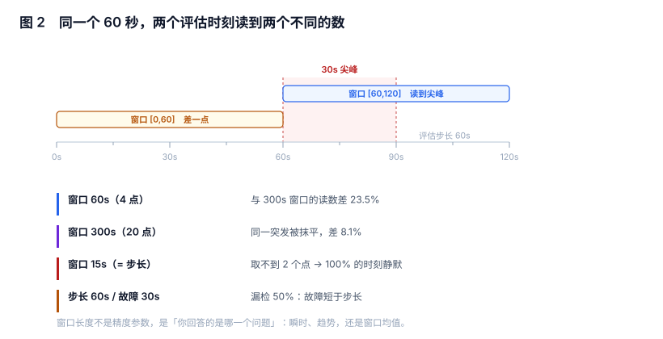

# 评估时刻与窗口：你读到的不是「现在」，是「一段时间」

「错误率超过 5% 就报警」这句话里藏着三个没写出来的参数：**在哪一刻评估、往回看多长、多久评估一次**。三个参数换任何一个，同一次故障的结论都会变——包括从「报警」变成「不报警」。

本页把评估这一段的语义拆开，并给出「最小可检出故障」的算式，用来判断一条规则到底能看见什么。

本页判据族 `ALW-A` ~ `ALW-H`，共 8 条。



## 一、评估是抽样，不是观测

告警引擎不是「持续盯着指标」，而是**每隔一个步长，取一个窗口，算一个数，比一次阈值**。所以它天然有三件事：

| 概念 | 含义 | 典型值 | 换它的后果 |
| --- | --- | --- | --- |
| 采样间隔（scrape interval） | 指标点多密 | 15s | 决定「点够不够算」 |
| 评估步长（evaluation interval） | 多久算一次 | 15s ~ 60s | 决定「最短能看见多长的故障」 |
| 窗口（range） | 每次往回看多长 | 1m ~ 1h | 决定「读的是瞬时还是趋势」 |

一个常见误解是「步长越小越灵敏」。步长确实决定灵敏度，但它同时决定**成本**（评估次数 × 规则数 × 序列数）。一个 2,000 条规则、5,000 条序列的系统，把步长从 60s 降到 15s，评估次数涨 4 倍，而真正需要的灵敏度往往只在那 20 条 P0 规则上。

::: tip 一句话理解
`for: 5m` 配 `interval: 1m` 的真实含义是「连续 5 次评估都越线」；`for: 5m` 配 `interval: 15s` 是「连续 20 次」。同样写 5m，**两者的抗抖动能力差 4 倍**。
:::

## 二、窗口是半开区间，边界比你想象的更常命中

绝大多数引擎用左开右闭区间 `(t-W, t]`。这条规则带来两个必须知道的行为：

1. **窗口两端的点归属唯一**：`t-W` 那一拍属于上一个窗口，不属于这个窗口。好处是不重复计数，坏处是「刚好落在边界上的那次尖峰」只会被一个窗口看见一次。
2. **窗口内的有效跨度小于名义窗口**：窗口 60s、步长 15s 时，窗口里通常只有 4 个点，首末点之间只隔 45s。引擎把 45s 的增量外推到 60s（或至少外推到窗口边界），这一步叫**外推**。

外推不是作弊，它是唯一能让「窗口 60s」和「窗口 5m」在稳态下得到同一个 rate 的做法。但它有代价：**当抖动或缺口让首末点位置偏移时，外推系数跟着变，读数就跟着变**。

```text
# 同一个指标，三种窗口
rate(http_requests_total{job="api"}[1m])    # 贴近瞬时，噪声大
rate(http_requests_total{job="api"}[5m])    # 常规选择
rate(http_requests_total{job="api"}[30m])   # 贴近趋势，看不见短故障
```

上面三行写在同一条规则里会被当成「同一个错误率」，但它们回答的是三个不同问题：**现在多快 / 最近多快 / 这一阵多快**。

## 三、窗口内点数不足时，引擎会「无数据」

这是最容易被忽略的一类静默：窗口 `W`、步长 `S`，有效点数约为 `W/S`；少于 2 个点时，绝大多数实现返回「无数据」，而「无数据」在告警语义里通常等于**不触发**。

| 窗口 | 步长 | 点数 | 结果 |
| --- | --- | --- | --- |
| 60s | 15s | 4 | 正常 |
| 30s | 15s | 2 | 勉强，外推误差大 |
| 15s | 15s | 1 | **无数据（实测 100% 的时刻）** |
| 10s | 15s | 0~1 | **永远无数据** |

所以「窗口等于步长」是一类配置事故：规则的 YAML 看起来合法、引擎不报错、规则的图上也画不出东西，因为**它从来没有真正评估过**。

::: danger 窗口 ≤ 步长 = 规则看起来存在，实际上不存在
正确做法是让窗口至少是步长的 2 倍，常规取 3~5 倍。若确实需要「最近一拍」的判断，用 `last_over_time(metric[2m])` 这类带窗口的选择器，而不是把窗口压到步长。
:::

## 四、读数不是均值：换窗口，数就变

同一段突发流量、同一个评估时刻，只换窗口长度，读数如下（24 小时突发流量，步长 15s，固定种子）：

| 窗口 | 窗口内点数 | 与 300s 窗口的相对偏差 | 与「窗口内分钟均值」的平均绝对偏差 |
| --- | --- | --- | --- |
| 30s | 2 | 最大 | 17.96% |
| 60s | 4 | +23.5% | 23.53% |
| 120s | 8 | 中等 | 17.42% |
| 300s | 20 | 基准 | 8.12% |

关键不是「哪个更准」，而是**它们不是同一个数**：60s 窗口的读数与 300s 窗口在同一次突发上差 23.5%，而 300s 自己与「分钟均值」也差 8.12%。当两套看板、两条规则、两份报表用了不同窗口，它们报出的「错误率」本来就不该相等——**差异不是 bug，是口径**。

操作上的结论只有一条：**阈值必须和窗口一起写**。「错误率 > 5%」不完整，「`rate(...[5m])` > 5%，评估步长 1m」才是可复现的判据。

## 五、迟到、乱序与计数器重置

三类数据缺陷会让窗口读数在**故障之外**的地方跳变：

| 缺陷 | 现象 | 对告警的影响 | 缓解 |
| --- | --- | --- | --- |
| 点迟到 | 窗口右边界回退，读到的是旧值 | 告警晚一个步长 | 增大窗口 / 允许 lateness |
| 乱序 | 同一时间戳被后来的点覆盖 | 读数回跳，可能触发「恢复」 | 引擎侧按时间戳去重 |
| 计数器重置 | 增量变负，被裁成 0 | 该窗口 rate = 0，可能触发「低流量」告警 | 用 `rate()` 而非 `delta()`；对低流量告警加 `and` 条件 |

迟到的影响可以直接算：`for=60s` 在步长 15s 下需要 4 次评估全部读到最新点，若每个点有 `p` 的概率迟到，则

`P(全部及时) = (1-p)^4`

代入实测的迟到率：

| 点迟到率 | 4 次评估全及时的比例 | 至少晚一个步长的告警占比 |
| --- | --- | --- |
| 2% | 92.2% | 7.8% |
| 5% | 81.5% | 18.5% |
| 10% | 65.6% | 34.4% |

计数器重置的影响是**确定性的**：窗口跨过一次重启，增量必为负，被裁成 0，于是该窗口的 rate 为 0。实测中每个跨重置窗口都读到 0——这解释了「服务刚重启，低流量告警就叫了」这一类必现的误报。

## 六、最小可检出故障 = 评估步长

一条规则能看见的最短故障，不是窗口长度，而是**评估步长**：如果故障持续时间 `d` 短于步长 `S`，它可能整段落在两次评估之间。

`P(漏检) = max(0, (S - d) / S)`

步长 60s 下的实测算式：

| 故障时长 | 漏检率 |
| --- | --- |
| 15s | 75.0% |
| 30s | 50.0% |
| 45s | 25.0% |
| 60s | 0% |

这条式子有两个用法：

1. **反向选步长**：业务要求「30 秒以上的故障必须报」，则步长必须 ≤ 30s，窗口 ≥ 60s。
2. **解释「为什么这次没报」**：故障 40 秒、步长 60 秒，漏检概率 33%——它不是「引擎坏了」，是配置决定的结果。

## 七、本节读数

| 项 | 读数 | 怎么复算 |
| --- | --- | --- |
| 窗口 15s（= 步长）无数据率 | **100%** | 生成 15s 步长序列，用 15s 窗口逐点求 rate，统计返回空的次数 |
| 60s 与 300s 窗口读数差 | **23.5%** | 同一突发的同一评估时刻，两种窗口各算一次 |
| 各窗口与分钟均值的平均绝对偏差 | 17.96% / 23.53% / 17.42% / 8.12% | 窗口 30 / 60 / 120 / 300s |
| 迟到 5% 时告警晚一拍的比例 | **18.5%** | `1-(1-0.05)^4` |
| 跨重置窗口 rate 归零 | **100%** | 在窗口中间注入一次计数器归零 |
| 步长 60s 对 30s 故障的漏检率 | **50%** | `(60-30)/60` |

## 八、本页判据

| 编号 | 判据 | 为什么要它 | 怎么验证 |
| --- | --- | --- | --- |
| `ALW-A` | 每条规则的窗口 ≥ 2× 评估步长 | 窗口 ≤ 步长时规则实际不评估 | 遍历规则文件，`range` 与 `interval` 比值 ≥ 2 |
| `ALW-B` | 阈值必须与窗口、步长一起记录 | 只写「>5%」无法复现结论 | 规则注释或文档里三者同行出现 |
| `ALW-C` | 「最小可检出故障」写进需求，并用步长反推 | 否则无法回答「为什么这次没报」 | 需求文档有 `S` 与 `d` 的算式 |
| `ALW-D` | 用 `rate()` 而非 `delta()` 处理计数器 | 重置会让 delta 为负 | 规则里不出现裸 `delta(counter)` |
| `ALW-E` | 「无数据」必须与「正常」区分，不允许静默通过 | 无数据被当成不触发，故障期可能整段丢失 | 规则有 `absent()` / `nodata` 分支 |
| `ALW-F` | 同一指标的多条规则使用同一窗口，或显式说明差异 | 不同窗口会给出不同结论 | 按指标 grep 规则，窗口集合只有一种或附说明 |
| `ALW-G` | 评估步长按「业务要求的可检出时长」分级，不全局取最小 | 全局最小步长成本翻几倍 | 步长分布表：P0 ≤ 30s，P2 ≥ 60s |
| `ALW-H` | 允许迟到（lateness）窗口 ≥ 最大抓取延迟 | 迟到点导致窗口右边界回退 | 引擎配置里 `lookback`/lateness 有显式值 |

## 九、验证方式

```text
-- 1) 窗口与步长比例自查：把 <range> / <interval> 换成你的规则
# 规则：窗口 60s、步长 15s → 比值 4，合格
# 若某条规则写成 [15s] + interval 15s，比值为 1，该规则实际不评估

-- 2) 「无数据」是否被当成正常：在故障注入期间断掉指标上报
absent(rate(http_requests_total{job="api"}[5m]))
-- 预期：断流 5 分钟后返回 1。若你的规则里没有这一条，断流期等于静默
```

```shell
# 3) 迟到实测：在抓取侧人为加 30s 延迟，观察告警时间戳是否整体后移
#    在 Prometheus 抓取配置里加：
#    scrape_configs: [{ job_name: api, scrape_interval: 15s, scrape_timeout: 10s }]
#    用 tc/netem 或 sidecar 注入 30s 延迟后，对比注入前后同一故障的 fired_at
# 预期：fired_at 整体后移约 30s；若后移超过 2 个步长，说明 lateness 配置过小
```

第三条的价值在于区分「引擎慢」和「数据晚」：前者要改引擎，后者要改采集或放宽迟到窗口，修错了方向会一直修不好。

## 十、参考资料

- [Prometheus: Query functions — `rate()` / `irate()`](https://prometheus.io/docs/prometheus/latest/querying/functions/#rate)：外推与「至少两个样本」的官方说明
- [Prometheus: Staleness and absent()](https://prometheus.io/docs/prometheus/latest/querying/basics/#staleness)：无数据与「值不变」的区别
- [Prometheus: Configuration — `evaluation_interval`](https://prometheus.io/docs/prometheus/latest/configuration/configuration/)：全局评估步长与规则组 `interval` 的覆盖关系
