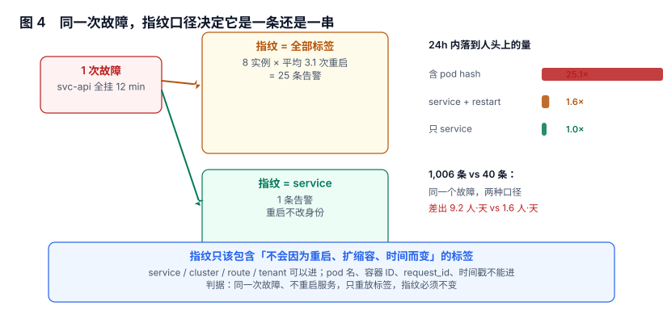

# 指纹与告警身份：一次故障应该是一条，还是一串

告警系统里唯一真正"设计"出来的东西，是**指纹**（fingerprint）：它由一组标签拼成，决定「哪两条告警是同一条」。规则名、阈值、通知模板都可以照抄，指纹抄不了——它取决于你的标签体系。

指纹选错的后果不是报错，而是**同一次故障被拆成 25 条**，然后所有人开始忽略告警。

本页判据族 `ALF-A` ~ `ALF-H`，共 8 条。



## 一、指纹是「一组标签的规范化」，不是哈希值本身

指纹的实现通常是「把参与的标签按名字排序，拼成 `k1=v1;k2=v2`，再取哈希」。所以真正需要设计的是**参与的那组标签**，哈希只是压缩。

```
参与标签：service, cluster, severity, rule
不参与：  pod, container_id, request_id, scrape_target, timestamp
```

判断一个标签该不该进指纹，只问一句：**它在「同一件事」的整个生命周期里会不会变**。

| 标签 | 会变吗 | 能进指纹吗 | 说明 |
| --- | --- | --- | --- |
| `service` | 不变 | 能 | 故障的主体 |
| `cluster` / `region` | 不变 | 能 | 定位需要，且同一故障不会跨集群漂移 |
| `severity` | 可能变（升级） | **谨慎** | 进指纹会导致「升级」变成「新告警」 |
| `route` / `endpoint` | 一般不变 | 能 | 同一接口的错误率是同一件事 |
| `pod` / `pod_template_hash` | **每次发布、每次重启都变** | 不能 | 典型事故来源 |
| `container_id` / `instance_ip` | 会变 | 不能 | 同上 |
| `request_id` / `trace_id` | 必然变 | 不能 | 会把指纹基数打到无穷 |
| `timestamp` / `window` | 必然变 | 不能 | 同上 |

::: tip 一句话理解
指纹里只放「回答『这是哪件事』所必需的标签」。定位到 pod 是**通知里**要做的事（把 pod 列出来），不是**指纹里**要做的事。
:::

## 二、三档粒度：一条、一串、一团

同一个故障，按三档指纹写法得到的条数完全不同（40 次故障，每次影响 1~30 个实例，平均每实例 1.55 次重启）：

| 指纹口径 | 条数 | 放大倍数 | 效果 |
| --- | --- | --- | --- |
| 全标签（含 pod hash） | **1,006** | **25.1×** | 每次重启都是一条新告警，值班的人看到刷屏 |
| `service` + 重启序号 | 62 | 1.55× | 重启仍会产生新告警，但同一次故障的多个实例合并了 |
| 仅 `service` | 40 | 1× | 一次故障一条，重启不影响身份 |

三档没有绝对优劣，取决于你要回答什么：

- **要「这次故障影响了哪些实例」** → 用第二档，通知里列出实例列表。
- **要「这个服务现在有没有事」** → 用第三档，实例明细放在告警的 annotation 里。
- **要「哪个 pod 出了问题」** → 那是**另一个指标**（pod 维度的瞬时状态），不该和「服务不可用」共用一条规则。

最糟的是第一档：它看上去「信息最全」，实际上把一次故障切成了 25 个互不相关的事件，导致去重、抑制、恢复判定全部失效。

## 三、重启、扩缩容与「身份漂移」

Kubernetes 环境里最常见的一类告警噪声，来自 pod 名字里的模板哈希：

```
api-7d9f8c5b6-x2k4p      # 发布前
api-5f6b7d8c9-m8n2q      # 发布后（hash 变了）
```

如果指纹包含 pod 名，那么**每一次发布、每一次 HPA 扩缩容、每一次 OOM 重启**都会产生新指纹。表现是：故障还在，但告警"换了个人"，于是

1. 去重失效：同一个故障有 N 条实例，N 条通知。
2. 抑制失效：抑制规则按指纹匹配，新指纹不在被抑制的集合里。
3. 恢复判定失效：旧指纹 `resolved`，新指纹 `firing`，报表里是「一次恢复 + 一次新增」。

正确做法是**指纹用稳定标签，展示用易变标签**：指纹取 `service`，通知模板里用 `$labels.pod` 这类模板变量列出受影响的实例。

## 四、混进来的两类脏标签

除了 pod，还有两类标签会悄悄把指纹基数打爆：

| 脏标签 | 来源 | 后果 | 实测 |
| --- | --- | --- | --- |
| `request_id` | 业务把请求 ID 打进了指标标签 | 每请求一条序列，指纹基数无穷 | 2% 概率混入 → 额外指纹 **2.19%** |
| `error_message` / `path` 原始值 | 直接把错误信息当标签 | 基数随错误种类发散 | 常见于自研埋点 |

第二类比第一类更隐蔽：它不会立刻爆，而是随业务增长慢慢涨。判据是「这个标签的取值个数是否随时间单调增长」——是，就不能进标签，更不能进指纹。

## 五、指纹是去重与幂等的同一件事

指纹在存储层的落地方式，决定了两件必须成立的性质：

1. **同一指纹同时最多一条未结束实例**——这是去重。
2. **同一指纹的重复写入不产生新记录**——这是幂等。

两条都能用一个部分唯一索引表达（只对 `pending`/`firing` 生效）：

```sql
CREATE UNIQUE INDEX ux_alert_open ON alert_instance(rule_id, fingerprint)
  WHERE state IN ('pending','firing');
```

为什么必须落在数据库层：应用层的「先查再插」在并发下会双写。实测 12 线程并发提交同一指纹，无唯一约束时写入 **2 条**，加约束后 **1 条**（另一条被拒）。

::: danger 指纹里带 `severity` 会让「升级」变成「新告警」
告警从 P2 升到 P1 时，如果 `severity` 参与指纹，系统会认为这是一条新告警：旧的那条 `resolved`、新的那条 `firing`，于是同一次故障在报表里变成「一次恢复 + 一次新增」，SLA 也被劈成两段。正确做法是 `severity` 不进指纹，升级只改实例的字段并追加一条事件。
:::

## 六、指纹与「事故」的关系

指纹稳定之后，实例与事故的对应关系还需要一层：

| 场景 | 指纹 | 实例 | 事故 |
| --- | --- | --- | --- |
| 单次故障 | 1 | 1 | 1 |
| 故障中途重启 | 1 | 1（不新建） | 1 |
| 恢复后 3 分钟内复发 | 1 | 2（旧已 resolved） | **应复用 1** |
| 两个服务同时故障 | 2 | 2 | 1（同一事故，多个实例） |

第三行是最容易做错的：恢复后短时间内复发，指纹相同但实例已关闭，会产生第二条实例。如果事故编号按「实例创建」生成，一次故障就变成两次事故。判据是**事故的关联窗口**（例如「同一指纹在 10 分钟内再次 `firing`，复用原事故」），见[恢复判定](../Recovery/index.md)。

## 七、本节读数

| 项 | 读数 | 说明 |
| --- | --- | --- |
| 40 次故障 → 含 pod hash 的告警条数 | **1,006** | 平均每次故障 25.1 条 |
| 同一批故障 → `service` + 重启序号 | 62 | 放大 1.55× |
| 同一批故障 → 仅 `service` | 40 | 放大 1× |
| `request_id` 混入 2% 带来的额外指纹 | **2.19%** | 且随流量线性增长 |
| 并发写入同指纹（无约束 / 有约束） | 2 条 / **1 条** | 12 线程，SQLite 实测 |
| 落到人头上的量（1,006 → 分组 + 抑制） | **230 条** | 9.2 人·天，见[噪声治理](../Noise/index.md) |

## 八、本页判据

| 编号 | 判据 | 为什么要它 | 怎么验证 |
| --- | --- | --- | --- |
| `ALF-A` | 指纹只含「同一件事生命周期内不变」的标签 | 易变标签会把一次故障切成一串 | 列出参与标签，逐个回答「它会不会变」 |
| `ALF-B` | `pod` / `container_id` / `request_id` 不进指纹 | 三者分别是重启、重建、每请求变化 | 指纹定义里不出现这三个键 |
| `ALF-C` | 指纹定义集中在一处，不在各规则里各写一遍 | 分散定义会导致同一故障两种身份 | 全库 grep 指纹拼接逻辑只有一处 |
| `ALF-D` | 存储层有「同指纹只允许一条未结束实例」的约束 | 应用层先查后写在并发下双写 | 并发插入同指纹，第二次被拒 |
| `ALF-E` | 实例明细通过 annotation 传递，不通过指纹传递 | 明细进指纹会放大基数 | 通知模板里有 `$labels.pod` 之类的展开 |
| `ALF-F` | 每个标签的取值个数有上限告警 | 基数发散是慢性的、难发现的 | 对 `count by (label)` 设阈值告警 |
| `ALF-G` | 告警升级不改指纹 | 升级若改指纹，同一次故障会被记成两次 | 升 P1 后实例 ID 不变 |
| `ALF-H` | 恢复后短窗复发复用原事故 | 否则一次故障计成多次事故 | 有「复发窗口」常量并被断言覆盖 |

## 九、验证方式

```sql
-- 1) 指纹基数是否失控：同一 service 的指纹数 vs 记录数
SELECT service,
       COUNT(DISTINCT fingerprint) AS fingerprints,
       COUNT(*) AS alerts,
       ROUND(COUNT(*) * 1.0 / COUNT(DISTINCT fingerprint), 2) AS per_fp
FROM alert_instance
WHERE started_at > now() - interval '7 days'
GROUP BY service
ORDER BY fingerprints DESC
LIMIT 10;
-- 预期：per_fp 接近 1（一条指纹一条记录）；far > 1 = 有重复写入
--       fingerprints 远大于「一周内真实故障次数」= 指纹里有易变标签
```

```sql
-- 2) 同指纹是否出现「未结束的重复」（应为 0 行）
SELECT rule_id, fingerprint, COUNT(*) FROM alert_instance
WHERE state IN ('pending','firing')
GROUP BY 1,2 HAVING COUNT(*) > 1;
-- 预期：0 行。有行 = 缺部分唯一索引
```

```shell
# 3) 重放测试：不动业务事实，只重放同一批标签
#    用规则测试工具或直接对引擎的 /api/v1/alerts 重放同一条告警两次
curl -s -X POST http://localhost:9093/api/v2/alerts -H 'Content-Type: application/json' -d '[{
  "labels": {"alertname":"api-5xx","service":"api","cluster":"c1","pod":"api-7d9f8c5b6-x2k4p"}
}]'
# 预期：实例表里只有 1 条；把 pod 改成另一个名字再发一次
#      若指纹不含 pod → 仍是 1 条（这是正确行为）
#      若指纹含 pod → 变成 2 条（这就是要修的地方）
```

第三条的关键是「改 pod 名字、条数不变」。这个测试能在五分钟内验证你的指纹设计对不对，比读文档可靠。

## 十、参考资料

- [Alertmanager: Alert 与 fingerprint 的关系](https://prometheus.io/docs/alerting/latest/alertmanager/)：通知去重基于标签集合的官方说明
- [Prometheus: Labels 与基数](https://prometheus.io/docs/practices/naming/)：标签命名与基数控制的最佳实践
- [Prometheus: `alertname` 与 `group_by` 的交互](https://prometheus.io/docs/alerting/latest/configuration/#route)：分组键与指纹不是同一个东西
