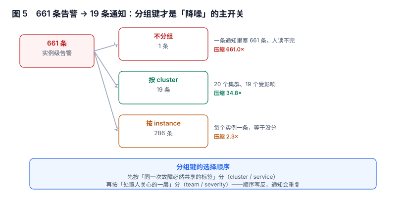

# 分组与通知聚合：分组键才是降噪的主开关

指纹决定「一次故障算几条告警」，分组决定「这些告警发几条通知」。两者常被混为一谈，实际是两个独立旋钮：**指纹没调好，分组能救一半；分组没调好，指纹再好也白搭**。

本页讲分组键怎么选、四个时序参数各自在等什么，以及为什么「压缩比」不是越高越好。

本页判据族 `ALG-A` ~ `ALG-H`，共 8 条。



## 一、分组做的是「合并通知」，不是「合并告警」

一段 10 分钟的机房故障，会同时触发：8 台机器的 `node-down`、3 个服务的 `5xx`、1 个网关的 `upstream-error`、2 条磁盘告警。它们在语义上是 12 个事实、1 件事。

| 层 | 数量 | 由什么决定 | 调它的代价 |
| --- | --- | --- | --- |
| 规则命中 | 每拍多次 | 规则数量 | 改规则 |
| 告警实例 | 12 | 指纹 | 改标签 |
| 通知分组 | 1~12 | 分组键 | 改 `group_by` |
| 人的工单 | 1 | 认领动作 | 改流程 |

分组只作用于第三层：它把同一批实例合并成一条通知。**它不减少实例**，所以「分组之后告警少了」是一种错觉——实例仍然都在，只是挤在同一条消息里。

::: tip 一句话理解
分组解决的是「人一次能读几条消息」，不是「系统该记几条记录」。前者是注意力问题，后者是数据问题。
:::

## 二、分组键怎么选：按「同一次故障必然共享」的标签

60 次故障、共 661 条实例级告警，三种分组键的结果：

| 分组键 | 通知条数 | 压缩比 | 人的感受 |
| --- | --- | --- | --- |
| 不分组（全局一组） | **1** | 661× | 一条消息里 661 行，等于没读 |
| `cluster` | **19** | 34.8× | 20 个集群里 19 个受影响，每条可读 |
| `instance` | 286 | 2.3× | 每个实例一条，等于没分 |

三个数说明一件事：压缩比从 2.3 到 661 都能实现，**可读性只在中段**。判断标准不是数字，而是「一条通知对应一件人能独立处理的事」。

分组键的选取顺序：

1. **先按「同一次故障必然共享的标签」分**：`cluster`、`service`、`zone`。这些标签在同一次故障里不会变，所以同组内的实例确实是同一件事。
2. **再按「处置人关心的一层」分**：`team`、`severity`。这一步决定消息发给谁。
3. **绝不按「会变化的标签」分**：`pod`、`instance` 会让分组退化成「每条一个组」。

第 2 步常被忽略：如果两个团队共用一个分组键，故障会发给所有人；如果分组键里没有 `team`，路由就只能按 `alertname` 猜，猜错的概率很高。

## 三、四个时序参数各自在等什么

分组不只是「按什么分」，还有「什么时候发」。四个参数各管一段：

| 参数 | 作用 | 典型值 | 调大的后果 | 调小的后果 |
| --- | --- | --- | --- | --- |
| `group_wait` | 首次通知前等多久，用来收集同组的新告警 | 30s | 首报延迟，但一条消息更全 | 同组告警分多条发 |
| `group_interval` | 同一组两次通知的最小间隔 | 5m | 新告警进组慢 | 通知过密 |
| `repeat_interval` | 未恢复时重复提醒的间隔 | 4h | 长时间故障被遗忘 | 提醒疲劳 |
| `resolve_timeout` | 多久没有该组告警就认为已恢复 | 5m | 恢复通知迟到 | 抖动时误报恢复 |

四个参数的共同点是**它们都是延迟**，而延迟的代价是「首报时间」。一次 P0 故障的实际首报时间是：

```
T_first = 检测延迟(窗口 + for) + group_wait + 排队
```

如果 `for=90s`、`group_wait=30s`、检测窗口 60s，那么从故障发生到手机响，理论最短是 3 分钟。这个数要写进 SLO，否则「5 分钟内响应」这类承诺在数学上就不成立。

::: warning `repeat_interval` 是唯一一个「不调就会出事」的参数
其他三个调错了只是慢，`repeat_interval` 调太大（比如 24h）会让一次持续 8 小时的故障在中间 8 小时完全没有提醒——值班的人处理完别的就忘了，而这期间服务一直是坏的。
:::

## 四、分组的三个反模式

1. **把 `alertname` 放进 `group_by`**：一条 `api-5xx` 和一条 `node-down` 会被分成两组，哪怕它们是同一件事。`alertname` 应该留在通知标题里，不进分组键。
2. **按 `severity` 单独分组**：P1 和 P2 分开是合理的，但如果全系统只有 P1/P2 两档，分组就退化成两个大桶，一天的消息全堆在两条里。
3. **`group_by: ['...']`（聚合所有）**：所有告警进一个组，`group_wait` 一到就发一条巨型消息。它适合「日报」类场景，绝不适合 P0。

## 五、分组和「事故」不是一回事

一个分组可能包含多个事故（同一集群的两个无关故障），一个事故也可能跨多个分组（数据库故障同时触发应用侧与 DB 侧）。所以**分组键不能当事故 ID 用**：

| 关系 | 例子 | 处理 |
| --- | --- | --- |
| 1 组 : 1 事故 | 单集群单服务故障 | 直接开单 |
| 1 组 : N 事故 | 同集群两个无关服务同时挂 | 靠人工拆分，或按 `service` 再分一层 |
| N 组 : 1 事故 | 数据库故障引发上游 5 个服务告警 | 靠抑制收敛（见[抑制](../Inhibition/index.md)） |

第三行是分组最无力的地方：上游 5 个服务的告警在 5 个不同的组里，分组无能为力，**只有抑制能把它们收成一个根因**。

## 六、本节读数

| 项 | 读数 | 说明 |
| --- | --- | --- |
| 60 次故障的实例级告警数 | **661** | 平均每次 11 条 |
| 不分组 | 1 条通知 | 压缩 661×，但不可读 |
| 按 `cluster` | **19 条** | 压缩 34.8×，可读 |
| 按 `instance` | 286 条 | 压缩 2.3×，等于没分 |
| 分组 + 抑制后的通知量 | 230 条/天 | 对应 9.2 人·天（见[噪声治理](../Noise/index.md)） |
| 首报时间下界 | 检测 + `group_wait` | 示例：60s 窗口 + 90s `for` + 30s 等待 = 3 分钟 |

## 七、本页判据

| 编号 | 判据 | 为什么要它 | 怎么验证 |
| --- | --- | --- | --- |
| `ALG-A` | `group_by` 只含「同一故障内不变」的标签 | 含易变标签会让分组退化 | 逐项检查 `group_by` 每个键的语义 |
| `ALG-B` | `alertname` 不进 `group_by` | 同一件事的不同规则会被拆开 | 配置里 `group_by` 不含 `alertname` |
| `ALG-C` | `group_by` 含 `team` 或路由键 | 否则路由只能按规则名猜 | 一条通知能定位到唯一值班组 |
| `ALG-D` | `repeat_interval` ≤ 该类故障的最长可接受沉默时间 | 过长会让长故障被遗忘 | 与 SLO 的「最长未响应时长」对齐 |
| `ALG-E` | 首报时间上界（检测 + 等待）写进 SLO 并核对 | 「5 分钟响应」在数学上可能不成立 | 报表里有 `T_first` 的 p90 |
| `ALG-F` | 分组键变更后重新评估「通知量 / 可读性」两个指标 | 压缩比高不等于好 | 变更前后各有一次读数 |
| `ALG-G` | 一个分组内的实例数设上限并告警 | 一条消息 600 行等于没发 | 分组大小分布有 p99 监控 |
| `ALG-H` | 分组不承担「事故合并」职责 | 分组是注意力工具，不是根因分析 | 跨服务同源故障由抑制/事故关联处理 |

## 八、验证方式

```yaml
# 1) 分组配置自查：四个参数都必须显式出现
route:
  group_by: ['cluster', 'service', 'team']   # 稳定标签 + 路由键
  group_wait: 30s
  group_interval: 5m
  repeat_interval: 4h
  receiver: 'oncall-primary'
```

```shell
# 2) 实测分组效果：向 Alertmanager 连发 3 条同组告警
for i in 1 2 3; do
  curl -s -X POST http://localhost:9093/api/v2/alerts -H 'Content-Type: application/json' -d "[{
    \"labels\": {\"alertname\":\"api-5xx\",\"service\":\"api\",\"cluster\":\"c1\",\"team\":\"core\"},
    \"annotations\": {\"pod\":\"api-$i\"}
  }]"
done
# 预期：30s（group_wait）后收到 1 条通知，里面含 3 个 pod
#       把 group_by 改成 ['cluster','service','pod'] 再试 → 收到 3 条
```

```text
# 3) 分组大小分布（引擎侧没有这个指标时，用告警实例数近似）
sum by (cluster, service) (ALERTS{alertstate="firing"})
# 预期：p99 不超过几十；出现 200+ 的组说明分组键过粗
```

第 2 条用三次 `curl` 就能验证分组是否按预期工作，比读配置快，也比等故障快。

## 九、参考资料

- [Alertmanager: `<route>` 与分组参数](https://prometheus.io/docs/alerting/latest/configuration/#route)：`group_by` / `group_wait` / `group_interval` / `repeat_interval` 的官方定义
- [Alertmanager: `resolve_timeout`](https://prometheus.io/docs/alerting/latest/configuration/#alertmanager_config)：恢复判定的默认行为
- [Google SRE Book: Being On-Call](https://sre.google/sre-book/being-on-call/)：注意力预算与通知量的关系
