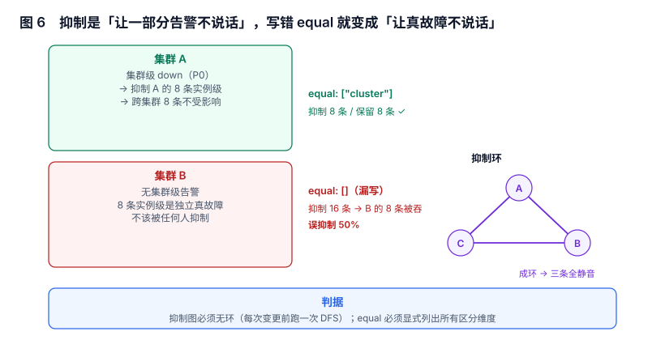

# 抑制与静默：让一部分告警不说话，而不是让真故障不说话

抑制（inhibition）是告警系统里唯一一个**主动减少信息**的机制：它让某些告警不发出去。这个动作的价值与风险对称——用对了，一场机房故障从 40 条通知变成 1 条；用错了，一场真故障从 40 条通知变成 0 条。

本页把抑制讲成一个图问题，并说明为什么「漏写一个 `equal`」会造成 50% 的误抑制。

本页判据族 `ALI-A` ~ `ALI-H`，共 8 条。



## 一、三个词：抑制、静默、静音

这三个词在日常对话里常被混用，实现上完全不同：

| 机制 | 谁触发 | 作用范围 | 有到期时间吗 | 有审计吗 |
| --- | --- | --- | --- | --- |
| 抑制（inhibit） | 规则，自动 | 按标签匹配的一批告警 | 无（由源告警的存在决定） | 通常无 |
| 静默（silence） | 人，手动 | 按匹配器选定的一批告警 | **必须有** | 必须有（谁、为什么、到什么时候） |
| 静音（mute） | 人，偏好 | 某个接收人 / 通道 | 可选 | 可选 |

三者的差别在「谁负责」：抑制的合理性由规则作者负责，静默的合理性由操作人负责。所以**静默必须有到期时间和创建人**，抑制必须有可评审的规则文件。

::: danger 用静默代替修复，是最常见的一类事故
「这个告警太吵，先静默一周」——一周后没人记得，故障发生时它确实没有响。静默必须满足三条：有到期时间、有 ticket 号、到期前有提醒。少一条就等于关掉了一个探测器。
:::

## 二、抑制是一个有向图，不是一个列表

一条抑制规则形如「当 A 存在时，抑制 B」。A 是源（source），B 是目标（target）。多条规则叠在一起就构成一个有向图：

```
集群级 down  ──抑制──▶  实例级 up
数据库主库故障 ──抑制──▶  应用侧 5xx
机房断电  ──抑制──▶  集群级 down
```

有向图有两个必须检查的性质：

1. **无环**：`A→B→C→A` 时，三条告警互相抑制，结果是三条全部静音——包括本该报的那条。
2. **可达性符合预期**：从「根因」出发应当能到达「所有衍生告警」，到达不了的说明有一条规则漏了（该收敛的没收敛）。

环检测是一个十几行的 DFS，值得在每次变更前跑一次：

```python
def has_cycle(g):                      # g: {节点: [被抑制的节点]}
    color = {}
    def dfs(u):
        color[u] = 1
        for v in g.get(u, []):
            if color.get(v) == 1: return True
            if color.get(v, 0) == 0 and dfs(v): return True
        color[u] = 2
        return False
    return any(color.get(u, 0) == 0 and dfs(u) for u in list(g))
```

实测：三条互相抑制的规则成环时检测为 `True`，删掉任意一条边后为 `False`。

## 三、`equal`：抑制规则里最贵的一个字段

`equal` 声明「源和目标必须在这些标签上相等，抑制才生效」。它决定抑制的**作用域**，也是最容易漏写的字段。

构造一个场景：集群 A 有集群级 `down` 告警，A 的 8 条实例级告警应当被抑制；集群 B 没有集群级告警，B 的 8 条实例级告警是**独立真故障**，不该被任何人抑制。

| 写法 | 抑制条数 | 保留条数 | 结果 |
| --- | --- | --- | --- |
| `equal: ["cluster"]` | 8 | 8 | 正确：只抑制同集群的 |
| `equal: []`（漏写） | 16 | 0 | B 的 8 条真故障被吞，**误抑制 50%** |
| `equal: ["cluster","service"]` | 0 | 16 | 过严：A 的 8 条也没被抑制（服务名不同） |

三行说明 `equal` 的两个方向都会错：漏写会过度抑制，写太细会抑制失效。它必须**恰好等于「区分这次故障与另一次故障所需要的最小标签集」**。

::: tip 怎么判断 `equal` 写全了
问一句：「如果两个标签都相同，这两条告警一定是同一件事吗？」是 → 这些标签够了；否 → 还缺维度。反过来：「如果少了这个标签，两条不同的事会不会被合并？」会 → 必须加。
:::

## 四、静默的四个字段与三类审计问题

一条静默至少要有：匹配器、开始时间、结束时间、创建人与原因。

| 字段 | 缺失后果 |
| --- | --- |
| 匹配器 | 无法确定影响范围，可能吞掉无关告警 |
| 开始/结束时间 | 永久静默，等价于删除告警 |
| 创建人 | 出事后无法追责，也无法判断是否还有效 |
| 原因 / ticket | 无法判断「这个静默还要不要续」 |

三类常见的审计问题，都能用一条 SQL 查出来：

1. **永久静默**：`ends_at` 为 `NULL` 或在 10 年后。
2. **过期未清**：`ends_at < now()` 但仍处于启用状态。
3. **无主静默**：创建人已离职 / 团队已解散。

```sql
SELECT id, matcher_key, starts_at, ends_at, created_by
FROM silence
WHERE ends_at IS NULL
   OR ends_at > now() + interval '90 days'
   OR (ends_at < now() AND state = 'active');
-- 预期：0 行。有行 = 存在「无限期」或「僵尸」静默
```

## 五、误抑制度量：一个必须算的分母

「抑制有效」不能靠感觉，要有一个数：

```
误抑制度 = 被抑制的告警里，「独立真故障」的占比
```

分母不是「被抑制的条数」，而是「被抑制的条数中事后被判定为独立故障的条数」——这需要人工标注或事后归类，成本不低，所以实践中常用一个代理指标：

| 代理指标 | 算法 | 阈值建议 |
| --- | --- | --- |
| 抑制后静默时长 | 某分组被抑制的总时长 / 该分组故障总时长 | > 80% 说明抑制面过宽 |
| 「抑制后仍无源告警」比例 | 目标告警被抑制，但同分组内没有 firing 的源告警 | 应接近 0 |
| 事故事后归因里的「漏报」计数 | 事后标记「本该报但被抑制」的条数 | 每月逐条过 |

第二条可以直接用 SQL 算，是三者里最容易落地的：

```sql
-- 被抑制但没有活着的源告警（说明抑制依据已经不成立）
SELECT t.id, t.fingerprint
FROM alert_instance t
WHERE t.suppressed_by IS NOT NULL
  AND NOT EXISTS (SELECT 1 FROM alert_instance s
                  WHERE s.id = t.suppressed_by AND s.state = 'firing');
-- 预期：0 行。有行 = 源告警已结束但抑制仍生效（抑制是「快照」而非「实时」的实现缺陷）
```

## 六、三个反模式

1. **抑制当成「优先级」用**：`severity=critical` 抑制 `warning`，`equal: []`。这会让任何一条 critical 吞掉全系统所有 warning——包括另一个机房的独立故障。正确做法是 `equal` 里带上机房或服务。
2. **抑制链过长**：A 抑制 B、B 抑制 C、C 抑制 D。链每长一层，可解释性掉一半；超过三层就该考虑用「根因聚合」而不是「逐层抑制」。
3. **静默没有到期**：见上一节。它是唯一一个「不写代码也能造成长期漏报」的操作。

## 七、本节读数

| 项 | 读数 | 说明 |
| --- | --- | --- |
| `equal: ["cluster"]` 的抑制/保留 | 8 / 8 | 正确作用域 |
| `equal: []` 的误抑制率 | **50%** | 16 条被抑制，其中 8 条是独立真故障 |
| `equal` 过严（多带 `service`） | 0 条被抑制 | 抑制完全失效 |
| 三节点抑制环 | 检测为 `True` | 成环时三条告警全部静音 |
| 抑制 + 分组对通知量的贡献 | 230 / 281 条 | 再降 18%（见[噪声治理](../Noise/index.md)） |

## 八、本页判据

| 编号 | 判据 | 为什么要它 | 怎么验证 |
| --- | --- | --- | --- |
| `ALI-A` | 抑制规则以有向图建模，且每次变更前跑一次环检测 | 成环会让相关告警全部静默 | DFS 返回 `False`，或 CI 里有这一步 |
| `ALI-B` | 每条抑制规则必须显式写 `equal`，禁止留空 | 留空等于全局抑制 | 配置解析时 `equal` 缺失即报错 |
| `ALI-C` | `equal` 覆盖「区分两次故障所需的最小标签集」 | 少了过度抑制，多了抑制失效 | 对每条规则写一句「为什么是这些标签」 |
| `ALI-D` | 静默必须有 `ends_at`、`created_by`、原因 | 否则无法审计、无法清理 | 表结构上三字段 `NOT NULL` |
| `ALI-E` | 存在「僵尸静默」巡检（过期未清、超长、无主） | 它们是长期漏报的根源 | 每日跑一次 SQL，有结果即报 |
| `ALI-F` | 抑制必须实时依赖源告警状态，不能快照 | 源已恢复时抑制必须立刻失效 | 「被抑制但无源」查询返回 0 行 |
| `ALI-G` | 抑制链长度 ≤ 3 层 | 链越长越不可解释 | 图的最长路径可算 |
| `ALI-H` | 静默到期前有主动提醒 | 人会忘，系统不能忘 | 到期前 24h 发一条提醒 |

## 九、验证方式

```sql
-- 1) 抑制图成环检测（递归 CTE，直接对规则表跑）
WITH RECURSIVE edge(a, b) AS (
  SELECT source_sev, target_sev FROM inhibit_rule
), reach(start, node, depth) AS (
  SELECT a, b, 1 FROM edge
  UNION ALL
  SELECT r.start, e.b, r.depth + 1 FROM reach r JOIN edge e ON e.a = r.node WHERE r.depth < 10
)
SELECT DISTINCT start FROM reach WHERE start = node;
-- 预期：0 行。有行 = 这些节点在环上，相关告警会互相吞掉
```

```shell
# 2) 实测抑制作用域：发一条源告警 + 两条目标告警（同集群 / 跨集群各一条）
curl -s -X POST http://localhost:9093/api/v2/alerts -H 'Content-Type: application/json' -d '[
 {"labels":{"alertname":"node-down","severity":"critical","cluster":"c1"}},
 {"labels":{"alertname":"svc-5xx","severity":"warning","cluster":"c1","service":"api"}},
 {"labels":{"alertname":"svc-5xx","severity":"warning","cluster":"c2","service":"api"}}
]'
# 预期：只收到 c1 的提醒（c2 那条不受 c1 的 node-down 影响）
#      若 c2 也被吞了 → equal 漏写 cluster
```

```sql
-- 3) 僵尸静默巡检（见第四节 SQL）
```

第 2 条是最直观的一次验证：跨集群那条必须留下来。留下来的才是"正确的抑制"。

## 十、参考资料

- [Alertmanager: `inhibit_rules`](https://prometheus.io/docs/alerting/latest/configuration/#inhibit_rule)：`source_matchers` / `target_matchers` / `equal` 的官方语义
- [Alertmanager: Silences](https://prometheus.io/docs/alerting/latest/alertmanager/#silences)：静默的字段与过期行为
- [Google SRE Workbook: Incident Response](https://sre.google/workbook/incident-response/)：根因收敛与「一条告警对应一件事」的思路
