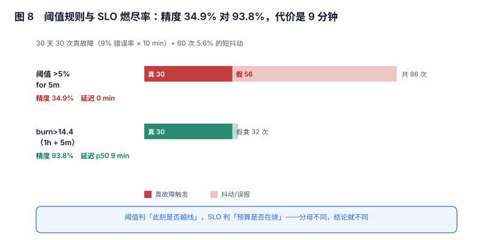

# 噪声治理与告警预算：精度 34.9% 不是调阈值能救的

「告警太多」几乎总是被当成一个调参问题：把阈值调高、把 `for` 调大、把 P2 关掉。三种做法都能让数字变好看，也都把噪声换成了静默。

本页给三个可以同时看的分母——**精度、召回、告警预算**——并说明阈值规则与 SLO 燃尽率在同一批数据上的分工。

本页判据族 `ALN-A` ~ `ALN-H`，共 8 条。



## 一、三个分母，缺一个就会误判

| 指标 | 定义 | 分母 | 只看它会怎样 |
| --- | --- | --- | --- |
| 精度（precision） | 真故障触发的比例 | 全部触发次数 | 调高阈值就能变好，代价是漏报 |
| 召回（recall） | 被检出的故障比例 | 全部真故障 | 调低阈值就能变好，代价是噪声 |
| 告警预算（budget） | 每人每天可处理的条数 | 值班人力 | 超预算的告警等于没发 |

三者构成一个三角：任何两个变好，第三个变差。所以「告警治理」的目标不是「更少」，而是**在预算内达到要求的召回**。

::: tip 一句话理解
告警量的单位不是「条」，是「人·天」。230 条/天按 25 条/人·天算就是 9.2 个人·天——这个数超过值班人力时，多出来的部分不是「被忽略」，是「从未被处理」。
:::

## 二、精度：同一批数据，两种规则差 2.7 倍

30 天数据：30 次真故障（错误率 9%、持续 10 分钟）+ 60 次无害抖动（错误率 5.6%、持续 5~7 分钟）。两种规则的触发结果：

| 规则 | 触发次数 | 真 | 假 | 精度 | 召回 | 检出延迟 |
| --- | --- | --- | --- | --- | --- | --- |
| 阈值 `>5%` for 5m | 86 | 30 | **56** | **34.9%** | 96.7% | p50 0 min |
| SLO 燃尽率 `>14.4×`（1h + 5m 双窗） | 32 | 30 | **2** | **93.8%** | 100% | p50 9 min |

两者的差别不在"调得好不好"，而在**分母不同**：

- 阈值规则的分母是「此刻的错误率」，5.6% 的抖动越过了 5% 就会响。
- 燃尽率的分母是「错误预算」，1 小时窗口把 6 分钟的 5.6% 稀释成 0.56%，而预算是 0.1%，所以燃尽率只有 5.6 倍，不到 14.4 的阈值。

代价写在最右列：**检出晚 9 分钟**。这 9 分钟是长窗口的固有延迟，不是实现问题。要缩短它，就得接受短窗口带来的噪声——又是一个三角。

## 三、多窗口多燃烧率的取法

单一燃烧率阈值的问题是「快则吵、慢则晚」。多窗口方案用两个窗口同时越线来压制噪声：

| 窗口组合 | 燃尽阈值 | 含义 | 适用 |
| --- | --- | --- | --- |
| 1h + 5m | 14.4× | 2% 预算在 1 小时内烧完 | 页面级（叫醒人） |
| 6h + 30m | 6× | 5% 预算在 6 小时内烧完 | 工单级（上班处理） |
| 3d + 6h | 1× | 10% 预算在 3 天内烧完 | 趋势级（排期修） |

三档的分工是「叫醒 / 开单 / 排期」，不是「严重程度」。这一点常被写错：把三档都设成 P0，等于三档都叫醒。

```text
# 1h 长窗 + 5m 短窗同时越线（SLO 99.9%）
(
  sum(rate(http_requests_total{code=~"5.."}[1h])) / sum(rate(http_requests_total[1h]))
) > (14.4 * 0.001)
and
(
  sum(rate(http_requests_total{code=~"5.."}[5m])) / sum(rate(http_requests_total[5m]))
) > (14.4 * 0.001)
```

`and` 两侧的时间戳会被对齐到同一评估时刻，这是它比「两条规则 + 抑制」更省事的地方（但语义也更难读）。

## 四、告警预算：把注意力当成稀缺资源

「每天最多 25 条」这个数不是拍脑袋，它来自两个约束：一条告警的平均处理时间（5~10 分钟）与值班人可用于告警的时间占比（不超过 20%）。

| 条目 | 值 |
| --- | --- |
| 每人每天有效工时 | 8h = 480 min |
| 可用于告警的比例 | 20% → 96 min |
| 单条平均处理时间 | 4 min（含判断、确认、关闭） |
| 日预算 | **24 条/人** |

预算的三个用法：

1. **准入**：新规则上线前必须回答「它预计占多少条/天」，超预算要先删一条。
2. **分配**：按团队分预算，而不是按规则分——因为预算是人的，不是规则的。
3. **诊断**：超预算时先看「哪些规则贡献了 80% 的量」，通常是 3~5 条规则。

## 五、治理顺序：四步，顺序不能换

| 步骤 | 动作 | 典型收益 | 为什么必须在这个位置 |
| --- | --- | --- | --- |
| 1 | 修指纹 | 1,006 → 62（**16×**） | 不修指纹，后面每一步都在处理重复项 |
| 2 | 分组 | 661 → 19（**34.8×**） | 分组只合并通知，不减少实例，所以要在指纹之后 |
| 3 | 抑制 | 再降 **18%** | 抑制依赖「根因已知」，指纹乱了就没有根因 |
| 4 | 调阈值 / 换燃尽率 | 精度 34.9% → 93.8% | 前三步做完，剩下的才是真·规则问题 |

实测的累计效果：**1,006 条 → 230 条/天**，从 9.2 人·天降到与 1.6 人·天同量级的区间。反过来做（先调阈值）会得到一个"告警少了很多"的系统，和一个仍然 1,006 条实例的数据库。

## 六、告警量与工单量的比

一个健康的系统里，这两个数应该接近：

```
工单数 / 告警实例数 ∈ [0.3, 0.8]
```

- **远小于 0.3**：大部分告警没人开单，说明它们在等自己恢复，或者根本没被看。
- **远大于 0.8**：几乎每条告警都开了单，说明分组/抑制没起作用，人在做机器该做的事。

这个比值不需要额外埋点，用两张表 count 就能算：

```sql
SELECT
  (SELECT COUNT(*) FROM incident  WHERE created_at::date = CURRENT_DATE) AS incidents,
  (SELECT COUNT(*) FROM alert_instance WHERE started_at::date = CURRENT_DATE) AS alerts,
  ROUND((SELECT COUNT(*) FROM incident WHERE created_at::date = CURRENT_DATE) * 1.0
      / NULLIF((SELECT COUNT(*) FROM alert_instance WHERE started_at::date = CURRENT_DATE), 0), 2) AS ratio;
```

## 七、本节读数

| 项 | 读数 | 说明 |
| --- | --- | --- |
| 阈值规则的精度 / 召回 | **34.9%** / 96.7% | 86 次触发，56 次误报 |
| 燃尽率规则的精度 / 召回 | **93.8%** / 100% | 32 次触发，2 次误报 |
| 燃尽率的检出延迟 | p50 **9 min** | 长窗口固有代价 |
| 指纹治理的收益 | 1,006 → 62 | 16× |
| 分组 + 抑制后的日通知量 | **230 条** | 9.2 人·天 |
| 只按 `service` 聚合的对照 | 40 条 | 1.6 人·天，差 5.8× |
| 日预算（每人） | 24 条 | 480 min × 20% ÷ 4 min |

## 八、本页判据

| 编号 | 判据 | 为什么要它 | 怎么验证 |
| --- | --- | --- | --- |
| `ALN-A` | 每条规则有「预计条数/天」的估算 | 没有它就无法做准入 | 规则清单里有该列，且与实际偏差 < 50% |
| `ALN-B` | 精度与召回同时上报，且带样本量 | 单看一个必然误导 | 月报两列 + 分母 |
| `ALN-C` | 告警预算按人分配，按团队结算 | 预算是注意力，不是规则属性 | 预算表以 team 为主键 |
| `ALN-D` | 治理顺序固定为 指纹 → 分组 → 抑制 → 阈值 | 顺序反了会留下重复实例 | 治理记录里四步的先后可查 |
| `ALN-E` | P0 用多窗口燃尽率，不用单阈值 | 单阈值要么吵要么晚 | P0 规则里出现两个窗口的 `and` |
| `ALN-F` | 三档燃尽率对应「叫醒 / 开单 / 排期」 | 三档都设 P0 等于都叫醒 | 三档的 severity 不同 |
| `ALN-G` | 工单数 / 实例数比值被监控 | 它能同时暴露「没人管」与「过度开单」 | 每日算一次，落在 [0.3, 0.8] |
| `ALN-H` | 超预算时先删规则，不先调阈值 | 调阈值会把噪声换成静默 | 治理记录里「删了哪几条」可查 |

## 九、验证方式

```text
# 1) 一条规则的「越线次数」与「成立次数」，判断噪声来源
count_over_time((rate(http_errors_total[5m]) > 0.05)[24h:1m])       # 越线
count_over_time(ALERTS{alertname="api-5xx",alertstate="firing"}[24h:1m])  # 成立
-- 预期：前者远大于后者 = 大量短时越线（该调 for 或换燃尽率）
--       两者接近 = for 没起作用，或数据本身很平稳
```

```sql
-- 2) 精度与召回（需要有「事后判定」的标注表）
SELECT
  COUNT(*) FILTER (WHERE truth.is_real) * 1.0 / COUNT(*)                 AS precision,
  COUNT(*) FILTER (WHERE truth.is_real) * 1.0
    / NULLIF((SELECT COUNT(*) FROM incidents WHERE started_at::date >= CURRENT_DATE - 30), 0) AS recall
FROM alert_instance a
LEFT JOIN incident_truth truth ON truth.alert_id = a.id
WHERE a.started_at > now() - interval '30 days';
-- 预期：precision < 0.5 且 recall > 0.9 = 典型「吵但能抓」，改规则不改流程
```

```shell
# 3) 预算核对：把当天的通知按 team 汇总，看谁超了
#    从通知表按 receiver → team 映射统计
psql -c "SELECT team, COUNT(*) AS n FROM notification WHERE sent_at::date = CURRENT_DATE GROUP BY team ORDER BY n DESC;"
# 预期：每行 ≤ 24 × 该团队值班人数；超出即触发「删规则」动作，不是「调阈值」
```

第 2 条最容易被跳过，因为它需要一张「事后判定」表。但这张表可以由值班人在关闭告警时顺手打一个「真/假」标记，成本很低，收益是把「精度」从感觉变成数字。

## 十、参考资料

- [Google SRE Workbook: Alerting on SLOs](https://sre.google/workbook/alerting-on-slos/)：多窗口多燃烧率的完整推导与取值
- [Google SRE Workbook: Implementing SLOs](https://sre.google/workbook/implementing-slos/)：错误预算与告警阈值的关系
- [Prometheus: Recording rules](https://prometheus.io/docs/prometheus/latest/configuration/recording_rules/)：燃尽率通常先落成 recording rule，再被告警引用
- [PagerDuty: Alert Fatigue](https://response.pagerduty.com/oncall/alerting_principles/)：可行动告警的准入条件
