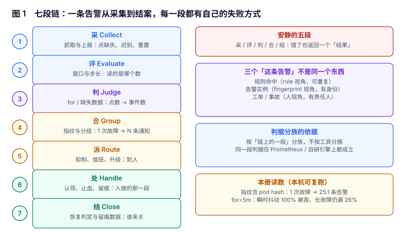

# 总览：三个「这条告警」与五个安静的失败

告警系统上线三个月后，团队通常会发现两个现象同时存在：**群里每天几百条消息，而真正出事的那次没有人第一时间知道**。这两件事不是矛盾的，它们是同一个原因的两面——系统把「规则命中」当成了「有事发生」，又把「发出去」当成了「处理完」。

本页先把对象拆开，再把失败形态摆出来，最后给一条不换监控系统也能走的三步起点。

本页判据族 `ALO-A` ~ `ALO-H`，共 8 条。



## 一、三个「这条告警」不是同一个东西

同一句话在三个地方指三个不同的对象，混用是大部分设计错误的源头：

| 视角 | 对象 | 身份由什么决定 | 数量级（一个典型故障） | 谁在用它 |
| --- | --- | --- | --- | --- |
| 规则 | 规则命中（rule match） | 规则名 + 时间 | 每一拍评估都可能命中一次 | 引擎内部，不该外泄 |
| 实例 | 告警实例（alert instance） | **指纹**（一组标签） | 1 条（理想）到 25 条（实测） | 通知、抑制、去重 |
| 人 | 工单 / 事故（incident） | 事故编号 | 1 条 | 值班、归因数据、SLA |

把三者混起来的典型后果：

1. **用规则命中当身份**：同一次故障在 12 分钟里产生 48 条记录，值班的人看第二遍就开始忽略。
2. **用实例当事故**：一个故障因为 pod 重启换了三次指纹，开了三张单，SLA 统计里变成三次事故。
3. **用事故当实例**：为了少开单，把不同故障合并进一个事故，恢复时无法判断「哪一部分好了」。

::: tip 一句话理解
规则的输出是「此刻是否越线」，实例的输出是「这一件事还在不在」，工单的输出是「谁负责、什么时候好」。三者可以一对一，但不该被同一个字段承载。
:::

## 二、七段链：每段的输入、输出与失败方式

| 段 | 输入 | 输出 | 失败时表现为什么 | 本册页面 |
| --- | --- | --- | --- | --- |
| 采 Collect | 抓取点 | 时间序列点 | 点缺失、迟到、计数器重置 | [评估与窗口](../EvaluationWindow/index.md) |
| 评 Evaluate | 点 + 窗口 | 一个标量 | 窗口选错，读的不是你以为的那个数 | [评估与窗口](../EvaluationWindow/index.md) |
| 判 Judge | 标量 + 阈值 + `for` | 状态迁移 | 抖动被吞或噪声被放行 | [规则状态机](../RuleState/index.md) |
| 合 Group | 实例 + 标签 | 通知分组 | 一次故障拆成一串，或一团无法阅读 | [指纹](../Fingerprint/index.md) / [分组](../Grouping/index.md) |
| 派 Route | 分组 + 抑制/静默 + 值班表 | 到人 | 发给不相关的人，或没人认领 | [抑制](../Inhibition/index.md) / [路由](../Routing/index.md) |
| 处 Handle | 人的动作 | 认领、止血、留痕 | 「有人在处理」但没人负责 | [路由](../Routing/index.md) |
| 结 Close | 恢复信号 | 关闭 + 数据 | 早关、重复开单、数据对不上 | [恢复判定](../Recovery/index.md) |

七段里，**第 1、2、3、4、7 段的失败是安静的**：系统仍然返回一个结果、通知仍然发出去、告警仍然会被关闭，监控上看不出任何异常。只有第 5、6 段（发送失败、无人认领）有机会被指标发现。

## 三、五个安静的失败

这五条是本册各章的主线，每条后面挂着一个本机实测读数：

| 失败 | 为什么安静 | 本册读数（本机可复跑） |
| --- | --- | --- |
| 窗口太短 = 没有数据 | 取不到 2 个点，引擎认为「无异常」 | 窗口 15s（= 步长）时 **100%** 的评估时刻取不到有效窗口 |
| 窗口长度换了，结论跟着换 | 都叫「错误率」 | 同一突发：60s 窗口与 300s 窗口读数差 **23.5%** |
| `for` 当降噪旋钮用 | 调大之后告警确实少了 | `for=5m` 在瞬时抖动场景 **100%** 漏掉，长故障场景仍漏 **26%** |
| 指纹含易变标签 | 每条看起来都对 | 40 次故障 → **1,006 条**告警（25.1×） |
| 恢复判定不写清楚 | 关了就是关了 | 立即关闭时 **34.5%** 的事件被关早、必须重开 |

五条分别对应：[评估与窗口](../EvaluationWindow/index.md)、[规则状态机](../RuleState/index.md)、[指纹](../Fingerprint/index.md)、[恢复判定](../Recovery/index.md)，以及第三、四条共同的出口——[分组](../Grouping/index.md)。

::: danger 不要把「告警变少了」当成治理成功
把 `for` 从 1 分钟调到 15 分钟，告警量能降一个数量级，指标很好看。但同一批数据里，**段长中位 45 秒的异常会被全部吞掉**（实测 `for=300s` 漏掉 10/11 段）。治理的验收指标必须是「漏报 + 误报」两条一起看，只看条数等于把噪声换成了静默。
:::

## 四、三个反模式

这三个写法在评审时都很合理，上线半年后都会变成「不敢动」：

1. **在业务代码里 `if (errRate > 0.05) sendAlert()`**：规则和业务耦合，改阈值要发版，且没有 `for`、没有指纹、没有恢复——四个必要能力一个都没有。正确做法是业务只暴露指标，判定交给引擎。
2. **把「通知」当「处置」**：通知只证明「消息到了某个群」，不证明「有人接手」。判据是「有没有一个字段记录认领人和认领时间」，见[路由](../Routing/index.md)。
3. **用一条「总分」代替全部判据**：把延迟、错误率、饱和度加权成一个 0~100 的健康分，再对分数设阈值。分数不可解释，出问题时无法回答「哪个指标越线了」，也无法做抑制（抑制需要知道「谁压制谁」）。

## 五、什么时候不需要告警系统

告警是有成本的：规则维护、值班人力、误报带来的信任损耗。下面四条同时成立时，**先别建告警系统**：

- 服务没有对外承诺（内部工具、一次性脚本），坏了不影响别人。
- 有更直接的发现渠道（用户会打电话、老板会走过来说），且这个渠道比告警快。
- 故障的代价可逆且可延迟（第二天上班再修也不亏）。
- 没有人愿意在夜里被叫起来——**没有值班承诺的告警，只是把噪声从一个群搬到另一个群**。

四条里只要有一条不成立，就需要至少一个最小形态：**一个能记录「谁在什么时候被叫醒、多久处理完」的表**。这张表不需要引擎，一个 cron 加一张表就能起步。

## 六、最小起步三步

1. **先有身份**：给每条告警定一个指纹（哪些标签参与），并加一条唯一约束「同一指纹同时只能有一条未结束的告警」。这一步能把通知量降一半以上，且不需要改任何规则。
2. **再有出口**：做一个能「认领 / 关闭 / 转交」的最小后台，记下人和时间。**出口比入口重要**——没有认领记录，你永远不知道告警到底有没有被处理。
3. **最后调规则**：在前两步的数据上算「每条规则的命中次数 / 真实故障次数」，只改精度最低的那三条。没有这个分母就调阈值，等于闭着眼睛拧旋钮。

顺序不能反。先调规则的人，通常会在第二周遇到「告警确实少了，但出了事没人知道」的死结——因为他删掉的是最长的那批告警，而不是最假的那批。

## 七、本页判据

| 编号 | 判据 | 为什么要它 | 怎么验证 |
| --- | --- | --- | --- |
| `ALO-A` | 「规则命中 / 告警实例 / 工单」三者分别有独立标识，不共用一个 ID | 三者生命周期不同，混用会让 SLA 与去重同时失真 | 库里能分别查到规则评估日志、`alert_instance` 与 `incident` 三张表 |
| `ALO-B` | 每条告警有明确的指纹定义，且指纹不含易变标签 | 指纹决定「一次故障算几条」 | 同一故障重放标签（不改业务事实），指纹不变 |
| `ALO-C` | 同一指纹同时最多一条未结束实例（数据库层约束） | 应用层「先查后写」在并发下会双写 | 并发插入同指纹：第二次必须被拒 |
| `ALO-D` | 每条规则必须写明 `for`，并说明为什么是这个值 | 不写明就等于默认 0，抖动直接放行 | 规则文件里 `for` 字段非空，且有注释/文档说明 |
| `ALO-E` | 存在「无通知也能落库」的通路 | 通道故障时不能丢告警 | 断开通路，告警仍出现在实例表里 |
| `ALO-F` | 恢复判定写明「连续几拍 / 多久」 | 不写就是「一拍即关」，会关早 | 恢复条件在配置或代码里有显式常量 |
| `ALO-G` | 验收指标至少三条：漏报、误报、未认领率 | 只看告警条数会把噪声换成静默 | 月报里有三列，且都带分母 |
| `ALO-H` | 每条告警可追到「命中哪条规则、哪个标签组合、哪次评估」 | 不可解释的告警无法抑制、无法调参 | 任取一条实例，能查到规则名与触发时的标签集 |

## 八、验证方式

三步都能在读完本册后对着自己的库跑，不需要改代码：

```sql
-- 1) 是否存在「同一指纹两条未结束实例」（应该永远返回 0 行）
SELECT rule_id, fingerprint, COUNT(*) AS n
FROM alert_instance
WHERE state IN ('pending','firing')
GROUP BY rule_id, fingerprint
HAVING COUNT(*) > 1;
-- 预期：0 行。有行 = 缺唯一约束，或约束没带 WHERE 条件
```

```sql
-- 2) 告警有没有「出口」：未认领占比
SELECT COUNT(*) FILTER (WHERE acked_at IS NULL) * 100.0 / COUNT(*) AS unacked_pct,
       COUNT(*) AS total
FROM alert_instance
WHERE state = 'firing';
-- 预期：unacked_pct 是你现在真实的「没人管」比例；>30% 说明派发链有问题，不是规则问题
```

```sql
-- 3) 指纹稳定性：同一 service 的实例数是不是远大于故障次数
SELECT service, COUNT(DISTINCT fingerprint) AS fp, COUNT(*) AS rows
FROM alert_instance
GROUP BY service ORDER BY fp DESC LIMIT 10;
-- 预期：fp 与 rows 应该接近（一条实例只出现一次）；fp 远大于真实故障次数 = 指纹里有易变标签
```

第三条最容易被忽略：它不需要你知道「真实故障几次」，只要看**同一个 service 下的指纹数量是不是离谱**。一个服务一天出现 60 个指纹，基本可以断定指纹里有 pod 名或时间戳。

## 九、参考资料

- [Prometheus: Alerting rules](https://prometheus.io/docs/prometheus/latest/configuration/alerting_rules/)：`for` / `keep_firing_for` 的语义与时序边界（2026-11 核对）
- [Prometheus: Alerting overview](https://prometheus.io/docs/alerting/latest/overview/)：从规则到 Alertmanager 的数据流，用于确认「规则命中 ≠ 通知」
- [Alertmanager 配置文档](https://prometheus.io/docs/alerting/latest/configuration/)：`group_by` / `group_wait` / `group_interval` / `repeat_interval` 与 `inhibit_rules` 的官方定义
- [Google SRE Workbook: Alerting on SLOs](https://sre.google/workbook/alerting-on-slos/)：多窗口多燃烧率（multi-window, multi-burn-rate）的推导，本册[噪声治理](../Noise/index.md)用它做对照
- [Google SRE Book: Monitoring Distributed Systems](https://sre.google/sre-book/monitoring-distributed-systems/)：为什么「每条告警都必须可行动」是唯一站得住的准入条件
