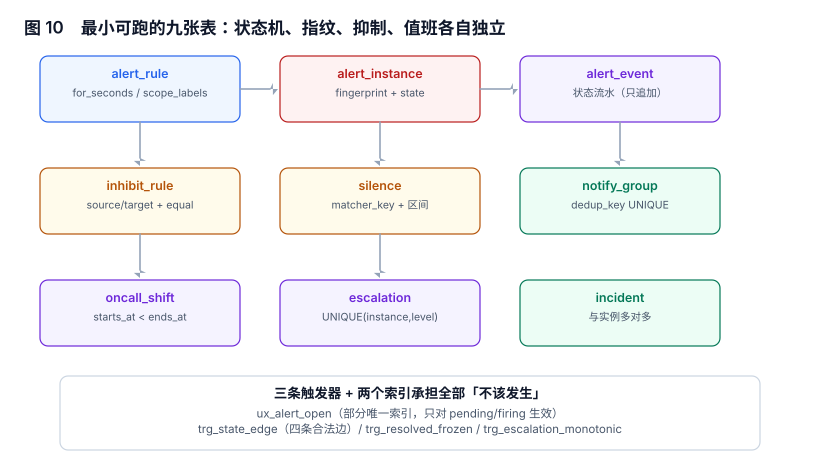

# 实战：九张表、三条触发器与九条断言

前面八页讲的都是判据，这一页把它们落到表上。目标不是「一个告警系统」，而是**一个能让上面所有判据被机器检查的最小骨架**：状态机、指纹、抑制、值班、升级各自独立，任一部分可以换实现。

本页判据族 `ALP-A` ~ `ALP-H`，共 8 条。



## 一、为什么是九张表

| 表 | 它固定的一件事 | 缺了会怎样 |
| --- | --- | --- |
| `alert_rule` | 规则的阈值、`for`、指纹范围 | 阈值散在代码里，无法审计 |
| `alert_instance` | 一次告警的身份与状态 | 无法去重、无法算时长 |
| `alert_event` | 状态迁移流水（只追加） | 无法回答「什么时候变成 firing 的」 |
| `silence` | 人工静默及其有效期 | 静默变成永久 |
| `inhibit_rule` | 抑制图的一条边 | 抑制关系靠记忆 |
| `notify_group` | 通知去重键 | 同一条通知发多遍 |
| `oncall_shift` | 值班区间 | 值表有洞，没人被叫 |
| `escalation` | 升级级别（单调） | 升级可以来回跳 |
| `incident` | 人与事的关系 | 告警与事故无法对齐 |

九张表里，只有 `alert_instance` 与 `alert_event` 是热表（高频写），其余都是配置或低频表。这个划分让「热路径」只有两张表，便于分库。

## 二、DDL：核心四张

```sql
-- 1) 规则：for 与指纹范围是必填
CREATE TABLE alert_rule(
  id          INTEGER PRIMARY KEY,
  name        TEXT NOT NULL UNIQUE,
  metric      TEXT NOT NULL,
  op          TEXT NOT NULL CHECK(op IN ('>','<')),
  threshold   REAL NOT NULL,
  for_seconds INTEGER NOT NULL DEFAULT 0 CHECK(for_seconds >= 0),
  severity    TEXT NOT NULL CHECK(severity IN ('P0','P1','P2')),
  scope_labels TEXT NOT NULL DEFAULT '[]');   -- JSON 数组：参与指纹的标签名

-- 2) 实例：指纹 + 状态
CREATE TABLE alert_instance(
  id          INTEGER PRIMARY KEY,
  rule_id     INTEGER NOT NULL REFERENCES alert_rule(id),
  fingerprint TEXT NOT NULL,
  service     TEXT NOT NULL,
  state       TEXT NOT NULL CHECK(state IN ('pending','firing','resolved')),
  started_at  TEXT NOT NULL,
  fired_at    TEXT,
  acked_at    TEXT,
  acked_by    TEXT,
  resolved_at TEXT,
  fired_value REAL,
  suppressed_by INTEGER REFERENCES alert_instance(id));

-- 3) 事件流水：只追加，不更新
CREATE TABLE alert_event(
  id          INTEGER PRIMARY KEY,
  instance_id INTEGER NOT NULL REFERENCES alert_instance(id),
  from_state  TEXT,
  to_state    TEXT NOT NULL,
  at          TEXT NOT NULL);
```

```sql
-- 4) 抑制：一条边 + 作用域
CREATE TABLE inhibit_rule(
  id            INTEGER PRIMARY KEY,
  source_sev    TEXT NOT NULL,
  target_sev    TEXT NOT NULL,
  equal_labels  TEXT NOT NULL);   -- JSON 数组；禁止为空数组

CREATE TABLE silence(
  id          INTEGER PRIMARY KEY,
  matcher_key TEXT NOT NULL,
  starts_at   TEXT NOT NULL,
  ends_at     TEXT NOT NULL,
  created_by  TEXT NOT NULL,
  reason      TEXT NOT NULL,
  CHECK(ends_at > starts_at));

CREATE TABLE notify_group(
  id        INTEGER PRIMARY KEY,
  group_key TEXT NOT NULL,
  dedup_key TEXT NOT NULL UNIQUE,
  sent_at   TEXT NOT NULL);

CREATE TABLE oncall_shift(
  id        INTEGER PRIMARY KEY,
  team      TEXT NOT NULL,
  person    TEXT NOT NULL,
  starts_at TEXT NOT NULL,
  ends_at   TEXT NOT NULL,
  CHECK(ends_at > starts_at));

CREATE TABLE escalation(
  id          INTEGER PRIMARY KEY,
  instance_id INTEGER NOT NULL REFERENCES alert_instance(id),
  level       INTEGER NOT NULL,
  at          TEXT NOT NULL,
  ack_by      TEXT,
  UNIQUE(instance_id, level));

CREATE TABLE incident(
  id          INTEGER PRIMARY KEY,
  primary_alert_id INTEGER REFERENCES alert_instance(id),
  opened_at   TEXT NOT NULL,
  confirmed_at TEXT,
  closed_at   TEXT,
  reopened_count INTEGER NOT NULL DEFAULT 0);
```

## 三、两条索引承担「去重」与「只对未结束生效」

```sql
-- 同一规则 + 同一指纹，同时只允许一条未结束实例（部分唯一索引）
CREATE UNIQUE INDEX ux_alert_open ON alert_instance(rule_id, fingerprint)
  WHERE state IN ('pending','firing');

-- 通知去重：同一分组 + 同一指纹集合只发一次
CREATE UNIQUE INDEX ux_notify_dedup ON notify_group(dedup_key);
```

`WHERE` 子句是关键：没有它，历史记录会让「同一指纹再来一次」直接插入失败（因为已关闭的旧实例也参与唯一性）。这是本页最容易踩的一个坑——**部分唯一索引的谓词必须与「未结束」的定义一致**，否则改一次状态名就全体插入失败。

## 四、三条触发器：把「不该发生」写在库里

```sql
-- 1) 只允许四条合法边
CREATE TRIGGER trg_state_edge BEFORE UPDATE OF state ON alert_instance
WHEN NOT ( (OLD.state='pending' AND NEW.state='firing')
        OR (OLD.state='firing'  AND NEW.state='resolved')
        OR (OLD.state='pending' AND NEW.state='resolved') )
BEGIN SELECT RAISE(ABORT,'ILLEGAL_EDGE'); END;

-- 2) 已关闭的实例不可再改（终态冻结）
CREATE TRIGGER trg_resolved_frozen BEFORE UPDATE ON alert_instance
WHEN OLD.state='resolved'
BEGIN SELECT RAISE(ABORT,'RESOLVED_FROZEN'); END;

-- 3) 升级级别只能递增
CREATE TRIGGER trg_escalation_monotonic BEFORE INSERT ON escalation
WHEN EXISTS (SELECT 1 FROM escalation e
             WHERE e.instance_id = NEW.instance_id AND e.level >= NEW.level)
BEGIN SELECT RAISE(ABORT,'ESCALATION_NOT_MONOTONIC'); END;
```

三条触发器都选择了「拒绝写入」而不是「自动纠正」。理由：自动纠正会让错误变成静默（调用方以为成功），而告警系统最不该有的就是新的静默。

## 五、九条断言：每一条都对应一个判据

用 SQLite 跑，脚本按 `AGENTS.md` 不提交，只提交断言清单与预期：

| 编号 | 断言 | 对应判据 | 实测结果 |
| --- | --- | --- | --- |
| `A1` | 同指纹插入第二条未结束实例被拒 | `ALF-D` | PASS（`UNIQUE constraint failed`） |
| `A2` | 已 `resolved` 的实例再被 `UPDATE` 被拒 | `ALC-G` | PASS（`RESOLVED_FROZEN`） |
| `A3` | `firing → pending` 被拒 | `ALS-A` | PASS（`ILLEGAL_EDGE`） |
| `A4` | 同一实例插入重复升级级别被拒 | `ALY-F` | PASS（`ESCALATION_NOT_MONOTONIC`） |
| `A5` | 三节点抑制环被检出 | `ALI-A` | PASS（环上 3 个节点） |
| `A6` | 静默区间命中判定正确 | `ALI-D` | PASS |
| `A7` | 通知去重键重复被拒 | `ALG-A` | PASS |
| `A8` | 值班表 24h 无空洞 | `ALY-A` | PASS（空洞 0 处） |
| `A9` | 指纹放大倍数可复算 | `ALF-A` | PASS（含 hash 30 / 只 service 1） |

实测汇总：**9 PASS / 0 FAIL，`EXIT=0`**。

## 六、判据怎么被断言覆盖

九条断言不是随机挑的，它们覆盖了四类「静默失败」：

| 失败类型 | 被哪条断言拦住 | 拦不住时的表现 |
| --- | --- | --- |
| 重复身份 | `A1` / `A9` | 一次故障多张单，无人察觉 |
| 非法状态 | `A2` / `A3` | 统计口径漂移，SLA 数字变好看 |
| 抑制失效或过宽 | `A5` / `A6` | 真故障静音，或噪声全放 |
| 派发断裂 | `A4` / `A8` | 无人认领，或升级乱跳 |

这四类共同点是：**它们不会让任何接口报错**。所以断言必须写在数据库层或测试里，不能靠"看日志"。

::: danger 断言必须带「反向探针」
只测「插入成功」的断言是没有价值的——它只证明你写对了 `INSERT`。必须有一条「把约束删掉后，这条断言应当失败」的探针（例如：删掉 `ux_alert_open` 后 `A1` 必须变成 2 条记录）。没有探针，`A1` 的通过可能只是因为这次并发不够。
:::

## 七、验收 SQL：四条能直接跑的查询

```sql
-- 1) 热表规模与增长率（判断要不要分区）
SELECT COUNT(*) AS rows,
       MIN(started_at) AS first_seen,
       MAX(started_at) AS last_seen
FROM alert_instance;

-- 2) 状态分布：resolved 占比过低 = 有大量「没人关」的实例
SELECT state, COUNT(*) AS n, ROUND(COUNT(*) * 100.0 / SUM(COUNT(*)) OVER (), 1) AS pct
FROM alert_instance GROUP BY state;

-- 3) 指纹稳定性：每服务平均每个指纹的实例数
SELECT service, COUNT(DISTINCT fingerprint) AS fp, COUNT(*) AS n,
       ROUND(COUNT(*) * 1.0 / COUNT(DISTINCT fingerprint), 2) AS per_fp
FROM alert_instance GROUP BY service ORDER BY per_fp DESC LIMIT 5;
-- 预期：per_fp ≈ 1；远大于 1 说明指纹里有易变标签

-- 4) 抑制有效性：被抑制但源已结束（应为 0）
SELECT COUNT(*) FROM alert_instance t
WHERE t.suppressed_by IS NOT NULL
  AND NOT EXISTS (SELECT 1 FROM alert_instance s
                  WHERE s.id = t.suppressed_by AND s.state = 'firing');
```

## 八、三个刻意的让步

一套「完整」的告警系统还需要：规则热加载、多副本一致性、通知重试与死信、审计日志、多租户隔离。本页的骨架**刻意不含**这五项，因为它们各自是一个专题，且不影响上面九条断言：

| 让步 | 影响 | 什么时候必须补 |
| --- | --- | --- |
| 无多副本 | 单点故障会丢评估 | 告警量 > 每秒百次评估 |
| 无通知重试 | 通道抖动会丢通知 | 有 P0 依赖该通道时 |
| 无审计表 | 无法追「谁改的规则」 | 有合规要求时 |
| 无租户隔离 | 多团队共用一张表 | 团队数 > 1 时 |
| 无历史归档 | `alert_instance` 无限增长 | 单表 > 千万行 |

## 九、本节读数

| 项 | 读数 |
| --- | --- |
| 表 / 触发器 / 索引 | 9 / 3 / 2 |
| 断言 | **9 PASS / 0 FAIL**，`EXIT=0` |
| 覆盖的判据族 | 8 族（`ALO`…`ALP`） |
| 反向探针 | 2 条（`A1`、`A2` 依赖约束存在） |
| 建表 + 断言耗时 | 本机 < 1 秒（SQLite 内存库） |

## 十、本页判据

| 编号 | 判据 | 为什么要它 | 怎么验证 |
| --- | --- | --- | --- |
| `ALP-A` | 指纹去重由部分唯一索引承担，不靠应用层先查后写 | 并发下先查后写会双写 | 并发插入同指纹，第二次被拒 |
| `ALP-B` | 状态机非法边由触发器拒绝 | 应用层校验会被补数据绕过 | 手工 `UPDATE` 非法边报错 |
| `ALP-C` | 事件流水只追加，不更新 | 更新会丢失历史，无法审计 | `alert_event` 无 `UPDATE` 语句 |
| `ALP-D` | 升级级别 `UNIQUE(instance_id, level)` 且单调 | 升级乱跳会让 SLA 失真 | 重复级别插入被拒 |
| `ALP-E` | 抑制关系建模为「边」，可跑环检测 | 成环会让告警全静默 | 递归 CTE 返回 0 行 |
| `ALP-F` | 静默三字段 `NOT NULL`（人 / 原因 / 结束时间） | 缺一个就不可审计 | 表结构可查 |
| `ALP-G` | 每条断言配一条反向探针 | 否则「通过」可能是巧合 | 删约束后断言必须失败 |
| `ALP-H` | 验收 SQL 四条可直接跑，不依赖应用代码 | 应用不可用时仍能判断状态 | 纯 SQL，无外部依赖 |

## 十一、验证方式

```shell
# 1) 建库并跑断言（SQLite，内存库，不落盘）
python3 - <<'PY'
import sqlite3
c = sqlite3.connect(":memory:")
c.executescript(open("schema.sql").read())
# 依次执行断言，任一条失败即抛异常
PY
# 预期：全部 PASS，退出码 0
```

```sql
-- 2) 反向探针：删掉唯一索引后，同指纹应能插入两条
DROP INDEX ux_alert_open;
-- 预期：随后两条同指纹 INSERT 都成功（证明 A1 确实依赖该索引）
--       验证完记得重建索引
```

```sql
-- 3) 触发器是否真的在拦（不是「应用没写这条语句」）
UPDATE alert_instance SET state = 'pending' WHERE id = 1 AND state = 'firing';
-- 预期：报错 ILLEGAL_EDGE。若成功，说明触发器没建或写错了 WHEN 条件
```

第 3 条最有价值：它区分「应用没做这件事」与「数据库不允许这件事」。前者靠代码评审，后者靠结构，只有后者能在补数据、手工修库、脚本批量操作时仍然成立。

## 十二、参考资料

- [SQLite: Partial indexes](https://www.sqlite.org/partialindex.html)：`CREATE UNIQUE INDEX ... WHERE` 的语义与限制
- [SQLite: CREATE TRIGGER](https://www.sqlite.org/lang_createtrigger.html)：`RAISE(ABORT)` 与 `WHEN` 子句
- [PostgreSQL: Partial unique indexes](https://www.postgresql.org/docs/current/indexes-partial.html)：生产环境常用 PG，语义等价
- [Alertmanager: 数据模型](https://prometheus.io/docs/alerting/latest/alertmanager/)：实例与通知的官方字段，可用来对照本页的表设计
