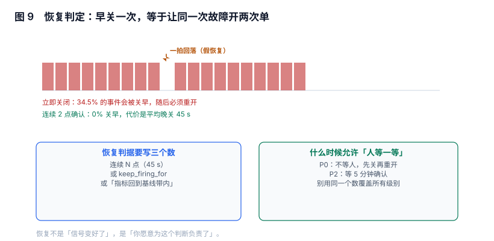

# 恢复判定与闭环：早关一次，等于同一次故障开两次单

告警的「结束」比「开始」更容易做错，因为它有两层含义：**指标恢复**（信号回到阈值内）与**事情结束**（人确认处理完了）。绝大多数系统把第一层当成了第二层，于是同一次故障在报表里被记成两次、三次、三十次。

本页讲三件事：恢复判据怎么写、复发窗口怎么设、关闭时该留下什么数据。

本页判据族 `ALC-A` ~ `ALC-H`，共 8 条。



## 一、恢复判据要写三个数

任何「恢复」判断都必须能回答三个问题，缺一个就会出现不确定性：

| 问题 | 参数 | 典型值 | 不写会怎样 |
| --- | --- | --- | --- |
| 连续多少个正常点才算恢复 | `N` | 2~3（30~45s） | 一拍即关，抖动结尾反复开关 |
| 或者持续多久正常 | `keep_firing_for` 的对偶 | 60~300s | 同上 |
| 或者回到基线什么范围 | 基线带 | ±2σ 或「低于阈值 50%」 | 「刚好在阈值上」的振荡永不恢复 |

第三种最容易被忽略：阈值 5%，读数在 4.9%~5.1% 之间振荡，前两种判据都会不停触发 `firing/resolved`，而「低于阈值 50%（即 2.5%）才算恢复」这种**迟滞（hysteresis）**判据不会。

::: tip 一句话理解
进入和退出用同一个阈值，是振荡的来源；用两个阈值（高一档进、低一档出），是消除振荡最便宜的办法。
:::

## 二、连续 N 点确认：用延迟换「不关早」

200 次故障，其中 30% 在故障中途有一拍信号回落（假恢复）。不同确认策略的结果：

| 确认策略 | 晚关闭（中位） | 关早后必须重开 |
| --- | --- | --- |
| 立即关闭（0 点） | 0 | **34.5%** |
| 连续 1 点（15s） | 约 30s | **34.5%** |
| 连续 2 点（30s） | 45s | **0%** |
| 连续 3 点（45s） | 60s | **0%** |
| 连续 6 点（90s） | 105s | **0%** |

关键的一行是「1 点 → 2 点」：只多等 15 秒，关早率从 34.5% 掉到 0。原因是**单点回落只持续一拍**，两点确认天然把它滤掉。再往上加（3 点、6 点）只增加延迟，不再降低关早率——因为假恢复的形态是「一拍」，不是「两拍」。

这就是「恢复判据的最优值通常很小」的原因：它对抗的不是随机噪声，而是**特定形态的伪信号**，形态决定点数。

## 三、事故复用：复发窗口比恢复判据更重要

恢复之后短时间内再次 `firing`，是同一件事还是两件？系统必须有一个显式答案：

| 策略 | 行为 | 风险 |
| --- | --- | --- |
| 每次 `firing` 都新建事故 | 一次故障记成 N 次 | SLA 统计失真，值班被重复打扰 |
| 同指纹 10 分钟内复发复用原事故 | 一次故障记一次 | 窗口太大时会合并两个真独立的事件 |
| 手动合并 | 最准 | 依赖人，且事后补 |

第二种是实践中最常用的折中，实现只需要一个字段：`incident.reopened_count` 与 `incident.last_fired_at`。

```sql
-- 复发复用：同一指纹 10 分钟内再次 firing，复用最近的事故
SELECT i.id FROM incident i
JOIN alert_instance a ON a.id = i.primary_alert_id
WHERE a.fingerprint = :fp
  AND i.closed_at > now() - interval '10 minutes'
ORDER BY i.closed_at DESC LIMIT 1;
-- 有结果 → 复用；无结果 → 新建
```

窗口大小的选取依据是**故障的典型间隔**：如果同类故障平均 30 分钟复发一次，窗口取 10 分钟不会误并；如果平均 3 分钟复发，10 分钟窗口会把两次独立故障并成一次。

## 四、关闭的动作归谁：自动、人工、还是两者都有

| 关闭方式 | 适用 | 隐患 |
| --- | --- | --- |
| 自动关闭（指标恢复即关） | 绝大多数指标类告警 | 关掉时人还没确认「业务是否真的恢复」 |
| 人工关闭（值班人点） | 有外部影响、需要确认的告警 | 人会忘，实例长期 `firing` |
| 自动关闭 + 人工确认业务恢复 | P0 / 面向用户的告警 | 需要两个字段：`metric_resolved_at` 与 `confirmed_at` |

第三种的判据是：**指标恢复与业务恢复是两个时间戳**。把它们合成一个，就无法回答「故障持续了多久」——按指标算是 8 分钟，按业务算是 23 分钟（含缓存未过期、用户重试），这两个数在报表里都有用。

## 五、关闭时要留下的四个数

一条实例关闭时，至少落下四个可统计的量：

| 字段 | 含义 | 用来算什么 |
| --- | --- | --- |
| `started_at` | 首次进入 `pending` | 检测延迟（与故障注入时间比） |
| `fired_at` | 进入 `firing` | 通知延迟（与 `group_wait` 比） |
| `acked_at` | 认领 | 响应时长 p50/p90 |
| `resolved_at` | 关闭 | 处置时长（MTTR 的分母） |

还缺一个「故障真实开始时间」——它通常不在系统里，只能靠注入演练或用户报告。所以**MTTD（平均检测时长）在纯生产数据里算不出来**，只能算「告警自身的时长」。这一点在写 SLA 报告时经常被搞混。

## 六、三个反模式

1. **用 `resolved` 通知当「事情结束」**：`resolved` 只说明指标回到阈值内，可能只是流量掉下去了。把它当结论，会让「服务已经不可用但没流量」这种情况显示为"已恢复"。
2. **自动关闭 + 自动开新单**：抖动结尾会来回开关，一次故障产生 5 张单。修法就是第二节的连续 N 点确认。
3. **关闭时不写 `resolved_by`**：事后无法回答「是谁判断它可以关了」，也就无法在事后归因时区分「误关」与「真恢复」。

## 七、本节读数

| 项 | 读数 | 说明 |
| --- | --- | --- |
| 立即关闭的关早率 | **34.5%** | 200 次事件，30% 有中途回落 |
| 2 点确认的关早率 | **0%** | 代价：晚关 45s |
| 6 点确认的关早率 | 0% | 晚关 105s，收益不再增加 |
| 假恢复的形态 | 1 拍 | 这是「2 点就够」的原因 |
| 非法状态边 | 3 条 | 触发器可挡住（见[实战](../Practice/index.md)） |

## 八、本页判据

| 编号 | 判据 | 为什么要它 | 怎么验证 |
| --- | --- | --- | --- |
| `ALC-A` | 恢复判据写明「连续 N 点 / 多久 / 基线带」三选一 | 不写就是一拍即关 | 配置或代码里有显式常量 |
| `ALC-B` | 进入与退出使用不同阈值（迟滞）或连续 N 点确认 | 同阈值会在边界振荡 | 规则里能看到两个阈值或 N |
| `ALC-C` | 复发窗口显式定义，并用于事故复用 | 否则一次故障记多次 | 有窗口常量，且复用逻辑可测 |
| `ALC-D` | 指标恢复时间与业务确认时间分列存储 | 合成一个就无法算两个时长 | 两个字段都存在 |
| `ALC-E` | `resolved` 不单独作为「事情结束」的依据 | 指标恢复 ≠ 业务恢复 | 事故关闭需要 `confirmed_at` |
| `ALC-F` | 关闭记录 `resolved_by` | 无法追责与区分误关 | 字段非空率 100% |
| `ALC-G` | 已关闭实例不可被再次 `UPDATE` | 事后改历史会让统计失真 | 触发器拒绝 `resolved` 后的更新 |
| `ALC-H` | MTTR 的口径写明分母（告警时长 / 业务时长） | 两个口径差数倍 | 报表注释里有定义 |

## 九、验证方式

```sql
-- 1) 关早检测：同一指纹在关闭后 10 分钟内再次 firing
WITH closed AS (
  SELECT id, rule_id, fingerprint, resolved_at
  FROM alert_instance WHERE state = 'resolved'
)
SELECT c.id AS closed_id, n.id AS reopened_id,
       (julianday(n.started_at) - julianday(c.resolved_at)) * 86400 AS gap_s
FROM closed c
JOIN alert_instance n
  ON n.rule_id = c.rule_id AND n.fingerprint = c.fingerprint
 AND n.started_at > c.resolved_at
WHERE (julianday(n.started_at) - julianday(c.resolved_at)) * 86400 < 600;
-- 预期：条数占比 < 5%。远高于 5% = 恢复判据太松（该上 2 点确认）
```

```sql
-- 2) 两个时长口径的差
SELECT ROUND(AVG((julianday(resolved_at) - julianday(fired_at)) * 1440), 1) AS alert_minutes,
       ROUND(AVG((julianday(confirmed_at) - julianday(fired_at)) * 1440), 1) AS business_minutes
FROM incident WHERE closed_at IS NOT NULL;
-- 预期：business ≥ alert。若两者几乎相等，说明业务确认是「顺手点一下」，不可信
```

```shell
# 3) 抖动实测：把阈值调到当前值的 95%，观察 1 小时内 resolved 次数
#    先用 recording rule 记录阈值附近的读数
# 预期：若 1 小时内 resolved 超过 3 次，说明缺迟滞或连续确认
```

第 1 条可以直接跑在任何有 `alert_instance` 的库上，它把「关早」从主观判断变成了一个比值。

## 十、参考资料

- [Prometheus: `keep_firing_for` 与恢复语义](https://prometheus.io/docs/prometheus/latest/configuration/alerting_rules/)：官方对「恢复」的定义
- [Alertmanager: `resolve_timeout`](https://prometheus.io/docs/alerting/latest/configuration/#alertmanager_config)：多久没有该组告警视为恢复
- [Google SRE Book: Postmortem Culture](https://sre.google/sre-book/postmortem-culture/)：为什么「关闭时间」的口径必须在事故记录里写清
