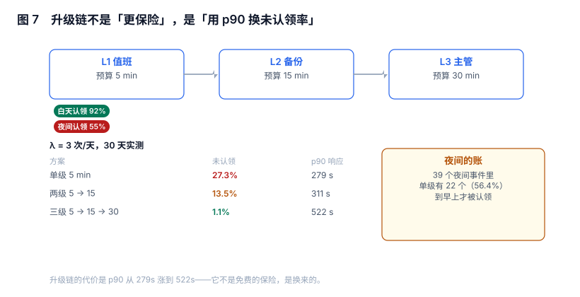

# 路由、值班与升级：从「发出去」到「有人负责」

一条通知发到群里，和一件事有人负责，中间隔着一整条派发链：**路由决定发给哪个组，值班表决定组里此刻是谁，升级链决定没人应的时候找谁**。这三段任何一段断了，告警都会表现为「已发送、未处理」。

本页用一组 30 天的值班仿真说明：升级链不是「更保险」，它是**拿 p90 响应时间换未认领率**。

本页判据族 `ALY-A` ~ `ALY-H`，共 8 条。



## 一、派发链的四段

| 段 | 输入 | 输出 | 失败表现 |
| --- | --- | --- | --- |
| 路由（route） | 分组 + 标签 | 接收组 | 发给不相关的人，或被默认路由吞掉 |
| 值班（roster） | 接收组 + 时间 | 具体的人 | 无人值班（表有洞） |
| 通知（notify） | 人 + 通道 | 送达 | 通道限流、免打扰、设备离线 |
| 升级（escalate） | 超时未认领 | 上一级 | 升级链断，或升到「一个组」而不是「一个人」 |

四段里最容易被跳过的是**认领**：它不是一段，而是贯穿三段的状态字段。没有这个字段，"已发送"就永远无法和"已处理"区分开。

::: tip 一句话理解
派发链的验收标准不是「消息到了」，而是「有一个人名 + 一个时间戳」。缺一个，就等于没派。
:::

## 二、值班表是一张区间表，不是一张名单

值班表的正确结构是「人 + 开始 + 结束」，覆盖必须连续无缝：

```sql
CREATE TABLE oncall_shift(
  id INTEGER PRIMARY KEY, team TEXT NOT NULL, person TEXT NOT NULL,
  starts_at TEXT NOT NULL, ends_at TEXT NOT NULL,
  CHECK(ends_at > starts_at));
```

两条必须的检查：

1. **无空洞**：任一时刻恰好一个人在岗。空洞意味着那个时段没人被叫。
2. **无重叠**：同一团队同一时刻不应有两个人同时"主值"（可以有一主一备，但要显式区分角色）。

空洞检测的 SQL 很短，值得每天跑：

```sql
SELECT a.team, a.ends_at AS gap_start
FROM oncall_shift a
WHERE a.ends_at < (SELECT MAX(b.ends_at) FROM oncall_shift b WHERE b.team = a.team)
  AND NOT EXISTS (SELECT 1 FROM oncall_shift c
                  WHERE c.team = a.team AND c.starts_at = a.ends_at);
-- 预期：0 行。有行 = 这些时段没人值班
```

## 三、升级链：27.3% → 1.1%，代价是 p90 从 279s 到 522s

30 天仿真，事件按泊松到达，白天认领概率 92%、夜间 55%，升级预算 5 / 15 / 30 分钟：

| 到达率 | 升级链 | 事件数 | 未认领 | p90 响应 |
| --- | --- | --- | --- | --- |
| 3 次/天 | 单级 5m | 99 | **27.3%** | 279s |
| 3 次/天 | 两级 5 → 15 | 104 | 13.5% | 311s |
| 3 次/天 | 三级 5 → 15 → 30 | 93 | **1.1%** | **522s** |
| 12 次/天 | 单级 5m | 367 | 25.1% | 267s |
| 12 次/天 | 两级 5 → 15 | 367 | 6.3% | 431s |
| 12 次/天 | 三级 5 → 15 → 30 | 367 | 3.3% | 522s |

两个结论：

1. **未认领率是乘法衰减的**：`(1-p)^n`，`p=0.92` 时两级就能把 8% 压到 0.6%，三级压到 0.05%。所以「加一级」的边际收益递减很快。
2. **p90 是加法增长**：每加一级，最坏情况多等一整级预算。三级链的 p90 是单级的 **1.87 倍**。

所以升级链该加几级，取决于你更怕哪一种失败：**怕没人管 → 加级；怕响应慢 → 减级**。两者不能同时优化，这是本页最重要的判断。

## 四、夜间的账：56.4% 的未认领发生在 22 点到 7 点

同一组数据按昼夜拆开，单级链的夜间未认领率是 **56.4%**（39 个夜间事件里 22 个没人应），白天只有 8%。加两级之后夜间降到 3.3%。

这说明两件事：

- **「平均未认领率」是一个会骗人的指标**。27.3% 的平均值背后，白天可能是 5%、夜间是 56%。用平均值做决策，会把问题平摊到不需要修的时间段。
- **夜间问题的解法不只有加级**：缩短值班周期（减少单班疲劳）、给夜间独立的响应预算、或者把 P2 类告警夜间静音，都比无限加级便宜。

## 五、认领与负载：轮转优于随机

300 个事件分给 5 个人：

| 派发方式 | 最忙 / 最闲 | Gini | 问题 |
| --- | --- | --- | --- |
| 随机派（按人去重随机） | 71 / 51 = **1.39×** | 0.061 | 长期看必然有人被压垮 |
| 轮转（round-robin） | 60 / 60 = 1.00× | 0.000 | 需要维护游标 |
| 按技能路由 | 取决于标签分布 | 可能更差 | 冷门技能的人被单点依赖 |

1.39 倍的差距看起来不大，但它是**纯随机的期望差**，会随时间累积：一个人连续三个月多接 39% 的夜间事件，离职概率显著上升。轮转的成本只是一个游标字段。

::: warning 「谁有空谁接」是最差的派发策略
它把派发权交给了响应速度最快的人，于是那个人永远最忙；同时它让「没人接」这件事没有任何责任人——因为理论上"大家都看到了"。
:::

## 六、通道与回执：送达 ≠ 读到

| 通道 | 送达语义 | 需要回执吗 | 典型失败 |
| --- | --- | --- | --- |
| 电话 | 接通 / 未接 | 是 | 静音、飞行模式、号码过期 |
| 短信 | 提交成功 | 是（回复确认） | 被拦截、延迟数小时 |
| IM（群） | 消息已投递 | 否 | 群里 40 人，无人认领 |
| IM（@个人） | 消息已投递 | 可选 | 免打扰时段 |
| 邮件 | 已接收 | 否 | 无人看 |

「回执」是派发链唯一能证明「人知道了」的信号。没有回执的通道（群、邮件）只能算**通知**，不能算**派发**——它们适合「知会」，不适合 P0。

## 七、交接：换班时最容易被丢掉的那半小时

交接的核心不是"说一声"，而是**把未关闭的实例显式转交**：

| 交接内容 | 不做会怎样 |
| --- | --- |
| 所有 `firing` 实例的清单 | 新值班的人不知道有活着的故障 |
| 每条实例的处理进度 | 重复排查，或以为已经处理 |
| 已发出的静默清单 | 新来的人不知道哪些告警被关了 |
| 升级中的事件 | 升级链指向上一班的人，通知发给了下班的人 |

第四行是最隐蔽的：升级链按"当前值班人"解析，如果事件是在上一班发起的，升级时会发给"上一班的值班人"而不是当前的人。修法是升级时重新解析值班表，见[实战](../Practice/index.md)的 `escalation` 表设计。

## 八、本节读数

| 项 | 读数 | 说明 |
| --- | --- | --- |
| 单级链未认领率（λ=3 / λ=12） | 27.3% / 25.1% | 与到达率关系不大，与认领概率关系大 |
| 三级链未认领率 | 1.1% / 3.3% | 边际收益快速递减 |
| 单级 → 三级的 p90 变化 | 279s → **522s** | 1.87 倍 |
| 夜间未认领占比（单级） | **56.4%** | 39 个夜间事件中 22 个 |
| 随机派发的负载不均 | **1.39×** | 5 人 300 事件 |
| 轮转派发的负载不均 | 1.00× | 需要游标 |

## 九、本页判据

| 编号 | 判据 | 为什么要它 | 怎么验证 |
| --- | --- | --- | --- |
| `ALY-A` | 值班表是区间表，覆盖无空洞、无重叠 | 空洞时段等于没人被叫 | 空洞 SQL 返回 0 行 |
| `ALY-B` | 每条通知能解析到唯一「当前值班人」 | 解析不到就只能广播 | 任一时刻查询返回 1 行 |
| `ALY-C` | 升级时重新解析值班表，不用发起时的人 | 否则升级会发给下班的人 | 升级记录里有 `resolved_at_time` 的接收人 |
| `ALY-D` | 有认领字段（人 + 时间），并作为核心指标 | 没有它无法区分「发了」和「处理了」 | `acked_at` / `acked_by` 非空率被监控 |
| `ALY-E` | 未认领率按昼夜分开统计 | 平均值会掩盖夜间问题 | 报表有夜间/白天两列 |
| `ALY-F` | 升级链级数 ≤ 3，且 p90 预算被显式接受 | 每加一级 p90 涨一档 | 升级配置旁注明 p90 实测值 |
| `ALY-G` | 派发用轮转或加权轮转，不用纯随机 | 随机派发长期不均 1.4 倍 | 负载 Gini < 0.1 |
| `ALY-H` | 交接清单包含未关闭实例、静默、升级中事件 | 换班是漏报高发点 | 交接模板含四项，且留痕 |

## 十、验证方式

```sql
-- 1) 值班覆盖：给定任意时刻，是否恰好一个人在岗
WITH t(ts) AS (VALUES ('2026-11-08T03:00:00'), ('2026-11-08T14:30:00'))
SELECT t.ts, COUNT(s.id) AS on_duty
FROM t LEFT JOIN oncall_shift s
  ON t.ts >= s.starts_at AND t.ts < s.ends_at
GROUP BY t.ts;
-- 预期：每行 on_duty = 1。0 = 空洞，>1 = 重叠
```

```sql
-- 2) 未认领率（分昼夜）
SELECT CASE WHEN CAST(strftime('%H', fired_at) AS INTEGER) BETWEEN 7 AND 21
            THEN 'day' ELSE 'night' END AS band,
       COUNT(*) AS total,
       SUM(CASE WHEN acked_at IS NULL THEN 1 ELSE 0 END) AS unacked,
       ROUND(SUM(CASE WHEN acked_at IS NULL THEN 1.0 ELSE 0 END) / COUNT(*) * 100, 1) AS pct
FROM alert_instance WHERE state IN ('firing','resolved')
GROUP BY band;
-- 预期：night 的 pct 明显高于 day；若两者接近，说明问题不在时段而在流程
```

```shell
# 3) 升级链实测：发一条不会被认领的告警，观察升级时间点
curl -s -X POST http://localhost:9093/api/v2/alerts -H 'Content-Type: application/json' \
  -d '[{"labels":{"alertname":"drill-escalation","severity":"P0","team":"core"}}]'
# 预期：5 分钟后出现 L2 记录、20 分钟后出现 L3 记录
#      若 5 分钟后没有任何新记录 → 升级链未接上「超时未认领」这个触发器
```

第 3 条是唯一能证明升级链真的在工作的测试：它不依赖真实故障，只需要一条故意没人理的告警。

## 十一、参考资料

- [PagerDuty: Incident Response — On-call 与升级策略](https://response.pagerduty.com/oncall/being_oncall/)：值班表、升级、交接的行业实践
- [Google SRE Book: Being On-Call](https://sre.google/sre-book/being-on-call/)：值班负载上限与「可行动告警」的取舍
- [Alertmanager: `<route>` 与 receiver](https://prometheus.io/docs/alerting/latest/configuration/#route)：路由匹配与默认路由的语义
