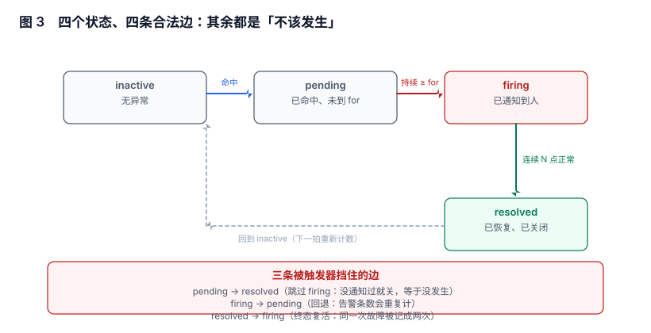

# 规则状态机与 for：把「点数」翻译成「事件数」

一条规则每一拍都在回答同一个问题：「此刻越线了吗」。但人需要知道的不是「此刻」，而是「这件事开始了没有、结束了没有」。把前者翻译成后者的，是**状态机 + `for`** 这一对东西。

这一对东西最常见的误用，是把 `for` 当成降噪旋钮：调大、告警变少、看起来有效。本页用一组实测说明它真实的代价，并给出「该取多大」的算法。

本页判据族 `ALS-A` ~ `ALS-H`，共 8 条。



## 一、四态四边：其余都是「不该发生」

| 状态 | 含义 | 进入条件 | 是否已通知 |
| --- | --- | --- | --- |
| `inactive` | 没有异常 | 上一拍未越线 | 否 |
| `pending` | 已命中，但还没到 `for` | 本拍越线，且计时开始 | **否** |
| `firing` | 已成立 | 连续越线时长 ≥ `for` | 是 |
| `resolved` | 已恢复 | 连续正常达到恢复判据 | 是（发恢复通知） |

合法边只有四条：`inactive→pending`、`pending→firing`、`pending→inactive`、`firing→resolved`（再回到 `inactive`）。另外三条边在任何实现里都是 bug，值得用触发器挡住：

1. **`pending → resolved`**：没通知过就关，等于这件事从没发生，但指标里会多一条「已恢复」。
2. **`firing → pending`**：回退会让同一次故障被重复计数（每次重新 `firing` 都算一次）。
3. **`resolved → firing`**：终态复活，同一次故障被记成两次事故。

::: danger `pending` 不是「轻微告警」，它是不存在的告警
`pending` 状态通常**不发送通知**。这意味着任何一条「只在 pending 停留过」的异常，对人来说等于没发生。如果你的规则里 `for` 大于「真实故障的常见时长」，系统会稳定地丢掉一大类故障，而 UI 上一切正常。
:::

## 二、`for` 不是降噪旋钮：它决定你放弃哪一段

`for` 的语义是「连续越线这么久才成立」。它做的事只有一件：**把短于 `for` 的异常整段丢弃**。丢掉的不是「噪声」，是「所有短故障」——两者在同一批数据里无法区分。

下面是三组 24 小时抖动数据（步长 15s）在不同 `for` 下的结果：

| 场景 | 真实异常段 | 总时长 | `for` | 成立次数 | 覆盖时长 | 漏掉段数 | 漏掉时长占比 |
| --- | --- | --- | --- | --- | --- | --- | --- |
| 瞬时抖动（段长中位 22s） | 6 | 330s | 0 | 6 | 330s | 0 | 0% |
| 同上 | 6 | 330s | 60s | 2 | 255s | 4 | 22.7% |
| 同上 | 6 | 330s | 300s | **0** | 0s | **6** | **100%** |
| 中等抖动（中位 45s） | 11 | 855s | 60s | 3 | 615s | 8 | 28.1% |
| 同上 | 11 | 855s | 300s | 1 | 375s | 10 | 56.1% |
| 长故障为主（中位 240s） | 20 | 5,475s | 60s | 18 | 5,415s | 2 | 1.1% |
| 同上 | 20 | 5,475s | 300s | 9 | 4,050s | 11 | 26.0% |
| 同上 | 20 | 5,475s | 900s | 1 | 960s | 19 | 82.5% |

读这张表只需要看一列：**漏掉时长占比**。同一批数据里，`for=5m` 在「长故障为主」的场景丢掉 26% 的故障时长，在「瞬时抖动」场景丢掉 100%。而「告警条数」这一列在两个场景里都变好看了——这就是为什么不能只看条数。

## 三、`for` 该取多大：三个输入，一个算式

取值的依据不是经验值，而是三个业务量：

```
for ≈ 可容忍的最短真故障时长 × 0.6 ~ 0.8
      且 for ≥ 2 × 评估步长
      且 for ≤ 该类故障的 SLO 响应预算 / 3
```

举例：某接口要求「持续 2 分钟以上的错误必须 10 分钟内有人响应」。那么

- 可容忍最短真故障 120s → `for` 取 80~96s，向上取整到步长的整数倍：`for: 90s`；
- 评估步长 30s → `for ≥ 60s`，合格；
- 响应预算 600s → `for ≤ 200s`，合格。

三个约束取交集，`for: 90s` 成立。反过来，如果业务说「1 分钟的错误也要报」，那 `for` 必须 ≤ 60s，且步长 ≤ 30s——**这条要求会直接改变采集成本**，不是改一行 YAML 的事。

## 四、`keep_firing_for`：抑制「刚恢复又立刻报」

`for` 管进入，`keep_firing_for` 管退出。它解决的是抖动结尾：故障在恢复边缘来回两三次时，没有它就会看到「firing → resolved → firing → resolved」的连环通知。

| 配置 | 抖动结尾的表现 | 代价 |
| --- | --- | --- |
| 无 `keep_firing_for` | 每次穿越都发一对「恢复 / 告警」通知 | 通知量翻倍 |
| `keep_firing_for: 5m` | 5 分钟内再次越线视为同一次 | 真恢复的通知晚 5 分钟 |
| 恢复判据用「连续 N 拍正常」 | 等价效果，且更可控 | 需要自己实现或选支持该语义的引擎 |

两种做法不要同时用满：既 `keep_firing_for: 5m` 又要求「连续 6 拍正常」，实际恢复延迟会叠加到 6.5 分钟以上，而报表里写的仍是 5 分钟。

## 五、缺失数据的三种策略，必须显式选一种

「指标没了」和「指标正常」在默认配置下是同一件事，这是告警系统里最贵的一个默认值。三种策略各有代价：

| 策略 | 行为 | 适用 | 代价 |
| --- | --- | --- | --- |
| 当作正常（默认） | 无数据不触发 | 采集抖动频繁、且业务可容忍 | 故障期整段静默 |
| 当作异常（`absent()`） | 无数据即告警 | P0 链路、要求「必须有数据」 | 采集故障时误报 |
| 单独一路（`Watchdog`） | 无数据发一条低优先级 | 大多数场景的折中 | 需要一条额外规则 + 一个「心跳」告警 |

第三种是 SRE 实践里的常见做法：一条永远处于 `firing` 的心跳告警，只要它停了，就说明「告警链路本身断了」。它把「无数据」这个语义从每条规则里抽出来，只在一个地方处理。

## 六、多条件：合取写在一条规则里，还是拆成两条

同一个故障常常同时满足几个条件（错误率高 **且** 流量不为零）。写法不同，语义差很远：

| 写法 | 语义 | 问题 |
| --- | --- | --- |
| 一条规则 `A > x and B > y` | 两个条件同一时刻成立才 `firing` | 两个条件的时间戳可能差一拍，导致抖动 |
| 两条规则 + 抑制 | 各自独立成立，用抑制表达「A 成立时 B 不重要」 | 需要维护抑制关系（见[抑制](../Inhibition/index.md)） |
| 一条规则 `A > x unless B` | A 成立且 B 不成立 | `unless` 的时间对齐同样敏感 |

选择依据：**如果两个条件描述的是同一件事的两个侧面**（错误率 + 请求量），写在一条规则里；**如果描述的是两件不同的事**（服务挂了 + 机器磁盘满），拆成两条，用抑制表达优先级。把两件不同的事塞进一条 `and`，会让「只有磁盘满、服务还正常」这种情况永远不报警。

## 七、本节读数

| 项 | 读数 | 说明 |
| --- | --- | --- |
| `for=5m` 对瞬时抖动的漏检 | **100%**（6/6 段） | 段长中位 22s |
| `for=5m` 对长故障的漏检 | **26.0%** 时长 | 20 段中漏 11 段 |
| `for=1m` 对中等抖动的漏检 | **28.1%** 时长 | 11 段中漏 8 段 |
| 成立次数与真实段数之比 | `for=5m` 时 0~0.45 | 同一批数据，比值随场景变化 4 倍以上 |
| 非法状态边 | 3 条 | 用触发器可 100% 挡住（见[实战](../Practice/index.md)） |

## 八、本页判据

| 编号 | 判据 | 为什么要它 | 怎么验证 |
| --- | --- | --- | --- |
| `ALS-A` | 状态机只有四条合法边，非法边在存储层被拒 | 应用层判断会被并发与补数据绕过 | 触发器存在，且手工 `UPDATE` 非法边报错 |
| `ALS-B` | `for` 由「可容忍最短真故障」反推，不取经验值 | 经验值无法回答「为什么这次没报」 | 规则注释含三个输入与算式 |
| `ALS-C` | `for ≥ 2 × 评估步长` | 否则「连续 N 拍」的 N 小于 2，语义退化 | 规则文件里两者同行可查 |
| `ALS-D` | 每条规则显式声明缺失数据策略 | 默认「无数据即正常」会整段静默 | 规则有 `absent()` 分支或 `nodata` 标注 |
| `ALS-E` | `keep_firing_for` 与恢复判据不同时用满 | 两者叠加会让恢复延迟超预算 | 二者取一，或文档写明叠加后的实际延迟 |
| `ALS-F` | `pending` 不得对外呈现为「告警」 | 会让人以为已通知 | 通知链路的输入只有 `firing` |
| `ALS-G` | 多条件合取只在「同一件事的两个侧面」时使用 | 两件事塞进 `and` 会永久漏报 | 规则评审时逐条说明合取理由 |
| `ALS-H` | 恢复后的再次 `firing` 必须能关联到同一事故 | 否则同一次故障被计成多次 | `incident_id` 在重开时复用（见[恢复](../Recovery/index.md)） |

## 九、验证方式

```text
-- 1) 看一条规则「成立过几次」与「越线过几次」的差
#    越线次数（含 pending）：用原始比较表达式做瞬时查询
count_over_time((rate(http_errors_total[1m]) > 0.05)[1h:15s])
-- 预期：这个数远大于 firing 次数 = for 正在大量吞掉短异常；两者接近 = for 偏小
```

```sql
-- 2) 状态迁移是否出现过非法边（应为 0 行）
SELECT a.id, a.from_state, a.to_state
FROM alert_event a
WHERE NOT (
     (a.from_state = 'inactive' AND a.to_state = 'pending')
  OR (a.from_state = 'pending'  AND a.to_state IN ('firing','inactive'))
  OR (a.from_state = 'firing'   AND a.to_state = 'resolved')
);
-- 预期：0 行
```

```shell
# 3) 缺失数据策略实测：摘掉一个 target 的抓取
#    在 Prometheus 里 curl -X POST /-/reload 之前把该 job 注释掉
# 预期：
#   - 若规则只有阈值判断 → 该服务在 UI 上「变成绿色」，这就是静默
#   - 若规则含 absent(...) → 5 分钟后出现一条「无数据」告警
```

第 1 条最有价值：它不需要改任何配置，只要把「越线次数」和「成立次数」并排看，就能知道 `for` 在你这里吞掉了多少东西。

## 十、参考资料

- [Prometheus: Alerting rules — `for` 与 `keep_firing_for`](https://prometheus.io/docs/prometheus/latest/configuration/alerting_rules/)：状态与计时的官方定义
- [Prometheus: `absent()` 与 `absent_over_time()`](https://prometheus.io/docs/prometheus/latest/querying/functions/#absent)：缺失数据的标准表达
- [Alertmanager: Watchdog alert](https://prometheus.io/docs/alerting/latest/configuration/#a-name-watchdog-a)：心跳告警的标准做法
