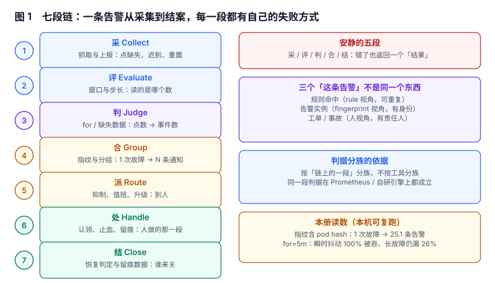
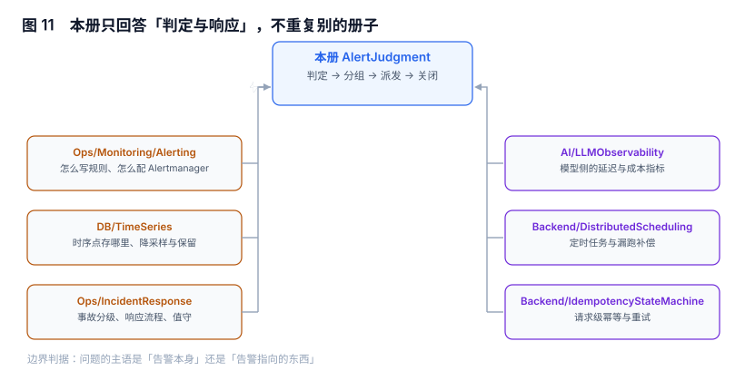

# 告警判定与响应工程

告警系统最常见的失败不是「规则写错了」，而是**它把一件需要人来处理的事，做成了一条不需要任何人处理的通知**：规则命中了、通知发了、群里有人回了个「收到」，然后没有人知道这件事到底有没有结束。

本专题只回答一个问题：**一条规则命中之后，到这件事被关掉之前，中间那六段各自由谁来做、做错了会怎样**。

::: tip 一句话理解
告警不是一个开关，是**一条有身份的流水线**：同一次故障必须始终是同一条告警，而不该是一串因为重启、扩缩容、标签抖动而不断新生的记录。
:::

## 本专题回答什么、不回答什么

「监控告警」这四个字常被当成一个东西，实际是四个团队的四种交付物。下面这张表是本册与库内相邻专题的分工，写死在这里，避免同一个问题被两册各答一遍。

| 问题的主语 | 由谁回答 | 具体页面 |
| --- | --- | --- |
| 指标怎么抓、规则怎么写、Alertmanager 怎么配 | 运维视角的「怎么搭」 | [监控告警](../../Ops/Monitoring/Alerting/index.md) |
| 时序点存在哪、怎么降采样、保留多久 | 存储引擎视角 | [时序数据库](../../DB/TimeSeries/index.md) |
| 出了事故怎么分级、怎么响应、怎么值班 | 事故管理视角 | [事故响应](../../Ops/IncidentResponse/OnCall/index.md) |
| 一次请求慢在哪一段、链路怎么追 | 可观测性视角 | [可观测性](../../Ops/Observability/index.md) |
| 定时任务漏跑了怎么补 | 调度视角 | [分布式调度](../DistributedScheduling/index.md) |
| 同一次重试会不会执行两遍 | 幂等视角 | [幂等状态机](../IdempotencyStateMachine/index.md) |
| 模型服务的延迟与成本指标怎么定 | AI 观测视角 | [LLM 可观测性](../../AI/LLMObservability/index.md) |
| 告警多了之后容量与成本怎么算 | 容量视角 | [容量与成本](../../Ops/CapacityCost/index.md) |
| **一条规则命中之后，它是什么身份、发给谁、谁认领、谁关掉** | **本册** | 就是你现在看的这一册 |

分界线用一句话概括：**问题的主语是「告警本身」，看本册；主语是「告警指向的那个东西」，看别的册子。**「Postgres 复制延迟高」这句话的主语是数据库，去数据库册子；「同一条复制延迟告警在 12 分钟里被拆成 37 条、发给了 5 个人、没人认领」这句话的主语是告警，来本册。

## 目录

| 章节 | 它管的那一段 | 一句话 |
| --- | --- | --- |
| [总览：三个「这条告警」与五个安静的失败](Overview/index.md) | 全景 | 先把「规则命中 / 告警实例 / 工单」拆开 |
| [评估时刻与窗口](EvaluationWindow/index.md) | 评 | 窗口长度不是精度参数，是「你回答哪个问题」 |
| [规则状态机与 for](RuleState/index.md) | 判 | for 不是降噪旋钮，是「多短的故障你决定不报」 |
| [指纹与告警身份](Fingerprint/index.md) | 判 → 合 | 重启一次就换一条告警，等于没有告警 |
| [分组与通知聚合](Grouping/index.md) | 合 | 分组键才是降噪的主开关 |
| [抑制与静默](Inhibition/index.md) | 合 | 写错一个 `equal`，真故障也不说话 |
| [路由、值班与升级](Routing/index.md) | 派 | 升级链是拿 p90 换未认领率 |
| [噪声治理与告警预算](Noise/index.md) | 派 → 处 | 精度 34.9% 的规则不是「再调调阈值」能救的 |
| [恢复判定与闭环](Recovery/index.md) | 结 | 早关一次，等于同一次故障开两次单 |
| [实战：九张表、三条触发器与九条断言](Practice/index.md) | 全链 | 状态机、指纹、抑制、值班各自落到表上 |
| [常见问题](FAQ/index.md) | — | 八个被反复问到的判断题 |

## 版本组织：本专题不建版本目录

本册面向的「换代」发生在**协议与产品**上（Prometheus 2.x 的规则语法、Alertmanager 0.27 的 `time_intervals`、各家云监控的告警模型），而不在判据上：**「同一次故障必须只有一个身份」「抑制图不允许有环」「恢复判定要写明连续几拍」这三条，在 2015 年的 Nagios 和 2026 年的自研引擎上完全一样**。

所以本册按「链上的一段」分族（`ALO` `ALW` `ALS` `ALF` `ALG` `ALI` `ALY` `ALN` `ALC` `ALP` `ALQ`），不按产品版本分目录。需要按大版本建目录的是「同一份代码两套写法」那类主题，库内已有范式可对照：

- [Spring 5](../Java/Frame/Spring/Spring5/index.md) 与 [Spring 6](../Java/Frame/Spring/Spring6/index.md)：两代 API 不兼容，旧版保留并标注状态。
- [Vue 2](../../Frontend/Frame/Vue/Vue2/index.md) 与 [Vue 3](../../Frontend/Frame/Vue/Vue3/index.md)：同一框架两套响应式写法。

本册没有这种分裂：规则文件的字段名变了，判据没变。

## 阅读顺序

- **只要结论**：读[总览](Overview/index.md)的「五个安静的失败」一节，五分钟能对上自己的系统。
- **正在被噪声折磨**：按 [指纹](Fingerprint/index.md) → [分组](Grouping/index.md) → [抑制](Inhibition/index.md) 的顺序读，三页加起来决定 80% 的告警量。
- **要落地**：直接看[实战](Practice/index.md)的九张表，倒推前面几页的设计意图。
- **老板问「为什么告警没用」**：读[噪声治理](Noise/index.md)，那页把「精度」和「延迟」的换算写成了可复算的数。

::: warning 本册所有读数都是本机可复跑的
各页「本节读数」小段里的数字来自固定种子的本地仿真与 SQLite 实测（脚本不入库，按 `AGENTS.md` 第 5 节要求只提交结论与可复跑的命令）。这些数字用来**比较两种口径的差距**，不是行业基准——你自己的系统里，量级会不同，方向不会。
:::
