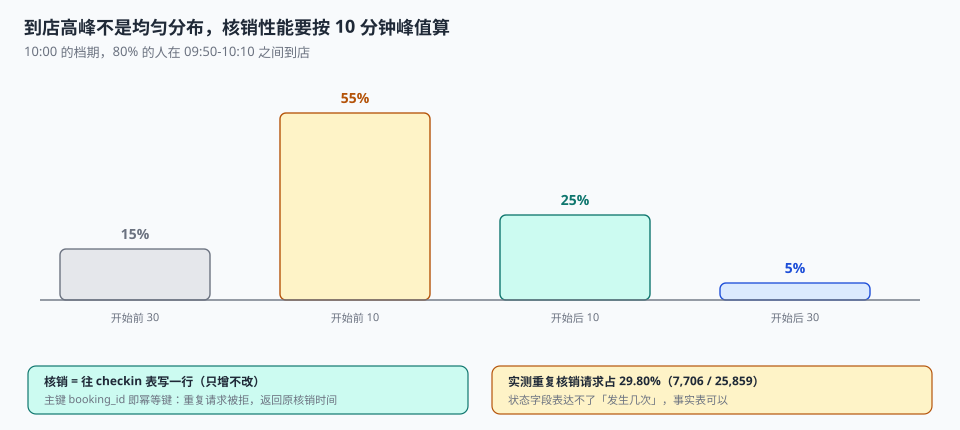

# 履约与核销

周六上午十点，一家亲子乐园的门口排了 20 个人。前台扫码，第一位顾客的码扫了两次（第一次网络超时），系统扣了 2 次入场名额；第三位顾客的码是昨天买的，系统显示「已使用」——因为昨天他在另一个门店被误扫了一次。

**核销是整个预约链上唯一一个「由现场人员在高压环境下执行」的动作。** 它必须做到：扫错不会多扣、重扫不会多扣、跨店误扫能被纠正。

::: tip 一句话理解
核销不是「把状态改成已到店」，是**往一张只增不改的表里写一行**。状态可以被覆盖，事实不能被覆盖；只有事实能被计数。
:::

## 一、核销必须是「写一次」，不是「改一次」

两种实现，两种后果：

| 实现 | 写法 | 重复请求 | 后果 |
| --- | --- | --- | --- |
| 改状态 | `UPDATE booking SET state='CHECKED_IN'` | 改两次，结果一样 | 表面幂等，但**没有到店次数** |
| 写事实 | `INSERT INTO checkin(booking_id, at)` | 第二次被主键拒绝 | 幂等 + 可计数 + 可追溯 |

状态字段只能表达「现在是什么」，表达不了「发生过几次」。而现场的所有异常都和次数有关：扫两次、两个门店各扫一次、顾客和同伴各扫一次。

本机实测：25,859 次有效核销里，**7,706 次（29.80%）是重复请求**。如果每次重复都消耗一个位，有效核销率会虚增近三成——排班、备货、场地容量全部按虚高的数字准备。

```sql
CREATE TABLE checkin (
  booking_id TEXT PRIMARY KEY REFERENCES booking(booking_id),  -- 主键即幂等键
  at         TEXT NOT NULL,
  operator   TEXT NOT NULL,
  device_id  TEXT,
  UNIQUE (booking_id)                                          -- 一个预约只能核销一次
);
```

主键在这一刻不是「标识」，是「约束」。**一个预约只能核销一次，这件事应该由数据库保证，而不是由「扫码前先查一下」保证。**

## 二、重复核销的三种来源

| 来源 | 现象 | 防御 |
| --- | --- | --- |
| 网络超时重试 | 前端拿不到响应，自动重发 | 主键 + 返回「已核销」而非报错 |
| 现场重复扫 | 前台以为没扫上，再扫一次 | 同上，且提示「已于 10:02 核销」 |
| 跨店误扫 | A 店扫了 B 店的码 | 核销前校验 `slot.point_id` 与当前门店一致 |

第三种最难防，因为它不是「重复」，是「错的对象」。防御必须落在核销时的**归属校验**上：

```sql
-- 核销前三件事一起校验：状态、门店、时间窗
SELECT b.booking_id
FROM booking b JOIN slot s ON s.slot_id = b.slot_id
WHERE b.booking_id = :bid
  AND b.state = 'CONFIRMED'                 -- 未确认/已取消不能核销
  AND s.point_id = :current_point           -- 只能在本店核销
  AND :now BETWEEN datetime(s.start_at, '-30 minutes')
                AND datetime(s.end_at,   '+30 minutes');   -- 核销时间窗
```

三个条件缺一不可。少第一条，已取消的单能进场；少第二条，跨店误扫；少第三条，昨天的单今天还能用。

## 三、爽约判定：三个时刻决定它

「爽约」不是一个状态，是一个**在某个时刻做出的判断**。判断依据是三个时间：

| 时刻 | 含义 | 谁来定 |
| --- | --- | --- |
| `start_at` | 档期开始 | 档期表 |
| `grace_min` | 宽限分钟数（常见 15~30） | 门店配置 |
| `judged_at` | 判定时刻（通常在档期结束后） | 定时任务 |

```sql
-- 判定：过了宽限期仍未核销 → NO_SHOW
UPDATE booking SET state = 'NO_SHOW'
WHERE state = 'CONFIRMED'
  AND slot_id IN (SELECT slot_id FROM slot
                  WHERE datetime(end_at, '+' || :grace_min || ' minutes') < :now)
  AND NOT EXISTS (SELECT 1 FROM checkin c WHERE c.booking_id = booking.booking_id);
```

`NOT EXISTS` 子查询是关键：**判定必须基于「有没有核销事实」，而不是「状态是不是 CHECKED_IN」**。状态可能因为人工干预、数据修复、跨店核销而暂时不一致，事实不会。

本机实测的爽约率是 **6.79%（3,036 / 44,730）**。这个数在不同业态差别极大（餐厅 5~10%，医院 10~20%，健身 20~30%），所以它必须**按门店/项目分别统计**，全局平均没有意义。

## 四、超售：用空置率换拒客率

超售是唯一一个「故意制造超卖」的设计。它的逻辑是：既然总有人不来，那就多卖几个位，用「偶尔拒客」换「减少空置」。

但它有一个明确的临界点。本机模拟（档期容量 12）：

| 爽约率 | 超售 1 位换来的空置减少 | 代价：拒客人数 | 打平倍数 |
| --- | --- | --- | --- |
| 7% | 0.531 | 0.389 | **1.36×** |
| 10% | 0.649 | 0.254 | 2.56× |
| 15% | 0.730 | 0.123 | 5.95× |

**读法**：如果「拒客一次」的成本是「空置一个位」成本的 1.36 倍以内，那么在 7% 爽约率下超售 1 位是划算的；超过 1.36 倍，多卖这一个位是亏的。

| 爽约率 | k=0 空置 | k=1 空置 | k=1 拒客 | k=2 拒客 | k=3 拒客 |
| --- | --- | --- | --- | --- | --- |
| 7% | 0.841 | 0.298 | 0.387 | 1.106 | 1.959 |
| 10% | 1.204 | 0.558 | 0.253 | 0.812 | 1.571 |
| 15% | 1.807 | 1.072 | 0.122 | 0.472 | 1.004 |

这张表解释了一个常见误区：**「爽约率高就该多超售」这句话只对了一半**。爽约率高确实让超售更划算（打平倍数从 1.36 涨到 5.95），但同时也意味着「拒客的补偿成本」必须更低——因为爽约率高的业态（健身、快剪）通常客单价低、补偿容易；爽约率低的业态（手术、专家号）客单价高、补偿极难。

::: danger 超售的四个坑
1. **超售额度写进 `capacity`**：`capacity` 从此不再表示「物理能接几个」，运营再也算不出真实产能。必须分列 `overbook`。
2. **超售位不参与唯一键**：`UNIQUE(slot_id, seat_no)` 的 `seat_no` 范围是 `1..capacity+overbook`，超出会被触发器拒绝——但很多人只写了 `1..capacity`，导致超售位永远卖不出去。
3. **拒客没有补偿流程**：超售的经济模型成立的前提是「拒客成本可量化」。没有补偿流程，成本会以口碑和投诉的形式出现，无法计入模型。
4. **对所有档期用同一个超售率**：热门档期超售 1 位换来的是「拒客」，冷门档期超售 1 位换来的是「多卖一个」。两者的经济含义完全相反。
:::

## 五、到店高峰与核销吞吐



核销的并发特征和下单完全不同：**它不是均匀分布，是一个尖峰**。10:00 的档期，80% 的人会在 09:50-10:10 之间到店。

| 时间 | 到店人数占比 | 核销 QPS 需求 |
| --- | --- | --- |
| 开始前 30 分钟 | 15% | 低 |
| 开始前 10 分钟 | 55% | 峰值 |
| 开始后 10 分钟 | 25% | 中 |
| 开始后 30 分钟 | 5% | 低 |

这意味着核销接口的性能预算不能按「日均」算，要按「峰值 10 分钟」算。一个日均 1 万次核销的系统，峰值可能是 **900 次/分钟**。

## 六、核销时间窗：三个参数

| 参数 | 常见取值 | 放宽的后果 | 收紧的后果 |
| --- | --- | --- | --- |
| 提前可核销 | 30 分钟 | 上一场的顾客被提前放进来，挤占场地 | 早到的顾客在门口等 |
| 迟到仍可核销 | 30 分钟 | 迟到顾客占用下一场时间 | 迟到 5 分钟就进不去，投诉 |
| 判定爽约 | 结束后 15 分钟 | 判定延迟，位回收慢 | 顾客还在路上就被判爽约 |

三个参数必须**按门店配置**，不能全局写死。亲子乐园的「迟到 30 分钟」和手术室的「迟到 5 分钟作废」不是同一个业务。

## 七、判据

本页判据族 `BKI-A` ~ `BKI-H`，共 8 条。

| 判据 | 断言 | 验证方式 |
| --- | --- | --- |
| `BKI-A` | 核销是插入事实，不是改状态 | 有 `checkin` 表且主键为 `booking_id` |
| `BKI-B` | 重复核销被主键拒绝且返回「已核销」 | 二次插入被拒，接口返回 200 + 原核销时间 |
| `BKI-C` | 核销前校验门店归属 | 跨店核销被拒 |
| `BKI-D` | 核销前校验时间窗 | 窗口外核销被拒 |
| `BKI-E` | 未确认/已取消的单不能核销 | 触发器拒绝 |
| `BKI-F` | 爽约判定基于「无核销事实」 | `NOT EXISTS checkin` 而非状态判断 |
| `BKI-G` | 超售额度与容量分列 | `overbook` 独立字段，`seat_no` 上限为两者之和 |
| `BKI-H` | 爽约率按门店分别统计 | 分组查询可出，不只有全局值 |

## 八、验证方式

```shell
# 1. 重复核销：第二次必须被拒（在实战库上跑）
sqlite3 ab.db "
insert into checkin values ('B001','2026-11-05 09:02:00','S01');
insert into checkin values ('B001','2026-11-05 09:03:00','S02');"
# 期望：UNIQUE constraint failed: checkin.booking_id

# 2. 未确认的单不能核销（期望被触发器拒绝）
sqlite3 ab.db "insert into checkin values ('B006','2026-11-05 10:05:00','S01');"
# 期望：booking not confirmed

# 3. 超售打平倍数（改爽约率看临界点怎么移动）
python3 - <<'PY'
import random
random.seed(20261104)
def sim(r, k, cap=12, n=60000):
    e = b = 0
    for _ in range(n):
        arrive = sum(1 for _ in range(cap + k) if random.random() > r)
        e += max(0, cap - arrive); b += max(0, arrive - cap)
    return e / n, b / n
for r in (0.07, 0.10, 0.15):
    e0, _ = sim(r, 0); e1, b1 = sim(r, 1)
    print(f"爽约 {r:.0%} 打平倍数 {(e0-e1)/b1:.2f}x")
PY
# 期望：1.36x / 2.56x / 5.95x
```

第 3 步的输出就是超售的决策依据：**打平倍数越高，超售越安全**。它同时告诉你「拒客补偿的成本上限」，超过就该停手。

## 参考资料

- 《中华人民共和国民法典》第五百七十七条：当事人一方不履行合同义务或履行不符合约定的违约责任。
- ISO 8601-1:2019《日期和时间 信息交换表示法 第 1 部分：基本规则》：时间窗与时长计算。
- 与本页相邻：[改期与取消](../Reschedule/index.md)、[候补与递补](../Waitlist/index.md)、[占位与支付](../Hold/index.md)。
