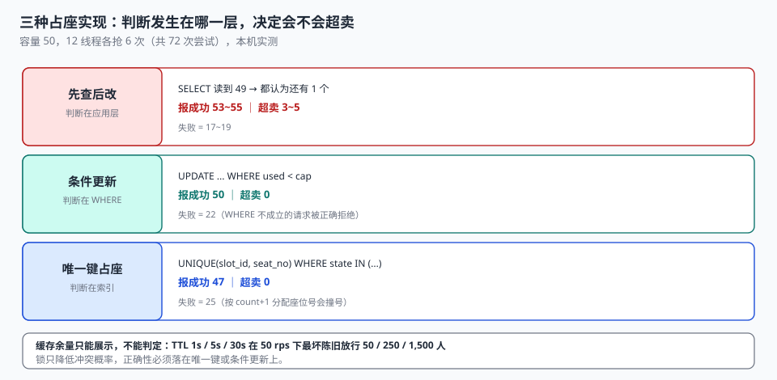

# 占量与并发

一个档期还剩最后 1 个位。三个顾客在不同设备上同时点了「确认」：一个在电梯里（弱网重试）、一个在小程序（点了两次）、一个在渠道页面（平台回源慢 300 毫秒）。

三秒后，系统里有三条确认记录，而这个档期只有 1 个位。**三处代码都「检查过余量」，三处都没写错，但三次检查之间没有任何东西挡住第二次写入。**

::: tip 一句话理解
占座不是「查一下还有没有」，而是**让数据库替我拒绝第二次写入**。凡是先 `SELECT` 再 `INSERT` 的占座，在并发下都会超卖，区别只是超卖几个。
:::

## 一、三种占座实现，三种结局

同一道题：容量 50 的档期，12 个线程各抢 6 次（共 72 次尝试），本机实测：

| 实现 | 报成功 | 实际占量 | 超卖 | 失败 |
| --- | --- | --- | --- | --- |
| 先查后改（`SELECT` 后 `UPDATE`） | 53~55 | 53~55 | **3~5** | 17~19 |
| 条件更新（`UPDATE ... WHERE used < cap`） | 50 | 50 | 0 | 22 |
| 唯一键占座（`UNIQUE(slot_id, seat_no)`） | 47 | 47 | 0 | 25 |



三行的差别不在代码长度，而在**判断发生在哪一层**：

- **先查后改**：判断在应用层。两次请求各自读到 `used = 49`，都认为「还有 1 个」，都写入，于是 51。
- **条件更新**：判断在数据库的 `WHERE` 里。第二条 `UPDATE` 到达时 `used` 已经是 50，`WHERE` 不成立，`rowcount = 0`，应用层据此返回「已满」。
- **唯一键**：判断在索引里。同一 `(slot_id, seat_no)` 的第二行直接违反唯一约束，抛 `IntegrityError`。

### 为什么先查后改「看起来是对的」

因为它在单线程和低并发下确实是对的。问题出在临界区：

```python
# 错误写法：检查与写入之间有窗口
used = db.execute("select used from s where id=?", (sid,)).fetchone()[0]
if used < cap:                      # ← 两个线程可能同时通过这里
    time.sleep(0.001)               # 表示任何耗时（网络、序列化、日志）
    db.execute("update s set used=used+1 where id=?", (sid,))
    db.commit()
```

本机实测里那个 `sleep(0.001)` 只是把窗口放大到肉眼可见。真实系统里这个窗口由「读缓存 → 反序列化 → 业务校验 → 拼 SQL → 网络往返」构成，通常是几毫秒——**足够 50 个并发请求全部通过检查**。

## 二、唯一键也会「少卖」：这不是 bug，是取舍

上表第三行只成功了 47 次（25 次失败），比条件更新的 50 次还少 3 个。原因是并发插入时，应用层按 `count(*) + 1` 分配 `seat_no`，两个线程算出同一个号，其中一个被唯一键拒绝——**位还空着，但请求失败了**。

这暴露了一个必须先做的选择：

| 策略 | 冲突时 | 结果 | 适合 |
| --- | --- | --- | --- |
| 快速失败 | 抛错给用户「已被抢走」 | 可能少卖几个位 | 强实名、一位一人、无法自动重试 |
| 重试分配 | 换一个 `seat_no` 重试（最多 3 次） | 卖满，但延迟增加 | 普通预约、位可互换 |
| 队列串行 | 同一档期的写入串行化 | 卖满且确定，吞吐受限 | 高价值资源（专家号、手术台） |

**「少卖 3 个位」和「超卖 5 个位」哪个更糟，取决于业务。** 医疗号源宁少卖不超卖；餐厅订座宁超卖不空置（有超售兜底）。这个选择必须写进设计文档，因为它决定了用哪种占座实现。

::: danger 四个并发占座的坑
1. **唯一键不带状态谓词**：`UNIQUE(slot_id, seat_no)` 会让退掉的座位永远不能再卖。必须是部分索引 `WHERE state IN ('HOLD','CONFIRMED','CHECKED_IN','NO_SHOW')`。
2. **事务里读、事务外写**：`SELECT` 在事务 A 里，`INSERT` 在事务 B 里，中间隔着一次 HTTP 调用。此时任何锁都不成立。
3. **用 `SELECT ... FOR UPDATE` 锁了错的粒度**：锁整张 `slot` 表会让所有档期串行；锁 `slot` 行在高并发下会造成大量等待。正确做法是锁「位」这一粒度，或用条件更新免锁。
4. **锁 TTL 短于业务耗时**：Redis 锁 3 秒过期，业务处理 5 秒，第二个请求在 3 秒后拿到锁——锁形同虚设。
:::

## 三、分布式锁的边界

当占座跨进程（多实例部署）时，本地锁不够用，常见做法是 Redis 锁。它有三个必须显式处理的边界：

| 边界 | 现象 | 处理 |
| --- | --- | --- |
| 锁过期 | 业务没做完，锁已释放 | 看门狗续期，或把 TTL 设成业务 P99 的 3 倍 |
| 锁误删 | A 的锁过期后被 B 拿到，A 完成后删了 B 的锁 | value 存唯一 token，删除前比对 |
| 主从切换 | 锁写主库未同步，主挂了从库没有这把锁 | 接受极小概率，用「唯一键兜底」而不是只靠锁 |

第三条是结论性的：**锁只能降低冲突概率，不能保证正确性。** 真正的正确性必须落在数据库约束上——唯一键、条件更新、行版本号。锁的作用是「让大多数请求不必走到冲突那一步」。

```python
# 正确的组合：锁降低冲突，唯一键兜底正确性
with redis_lock(f"slot:{slot_id}", ttl=10, token=token):
    try:
        db.execute("""INSERT INTO booking(booking_id, idem_key, slot_id, seat_no, ...)
                      VALUES (?,?,?,?,...)""", (...))
    except sqlite3.IntegrityError:
        return {"code": "SEAT_TAKEN"}     # 锁失效时的最后一道防线
```

## 四、余量缓存：超卖窗口的量化

前端要显示「还剩 3 位」，这个数几乎不可能每次都查库。缓存 TTL 越长，体验越好，超卖窗口越大。本机按 50 rps 估算：

| TTL | 一个 TTL 内按旧余量放行的最大人数 | 档期真实余量 5 时最坏超卖 |
| --- | --- | --- |
| 1 秒 | 50 | 45 |
| 5 秒 | 250 | 245 |
| 30 秒 | 1,500 | 1,495 |

**这张表说明「缓存余量只能用于展示，不能用于判定」。** 判定必须回源，且回源时用条件更新或唯一键。

正确做法是把「展示余量」和「判定余量」分开：

```text
展示：cache.get(slot) ?? db.read(v_slot_usage)   → TTL 3~5 秒，允许陈旧
判定：UPDATE slot SET used = used + 1 WHERE used < capacity + overbook
      或 INSERT ... 靠唯一键
```

展示层可以骗人，判定层不能。这句话听起来理所当然，但生产事故里最常见的形态恰恰是**判定层直接用了展示层的缓存值**。

## 五、双幂等键：点击与回调是两件事

预约链路里有两次「可能重复」的写入，它们的幂等键不是同一个：

| 写入 | 重复来源 | 幂等键 |
| --- | --- | --- |
| 创建预约 | 用户连点、弱网重试 | `idem_key`（客户端生成，随请求带上） |
| 支付回调 | 渠道重发、多实例消费 | `(channel, channel_txn_id)` |

两者必须分开。用同一个键会导致：用户改了支付方式重新发起，被当成重复请求拒绝；或者渠道回调和用户点击撞了键，回调把占位状态改错。

```sql
CREATE TABLE booking (
  idem_key      TEXT NOT NULL UNIQUE,          -- 用户点击维度
  channel_txn   TEXT,                          -- 支付回调维度
  UNIQUE (channel, channel_txn)                -- 允许多行为 NULL（未支付）
);
```

`UNIQUE(channel, channel_txn)` 在 SQL 里对 `NULL` 不生效（多行 `NULL` 不算重复），这正好符合「未支付的单没有 `channel_txn`」的语义——**这是 SQL 标准里少数几个「NULL 行为恰好帮上忙」的地方**。

## 六、事务边界：占座、写单、扣配额必须同一事务

一次成功的预约要动三张表：

```text
① booking       插入占位行
② channel_quota used = used + 1
③ booking_event 记录创建事件
```

三步必须在一个事务里，否则会出现三种半成品状态：

| 漏掉哪一步 | 结果 | 发现方式 |
| --- | --- | --- |
| 漏 ② | 配额用不完，渠道侧以为还有量 | 月底对账 |
| 漏 ③ | 状态迁移无痕迹，查不到谁改的 | 客诉时 |
| ② 成功但 ① 回滚 | 配额被吃掉，位还空着 | 永远发现不了 |

最后一行是最恶劣的：**配额被扣了，但没有任何预约**。它不会触发任何告警，只会让渠道侧的可售量慢慢变少。

## 七、判据

本页判据族 `BKC-A` ~ `BKC-H`，共 8 条。

| 判据 | 断言 | 验证方式 |
| --- | --- | --- |
| `BKC-A` | 占座判定在数据库层，不在应用层 | 无「先 SELECT 后 INSERT」路径，靠 `WHERE` 或唯一键 |
| `BKC-B` | 并发抢位不超卖 | 12 线程抢 50 位，最终占量 = 50 |
| `BKC-C` | 唯一键带状态谓词 | 取消后可重新占同一座位 |
| `BKC-D` | 唯一键冲突有明确返回码，不是 500 | 冲突返回 `SEAT_TAKEN` |
| `BKC-E` | 展示余量与判定余量分离 | 判定路径不读缓存 |
| `BKC-F` | 两类写入各有独立幂等键 | `idem_key` 与 `(channel, channel_txn)` 都存在 |
| `BKC-G` | 占座 + 配额 + 事件在同一事务 | 人为让第三步失败，前两步回滚 |
| `BKC-H` | 锁 TTL 大于业务 P99 | 配置可查，且锁有续期或兜底 |

## 八、验证方式

```shell
# 并发抢位：12 线程抢 50 个位，看最终占量（期望 50，不是 51+）
python3 - <<'PY'
import sqlite3, tempfile, os, threading
p = os.path.join(tempfile.mkdtemp(), "c.db")
c = sqlite3.connect(p); c.execute("PRAGMA journal_mode=WAL")
c.execute("create table s(id int primary key, used int)"); c.execute("insert into s values(1,0)")
c.commit(); c.close()
bad = []
def w():
    for _ in range(6):
        d = sqlite3.connect(p, timeout=30)
        n = d.execute("update s set used=used+1 where id=1 and used<50").rowcount
        d.commit(); d.close()
        if n == 0: bad.append(1)
ts = [threading.Thread(target=w) for _ in range(12)]
[t.start() for t in ts]; [t.join() for t in ts]
d = sqlite3.connect(p)
print("最终占量", d.execute("select used from s").fetchone()[0], "失败", len(bad))
PY
# 期望：最终占量 50 失败 22

# 唯一键 + 状态谓词：取消后同座位可再卖（在实战库上跑）
sqlite3 ab.db "
update booking set state='CANCELLED' where booking_id='B003';
insert into booking(booking_id,idem_key,slot_id,seat_no,user_id,channel,state,created_at,pay_deadline)
values ('B099','k-B099','P01-2026-11-05-09',3,'U99','SELF','HOLD','2026-11-04 11:00:00','2026-11-04 11:15:00');
select count(*) from booking where slot_id='P01-2026-11-05-09' and seat_no=3;"
# 期望：2（一条 CANCELLED、一条 HOLD，唯一键只管有效状态）
```

第 1 步的期望值里，**「失败 22」和「占量 50」同样重要**：一个从不失败的系统，通常是它根本没在判断。

## 参考资料

- ISO 8601-1:2019《日期和时间 信息交换表示法 第 1 部分：基本规则》：档期时间区间的表示。
- SQLite 官方文档《Partial Indexes》：带 `WHERE` 谓词的唯一索引及其适用条件。
- Martin Kleppmann《Designing Data-Intensive Applications》第 7 章：分布式锁与 fencing token 的局限。
- 与本页相邻：[档期与时段建模](../SlotModel/index.md)、[占位与支付](../Hold/index.md)、[幂等状态机](../../IdempotencyStateMachine/IdempotencyKey/index.md)。
