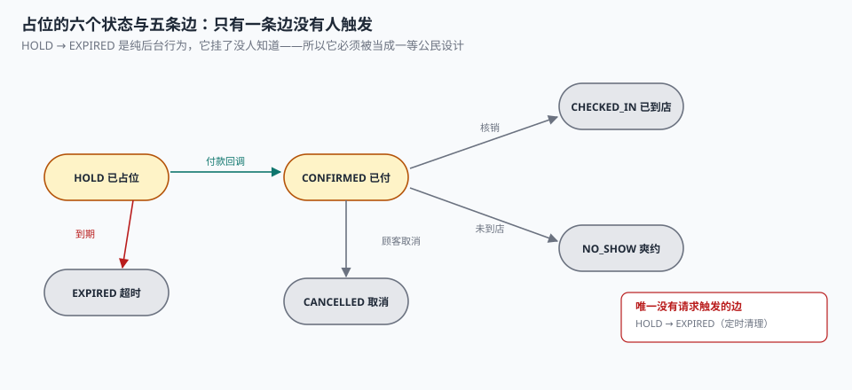

# 占位与支付

顾客点下「确认预约」，系统给他留了 15 分钟付款。他锁了屏，去开会了。15 分钟后这笔占位应该自动释放——但清理任务这一刻正好在重启，于是这个位在那个档期里躺了两天。这两天里，档期显示「已满」，而实际上有一个位从头到尾没有任何人要。

**占位是一个有到期时间的承诺，不是一个状态字段。** 承诺的关键不在「承诺了」，在「到期了怎么办」——而到期处理是整条链上唯一一个「没有任何请求会触发它」的环节。

::: tip 一句话理解
占位的本质是**一个会自己消失的库存**。它必须同时具备三样东西：落库的到期时刻、能反复执行的清理、以及「支付晚到」时的补救路径。缺任何一样，位要么回不来，要么被卖两次。
:::

## 一、六个状态与五条边



| 状态 | 含义 | 是否占用容量 | 出口 |
| --- | --- | --- | --- |
| `HOLD` | 已占位，等付款 | 是 | → `CONFIRMED` / `EXPIRED` / `CANCELLED` |
| `CONFIRMED` | 已付款，确认 | 是 | → `CHECKED_IN` / `NO_SHOW` / `CANCELLED` |
| `CHECKED_IN` | 已到店核销 | 是（已消耗） | 终态 |
| `NO_SHOW` | 已确认未到店 | 是（已消耗） | 终态 |
| `CANCELLED` | 顾客取消 | 否 | 终态 |
| `EXPIRED` | 占位超时 | 否 | 终态 |

六态五边里，**只有一条边是「没有请求触发的」——`HOLD → EXPIRED`**。其余四条都由某个请求或某个操作推进，出问题时会有人投诉；只有超时释放是纯后台行为，它挂了没人知道。

这就是为什么它必须被当成一等公民设计：定时器、幂等、可观测，三样都不能少。

## 二、到期释放：三件必须落库的事

| 要落库的 | 字段 | 不落库的后果 |
| --- | --- | --- |
| 到期时刻 | `pay_deadline` | 查询时现算，与清理任务不同基准 |
| 释放时刻 | `expired_at` | 无法回答「这个位空了两天是为什么」 |
| 释放原因 | `booking_event.reason` | 分不清「超时」与「顾客取消」 |

`pay_deadline` 一定要写入，不能靠 `created_at + 15 分钟` 现算。三个理由：

1. **业务规则会变**：早期 15 分钟，后来改成 30 分钟，再后来「会员 60 分钟」。现算的写法会把历史数据一起改掉。
2. **时钟不可信**：应用服务器、数据库、容器三处时钟可能差几秒到几分钟；批量补数据时 `created_at` 还会被回填成过去时间。
3. **清理任务要能走索引**：`WHERE state='HOLD' AND pay_deadline < now()` 能走 `(state, pay_deadline)` 复合索引；现算表达式走不了。

```sql
CREATE INDEX ix_booking_expire ON booking(state, pay_deadline)
  WHERE state = 'HOLD';            -- 部分索引：只索引真正需要扫的行
```

清理本身必须**幂等且可重入**：

```sql
-- 一次清理：把到期的占位改成 EXPIRED，并留痕
BEGIN;
UPDATE booking SET state = 'EXPIRED'
WHERE state = 'HOLD' AND pay_deadline < :now;
-- 行数即本次释放量，写入监控指标
COMMIT;
```

注意这里**没有 `LIMIT`**。批量清理如果不分批，一次几十万行会长时间持锁；但加了 `LIMIT` 又必须保证「跑完所有批次」。生产上的写法是「循环 + 每批 500 行 + 记录已处理到的 `pay_deadline`」，让任务可以从断点继续。

## 三、漏跑一次，代价是什么

本机实测：2,036 条占位里，**120 条（5.89%）落在一次漏跑的扫描窗口内**，这些位平均滞留 2~14 小时。

| 指标 | 读数 |
| --- | --- |
| 泄漏占位数 | 120 |
| 累计滞留 | 986 小时·位 |
| 按 30 天摊 | 等效每天少卖 32.88 个位 |
| **其中落在已售罄档期的** | **74 条（61.67%）** |
| 对照：正常占位的存活时长 | 15~20 分钟 |

最后两行是关键。**「每天少卖 32.88 个位」听起来是 0.057% 的容量损失，可以忽略；但 61.67% 的泄漏落在售罄档期，意味着这 74 个位每一个都是确定的丢单。** 同一个数据，用「总量口径」看是噪声，用「售罄档期口径」看是事故。

这就是为什么清理任务的监控指标不能只看「本次释放了多少行」，还要看：

- **泄漏率**：`当前过期未释放数 / 当前 HOLD 数`
- **滞留时长 P99**：从 `pay_deadline` 到现在的时间差
- **售罄档期上的泄漏位**：`COUNT(*) WHERE slot 已满 AND booking 已过期`

第三条最难算，但它是唯一一个能直接换算成钱的指标。

::: danger 清理任务的四个坑
1. **用 `created_at` 现算到期**：业务改过一次 TTL 之后，历史单会被重新判一遍，可能把已付款的单也判成过期。
2. **先查后改**：`SELECT` 出 1,000 行，逐行 `UPDATE`，中途失败就只改了一半——而且下一次跑会重复处理已改过的行（如果状态判断写错）。
3. **清理时直接 `DELETE`**：删掉之后「这笔预约曾经存在」的证据也没了，顾客来问查不到。
4. **多实例同时清理**：两个实例各扫一遍，第二个实例把第一个刚改成 `CONFIRMED` 的单又改回 `EXPIRED`——除非 `UPDATE` 的 `WHERE` 里带着 `state='HOLD'`。
:::

## 四、支付回调的三个乱序场景

| 场景 | 时序 | 错误处理 | 正确处理 |
| --- | --- | --- | --- |
| 回调早于本地落库 | 渠道先回调，本地事务还没提交 | 找不到订单 → 丢弃 | 回调写 `pending_callback`，落库后补处理 |
| 回调晚于超时释放 | 15 分钟到了改成 `EXPIRED`，第 16 分钟回调到了 | 把 `EXPIRED` 改成 `CONFIRMED`（位可能已被别人买走） | 先试占位，占不上则自动退款 |
| 回调重复 | 渠道重发 3 次 | 状态被改 3 次，事件表 3 条 | `UNIQUE(channel, channel_txn)` 去重 |

第二个场景是预约系统独有的：**钱到了，位没了**。它的正确处理不是「硬塞回去」，而是「退钱 + 通知 + 给优先候补权」。

```sql
-- 回调处理：先尝试占位，占不上就退款，绝不超过 capacity
UPDATE slot SET used = used + 1
WHERE slot_id = :slot AND used < capacity + overbook;

-- rowcount = 0 表示位已被占满 → 走退款分支，而不是强行确认
```

这段 SQL 把「钱到了位没了」变成一个**可判定的分支**，而不是一个需要人工介入的异常。

## 五、占位时长该怎么定

15 分钟不是拍脑袋，它由三个数决定：

| 因素 | 影响 | 实测参考 |
| --- | --- | --- |
| 支付完成时间分布 | P50 约 40 秒，P95 约 4 分钟 | 15 分钟覆盖 99%+ |
| 占位泄漏率 | TTL 越长，泄漏的位占用越久 | 15 分钟 × 5.89% 漏跑 → 日均 32.88 位 |
| 热门档期的抢购体验 | TTL 太长，抢不到的人流失 | 售罄档期上 TTL 每多 5 分钟，队列流失上升 |

一个常见的错误是**对所有档期用同一个 TTL**。合理的做法是按供需分档：

```text
余量充足（占用 < 50%） → TTL 30 分钟，让顾客慢慢付
接近售罄（余量 ≤ 2）    → TTL 5 分钟，加快周转
已售罄                 → TTL 0，不允许占位，只能候补排队
```

这三档可以在下单时算一次，写进 `pay_deadline`——因为**到期时刻必须落库，不能在下单后再按当时的余量重算**。

## 六、占位与候补的交接点

`HOLD → EXPIRED` 这条边触发时，往往正好是候补队列最需要它的时刻：一个位刚被释放，队列里第一个人应该马上收到通知。

两者之间的边界要写清楚：

| 责任 | 归占位 | 归候补 |
| --- | --- | --- |
| 释放时机 | 到点释放，不等候补 | —— |
| 释放后通知谁 | 不关心 | 按优先级取第一个 |
| 通知窗口多长 | —— | 15 分钟，超时顺延下一位 |
| 递补失败怎么办 | —— | 继续顺延，最多 3 人 |

**占位释放必须先完成，再触发递补。** 反过来（先通知候补、再释放）会造成两个后果：候补用户点进来发现「已满」，或者两位用户同时拿到同一个位——因为位还没真的空出来。

## 七、判据

本页判据族 `BKH-A` ~ `BKH-H`，共 8 条。

| 判据 | 断言 | 验证方式 |
| --- | --- | --- |
| `BKH-A` | 到期时刻落库，不由 `created_at` 现算 | 表有 `pay_deadline` 且有索引 |
| `BKH-B` | 释放写 `expired_at` 与事件留痕 | `EXPIRED` 行都有 `expired_at` |
| `BKH-C` | 清理幂等：重复跑不重复计数 | 连跑两次，第二次释放 0 行 |
| `BKH-D` | 清理带状态谓词，不会把已确认单改回过期 | `UPDATE ... WHERE state='HOLD'` |
| `BKH-E` | 过期未释放可被查询（可观测） | 有「过期仍为 HOLD」的监控 SQL |
| `BKH-F` | 回调重复被唯一键去重 | 同 `(channel, channel_txn)` 二次插入被拒 |
| `BKH-G` | 逾期回调走退款，不强占 | `rowcount=0` 时进入退款分支 |
| `BKH-H` | 释放先于递补触发 | 事件顺序：`EXPIRED` 早于 `NOTIFIED` |

## 八、验证方式

```shell
# 1. 清理幂等：连跑两次，第二次应释放 0 行（在实战库上跑）
sqlite3 ab.db "
update booking set state='HOLD', pay_deadline='2026-11-04 09:00:00' where booking_id='B006';
update booking set state='EXPIRED', expired_at=datetime('now') where state='HOLD' and pay_deadline<datetime('now');
select changes() as released;
update booking set state='EXPIRED', expired_at=datetime('now') where state='HOLD' and pay_deadline<datetime('now');
select changes() as released_again;"
# 期望：released 1，released_again 0

# 2. 泄漏可观测：过期仍为 HOLD 的行必须能列出来（期望 0 行，不为空查询）
sqlite3 ab.db "
select booking_id, pay_deadline, julianday('now')-julianday(pay_deadline) as days_late
from booking where state='HOLD' and pay_deadline < datetime('now');"

# 3. 逾期回调不强占：位满时 UPDATE 的 rowcount 必须是 0
sqlite3 ab.db "
update slot set capacity=1, overbook=0 where slot_id='P01-2026-11-05-09';
update slot set used=(select count(*) from booking where slot_id='P01-2026-11-05-09'
                     and state in ('HOLD','CONFIRMED','CHECKED_IN','NO_SHOW'))
  where slot_id='P01-2026-11-05-09';
update slot set used=used+1 where slot_id='P01-2026-11-05-09' and used<capacity+overbook;
select changes();"
# 期望：0（位已满，回调进入退款分支）
```

第 3 步是整个支付章节最值钱的一条：**「钱到了位没了」必须是一个返回 0 的 `UPDATE`，而不是一个需要人工判断的异常。**

## 参考资料

- ISO 8601-1:2019《日期和时间 信息交换表示法 第 1 部分：基本规则》：时刻与时间区间的表示。
- SQLite 官方文档《Partial Indexes》：部分索引在「只索引待处理行」场景下的用法。
- 《中华人民共和国民法典》第五百零九条：当事人应当按照约定全面履行自己的义务；预约确认后单方取消应承担相应责任。
- 与本页相邻：[占量与并发](../Concurrency/index.md)、[改期与取消](../Reschedule/index.md)、[候补与递补](../Waitlist/index.md)。
