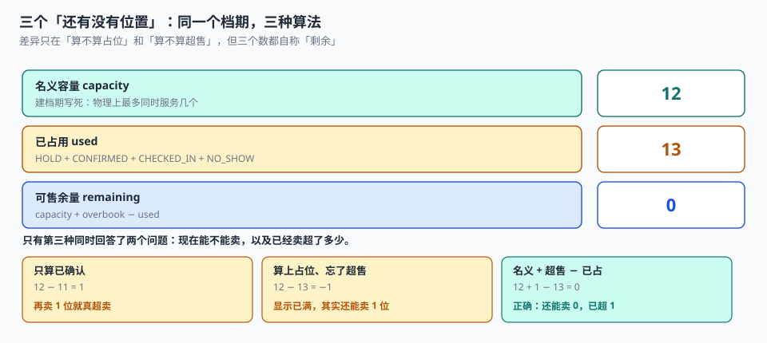

# 总览：七段链与三个「还有没有位置」

一个顾客在周六晚上刷到一家餐厅，点开「订座」，选了明天 19:00、两位，填了手机号，点了确认。屏幕上跳出「预订成功」。同一秒钟，另一个顾客在点评页面上也订了 19:00、两位——而这家店 19:00 只留了 4 个两人位，前一个小时已经卖掉了 3 个。

两分钟后，店里收到 5 条预订。店长打开后台，看到「已订 5 / 可订 4」，然后打电话给最后一位顾客道歉。

**没有任何一处报错。** 两条记录都是合法的数据库行，两个顾客都收到了短信，页面都显示成功。错的地方在于：这个「4」在三次校验里被读了三次，而三次读之间没有任何东西阻止第二次写入。

::: tip 一句话理解
预约系统卖的是**某个资源在某段时间上的一个位**，不是「一个时间点」。所以它先是库存系统（一位只能卖一次），再是排队系统（没抢到的人怎么排），最后才是日历。
:::

## 一、为什么预约不是「日历 + 一个按钮」

很多人第一版会做成这样：一张 `events` 表存时间，前端画个日历，点一下 `INSERT`。这一版能跑，也能上线，然后会在三个地方同时坏掉。

| 维度 | 日历（`events`） | 预约（`slot` + `booking`） |
| --- | --- | --- |
| 容量 | 一个事件 = 一个条目，默认无限人 | 一个档期 = N 个位，位是**可数的** |
| 冲突判定 | 同一时刻已有事件 → 冲突 | 同一时刻**剩余位 > 0** → 可约 |
| 时间语义 | 一个开始时间 + 时长 | **半开区间**，相邻档期首尾相接 |
| 状态 | 有 / 没有 | 占位 → 确认 → 到店 → 爽约 / 取消 / 过期 |
| 失败形态 | 冲突会报错 | 超卖**不报错**，只是有人站着 |
| 参与方 | 创建者自己 | 顾客 + 渠道 + 前台 + 服务人员 |

六个维度里，**只有第二个是「数量」问题，其余五个都是「语义」问题**。把预约做成日历的人，通常只看到了第一行。

## 二、七段链与它们的失败形态



| 段 | 关键判断 | 失败形态 | 谁先发现 |
| --- | --- | --- | --- |
| 开 | 这个档期到底有几个位 | **安静**：容量写大了，永远「有位置」 | 到店排队时 |
| 约 | 这次点击是不是同一次 | 半显性：重复提交多一条，顾客会问 | 客服 |
| 占 | 这个位有没有被别人同时拿走 | **安静**：先查后改照样返回成功 | 到店 / 对账 |
| 付 | 钱到了，占位该不该转确认 | **安静**：回调乱序把它改回未支付 | 过期释放时 |
| 改 | 旧位释放了没有、新位占了没有 | **安静**：只做一个就是双占或丢位 | 月底看容量账 |
| 履 | 这次核销是不是第一次 | **安静**：重复核销多消耗一个位 | 排班与现场不符 |
| 清 | 到期的位有没有回来 | **安静**：漏释放的位再也不会回来 | 永远没人发现 |

「安静」的意思是：**没有任何一处会抛异常**。页面能开、短信能发、核销能过，只有「这个位还能不能卖」是错的。

### 为什么「安静」比「报错」更危险

报错会被处理，安静的偏差会被**解释掉**。本机实测里有一组特别典型的读数：

- 4,800 个档期的加权平均占用率 **81.19%**，看起来「基本卖满」
- 但 **44.31% 的档期已售罄**，同时 **31.35% 的档期占用不到一半**
- 也就是说，**平均值把一个「一半挤爆、一半空着」的系统描述成了「八成满」**

任何以「总体出租率」为 KPI 的运营看板，都会在这一步失效：分子的售罄与空置互相抵消，分母还是那个分母。

## 三、三个「还有没有位置」与它们之间的桥

| 口径 | 数据来源 | 什么时候成立 | 差在哪 |
| --- | --- | --- | --- |
| 名义容量 `capacity` | 建档期写死的字段 | 档期生成时 | 超售时实际可约 = `capacity + overbook` |
| 已占用 `used` | 有效状态的行数 | 每次写操作后 | 少算 `HOLD` → 余量虚高 |
| 可售余量 `remaining` | `capacity + overbook − used` | 下单校验时 | 前端缓存 → 与库里的值不同步 |

三者之间的关系可以写成一个恒等式：

```text
Σ capacity + Σ overbook
  = Σ used(CONFIRMED) + Σ used(HOLD) + Σ used(NO_SHOW) + Σ remaining
```

这个恒等式有三个用途，缺一不可：

1. **下单校验**：`remaining > 0` 才允许写，且判定与写入必须在同一条语句里完成。
2. **运营看板**：分母用 `capacity + overbook`，分子分状态列，**不要只报一个百分比**。
3. **对账**：渠道侧报的「已订」要能和本地 `used` 按状态对齐，对不上先分差异形状。

::: danger 四个最容易写错的字段
1. **`seat_no` 不能只靠应用层分配**：`SELECT MAX(seat_no)+1` 在并发下会给出同一个号。实测 12 线程抢 50 个位，先查后改**超卖 3~5 位**。
2. **`remaining` 不能存成字段再定时刷**：它会同时被「下单」「取消」「超时释放」「改期」四个写入点修改，任何一个漏了就是永久偏差。要么用视图现算，要么用带条件的原子更新。
3. **`end_at` 不能省**：只有 `start_at` + 「默认一小时」的写法，在「15 分钟快剪」「90 分钟推拿」「跨零点夜宵」三种场景下都会错，而且错得没人发现。
4. **`state` 不能用布尔 `is_booked`**：占位、确认、到店、爽约、取消、过期是六个状态，布尔值只能表达两个；剩下的四个会被塞进注释里。
:::

## 四、一个位的最小字段集

下面这几组字段，少任何一组都会在某个环节算不出数：

```sql
CREATE TABLE slot (
  slot_id   TEXT PRIMARY KEY,             -- 全局唯一（建议 ULID）
  point_id  TEXT NOT NULL,                -- 哪个资源（门店 / 诊室 / 场地 / 技师）
  biz_date  TEXT NOT NULL,                -- 归属日，跨零点时用来切账
  start_at  TEXT NOT NULL,                -- 半开区间左端点，含
  end_at    TEXT NOT NULL,                -- 半开区间右端点，不含
  capacity  INTEGER NOT NULL CHECK (capacity > 0),
  overbook  INTEGER NOT NULL DEFAULT 0,   -- 超售额度，与 capacity 分列
  state     TEXT NOT NULL DEFAULT 'OPEN', -- OPEN / CLOSED
  UNIQUE (point_id, start_at),            -- 同一资源的同一时刻只能有一个档期
  CHECK (end_at > start_at)
);

CREATE TABLE booking (
  booking_id   TEXT PRIMARY KEY,
  idem_key     TEXT NOT NULL UNIQUE,      -- 幂等键：同一次点击只产生一行
  slot_id      TEXT NOT NULL REFERENCES slot(slot_id),
  seat_no      INTEGER NOT NULL,          -- 位号，1..capacity+overbook
  state        TEXT NOT NULL,             -- HOLD/CONFIRMED/CHECKED_IN/NO_SHOW/CANCELLED/EXPIRED
  pay_deadline TEXT NOT NULL,             -- 占位到期时刻，落库不靠现算
  moved_from   TEXT                       -- 由哪一单改期而来（自引用）
);

-- 只在「有效状态」下唯一：退掉的座位要能再卖
CREATE UNIQUE INDEX ux_booking_seat ON booking(slot_id, seat_no)
  WHERE state IN ('HOLD','CONFIRMED','CHECKED_IN','NO_SHOW');
```

`pay_deadline` 是最容易被省略、又最不该省略的字段。它的作用不是「记录一个时间」，而是**在两个月后有人问「为什么这个位空着没人卖」时，能一次查出是清理任务漏跑，还是这一单其实付了钱**。没有它，只能拿 `created_at` 现算，而现算在时钟漂移、时区切换、批量补数据三种情况下都会失效。

## 五、「安静」的四种形态

把七段链里所有安静失败归纳一遍，其实只有四种：

| 形态 | 表现 | 实测读数 | 对应页 |
| --- | --- | --- | --- |
| 少算 | 占位没算进 `used`，余量虚高 | 只算确认 77.66% vs 含占位 81.19% | [占位与支付](../Hold/index.md) |
| 多算 | 重复核销 / 双占多消耗位 | 重复核销 29.80% | [履约与核销](../Checkin/index.md) |
| 不释放 | 到期占位没人清 | 漏跑窗口内 120 条，74 条堵住售罄档期 | [占位与支付](../Hold/index.md) |
| 算错口径 | 各入口各算一遍 | 渠道配额错配导致可用率 85% | [渠道同步与对账](../Reconcile/index.md) |

四种形态有一个共同点：**它们的错误量都不会超过「容量」这个量级，所以永远不会触发任何阈值告警**。一个容量 12 的档期，超卖 1 位就是 8.3% 的偏差，看起来像噪声；但如果你有 4,800 个档期，这就是每天几十个顾客站在门口。

## 六、七段链的判据

本页判据族 `BKO-A` ~ `BKO-H`，共 8 条。八条都能被单独判定，任何一条不成立就不算这篇文档写完。

| 判据 | 断言 | 验证方式 |
| --- | --- | --- |
| `BKO-A` | 占用量由视图或原子更新算出，不存在独立维护的 `remaining` 字段 | 全库检索无 `remaining` 列的写入语句 |
| `BKO-B` | 档期用半开区间 `[start_at, end_at)`，同一资源 `start_at` 唯一 | 相邻档期 `a.end_at = b.start_at` 且无重叠，违例 0 |
| `BKO-C` | `overbook` 与 `capacity` 分列，可售上限 = 两者之和 | 插入第 `capacity+overbook+1` 个位被拒 |
| `BKO-D` | 占座有唯一键，且唯一键带状态谓词 | 同档期同座位二次插入被拒；取消后可再插入 |
| `BKO-E` | 占位有落库的 `pay_deadline`，到期可被判定 | `SELECT` 出所有「已过期仍为 HOLD」的行 |
| `BKO-F` | 每次状态迁移留痕，历史不可改 | `booking_event` 行数与迁移次数相等 |
| `BKO-G` | 核销是幂等写，同一预约只算一次 | 重复核销被拒且 `used` 不变 |
| `BKO-H` | 三个口径能各自求和，且差异可归入状态 | 四个 `SUM` 跑得出，差值等于 `HOLD + NO_SHOW` 之和 |

## 七、验证方式

```shell
# 1. 半开区间：相邻档期必须首尾相接，无重叠无缝隙（期望输出 0）
sqlite3 :memory: "
create table slot(point_id text, biz_date text, start_at text, end_at text);
insert into slot values ('P01','2026-11-05','2026-11-05 09:00:00','2026-11-05 10:00:00'),
                        ('P01','2026-11-05','2026-11-05 10:00:00','2026-11-05 11:00:00');
select count(*) from slot a join slot b
  on a.point_id=b.point_id and b.start_at>a.start_at
where a.end_at<>b.start_at;"
# 期望：0

# 2. 三个口径必须各自求和且能对上（在实战库上跑）
sqlite3 ab.db "
select 'capacity', sum(capacity+overbook) from slot
union all select 'confirmed', count(*) from booking where state='CONFIRMED'
union all select 'hold', count(*) from booking where state='HOLD'
union all select 'noshow', count(*) from booking where state='NO_SHOW'
union all select 'remaining', sum(capacity+overbook) - count(*) from booking
  where state in ('CONFIRMED','HOLD','NO_SHOW','CHECKED_IN');"

# 3. 过期未释放的占位（期望能列出具体行，而不是 0 行）
sqlite3 ab.db "
select booking_id, pay_deadline from booking
where state='HOLD' and pay_deadline < datetime('now','-30 minutes')
limit 5;"
```

第 1 步的那条 SQL 是整个专题的地基：**只要 `a.end_at = b.start_at` 成立，接缝处的那个时刻就只属于后一段**。写成 `BETWEEN start AND end` 的系统，会让 09:00 这个时刻同时属于 08:00-09:00 和 09:00-10:00 两个档期——每个接缝多算一个可约时刻，一天八个时段就多出 12.5% 的日容量。

## 与「充电桩运营与计费工程」专题的分工（第 255 天补充）

本页只讲「预约与资源档期」本身。充电桩侧的「三个电量口径、分时拆分、分成比例」由[充电桩运营与计费工程](../../ChargingNetwork/Overview/index.md)讲透，这里不重复：

| 边界 | 本页负责 | 该专题负责 |
| --- | --- | --- |
| 口径归属 | 预约与资源档期自身的度量与状态 | 一根枪的三个电量、三个价、三个率 |
| 失败形态 | 本领域的典型缺陷 | 充电链路上的安静失败（积分偏小、单笔偏 49%） |
| 验证方式 | 本页的命令与预期输出 | 十表四触发器十五条断言 |

一处只在本页成立的坑：预约的「占位」与充电的「占位费」是两个完全不同的东西：前者是**充电前**锁住一把枪（防止两辆车抢同一把），后者是**充电后**仍不拔枪造成的车位占用（超 30 分钟起收，封顶 30 元）。把它们混成一个「占位」概念，会出现「预约了但没来也要收占位费」这类无法自圆的规则。**预约过期要解锁，占位超时要计费，两条状态机不能合并。**


## 与「酒店房态与预订管理工程」专题的分工（第 258 天补充）

酒店把库存卖成「房 × 夜」的格子，本页把库存卖成「时段 × 位」的格子（半小时 × 座位）。两者都是「有限资源 + 时间窗口」，但**分母与失败形态不同**，边界如下：

| 这件事 | 本页负责 | 酒店专题负责 |
| --- | --- | --- |
| 配额与占用 | 按时段放号、占位到期释放、候补顺延 | 按房型-日放量、超售额度、walk 赔付 |
| 时间粒度 | 半小时起，允许 15 分钟切分 | 以「一晚」为最小单位，跨零点必须拆分 |
| 超卖 | 占位漏跑导致超卖，靠到期释放作业兜底 | 按房型-日设额度，靠触发器 + 唯一索引两层兜底 |
| 对账 | 核销幂等与渠道同步 | 三个金额（卖价/净价/佣金）与四种差额 |

**分工线**：**「单位是不是一晚」**：能按半小时切的是本页，只能按整晚卖的是酒店。把半小时时段直接搬成「一晚」，会丢掉「凌晨到店算前一天」这条口径，夜审的间夜会整体错位。

::: danger 只在本页成立的一个坑
**拿「剩余名额」直接当「剩余房量」用**。名额是「一个时段内还能进几个人」，房量是「这一晚还有几间房能卖」——前者可以不连续（10:00 剩 3 个、10:30 剩 8 个），后者在同一晚内是同一个数。把两者写成同一个字段后，「明天还剩几间」就再也答不出来了。
:::

酒店侧的完整口径见 [酒店房态与预订管理工程](../../HotelPMS/index.md)。

## 参考资料

- ISO 8601-1:2019《日期和时间 信息交换表示法 第 1 部分：基本规则》：时间区间的表示与两个端点的写法。
- RFC 5545《iCalendar》第 3.8.2.2 节：`DTEND` 为 non-inclusive，即半开区间 `[start, end)` 的出处。
- RFC 5545《iCalendar》第 3.3.10 节：`DURATION` 与 `DTEND` 的互斥语义，以及本地时间在夏令时切换日的处理约定。
- 与本页相邻：[档期与时段建模](../SlotModel/index.md)、[占量与并发](../Concurrency/index.md)、[占位与支付](../Hold/index.md)。
